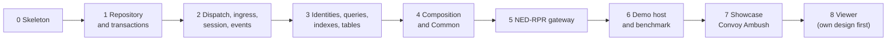

# Implementation Plan

**Current stage: 8 - Viewer (DD-005 approved; in progress)**

The plan turns the approved designs (DD-001 .. DD-004) into code in stages. Each stage has a
scope, the designs and rulings it implements, its tasks (`docs/TASKS.md`) and **exit criteria**.

Rules for every stage:

- Work in rounds; **commit after every round** (R-007) with the task id in the message.
- A stage is finished only when `dotnet build` and `dotnet test` are green, the exit criteria
  are met, and the governing design's **as-built notes** record every deviation.
- **Stage boundaries are review checkpoints**: the stage is reported to the user (what was built,
  test results, deviations) before the next stage starts.
- A deviation from a design discovered during implementation is raised, not silently chosen
  (R-008); if it changes a design decision it goes through a `P-n` proposal.
- Everything must stay cross-platform (R-012); Linux is verified as soon as a Linux machine is
  available, at the latest at the end of stage 5.

## Stages

| Stage | Scope | Designs / rulings | Tasks | Exit criteria |
|---|---|---|---|---|
| **0 Solution skeleton** | Solution and all projects of DD-003 (empty but compiling), `Directory.Packages.props`, test projects per layer, `Architecture.Tests` enforcing the dependency rules, `scripts/build.sh` + `scripts/test.sh`, CLAUDE.md paths updated | DD-003; R-048 .. R-053, R-012 | T-012 | build + test green; an intentionally forbidden reference makes `Architecture.Tests` fail (checked once, then reverted) |
| **1 Repository and transactions** | `EntityId`/`AttrId`/... ids, `Vec3`, `AttrValue`, `AttrMeta`, registries (attributes, events, sources), `EntityRecord`, `StateRepository` reads, reusable `ChangeSet` (create, destroy, set, clear, pending reads), commit validation and apply with inverses, write-authority policy hook (permissive + single-writer), `TransferOwner`, pooled `ChangeSetRecord`/`EntityDelta`, `ChangeJournal` | DD-001 3.1 - 3.3, 6.2, 6.6; DD-004 P-34; R-014, R-019, R-025, R-026, R-033, R-057 | T-003a | unit tests "values and registry" and "repository and transactions" of DD-001 section 12; steady-state commit of entity updates allocates 0 bytes |
| **2 Dispatch, ingress, session, events** | Rule builder and `RuleInfo`, dispatcher with attribute index, all trigger kinds (entity, event, session, session request with veto, timer, tick end, change-set end), cascades with depth limit, diagnostics, generic ingress (`Drain`/`Deliver<T>`, router, `IngressContext` incl. `Abort`), engine `Tick`, `SessionController`, pooled `SimEvent`/`AttributeBag` and event log, `IClock` | DD-001 4, 5, 6.1 - 6.5; DD-004 P-36; R-015 .. R-018, R-023, R-030, R-038, R-059 | T-003b | unit tests "dispatch", "ingress", "session", "events"; a full message round trip (ingress -> commit -> dispatch -> no-op egress) allocates 0 bytes |
| **3 Identities, queries, indexes, tables** | `IdentityRegistry`, `IdentityMap<TKey>`, `IIdAllocator<TKey>`, buffered and immediate binding, deferred release; recency lists, presence sets, reverse reference index, spatial index; struct `EntityQuery` with `CopyTo`/`ForEach`; `EntityTable<T>`; vocabulary validation (`Produces`, `Validate()`) | DD-001 3.4 - 3.7; DD-004 P-33, P-35; R-031, R-034 .. R-037, R-039, R-041, R-056, R-058 | T-003c | unit tests "queries", "identities and allocators", "vocabulary validation", "cardinality" (engine part), "allocations"; index contents equal a brute-force scan in randomized tests |
| **4 Composition and Common** | `Engine.InMemory` (in-memory channels, `ManualClock`, outbound recorders); `IGatewayProfile`, `GatewayBuilder`, typed ports, settings records and configuration registries; Common: WGS-84 and frame conversions, predictor registry with the DIS algorithms, range and pool (quarantine) allocators, generic DR-extrapolation processor and stale-entity reaper parameterised by attribute ids | DD-003 4 - 5; DD-001 8; DD-004 P-37; R-020, R-021, R-024, R-029, R-051, R-052, R-054, R-060 | T-012b, T-004a | Common tests (geo round trips incl. poles and date line, predictors, allocators, processors on a test schema); `Build()` rejects unbound or mistyped ports |
| **5 NED-RPR gateway** | Protocol projects (NED, RPR incl. DIS types and `SimulatedRti`, display) as pure wire models; `PivotSchema`; the NED, RPR and display modules of DD-001 section 9 with the contributor-based `RprEntityEgress`, heartbeat, weapon status, fire, detonation, control, echo suppression; `NedRprProfile` and its configurations | DD-001 7, 9; DD-002 7 (the basic parts); R-022, R-027, R-028, R-040, R-045, R-047, R-050, R-061 | T-004b | end-to-end tests of DD-001 section 12 ("end to end", "events and stored data", "dead reckoning"); Linux build + test verified |
| **6 Demo host and benchmark** | `Hosts/SimNetGateway.Demo`: `--config <name>`, default demo, `--schema`, `--bench` (10k entities, DR-thinned input, tick timings, allocations, GC counts) | DD-003 5; R-005, R-006 | T-006 | demo runs; benchmark results recorded in DD-001 as-built notes and reviewed against R-005 / R-033 |
| **7 Showcase "Convoy Ambush"** | DD-002 protocol extensions (formation, aggregate entity, split fire + assembler, damage notification, fire target member, asynchronous RTI, replay policy, customer percent damage, faulty/rogue test modules), `SimNetGateway.Showcase` harness, acceptance test, `--showcase` report | DD-002; R-042 .. R-047 | T-010 | every `S-*` condition passes, no `G-*` invariant violated at any tick, final state empty |
| **8 Viewer** | raylib-cs ImGui monitor/diagnostics viewer of the repository, rules, journal, identities, traces - **design document first** | DD-005; R-006 | T-007 | DD-005 section 8 test plan; Convoy Ambush PASS through the viewer's headless frame loop |

Later (not planned yet): real transports (DDS, Pitch RTI, VR-Link), the WAN protocol (R-062),
user-authored translators from the concept document.

## Stage log

| Stage | Started | Finished | Result |
|---|---|---|---|
| 0 | 2026-10-24 | 2026-10-24 | build + test green on Linux (.NET 8.0.426); 77 architecture tests; a forbidden `Protocol.Ned -> Engine` reference failed 3 of them (checked once, reverted); deviations in DD-003 section 9; approved by user |
| 1 | 2026-10-24 | 2026-10-24 | build + test green on Linux; 62 engine tests incl. 0-byte steady-state commits; deviations in DD-001 section 15 |
| 2 | 2026-10-24 | 2026-10-24 | build + test green on Linux; 136 engine tests incl. 0-byte message round trip; deviations in DD-001 section 15 |
| 3 | 2026-10-24 | 2026-10-24 | build + test green on Linux; 235 engine tests incl. randomized index-vs-scan checks and 0-byte queries/round trip; deviations in DD-001 section 15 |
| 4 | 2026-10-24 | 2026-10-24 | composition, in-memory transports, Common, R-068 staleness; build + test green on Linux (Engine 271, Common 116, Architecture 77, reported by the agents); mutation-checked; notes in DD-001 / DD-003 |
| 5 | 2026-10-24 | 2026-10-24 | build + test green on Linux (Engine 271, Common 116, Gateway.NedRpr 202, Architecture 77, reported by the agent); DD-002 invariants checked every tick in the end-to-end tests; notes and Appendix A in DD-001 |
| 6 | 2026-10-24 | 2026-10-24 | demo + benchmark run (Release, 10k entities: 2.7-2.9x real time, p95 31-34 ms, 3.7-17 KB/inbound message); findings reviewed against R-005/R-033 -> T-015; Gateway.NedRpr 302 tests |
| 7 | 2026-10-24 | 2026-10-24 | 48/48 success conditions PASS, no G-* violation in 8,400 ticks, final state empty; Engine 309, Common 144, Gateway.NedRpr 560, Architecture 77 tests (reported by the agents); P-47 open |
| 8 | 2026-10-24 | - | - |
