# DD-001: Gateway Engine Proof of Concept

| | |
|---|---|
| **Status** | in review - all proposals approved (R-013 .. R-042); acceptance scenario in DD-002 |
| **Tasks** | T-002 (this design), T-003, T-004, T-005, T-006 |
| **Rulings honoured** | R-001 .. R-006, R-008, R-011 .. R-062 |
| **Date** | 2026-10-24 |

## 1. Context and goals

We need a gateway engine that sits between two simulation networks (internally NED SST over DDS,
externally HLA RPR FOM, see the reference concept "NED-HLA-Gateway-Design", R-011; the document is not kept in the
repository). "The concept doc" below refers to it.
This document describes the **implementation** of the engine core and of a proof of concept that
exercises it **in-process, with no real network** (R-002).

Goals of the PoC:

1. A **central state repository** of entities and attributes with per-attribute metadata (R-004).
2. **Triggers** raised by changes, handled by **egress rules** of the form
   *trigger -> condition -> action* (R-004).
3. **Ingress and egress modules** that are small, independently registered and network-agnostic
   (R-002, R-003).
4. Correct handling of the three kinds of input: **entity state**, **simulation events**
   (fire, detonation, damage notification) and **management / session control** (load, start,
   pause, resume, unload, load a recorded run for debriefing).
5. **Dead reckoning parameters** carried as plain attributes for ~10,000 entities (R-005); the
   received state is stored as received (R-020); extrapolation or any other transformation a
   side needs (e.g. a side that does not understand DR) is optional custom logic in
   **processor modules** reacting to timers and triggers, never engine code (R-021, R-024).
6. A console demo, a 10k benchmark and an automated test suite (R-006). The ImGui viewer (T-007)
   is out of scope here but the design must make it easy (section 13).
7. The input and output sides may differ in **granularity and timing** of entity updates and
   simulation events (R-013): data carried by events may have to be stored, events may change
   stored attributes, and outgoing messages may need attributes stored by earlier inputs.
8. **Queries** over the repository for custom logic, e.g. "all entities whose state changed in
   the last 3 seconds" (R-031), answered from indexes rather than full scans.
9. A **shared vocabulary** (pivot schema) generalising both sides, specific to the systems the
   gateway connects and defined outside the engine (R-032, R-034).
10. **Identity translation and id allocation** per side, where each side may identify entities
    with a different key type (R-035).
11. **No unnecessary allocations on the hot path** (R-033): steady-state processing of an entity
    update allocates nothing in the engine.
12. **Different entity cardinality** between sides: one entity on one side may be several
    entities on the other (1:N, N:1, N:M) - section 3.7.

Platform: everything (engine, modules, demo, tests) is plain cross-platform .NET 8 with no OS-specific
APIs and must build and pass the tests on Linux and Windows (R-012); the later raylib-cs viewer
must use a package that ships Linux native binaries.

Non-goals for the PoC: real DDS/RTI transports, HLA ownership negotiation, user-authored
translators (blueprints/expressions from the concept doc), multi-threaded dispatch.

### Vocabulary

| Term | Meaning |
|---|---|
| **Side** / **source** | One connected network (e.g. `NED`, `RPR`) or the engine itself. Identified by a `SourceId`. |
| **Entity** | Anything the connected systems identify (vehicle, person, unit, ...). Has a gateway-internal `EntityId` and, per side, a wire identity of that side's own key type, held in an `IdentityMap<TKey>`. The engine knows no entity kinds. |
| **Identity map** | The bidirectional translation `TKey <-> EntityId` for one kind of wire identity of one side, with an optional id allocator. |
| **Attribute** | One named, typed value of an entity (`Spatial.Position`, `Status.Damage`). Identified by `AttrId` (int). |
| **Pivot schema** | The shared set of attributes both sides translate into and out of (the "shared ECS pivot" of the concept doc). |
| **Correlation id** | Unique id of one unit of input work - normally **one received message**. Every attribute written and every event published while processing it carries the same id. (This is the "unique ID of the event" from R-004; renamed to avoid confusion with *simulation* events.) |
| **Change set** | The transaction of one unit of work: a buffer of **commands** (create, destroy, set, clear, bind key) recorded by ingress handlers and applied by the engine atomically at commit, or discarded. Applied commands keep their inverse, so they are undoable (R-019). |
| **Simulation event** | A transient occurrence (weapon fire, detonation) - has no lifetime, is not stored as state. |
| **Rule** | A subscription of a module: trigger kind + optional condition + action. |
| **Processor** | A module that is neither ingress nor egress: it reacts to triggers (timers, attribute changes, events), reads the repository and writes derived data back or publishes events. No wire involved. |
| **Derived attribute** | An attribute computed by gateway logic (a processor), never received from a wire, e.g. `Derived.PredictedPosition`. |

## 2. Block diagram

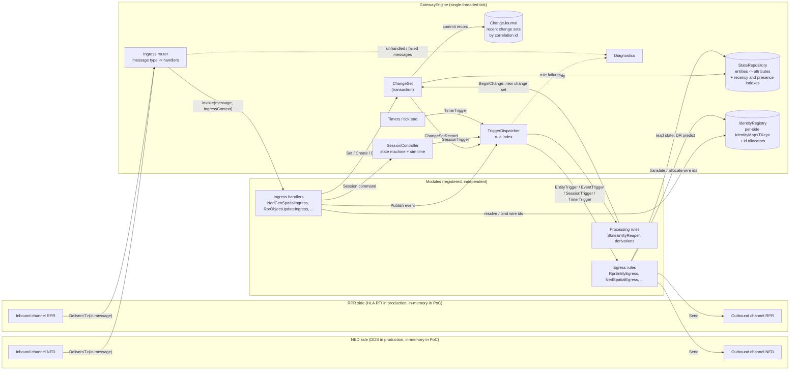

**What the blocks do and how they relate:**

- **Inbound channels** are the only thing a transport has to implement for ingress. Each tick
  the engine calls `Drain(sink, budget)`, and the channel pushes each received message into the
  engine with the generic `sink.Deliver<T>(in T message)` - structs are not boxed (R-033). A real
  DDS channel would `take()` samples from readers; an RTI channel would call `evoke`/`tick` and
  forward reflected callbacks. The PoC uses `InMemoryInbound<T>` (a thread-safe queue).
- The **ingress router** maps the message type `T` to the list of ingress handlers registered
  for it. Several handlers may share one message type (a fat NED descriptor
  can be shattered by several small modules) - they all run in **one change set** and therefore
  share one correlation id.
- **Ingress handlers** translate wire data to the pivot: they write attributes through the
  `ChangeSet`, publish simulation events, or issue session commands. They never talk to egress.
- The **ChangeSet** buffers the handlers' commands. At commit the engine validates the whole
  buffer, applies it to the **StateRepository** (recording old values) and produces an immutable
  `ChangeSetRecord` (what changed, per entity, with old and new values) that is appended to the
  **ChangeJournal** and handed to the **dispatcher**. A failed or aborted transaction applies
  nothing.
- The **SessionController** owns the session state machine and the simulation clock.
- The **TriggerDispatcher** holds the rule index and turns change-set records, events, session
  transitions and timer ticks into triggers for **egress rules**.
- **Egress rules** read whatever else they need from the repository (they are not limited to what
  changed), evaluate their condition and act - usually by sending a message to their **outbound
  channel**. **Processing rules** are rules whose action writes back to the repository through a
  new change set (`BeginChange` ... `Commit`), e.g. the stale entity reaper; their changes cascade through the
  dispatcher again (bounded, section 6.4).
- The **IdentityRegistry** holds the per-side identity maps (wire key <-> `EntityId`) and their
  id allocators. Modules translate identities through it; the engine only keeps the maps
  consistent with entity lifetimes (section 3.6).
- **Diagnostics** collects counters and recent warnings/errors (unhandled message types, failed
  ingress, rule exceptions, rejected session commands, cascade overflow). The future ImGui viewer
  reads it.

The engine knows **no protocol types**. All NED/RPR knowledge lives in modules, and all network
knowledge lives behind `IInboundChannel` / `IOutboundChannel<T>` (R-002).

## 3. The central state repository

### 3.1 Shape

The proposal of R-004 - *a cascade of dictionaries* - is kept:

```
Dictionary<EntityId, EntityRecord>          // ~10k entries
    EntityRecord.Slots: Dictionary<int attrId, AttrSlot>   // typically 5-30 entries
        AttrSlot = (AttrValue Value, AttrMeta Meta)        // both structs, stored inline
```

Refinements:

- **No boxing.** `AttrValue` is a small tagged-union struct: kind + `long` + `Vec3` + one object
  reference. Supported kinds: `Bool`, `Int` (64-bit), `Double`, `Vec3`, `String`, `EntityRef`,
  `Object` (an immutable reference value such as a weapon list; change detection by `Equals`).
  `Vec3` is a first-class kind because positions/velocities/orientations dominate traffic and
  splitting them into three scalar attributes would triple trigger work and lose atomicity.
- **Typed attribute registry.** Attribute ids are allocated by `AttributeRegistry.Register(name,
  kind)`; registration is idempotent by name, so independent modules that use the same pivot
  attribute get the same id without knowing about each other (R-003). A kind mismatch on write is
  an error. Names make the repository self-describing for diagnostics and the ImGui viewer.
- **Metadata per attribute** (`AttrMeta`): `Source` (which side wrote it), `Correlation` (the
  input unit of work), `WallTime` and `SimTime` of the last write (receive time),
  `ChangedWallTime` and `ChangedSimTime` of the last actual value change, `Version` (incremented
  only when the value actually changes).
- **Entity-level metadata** (`EntityRecord`): `Origin` (the side that introduced the entity -
  drives echo suppression), creation correlation/time, `LastWriteWallTime` (for stale detection),
  `LastChangeWallTime` (for "changed recently" queries), `IsAlive`, and the intrusive links of
  the recency indexes (section 3.4).
- **No entity kinds.** An entity is just an id with a set of attribute slots; any entity may carry
  any registered attribute. Whether something is a platform, a munition or a unit is itself an
  attribute defined by the modules (R-034).
- **Wire identities are not stored in the record.** They live in the identity maps of the
  `IdentityRegistry` (section 3.6); the gateway-internal `EntityId` never leaves the process.

### 3.2 API

Reads are available at any time through `IStateView` (`Find`, `TryGet`, `Entities`, key lookup,
journal). **Writes are buffered commands** recorded in a `ChangeSet` and applied only when the
transaction commits (R-019):

| Command | When recorded by a handler | When applied at commit |
|---|---|---|
| `CreateEntity(origin?)` | Reserves an `EntityId` immediately, so later commands of the same transaction can refer to it. Origin defaults to the change set's source. | Entity inserted. |
| `DestroyEntity(id)` | Recorded. | Entity removed; its wire identities are released after the removal triggers ran (section 3.6); the record stays readable by triggers (`IsAlive = false`). |
| `Set(id, attr, value)` | Value kind checked against the attribute registry (a programming error, reported at once). | Value + metadata written. *Written* always; *changed* only if the value differs. |
| `Clear(id, attr)` | Recorded. | Attribute removed (e.g. DR information no longer present); counts as changed. |
| `map.Bind(changes, id, key)` | Buffered in the identity map, typed (`TKey`), no boxing. | Wire identity bound (validated: key not bound to another entity, entity not already bound in that map). |

- A handler **reads committed state**. Its own pending commands (or those of another handler of
  the same message) are visible through `Changes.TryGetPending(id, attr, out value)`. The
  repository therefore never contains half-applied state that anybody could observe (P-10).
- **Commit** first validates the whole buffer against the current state, in command order
  (entity exists and is alive, wire key not bound to another entity, no write after destroy,
  ...).
  Only if everything is valid is the buffer applied; otherwise nothing is applied.
- Every applied command keeps its inverse (old value or absence, destroyed record) in the
  `ChangeSetRecord`, so a committed transaction can be reverted. The PoC records the inverses;
  an *undo / rewind* API on top of them (e.g. for debriefing) is future work.
- There is exactly one open change set at a time (single writer).

### 3.3 Query by correlation id

R-004 asks to find *all attributes written by the same input event*. Two mechanisms:

1. Every slot's metadata carries the correlation id, so any attribute can be asked "were you
   written by the same input as that one?".
2. The **ChangeJournal** keeps the last N change-set records (default 1024) indexed by correlation
   id: `Journal.GetWrites(correlation)` returns every `(entity, attribute, old, new)` of that unit
   of work - including writes that have since been overwritten. Change sets created by processing
   rules record `CausedBy` (the correlation of the trigger that caused them), so cause/effect can
   be followed.

In practice egress modules rarely need this query: the trigger they receive already *is* the
grouped result (next section).

### 3.4 Queries

Triggers tell a module *that something just happened*; custom logic (processors, timers,
heartbeats, reapers) also needs to ask *what the state is* (R-031). The repository offers a small
fluent query API over entities, backed by indexes so that the typical time-window question does
not scan all 10,000 entities:

```csharp
// all NED entities whose state changed in the last 3 s and that are moving;
// _moving is a List<EntityRecord> owned and reused by the module (no allocation per call)
gw.State.Query()
    .ChangedWithin(TimeSpan.FromSeconds(3))
    .FromOrigin(ned)
    .Has(p.Velocity)
    .Where(p.DrAlgorithm, static (e, alg) => e.Get(alg).AsInt() != (long)DrAlgorithm.Static)
    .CopyTo(_moving);

// stale RPR objects (no update for 12 s) - what StaleEntityReaper asks
gw.State.Query().FromOrigin(rpr).NotWrittenWithin(TimeSpan.FromSeconds(12)).CopyTo(_stale);

// or without any list: a struct visitor, called for each match
gw.State.Query().Has(p.Position).KnownTo(displayIds).ForEach(ref _predictVisitor);
```

| Filter | Meaning | Served by |
|---|---|---|
| `ChangedWithin(span)` / `ChangedSince(time)` | any attribute value changed in the window | **recency index** (by last change) |
| `WrittenWithin(span)` / `NotWrittenWithin(span)` | written (even unchanged) in / not in the window | **recency index** (by last write) |
| `AttributeChangedWithin(attr, span)` | that attribute changed in the window (`AttrMeta.ChangedWallTime`) | recency index, then filter |
| `Has(attr)` / `Lacks(attr)` | attribute present / absent | **presence index** (per attribute) |
| `FromOrigin(side)` / `NotFromOrigin(side)` | entity introduced by that side | filter |
| `KnownTo(map)` | entity has a wire identity in that identity map (was published there or came from there) | **identity map** |
| `ReferencedBy(attr, target)` | entities whose `EntityRef` attribute `attr` points at `target` (e.g. all members of a unit) | **reverse reference index** (attributes registered with `IndexReferences`, section 3.7) |
| `Where(state, predicate)` | arbitrary condition; a `static` lambda plus a state argument, so no closure is allocated | filter |
| `InSimTime()` | interpret the time filters in sim time instead of wall time | filter |

- **Indexes** are maintained at commit, O(1) per changed entity: two intrusive doubly linked
  *recency lists* (entities ordered by last write and by last change; a written entity moves to
  the tail) and a per-attribute *presence set*; identity maps serve `KnownTo`. A window query walks a
  recency list from the tail and stops at the first entity outside the window; a staleness query
  walks from the head. Cost is proportional to the result, not to the entity count.
- **Planning** is trivial: start from the most selective index the query uses (time window,
  presence, side), apply everything else as filters.
- **Sim-time** conditions are applied as filters (sim time can reset on `Load`, so the indexes use
  wall time, which is monotonic).
- **No allocation.** `Query()` returns a struct builder (filters held in fields, attribute ids in
  a small inline buffer). Results go into a **caller-owned, reused list** (`CopyTo(list)`) or to a
  **struct visitor** (`ForEach(ref visitor)`, generic over `TVisitor : struct, IEntityVisitor`, so
  the call is not boxed). `Count()` and `Any()` allocate nothing. There is deliberately no
  `ToList()` and no LINQ (R-033, R-036).
- **Snapshot semantics.** `CopyTo` fills the list before returning, so a processor can query and
  then open a change set safely. `ForEach` must not write; a visitor collects and the caller
  writes afterwards.
- **History** questions ("what happened") go to the journal instead: `Journal.Since(time)`
  returns the retained change-set records, `Journal.RecentEvents` the event log - bounded by their
  capacity. Repository queries answer "what is".

Rejected: *LINQ* - excluded by R-036 (O(10k) per query and enumerator/closure allocations);
*a general query language* (SQL-like) - far beyond what the use cases need.

### 3.5 The shared vocabulary (pivot schema)

The engine itself contains **no vocabulary**: it only has registries that map names to ids and
kinds (`AttributeRegistry`, `EventTypeRegistry`, `SourceRegistry`). Which attributes and event
types exist, what they are called, their units and granularity, is **specific to the systems the
gateway connects** and lives entirely in modules (R-032):

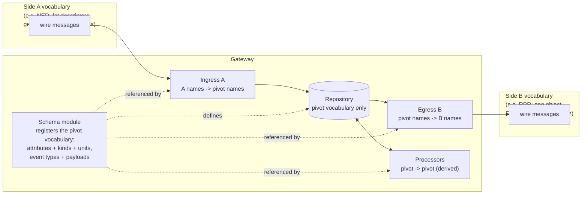

- **Translation happens only in modules**: ingress translates a side's names, granularity, units
  and semantics into the pivot; egress translates the pivot into the other side's; processors
  derive pivot data from pivot data. Neither side's vocabulary ever reaches the other.
- **The schema defines only generalised attribute types and event types** (names, value kinds,
  units, payload attributes). It imposes **no entity types and no rule which attributes belong to
  which entities**: any entity may carry any attribute, and entity "kinds", if the connected
  systems have them, are just attributes. All of that is module logic; nothing of it is
  hard-coded in the engine (R-034).
- **The pivot vocabulary is still defined in one place** - a *schema module* per gateway
  configuration (PoC: `PivotSchema` in `Gateway.NedRpr/Schema`, DD-003) that registers every shared attribute and
  event type with its kind, unit/frame and description. Ingress, egress and processor modules
  reference it; they never invent shared names ad hoc. Attributes private to one module are
  allowed and are prefixed with the module name. This is the "shared component registry" of the
  concept doc (section 5).
- **How the vocabulary generalises both sides** (design guidance for the schema author):
  - canonical units and frames where the sides disagree (SI, ECEF, radians, geocentric
    orientation); enumerations kept in one side's numbering or a neutral one, with mapping
    services (the PoC's `TypeCatalog` maps TKB <-> DIS);
  - granularity chosen by what changes independently and what triggers or overrides need -
    finer than the fattest side, and values that must stay consistent kept atomic (one `Vec3`,
    one `Object` value);
  - generalised event types whose payload is the union of what the sides carry, side-specific
    extras as optional payload attributes;
  - side-specific ("mirror") attributes when only one side has the concept, and `Derived.*`
    attributes produced by processors;
  - names `Domain.Name` (`Spatial.Position`, `Weapon.Ammo`, `Event.Shooter`,
    `Derived.PredictedPosition`).
- **Startup validation** (P-17): modules declare what they produce (`setup.Produces(...)`);
  what they consume is known from their subscriptions. After registration the engine reports
  attributes or event types that are consumed but never produced, or produced but never consumed
  (warnings), and kind conflicts (errors) - about attributes and events only, never about entity
  structure, and can dump the whole vocabulary with producers and
  consumers (`--schema` in the demo, a table in the viewer).
- Later (concept doc): the schema as data (e.g. JSON) with stable GUIDs and versioned layouts,
  editable without recompiling. Not in the PoC.

### 3.6 Entity identity and id allocation

Each side identifies entities in its own way and with its own **type**: a NED entity id is a
64-bit number, an HLA object is identified by an RTI-allocated object instance handle (and
possibly a name), DIS and the RPR FOM use an `EntityIdentifier` of (site, application, entity
number), other systems use GUIDs or strings. A side may even use two identities for the same
entity (HLA handle **and** RPR `EntityIdentifier`). The engine must translate between all of them
without knowing any of them (R-035).

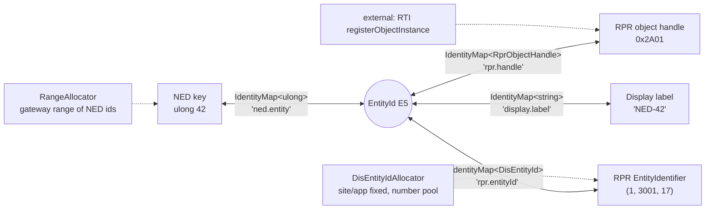

- **`IdentityMap<TKey>`** (`TKey : notnull, IEquatable<TKey>`) is the translation for one kind of
  wire identity of one side: `TryResolve(key, out EntityId)` and `TryGetKey(EntityId, out TKey)`,
  both O(1) and allocation-free (`EqualityComparer<TKey>.Default`, no boxing of struct keys).
  Modules create their maps at registration: `setup.Identities.Create<ulong>(ned, "ned.entity",
  allocator)`. The engine holds them in the `IdentityRegistry` behind a non-generic interface and
  never looks at the key type.
- **Binding** inside a transaction is a buffered command (`map.Bind(ctx.Changes, id, key)`),
  validated and applied at commit like every other command; `map.TryResolve(ctx.Changes, key, ...)`
  also sees bindings pending in the current transaction, so two handlers of one message agree on
  a newly created entity. Outside a transaction (an egress publishing an entity during dispatch)
  binding is immediate: identity maps are indexes, not attributes, and raise no triggers.
- **Id allocators** (`IIdAllocator<TKey>`: `TryAllocate(out key)`, `Release(key)`) produce wire
  identities for entities the gateway introduces to a side. `map.GetOrAllocate(id)` returns the
  existing key or allocates and binds a new one. Allocation strategies are pluggable modules'
  business: a number range reserved for the gateway (NED), a pool of entity numbers under a fixed
  site/application (DIS), or **external** allocation where the transport provides the key (an RTI
  returns the handle from `registerObjectInstance`; the egress binds it when it arrives).
  Exhaustion is a normal outcome (`TryAllocate` returns false): the egress does not publish and
  diagnostics record it.
- **Lifetime.** When an entity is destroyed its keys stay resolvable while the removal triggers
  run (the egress needs the handle to send the delete), and are then removed and released to
  their allocator, which may reuse them according to its policy (e.g. a DIS entity number only
  after a quarantine period).
- **Translation** between sides always goes through the `EntityId`: ingress resolves the incoming
  key to an `EntityId` (creating the entity on first sight), the pivot and events refer to
  entities only by `EntityId` / `EntityRef`, and egress translates the `EntityId` into its side's
  key (allocating one if needed). An unknown reference is the module's decision: leave the
  attribute absent, send "no object", or abort the transaction.

### 3.7 Entity cardinality across sides (1:N, N:1, N:M)

Granularity differences can go beyond attributes: what one side models as **one** entity, the
other may model as **several** - a NED formation (unit) that carries its members' positions in one
descriptor while RPR publishes every member as its own platform object; a vehicle and its
turret; an aggregate entity and its subordinates.

**Principle: the pivot models every independently identifiable thing as its own entity, at the
finest granularity any side needs, and expresses the structure with relations** - ordinary
`EntityRef` attributes defined by the schema (e.g. `Structure.Parent`, `Structure.MemberIndex`).
The coarse side's modules **shatter** on ingress and **aggregate** on egress; the fine side maps
1:1. Nothing about structure is known to the engine (R-034); it only offers two generic aids.

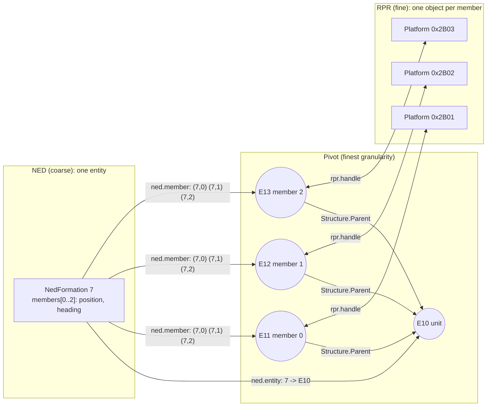

How each part is handled:

- **Identity of the parts.** The coarse side has one wire key for the whole, but the parts need a
  stable identity across updates. The coarse side's module creates a second identity map with a
  **composite key type** (R-039), e.g. `IdentityMap<NedMemberKey>` with
  `NedMemberKey(ulong FormationId, int MemberIndex)`. Member 1 of formation 7 is always the same
  pivot entity. The fine side keeps its ordinary 1:1 maps.
- **Shatter on ingress.** One coarse message is **one transaction**: the module resolves or creates
  the parent and every part, writes the parts' attributes and their `Structure.Parent`, and
  destroys parts that disappeared from the message - all or nothing. The fine side's egress sees
  ordinary per-entity triggers, one per member.
- **Aggregate on egress.** The coarse side's egress reacts to changes of the parts and must emit
  one coarse message per parent, not one per part. Two generic engine aids make this cheap:
  1. **Reverse reference index.** An `EntityRef` attribute registered with
     `AttrOptions.IndexReferences` is indexed backwards: `Query().ReferencedBy(attr, target)`
     returns all entities whose `attr` points at `target` (all members of a unit) without a scan.
     Maintained at commit like the other indexes; allocation only when a relation is first formed.
  2. **`OnChangeSetEnd()` trigger.** Fires once after all entity triggers of one committed change
     set were dispatched. The aggregating egress marks parents dirty in its attribute rule and
     sends one message per dirty parent in the change-set-end rule. (Per-tick batching across
     several inputs remains `OnTickEnd()`.)
- **Derived aggregate state.** Values that exist only for the whole on the fine side (e.g. an RPR
  aggregate's position as the centroid of its members) are computed by a processor into derived
  attributes of the parent - the pattern of section 8.
- **Lifecycle.** Structure is module logic: when a parent disappears, the module that owns the
  structure destroys or re-parents the parts (a rule on `OnEntityRemoved` plus
  `ReferencedBy`). Parts that appear on the fine side before their parent is known keep an
  absent `Structure.Parent`; a processor links them when the parent arrives. Re-parenting is a
  `Set` of `Structure.Parent` and moves the entity in the reverse index.
- **N:M** (sides grouping the same things differently) is the same mechanism: the pivot holds the
  common finest entities plus each side's grouping as its own relation attribute
  (`StructureA.Parent`, `StructureB.Parent`), and each side's modules shatter/aggregate along their
  own relation.
- **Events** referring to a coarse entity are translated by the modules too (e.g. a detonation on
  formation 7 member 1 refers to `E12`; towards a side that only knows the formation, the egress
  maps `E12 -> Structure.Parent -> E10 -> 7`).

Rejected: *pivot at the coarse granularity, fine-side egress fans out* - parts would have no
entity of their own, so they could carry no metadata, triggers, queries or identities of their
own, and every fine-side module would re-implement the split; *one entity with many keys of the
same map* - breaks the 1:1 `TryGetKey` translation and the identity lifetime rules.

## 4. Triggers and rules

### 4.1 Trigger granularity: one trigger per entity per change set

Instead of one trigger per written attribute, the dispatcher raises **one `EntityTrigger` per
entity per change set**, carrying the full list of `AttrChange(attr, old, new, changed)`.

*Why:* an RPR egress module assembles **one** attribute update from position, orientation,
velocity and DR algorithm. With per-attribute triggers it would fire four times for one input
and either send four packets or need its own coalescing. With per-entity triggers the module
sees the whole picture of one input at once - this is exactly the *"recognise which attributes
arrived together"* requirement of R-004, solved structurally instead of by query.

Rejected: *one trigger per attribute* - multiplies dispatch work by the attribute count and pushes
re-grouping into every egress module.

### 4.2 Trigger kinds

| Subscription (on `ModuleSetup`) | Fires when | Trigger object |
|---|---|---|
| `OnEntityCreated()` | an entity was created in a committed change set | `EntityTrigger` (Kind = Created) |
| `OnEntityRemoved()` | an entity was destroyed | `EntityTrigger` (Kind = Removed, record still readable) |
| `OnAttributesChanged(a, b, ...)` | any listed attribute **changed value** (empty list = any) | `EntityTrigger` (Kind = Updated) |
| `OnAttributesWritten(a, b, ...)` | any listed attribute was **written**, even with the same value | `EntityTrigger` (Kind = Updated) |
| `OnEvent(type)` / `OnAnyEvent()` | a simulation event was published | `EventTrigger` |
| `OnSessionChanged()` | a session command was accepted | `SessionTrigger` (command, previous, current state) |
| `Every(period)` | wall-clock period elapsed (no catch-up bursts) | `TimerTrigger` |
| `OnTickEnd()` | end of every tick (flush batched output) | `TimerTrigger` |
| `OnChangeSetEnd()` | after all entity triggers of one committed change set (coalesce several entities of one input, section 3.7) | `ChangeSetTrigger` (the `ChangeSetRecord`) |
| `OnSessionRequest()` | a session command is about to be applied; the rule may `Veto(reason)` (DD-004, R-059) | `SessionRequestTrigger` |

### 4.3 Rule = trigger + condition + action

```csharp
setup.OnAttributesChanged(p.Position, p.Orientation, p.Velocity)
     .Named("PublishSpatial")
     .When(t => t.Entity.Origin != ned)          // condition (several When() are ANDed)
     .When(t => t.Entity.Has(p.Position))
     .Do(t => outbound.Send(ToGeoSpatial(t.Entity)));   // action
```

- A rule fires **at most once per trigger** even if several of its attributes changed.
- Rules fire in **registration order**.
- Every rule is described by a `RuleInfo` (module, name, trigger description, enabled flag,
  counters: fired / rejected by condition / failed). Rules can be **disabled by name** at
  runtime - the hook the concept doc needs for *"disable one shipped default and replace it"*
  (concept section 8), and something the ImGui viewer can show and toggle.
- An exception in a rule is caught, counted and logged; the remaining rules still run.

### 4.4 Module roles: ingress, egress, processor

The engine has **no module types**: a module is simply whatever it registers in
`Register(ModuleSetup)`. Three roles exist by convention, and one module may combine them:

| Role | Registers | Writes to | Examples |
|---|---|---|---|
| **Ingress** | `OnMessage<T>` handlers | the message's transaction (`ctx.Changes`), events, session commands | `NedGeoSpatialIngress` |
| **Egress** | rules (`OnAttributesChanged`, `OnEvent`, `Every`, ...) | an outbound channel | `RprEntityEgress` |
| **Processor** | rules, typically `Every(period)` timers or attribute/event triggers | the repository through `Gateway.BeginChange(source)` ... `Commit()` (derived attributes, destroys) and `Gateway.Publish(...)` | `DrExtrapolationProcessor`, `StaleEntityReaper`, an event assembler |

A processor's writes are normal transactions: they carry the processor's own `SourceId`
(e.g. `proc.dr`) and `CausedBy` (the correlation of the trigger that caused them, if any), and
they raise triggers and cascade like any other change (section 6.4). This is the place for all
**custom gateway logic** that is not a translation of one wire message (R-024): dead-reckoning
extrapolation, smoothing, derivations, assembling an event from several messages, timeouts.

## 5. State, simulation events and session control

This answers the question of R-004 whether all inputs can simply be written as entities and
attributes and left to the trigger mechanism.

### 5.1 Entity state updates -> repository

Entity state (identity, spatial, damage level, ...) is **state**: it has a lifetime, late
subscribers need its current value, and only changes are interesting. It goes into the
repository and the trigger mechanism handles it - exactly as proposed.

### 5.2 Simulation events -> event bus, not repository

**The event itself is transient and is not stored; the data it carries may well be (R-016).**

Weapon fire, detonation or a "damage happened" notification are **occurrences**. Storing the
occurrence as an entity in the repository does not fit:

| Problem with "event as entity" | Consequence |
|---|---|
| No lifetime | Someone must delete them; until then they pollute queries, the viewer and 10k-entity iteration. |
| Change detection is wrong for events | Two identical fire events in a row are two shots, but "attribute changed" would suppress the second. |
| Late joiners | An egress module or a newly connected side must not "discover" a shot that happened earlier. |
| Echo suppression and ownership are entity concepts | Events have a source, not an owner. |

Therefore simulation events travel as `SimEvent` objects (event type id + an `AttributeBag`
payload + the same metadata: source, correlation id, times) through the **same dispatcher and
the same rule mechanism** (`OnEvent(type)`). The payload uses the same attribute registry and
`AttrValue` kinds, so tooling is uniform. Events reference entities with `EntityRef` values.

**But the two sides differ in granularity and timing (R-013)**, so an event ingress module
typically does three things in **one transaction**:

1. **Writes the state effects** the event carries into the repository - a detonation that
   reports the target's resulting damage sets the target's `Status.Damage`; a fire event
   decrements the shooter's `Weapon.Ammo`.
2. **Stores event data the other side will need later** as ordinary attributes when the outgoing
   protocol needs it in a different message or at a different time.
3. **Publishes the transient `SimEvent`.**

The state effects are dispatched **before** the event (same correlation id), so event rules see
the updated state. On the outgoing side:

- An egress rule for an event **combines the event with stored state**: the RPR weapon-fire
  interaction needs the munition type; when the NED fire message does not carry it, the egress
  takes the shooter's `Weapon.SelectedMunition`, stored earlier from a NED weapon-status
  descriptor (an outgoing event referring to previously stored attributes).
- **Kinds may cross over.** An incoming event can surface outgoing as a state update only (the
  detonation's damage reaches RPR as a `DamageState` attribute update through `RprEntityEgress`,
  in addition to the detonation interaction), and an incoming state change can surface as an
  outgoing event (a side that reports damage only as a notification gets an event message from a
  rule on `Status.Damage` changed). What is "state" and what is "event" is decided per side; the
  pivot decouples them.
- **An event split over several input messages** is assembled by its ingress module from partial
  data stored as attributes (on the entity concerned, or on a helper entity the module owns) and
  published once complete; a timer rule can drop incomplete ones. The PoC does not need this, but
  it uses only the primitives above.

#### How an incoming simulation event is processed

Yes - an incoming event raises its own trigger, the **`EventTrigger`**, delivered to every rule
registered with `OnEvent(type)` (or `OnAnyEvent()`):

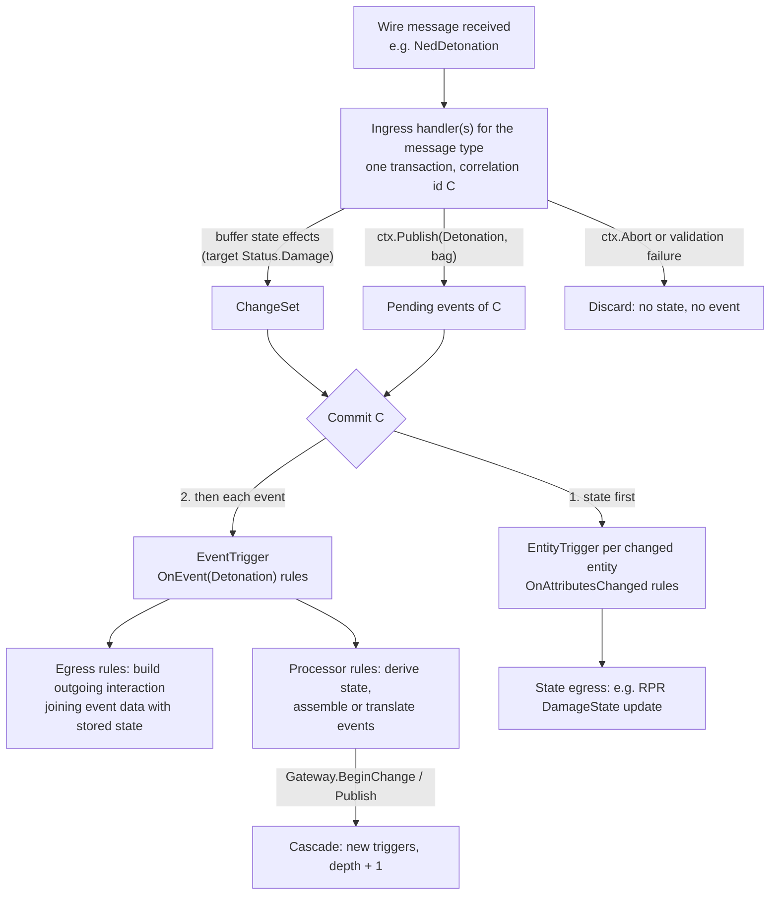

1. The ingress handler of the event message buffers the **state effects** and calls
   `ctx.Publish(type, payload)` with a payload rented from a pool (`ctx.RentPayload()`). The event
   is only queued; nobody sees it yet.
2. If the transaction is aborted or fails validation, the queued event is **dropped together
   with** the state effects - an event never fires for an input that was rejected.
3. On commit the change set is dispatched first (entity triggers), then each queued event in
   publish order: the dispatcher looks up the rules registered for the event's type (plus the
   `OnAnyEvent` rules), evaluates their conditions and runs their actions with an
   `EventTrigger { Event: type, payload, Source, Correlation, WallTime, SimTime }`.
4. Typical subscribers: **egress** rules that translate the event into an outgoing message
   (condition `Source != own side` for echo suppression), and **processor** rules that turn it
   into state or other events. Their change sets and published events cascade with depth + 1.
5. After dispatch the event object is gone. An event with no subscriber is simply not
   forwarded (counted per event type in diagnostics). Events can also be published by
   processors and by the host through `Gateway.Publish`; they get their own correlation id with
   `CausedBy` set.
6. For diagnostics and the future viewer, the last N dispatched events are kept in a bounded
   **event log** (`Journal.RecentEvents`). It is a record of what happened, not state: rules do
   not query it (P-15).

Rejected: *events as auto-expiring entities* - needs garbage collection, special "always fire"
semantics and filtering everywhere; it re-implements an event bus inside the state store.

### 5.3 Session control -> engine state machine

Management messages (load scenario, start, pause, resume, unload, load a recorded run for
debriefing) change **the engine itself** (simulation clock, lifecycle of all entities), so they
are executed by the `SessionController`, not stored as attributes. Ingress modules translate
their protocol's control messages into a protocol-neutral `SessionCommand`; accepted commands
raise a `SessionTrigger` that egress modules can forward to their side (e.g. RPR
`StartResume` / `StopFreeze`).

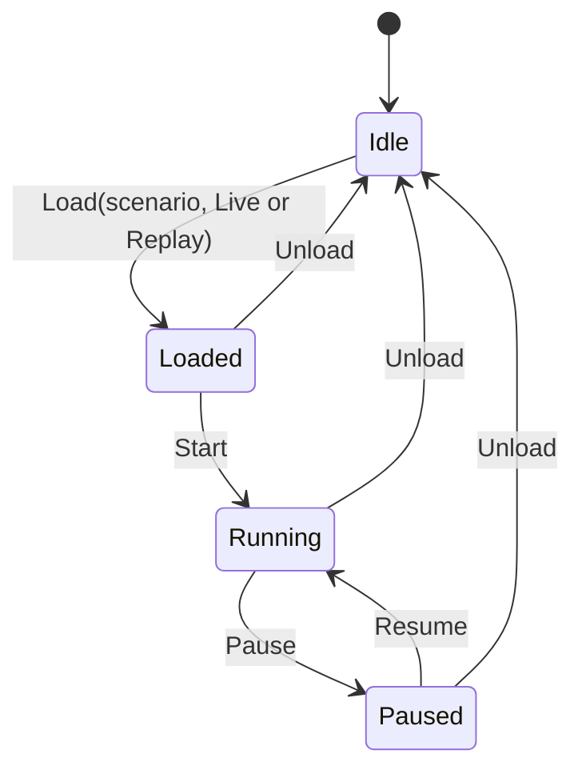

- **Idle** - no scenario; the gateway still relays free-play traffic and sim time runs with wall
  time.
- **Load** resets sim time to 0. `Mode = Replay` is the debrief case (a recorded run is played
  into the gateway by a replay source); the engine treats it like live, the mode is available to
  modules (e.g. to refuse to forward replay data to a live network).
- **Loaded / Paused** - sim time is frozen, so dead-reckoning predictions freeze too.
- **Unload** destroys every entity in one engine change set, so every egress module receives
  `OnEntityRemoved` triggers and can tell its side to delete the objects.
- Any other transition is **rejected** (counted in diagnostics, no trigger).

## 6. Processing model

### 6.1 The tick

The engine is driven by `Tick()` - from the console loop in the PoC, later from the raylib render
loop (one tick per frame, then draw), which keeps the viewer single-threaded and lock-free.

1. Read the clock, advance sim time if the session runs.
2. **Ingress**: poll inbound channels round-robin, up to `MaxMessagesPerTick` messages. Each
   message is processed **completely** (handlers -> commit -> dispatch -> cascades) before the next.
3. **Timers**: fire due `Every(period)` rules.
4. **Tick end**: fire `OnTickEnd()` rules (flush batched output).

Real network threads only ever enqueue into inbound channels; everything else runs on the engine
thread, so the repository needs no locks.

### 6.2 One message = one unit of work

For each received message: allocate a correlation id, open a change set, run all handlers
registered for the message type. Handlers only **record** commands, events and session commands.
Then the engine commits: validate, apply, dispatch - the change set first, then the events, then
the session commands.

**What can make a transaction fail (P-11)** - the design does not rely on exceptions; tuned
software should not throw, so the designed failure paths are cheap, explicit checks:

| Cause | Example | Handling |
|---|---|---|
| Validation at commit | `Set` on an entity destroyed earlier in the same transaction (or by an earlier message), wire key already bound to another entity | Whole transaction discarded |
| Explicit abort by the module | Message content inconsistent or out of range, a reference that must resolve does not | Handler calls `ctx.Abort(reason)`; whole transaction discarded |
| Unexpected exception (a bug) | - | **Safety net only**: one `try/catch` around the handler loop (free when nothing throws) so one faulty module cannot stop the gateway; treated like an abort |

Discarding means: no command applied, queued events and session commands dropped, diagnostics
record the reason and the module. A malformed packet never leaves half-applied state.

### 6.3 Dispatch immediately, per message

Triggers are dispatched right after each message, not batched at the end of the tick. The state
a rule reads is therefore exactly the state after that message (an event rule sees the shooter
as it was when the shot arrived, a removed entity is not already gone for an earlier update
trigger). Modules that want per-tick batching do it themselves with `OnTickEnd()`.

### 6.4 Cascades

Processing rules may write (`BeginChange` ... `Commit`) or publish events while dispatching. The new work is
queued and dispatched after the current item (breadth-first) with **depth + 1**. Work beyond
`MaxCascadeDepth` (default 8) is **refused before it is applied** (so state and triggers never
diverge) and reported as a cascade overflow - a guard against rule loops.

### 6.5 Engine tick, timers and protocol heartbeats

Three different "clocks" that are easy to confuse:

| | What it is | Who defines it | Sends anything? |
|---|---|---|---|
| **Engine tick** | The host calling `Tick()` (console loop, later the render loop, e.g. 60 Hz). The pump: poll inbound channels, fire due timers, run tick-end rules. | The host application | No - it has no protocol meaning |
| **Timer rules** | `Every(period)` rules, checked on every tick against wall time. Resolution is the tick period; after a long gap a timer fires once, not in a burst. | Any module | Only what the rule's action does |
| **Protocol heartbeat** | A requirement of **one side's protocol**: receivers drop an object that has not been refreshed within a timeout, and late joiners learn existing objects from the periodic updates. DIS uses a 5 s heartbeat with a 12 s timeout, and many RPR federations expect the same behaviour. | That side's egress logic | Yes - periodic full updates |

So the heartbeat is **not** the engine tick. It is side-specific logic built from the generic
pieces: `RprHeartbeatEgress` registers an `Every(1 s)` timer rule, asks which published entities
have not been sent for 5 s, and re-sends them (with the position predicted to now, section 8).
The NED side needs none, because DDS keeps the last sample of every instance and has its own
liveliness mechanism - so no NED heartbeat module is registered.

Its mirror image on the receiving side is `StaleEntityReaper`: for a side whose protocol relies on
heartbeats, entities not refreshed within the timeout
(`Query().FromOrigin(side).NotWrittenWithin(timeout)`) are destroyed, which propagates as removals
to the other sides. Both are ordinary modules, configured per side and disabled by rule name.

### 6.6 Allocation discipline on the hot path

The hot path is everything that runs per message and per timer tick: routing, handlers, the
command buffer, commit, index updates, dispatch, rule conditions and actions, queries. It must not
allocate in steady state (R-033):

| Technique | Where |
|---|---|
| Values are structs (`AttrValue`, `AttrMeta`, `Vec3`), stored inline in the slot dictionaries | repository |
| Generic message delivery `Deliver<T>(in T)` and generic handler lists per message type - no boxing of struct messages | ingress |
| Struct wire keys with `EqualityComparer<TKey>.Default`, typed `IdentityMap<TKey>` | identities |
| **One reusable `ChangeSet`** (one open at a time), its command list cleared and reused; `BeginChange` / `Commit` instead of a lambda, so no closure per write | transactions |
| `ChangeSetRecord`, `EntityDelta` and their change lists **pooled**; a record returns to the pool when it falls out of the journal ring - a record is valid until then | commit, journal |
| Trigger objects **reused** per trigger kind - valid only during the rule call, rules must not keep them | dispatch |
| `SimEvent` and `AttributeBag` pooled; recycled when evicted from the event log | events |
| Rule index in arrays, matched-rule scratch buffer and de-duplication stamps reused | dispatch |
| Intrusive recency links in the entity record, presence sets keyed by `EntityId` | indexes |
| Struct query builder, caller-owned result lists, struct visitors, `static` lambdas with explicit state | queries |
| No LINQ, no `params` arrays, no string formatting, no exceptions for control flow (R-026) | everywhere on the hot path |

Allowed allocations: registration and startup; creating and destroying an entity (its record
and slot dictionary - amortised over the entity's lifetime, may be pooled later); amortised
growth of dictionaries and lists; diagnostics on warnings and errors; and whatever modules and
transports allocate themselves (in the PoC the outgoing protocol messages are records - a
production egress would use pooled or struct messages).

Verified by tests (section 12): steady-state processing of entity updates through the engine with
a no-op egress allocates **0 bytes** (`GC.GetAllocatedBytesForCurrentThread`), and the benchmark
reports allocated bytes per message and GC counts.

## 7. Identity mapping and echo suppression

- An ingress module resolves the incoming wire key through its identity map and creates the
  entity on first sight (DDS topics arrive in any order: a `GeoSpatial` sample may arrive before
  the `EntityMaster`) - section 3.6.
- An egress module publishing an entity to its side gets or allocates the side's key
  (`map.GetOrAllocate(id)`), or binds the key its transport returned.
- **Echo suppression** is by entity origin: an egress module publishes only entities whose
  `Origin` is not its own side; an ingress module that resolves a wire id to an entity of another
  origin ignores the message (it is our own publication looped back, which DDS can do).
- Events carry `Source`; an egress module does not forward events that came from its own side.
- Full attribute-level ownership (HLA divest/acquire, concept doc section 11.2) is out of scope;
  `Origin` + `Source` are the PoC stand-ins and the metadata is in place to grow into it.

## 8. Dead reckoning

**The engine contains no dead reckoning (R-021).** Dead reckoning is data plus custom module
logic that the gateway configuration may or may not include (R-024):

- The pivot carries the DR parameters as **ordinary attributes**: `Spatial.Position`,
  `Spatial.Velocity`, `Spatial.Acceleration` (ECEF), `Spatial.Orientation` (geocentric Euler
  psi/theta/phi), `Spatial.DrAlgorithm` (DIS numbering: Static, FPW, RVW, ...) and
  `Spatial.StateTime` (sim time at which the values were valid). Ingress writes what the sender
  sent, and **received attributes are never overwritten by predictions** (R-020), so every side
  can always get the true last known state.
- **Pass-through** when the outgoing side understands DR (RPR): egress forwards the last known
  state and the DR parameters, and the remote federates predict. Senders already thin updates by
  DR (R-005), so this costs work proportional to the updates, nothing per frame.
- **Transformation** when the outgoing side does not understand DR, or needs values at another
  rate or in another form: a **processor module** does it. The PoC's `DrExtrapolationProcessor`:
  1. runs on an `Every(period)` timer at the rate the consuming side needs (PoC: 10 Hz,
     configurable per instance);
  2. selects the entities by a condition (e.g. "known to the display side" and DR algorithm not
     `Static`);
  3. predicts each position at the current sim time with the predictor registered for the
     entity's strategy id (predictor registry in Common, DD-004 P-37; the DIS algorithms first) -
     formerly described as the pure helper library
     (`DeadReckoning.Extrapolate(algorithm, p, v, a, dt)` in `SimNetGateway.Common`, DD-003);
  4. writes the result as **derived attributes** `Derived.PredictedPosition` and
     `Derived.PredictedAt` in **one transaction per timer tick** (source `proc.dr`), only for
     entities whose prediction actually changed - static entities and a paused session (frozen
     sim time) produce no writes and no triggers;
  5. a non-DR egress (`DisplayPositionEgress` in the PoC) subscribes to
     `OnAttributesChanged(Derived.PredictedPosition)` exactly like to any other attribute.

  Why derived attributes rather than sending directly: the processor stays protocol-free and
  reusable for any number of non-DR sides; several egress modules share one prediction; the
  prediction is visible in the journal and the viewer; disabling the processor's rule switches
  the whole behaviour off; and the received state stays intact for the DR-aware sides.
- **Inline variant** (also allowed): a module that is the only consumer may interpret the DR
  parameters itself with the same helper and send directly, without writing to the repository.
  `RprHeartbeatEgress` does this - a heartbeat for a moving entity sends the position predicted
  to now, so receivers do not see it jump back to the last update (P-13).
- **Cost.** Derived writes cost N x f per second for N processed entities at f Hz: 10,000 x 10 Hz
  = 100k attribute writes and entity triggers per second, a target the T-006 benchmark must
  measure. The condition, the "only if changed" rule and the per-consumer rate keep N and f
  small; if the benchmark shows a problem, high-rate consumers use the inline variant.
- **Other transformations follow the same pattern**: smoothing, conversion between DR algorithms,
  threshold-based thinning for an input that is not DR-thinned (e.g. a 60 Hz feed), unit or frame
  conversions needed by one side only. Each is a processor (or an inline egress) whose rules can be
  disabled or replaced by name; none of it is engine code.

## 9. Sample protocols and modules of the PoC

To prove the design without a network, the PoC models both sides with simplified C# message
records that keep the real structural mismatches of the concept doc:

| NED-like (fat descriptors, geodetic, degrees, TKB ids) | RPR-like (one object, ECEF, radians, DIS types) |
|---|---|
| `NedEntityMaster(id, name, tkbType, force)` | `RprObjectUpdate(handle) { Marking?, EntityType?, ForceId?, WorldLocation?, Orientation?, VelocityVector?, AccelerationVector?, DeadReckoningAlgorithm?, DamageState? }` (only present attributes are reflected) |
| `NedGeoSpatial(id, lat/lon/alt, heading/pitch/roll deg, speed)` | (part of `RprObjectUpdate`) |
| `NedEntityDamage(id, level)` | (part of `RprObjectUpdate`) |
| `NedWeaponStatus(id, selectedMunitionTkb, ammo)` | (no equivalent; enriches outgoing fire events) |
| `NedEntityDisposed(id)` | `RprObjectRemoved(handle)` |
| `NedWeaponFire(fireId, shooter, target, munitionTkb or 0 = selected weapon, position, quantity)` | `RprWeaponFire(eventId, firingObject?, targetObject?, location, munitionDisType, quantity)` |
| `NedDetonation(detonationId, target, munitionTkb, location, result, targetDamage?)` | `RprMunitionDetonation(...)` (damage goes out as `DamageState` of the target object) |
| `NedSimControl(kind, scenario?)` | `RprSimulationControl(StartResume / StopFreeze)` |

A third, deliberately simple **display side** stands for a consumer that does **not**
understand dead reckoning: it only receives `DisplayEntityPosition(id, lat, lon, alt, headingDeg)`
messages carrying the current position (P-14).

Pivot (the shared contract, registered by `PivotSchema`): `Identity.Name`, `Identity.TypeTkb`,
`Identity.Force`, the spatial attributes of section 8, `Status.Damage`, `Weapon.SelectedMunition`,
`Weapon.Ammo`, the derived `Derived.PredictedPosition` and `Derived.PredictedAt`; event types `WeaponFire`
and `Detonation` with `Event.*` payload attributes. Canonical frames as in the concept doc:
positions/velocities ECEF, orientation geocentric. The NED modules convert geodetic <-> ECEF,
local heading/pitch/roll <-> geocentric Euler and speed + heading <-> velocity vector; the RPR
modules map DIS entity types <-> TKB ids through a `TypeCatalog` service.

Modules (each one class, registered independently - R-003):

| Side | Ingress | Egress |
|---|---|---|
| NED | `NedEntityMasterIngress`, `NedGeoSpatialIngress`, `NedDamageIngress`, `NedWeaponStatusIngress`, `NedDisposeIngress`, `NedWeaponFireIngress` (decrements shooter ammo + event), `NedDetonationIngress` (target damage + event), `NedControlIngress` | `NedIdentityEgress`, `NedSpatialEgress`, `NedDamageEgress`, `NedLifecycleEgress`, `NedWeaponFireEgress` |
| RPR | `RprObjectUpdateIngress`, `RprObjectRemovedIngress`, `RprWeaponFireIngress` | `RprEntityEgress` (publishes once type and position are known, then forwards changed attributes incl. DR parameters, coalesced per change set), `RprHeartbeatEgress` (pluggable timing), `RprWeaponFireEgress` (munition from event or shooter's stored selection), `RprDetonationEgress`, `RprControlEgress` |
| Display | - | `DisplayPositionEgress` (sends the derived predicted position) |
| processors (no wire) | - | `DrExtrapolationProcessor` (section 8), `StaleEntityReaper` (destroys entities of a side not updated within a timeout) |

The showcase scenario (DD-002 section 7) extends these protocols and modules (aggregate entity,
split fire, damage notification, asynchronous RTI registration, contributor-based RPR egress).

Adding e.g. a new NED descriptor means: register its pivot attributes, add one ingress module on
the NED side and - only if RPR needs it - one egress module (or one more rule) on the RPR side.

## 10. Class diagrams

### 10.1 Engine core (`SimNetGateway.Engine`)

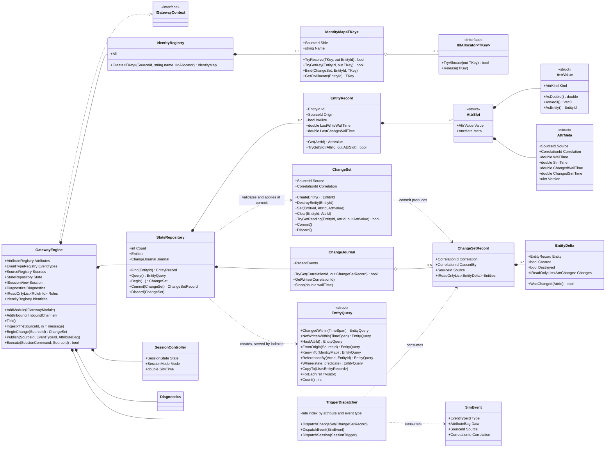

- `GatewayEngine` is the composition root and implements `IGatewayContext`, the narrow facade
  modules see (state reader, registries, identities, session view, diagnostics,
  `BeginChange`/`Publish`/`Execute`).
- `StateRepository` owns entities and the recency/presence indexes; it hands out the single
  reusable `ChangeSet`.
- `IdentityRegistry` owns the typed `IdentityMap<TKey>`s (one per kind of wire identity of a
  side) and their optional `IIdAllocator<TKey>`; it is told about destroyed entities and releases
  their keys after the removal triggers ran.
- `ChangeSet` buffers commands; `Commit` validates and applies them, builds the `EntityDelta`s
  (old and new values, so every applied command is reversible) and freezes them into a
  `ChangeSetRecord`, kept by the `ChangeJournal` (bounded ring).
- `TriggerDispatcher` turns records, events, session transitions and timer ticks into triggers
  and calls the matching rules.
- `EntityQuery` is a short-lived struct builder created by `StateRepository.Query()`; it picks
  the most selective index (recency lists, presence sets, identity maps) and fills a
  caller-owned list or calls a struct visitor.

### 10.2 Module API and transports

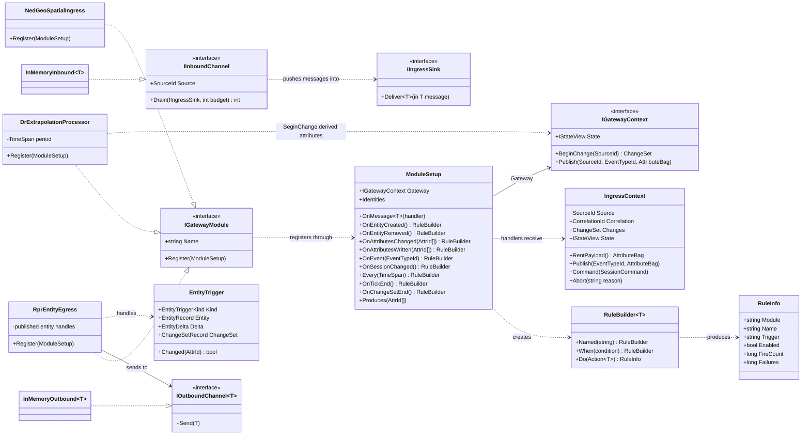

- A module implements `IGatewayModule.Register` and declares everything there: message handlers
  (`OnMessage<T>`) and rules (`On... .When(...).Do(...)`). It receives its outbound channel (and
  shared side services such as id allocators or the type catalog) through its constructor - the
  engine never sees protocol or transport types.
- `IngressContext` is the sandbox of an ingress handler: the open change set (command buffer),
  read access to committed state, publishing events, issuing session commands and `Abort` - all
  bound to the current correlation id.
- A processor such as `DrExtrapolationProcessor` uses the same module API but no channel: it
  registers a timer rule and writes through `IGatewayContext.BeginChange` ... `Commit`.
- Replacing `InMemoryInbound`/`InMemoryOutbound` with DDS or RTI implementations changes nothing
  else (R-002).

### 10.3 API reference

The major engine APIs, as signatures. Names are binding for the implementation; parameter details
may be refined and are then recorded in the as-built notes (section 15).

**Core value types**

```csharp
readonly record struct EntityId(int Value);        // gateway-internal, never on a wire
readonly record struct AttrId(int Value);
readonly record struct EventTypeId(int Value);
readonly record struct SourceId(int Value);        // a side, a processor, or the engine
readonly record struct CorrelationId(long Value);  // one input unit of work
readonly record struct Vec3(double X, double Y, double Z);

enum AttrKind { Bool, Int, Double, Vec3, String, EntityRef, Object }
readonly struct AttrValue {                        // tagged union, no boxing
    AttrKind Kind; bool IsNone;
    static AttrValue From(bool|long|double|Vec3|string|EntityId); static AttrValue FromObject(object immutable);
    bool AsBool(); long AsInt(); double AsDouble(); Vec3 AsVec3(); string AsString();
    EntityId AsEntity(); T AsObject<T>();
}
readonly record struct AttrMeta(SourceId Source, CorrelationId Correlation,
    double WallTime, double SimTime, double ChangedWallTime, double ChangedSimTime, uint Version);
readonly record struct AttrSlot(AttrValue Value, AttrMeta Meta);
```

**Registries** (names -> ids; the engine knows no vocabulary)

```csharp
AttrId      AttributeRegistry.Register(string name, AttrKind kind, string? description = null,
                                       AttrOptions options = AttrOptions.None);   // IndexReferences,
                                                                    // SpatialIndex(cellSize) (DD-004)
AttributeDef AttributeRegistry[AttrId];   bool TryGet(string name, out AttributeDef def);
EventTypeId EventTypeRegistry.Register(string name, string? description = null);
SourceId    SourceRegistry.Register(string name);   string NameOf(SourceId);
```

**Reading the repository** - `IStateView` (`gw.State`, `ctx.State`)

```csharp
int Count;
EntityRecord? Find(EntityId id);              bool TryGet(EntityId id, out EntityRecord entity);
EntityQuery Query();                          ChangeJournal Journal;

class EntityRecord {
    EntityId Id; SourceId Origin; SourceId Owner; bool IsAlive; CorrelationId CreatedBy;   // Owner: DD-004
    double CreatedWallTime, LastWriteWallTime, LastChangeWallTime;
    bool Has(AttrId a); AttrValue Get(AttrId a); bool TryGet(AttrId a, out AttrValue v);
    bool TryGetSlot(AttrId a, out AttrSlot slot);
    AttributeEnumerator Attributes;           // struct enumerator over (AttrId, AttrSlot)
}
```

**Queries** (struct builder, no allocation, section 3.4)

```csharp
EntityQuery ChangedWithin(TimeSpan) | ChangedSince(double) | WrittenWithin(TimeSpan)
          | NotWrittenWithin(TimeSpan) | AttributeChangedWithin(AttrId, TimeSpan) | InSimTime()
          | Has(AttrId) | Lacks(AttrId) | FromOrigin(SourceId) | NotFromOrigin(SourceId)
          | KnownTo(IIdentityMap) | ReferencedBy(AttrId, EntityId)
          | InCell(AttrId, CellKey) | InBox(AttrId, Vec3, Vec3) | WithinRadius(AttrId, Vec3, double)  // DD-004
          | Where<TState>(TState state, Func<EntityRecord, TState, bool> predicate);
void CopyTo(List<EntityRecord> target);       // caller-owned, cleared and filled
void ForEach<TVisitor>(ref TVisitor visitor) where TVisitor : struct, IEntityVisitor;
int Count(); bool Any();
```

**History** - `ChangeJournal`

```csharp
bool TryGet(CorrelationId c, out ChangeSetRecord record);
WriteEnumerator GetWrites(CorrelationId c);   // (EntityId, AttrChange) of one input
RecordEnumerator Since(double wallTime);      // retained change sets, oldest first
EventEnumerator RecentEvents;                 // bounded event log
```

**Writing** - transactions (section 3.2)

```csharp
class ChangeSet {                             // one reusable instance; buffered commands
    SourceId Source; CorrelationId Correlation; CorrelationId CausedBy; double WallTime, SimTime;
    EntityId CreateEntity(SourceId? origin = null);
    void DestroyEntity(EntityId id);
    void Set(EntityId id, AttrId attr, AttrValue value);
    void Clear(EntityId id, AttrId attr);
    void TransferOwner(EntityId id, SourceId newOwner);   // DD-004; writes checked by IWriteAuthorityPolicy
    bool TryGetPending(EntityId id, AttrId attr, out AttrValue value);
    CommitResult Commit();                    // validate + apply + dispatch, or nothing
    void Discard();
}
ChangeSet         IGatewayContext.BeginChange(SourceId source);
AttributeBag      IGatewayContext.RentPayload();
void              IGatewayContext.Publish(SourceId source, EventTypeId type, AttributeBag payload);
bool              IGatewayContext.Execute(SessionCommand command, SourceId source);
```

**Change notification** (what a commit produces; pooled, valid while in the journal)

```csharp
class ChangeSetRecord { CorrelationId Correlation, CausedBy; SourceId Source;
                        double WallTime, SimTime; DeltaList Entities; }
class EntityDelta     { EntityRecord Entity; EntityId Id; bool Created, Destroyed;
                        ChangeList Changes; bool WasWritten(AttrId); bool WasChanged(AttrId);
                        bool TryGetChange(AttrId, out AttrChange); }
readonly record struct AttrChange(AttrId Attr, AttrValue Old, AttrValue New, bool Changed);
class SimEvent        { EventTypeId Type; AttributeBag Payload; SourceId Source;
                        CorrelationId Correlation, CausedBy; double WallTime, SimTime; }
class AttributeBag    { AttributeBag Set(AttrId, AttrValue); AttrValue Get(AttrId);
                        bool TryGet(AttrId, out AttrValue); int Count; }
```

**Identities** (section 3.6)

```csharp
IdentityMap<TKey> IdentityRegistry.Create<TKey>(SourceId side, string name,
                                                IIdAllocator<TKey>? allocator = null)
                                                where TKey : notnull, IEquatable<TKey>;
class IdentityMap<TKey> : IIdentityMap {
    SourceId Side; string Name;
    bool TryResolve(in TKey key, out EntityId id);
    bool TryResolve(ChangeSet pending, in TKey key, out EntityId id);   // sees pending binds
    bool TryGetKey(EntityId id, out TKey key);                          // also during removal
    void Bind(ChangeSet changes, EntityId id, in TKey key);             // buffered
    void Bind(EntityId id, in TKey key);                                // immediate (no transaction)
    bool TryGetOrAllocate(EntityId id, out TKey key);                   // via allocator
}
interface IIdAllocator<TKey> { bool TryAllocate(out TKey key); void Release(in TKey key); }
```

**Modules, ingress and rules**

```csharp
interface IGatewayModule { string Name { get; } void Register(ModuleSetup setup); }

class ModuleSetup {
    IGatewayContext Gateway; AttributeRegistry Attributes; EventTypeRegistry EventTypes;
    SourceRegistry Sources; IdentityRegistry Identities;
    void Produces(params AttrId[] attrs);   void Produces(EventTypeId type);   // validation, 3.5
    void OnMessage<T>(IngressHandler<T> handler);
    RuleBuilder<EntityTrigger>    OnEntityCreated(); OnEntityRemoved();
    RuleBuilder<EntityTrigger>    OnAttributesChanged(params AttrId[] attrs);
    RuleBuilder<EntityTrigger>    OnAttributesWritten(params AttrId[] attrs);
    RuleBuilder<EventTrigger>     OnEvent(EventTypeId type); OnAnyEvent();
    RuleBuilder<SessionTrigger>   OnSessionChanged();
    RuleBuilder<ChangeSetTrigger> OnChangeSetEnd();
    RuleBuilder<SessionRequestTrigger> OnSessionRequest();                    // DD-004, may veto
    EntityTable<T> CreateEntityTable<T>(string name) where T : struct;        // DD-004, auto-cleanup
    RuleBuilder<TimerTrigger>     Every(TimeSpan period); OnTickEnd();
}
delegate void IngressHandler<T>(in T message, IngressContext ctx);

class IngressContext {
    SourceId Source; CorrelationId Correlation; double ReceivedAt, WallTime, SimTime;
    ChangeSet Changes; IStateView State; ISessionView Session; Diagnostics Diagnostics;
    AttributeBag RentPayload(); void Publish(EventTypeId type, AttributeBag payload);
    void Command(SessionCommand command); void Abort(string reason);
}

class RuleBuilder<T> { RuleBuilder<T> Named(string name);
                       RuleBuilder<T> When(Func<T, bool> condition);       // ANDed
                       RuleInfo Do(Action<T> action); }
class RuleInfo { string Module, Name, FullName, Trigger; bool Enabled;
                 long FireCount, ConditionRejects, Failures; }

// trigger objects (reused; valid only during the rule call)
class EntityTrigger    { EntityTriggerKind Kind; EntityRecord Entity; EntityId Id; EntityDelta Delta;
                         ChangeSetRecord ChangeSet; SourceId Source; CorrelationId Correlation;
                         bool Changed(AttrId); bool Written(AttrId); }
class EventTrigger     { SimEvent Event; EventTypeId Type; AttributeBag Payload; SourceId Source; }
class SessionTrigger   { SessionCommand Command; SessionState Previous, Current; SourceId Source; }
class ChangeSetTrigger { ChangeSetRecord ChangeSet; }
class TimerTrigger     { double WallTime, SimTime; TimeSpan Period; }
class SessionRequestTrigger { SessionCommand Command; SourceId Source; void Veto(string reason); }

// engine-managed per-module state (DD-004 P-35)
struct-backed class EntityTable<T> { ref T GetOrAdd(EntityId id); bool TryGet(EntityId id, out T value);
                                     void Remove(EntityId id); int Count; }   // entry removed when the entity is destroyed
// write authority (DD-004 P-34), set in GatewayOptions
interface IWriteAuthorityPolicy { bool CanWrite(EntityRecord entity, SourceId writer, AttrId attr); }
// PermissivePolicy (PoC default), SingleWriterPolicy(trustedProcessorSources)
```

**Engine, session, transports**

```csharp
class GatewayEngine : IGatewayContext {
    GatewayEngine(IClock clock, GatewayOptions options);   // MaxMessagesPerTick, MaxCascadeDepth,
                                                           // JournalCapacity, EventLogCapacity
    void AddModule(IGatewayModule module);  void AddInbound(IInboundChannel channel);
    ValidationReport Validate();            // vocabulary producers/consumers, kinds (3.5)
    void Tick();
    void Ingest<T>(SourceId source, in T message);         // synchronous, for tests and tools
    IReadOnlyList<RuleInfo> Rules; RuleInfo? FindRule(string fullName); Diagnostics Diagnostics;
}
interface IGatewayContext { IStateView State; ISessionView Session; IdentityRegistry Identities;
                            AttributeRegistry Attributes; EventTypeRegistry EventTypes;
                            SourceRegistry Sources; Diagnostics Diagnostics;
                            double WallTime, SimTime; long TickCount;
                            /* BeginChange, RentPayload, Publish, Execute as above */ }

enum SessionState { Idle, Loaded, Running, Paused }   enum SessionMode { Live, Replay }
record SessionCommand(SessionCommandKind Kind, string? Scenario, SessionMode Mode);  // Load, Start,
                                                                // Pause, Resume, Unload
interface ISessionView { SessionState State; SessionMode Mode; string? Scenario; double SimTime; }

interface IInboundChannel { SourceId Source; string Name; int Drain(IIngressSink sink, int budget); }
interface IIngressSink    { void Deliver<T>(in T message, double? receivedAt = null); }
interface IOutboundChannel<in T> { void Send(in T message); }
interface IClock { double Now { get; } }                // ManualClock (tests), StopwatchClock
```

## 11. Sequence diagrams

### 11.1 NED spatial update to RPR (happy path)

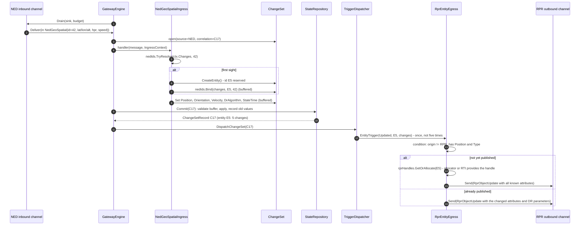

One received sample becomes one transaction with one correlation id (C17). The handler only
buffers commands; the engine validates and applies them at commit and dispatches **one** entity
trigger. The RPR egress forwards the last known state and DR parameters - it does not predict
anything. On first publication it allocates and binds an RPR object handle so later updates,
removals and event references can be mapped.

### 11.2 Weapon fire event, NED to RPR

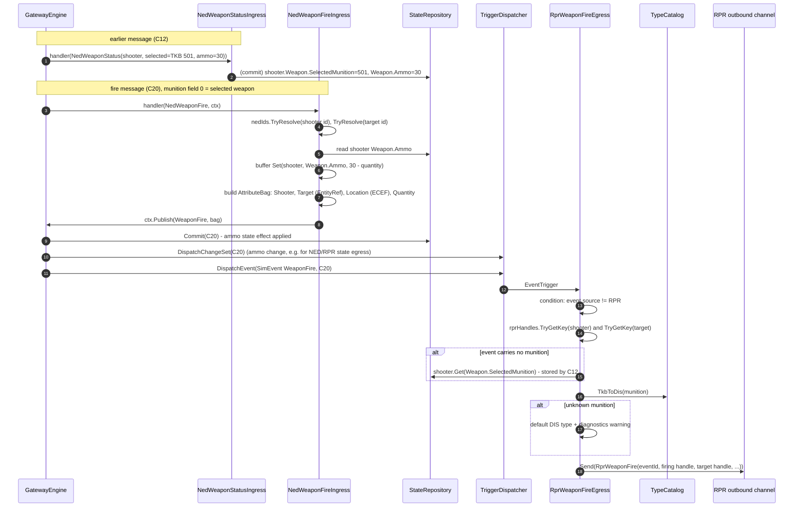

The event never enters the repository, but its **state effect** (ammo) does, in the same
transaction and dispatched first. The outgoing event needs data the incoming one does not carry
(munition type), which the egress finds in an attribute stored by an **earlier, different**
message - the granularity/timing difference of R-013. An entity unknown on the RPR side is sent
as "no object".

### 11.3 Session unload

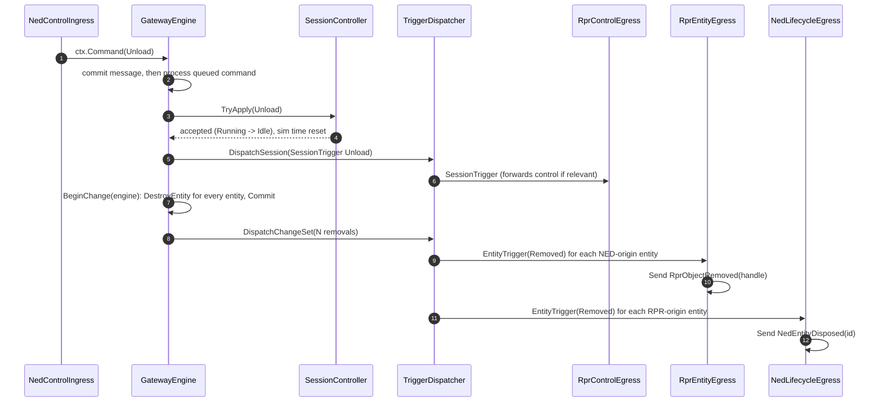

Session commands are executed after the message's own state changes. Unload produces one engine
change set that removes everything, so each side is told to delete exactly the objects the
gateway published to it. A command that is invalid in the current state is rejected and produces
no trigger.

### 11.4 Dead-reckoning check and heartbeat (timer)

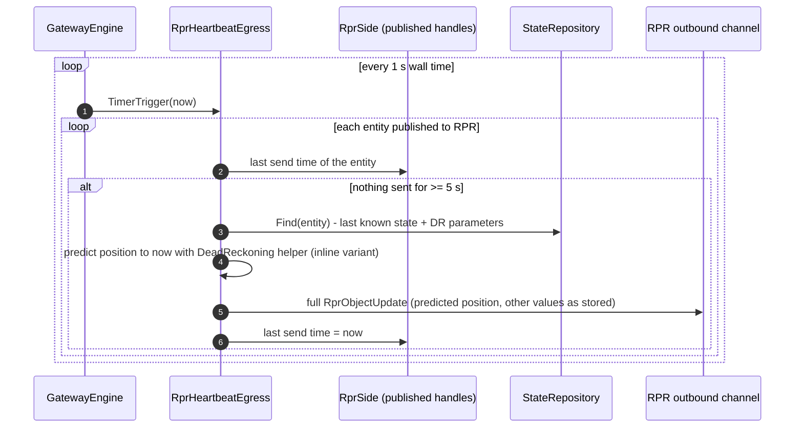

Timing differences between the sides are modules, not engine features. The heartbeat is a
separate, independently registered module that shares only the published-handle bookkeeping
(`RprSide`) with `RprEntityEgress`, which records each send. Disabling its rule turns heartbeats
off without touching anything else. For a moving entity it sends the position predicted to now
(the inline variant of section 8), so receivers do not see the entity jump back; the stored
attributes are not changed.

### 11.5 Ingress failure

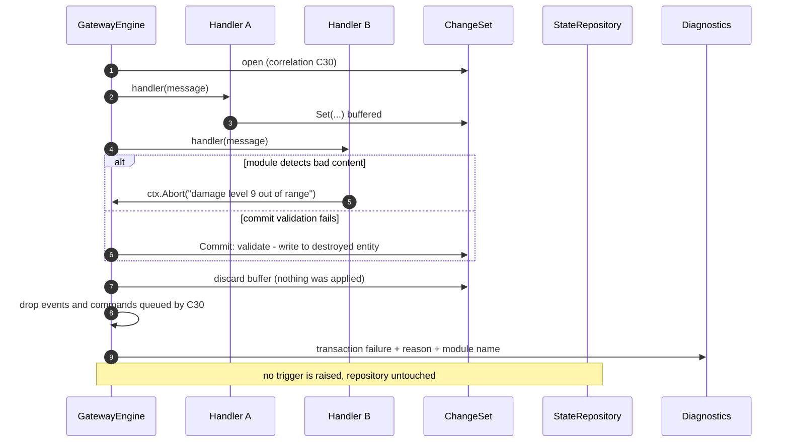

Because handlers only buffer, an abort or a failed validation simply throws the buffer away; the
repository was never touched. An unexpected exception in a handler takes the same path (safety
net).

### 11.6 Extrapolation for a side without dead reckoning (processor)

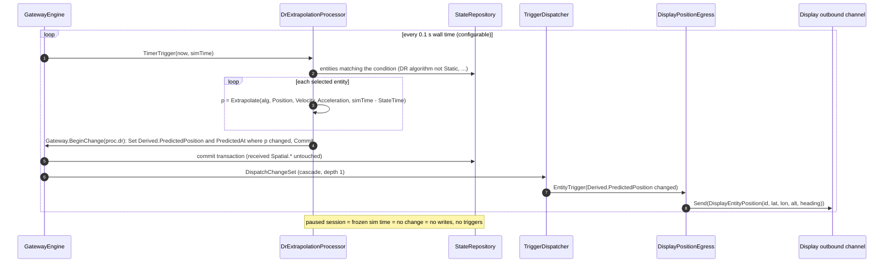

The processor is custom gateway logic on top of the engine: a timer rule, reads, and one
transaction of derived attributes per tick. The display egress does not know dead reckoning
exists; it reacts to an attribute like any other. A new NED spatial update changes the received
attributes, and the next timer tick re-predicts from them. Disabling the processor's rule (or not
registering the module) removes the behaviour completely.

### 11.7 Time-window query from a processor

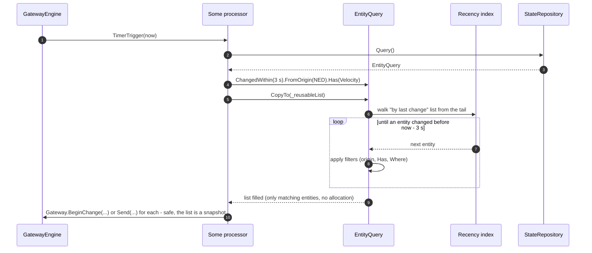

The query touches only the entities that changed in the window (plus filtering), regardless of
how many entities the repository holds. Because the result is a snapshot, the processor may write
while iterating it.

### 11.8 Identity translation between sides with different key types

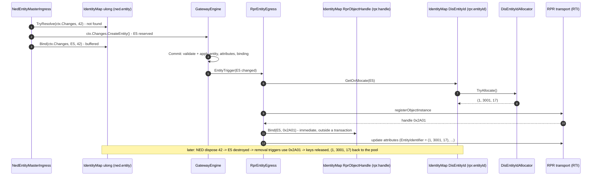

The NED side's `ulong`, the RTI-provided object handle and the RPR `EntityIdentifier` triple are
three different key types in three identity maps; the engine sees only `EntityId`. The NED key is
bound inside the ingress transaction, the RPR identities by the egress during dispatch - one from
a pluggable allocator, one from the transport (external allocation).

### 11.9 One coarse entity to many fine entities and back

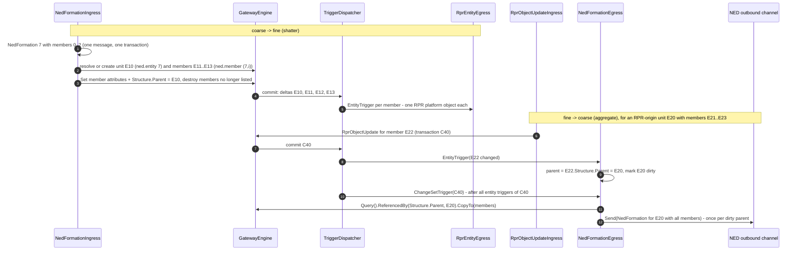

The coarse side's modules own the structure: the ingress shatters one message into several pivot
entities in a single transaction, using a composite-key identity map for the members; the egress
aggregates member changes into one message per parent, using the reverse reference index and the
change-set-end trigger. The fine side's modules see only ordinary entities.

## 12. Test plan (T-005)

Unit tests per mechanism are listed here; the integrated showcase that exercises all of them
together on complex sides is DD-002 "Convoy Ambush".

xUnit, deterministic (`ManualClock`, no sleeping). Groups and the cases each must cover:

- **Values and registry** - equality per kind (NaN, -0.0, Vec3, strings, object values),
  kind mismatch errors, idempotent registration, conflicting re-registration.
- **Queries** - every filter alone and combined; window boundaries (exactly at the edge); written
  but unchanged entities appear in written-windows only; entities move in the recency order on
  write; destroyed entities disappear from all indexes; presence index after `Clear`; `KnownTo`
  after binding; sim-time filters across a `Load` reset; snapshot result stays valid while the
  caller modifies state; a window query over 10k entities touches only the matching ones.
- **Vocabulary validation** - consumed-but-never-produced and produced-but-never-consumed
  warnings, kind conflict error, schema dump lists producers and consumers; any entity accepts
  any registered attribute (no entity-structure checks).
- **Identities and allocators** - resolve/translate across maps with different key types (`ulong`,
  struct handle, (site, app, number) triple, string); binding buffered in a transaction is visible
  to a second handler of the same message and discarded on abort; duplicate key or second key
  for the same entity in one map rejected at commit; immediate binding outside a transaction;
  keys still resolvable in removal triggers and released afterwards; allocator exhaustion;
  quarantined reuse; external allocation (key bound later than the entity appears).
- **Cardinality** - one coarse message creates/updates/removes the right part entities in one
  transaction (all or nothing); stable part identity via a composite key across updates; part
  removal when a member disappears from the message; `ReferencedBy` after create, re-parent and
  destroy; `OnChangeSetEnd` fires once per change set after all entity triggers, so an
  aggregating egress sends one message per dirty parent; parts arriving before their parent are
  linked later; an event on a part is mapped to the coarse side's parent key.
- **Allocations** - steady-state entity updates through ingress, commit, dispatch and a no-op
  egress allocate 0 bytes; queries with `CopyTo` / `ForEach` allocate 0 bytes; pooled records,
  triggers and events are recycled and not observable after their lifetime.
- **Repository and transactions** - create/destroy/set/clear/bind; written vs changed (same value
  written: written but not changed, version unchanged); metadata recorded; handler reads see
  committed state, `TryGetPending` sees the buffer; reserved ids usable within the transaction;
  validation failures (write to missing or destroyed entity, write after destroy, duplicate key)
  discard everything; explicit abort discards everything; exception safety net; create + destroy
  in one transaction raises nothing; inverse (old values) recorded; journal lookup by
  correlation and eviction at capacity.
- **Dispatch** - a rule fires once when several of its attributes change; condition false means
  no action; registration order; changed vs written subscriptions; a failing rule does not stop
  others and is counted; disabled rules do not fire; cascades dispatch in the same tick; a rule
  loop hits the cascade limit without corrupting state; timers fire at their period without
  catch-up bursts; tick-end rules.
- **Ingress** - several handlers of one message share a correlation id; an unhandled message
  type is counted; per-tick message budget leaves the rest for the next tick; round-robin between
  channels.
- **Session** - all valid transitions; invalid ones rejected; sim time advances only when it
  should; unload removes all entities and egress sends deletions; replay mode exposed.
- **Geo math** - geodetic <-> ECEF round trips (equator, poles, date line, altitude),
  orientation and velocity frame round trips.
- **End to end NED <-> RPR** - entity published to RPR only when type and position are known;
  attributes coalesced into one update; descriptors arriving in any order; damage-only update;
  dispose -> remove, unknown dispose ignored; RPR-origin entity reaches NED and is not echoed back
  to RPR (and vice versa); a looped-back own publication is ignored; pause/resume forwarded;
  stale entity reaped and removal propagated.
- **Events and stored data (R-013, R-016)** - fire decrements the shooter's stored ammo before
  the event is dispatched; fire without munition uses the shooter's stored selected munition;
  unknown munition and unknown shooter; detonation sets target damage and RPR receives both the
  detonation and a `DamageState` update; fire from RPR reaches NED and is not echoed.
- **Dead reckoning (R-020, R-021, R-024)** - DR parameters and state time forwarded unchanged to
  RPR; received attributes are never changed by predictions; the extrapolation processor writes
  correct predictions (Static, FPW, RVW) at its period, only for selected entities and only when
  the value changed; no writes while paused; its transaction carries source `proc.dr` and
  `CausedBy`; the display egress receives positions only through the derived attribute;
  disabling the processor rule stops display updates while RPR is unaffected; the heartbeat
  re-sends after 5 s with the position predicted to now and stays quiet while updates flow;
  the stale reaper removes entities of its side only, after the timeout, and the removal reaches
  the other side.
- **Events** - an `EventTrigger` reaches `OnEvent(type)` and `OnAnyEvent` rules after the
  transaction's state triggers; an aborted transaction raises no event; an event with no
  subscriber is counted; processor-published events cascade; the event log keeps the last N.
- **Scale** - 10,000 entities created and updated within a generous time bound; the console
  benchmark (T-006) reports per-tick timings for 10k entities with DR-thinned input.

## 13. Project layout

Superseded by **DD-003** (solution structure, dependency rules, gateway profiles, host assembly).
The ImGui viewer (T-007) becomes a host project there; it calls `engine.Tick()` once per frame and
reads `State`, `Rules`, `Diagnostics` and the `Journal` - all designed for it (names in the
attribute registry, rule infos with counters, bounded recent-diagnostics list).

## 14. Proposals awaiting approval

Review of 2026-10-24: P-1 .. P-9 approved, P-3, P-6 and P-7 with amendments. They are recorded as
rulings:

| Proposal | Outcome | Ruling |
|---|---|---|
| (user note) | Sides differ in granularity and timing; event data may need storing | **R-013** |
| P-1 Repository shape and unboxed values | approved | **R-014** |
| P-2 One trigger per entity per change set | approved | **R-015** |
| P-3 Events not stored | amended: the event is transient, the data it carries may be stored (section 5.2) | **R-016** |
| P-4 Session state machine | approved | **R-017** |
| P-5 Single-threaded tick, dispatch per message | approved | **R-018** |
| P-6 Transactions | amended: buffered, undoable commands applied by the engine; not exception-driven (sections 3.2, 6.2) | **R-019** |
| P-7 DR on demand with remote model | replaced: no extrapolation, the outgoing side interprets the last known state (section 8) | **R-020** |
| (user note) | DR is pluggable logic on triggers and attributes, not engine code | **R-021** |
| (user note) | Custom logic modules (processors) may extrapolate or otherwise transform data when the gateway logic requires it | **R-024** |
| P-8 Echo suppression by origin/source | approved | **R-022** |
| P-9 "Correlation id" naming | approved | **R-023** |
| P-10 Handlers read committed state, pending via `TryGetPending` | approved | **R-025** |
| P-11 Failure model: validation + `Abort`, exceptions only a safety net | approved | **R-026** |
| P-12 Weapon status / ammo / detonation damage example | approved | **R-027** |
| P-13 Heartbeat sends the position predicted to now | approved | **R-028** |
| P-14 DR processor writing derived attributes, display side without DR | approved | **R-029** |
| P-15 Bounded event log | approved | **R-030** |
| (user note) | Queries over the repository for custom logic (e.g. changed in the last 3 s) | **R-031** |
| (user note) | Shared vocabulary is specific to the connected systems, not hard-coded in the engine; it lives in the modules | **R-032** |
| (user note) | Avoid unnecessary allocations on the hot path; no plain LINQ | **R-033** |
| (user note) | The schema defines generalised attributes and events only; no entity kinds, no attribute-to-entity restrictions | **R-034** |
| (user note) | Per-side id allocation and identity translation with different key types per side | **R-035** |
| P-16 Query API with indexes | approved, without LINQ and allocation-free (section 3.4) | **R-036** |
| P-17 One schema module | approved | **R-037** |

| P-18 Allocation-free APIs and lifetimes | approved | **R-038** |
| P-19 Identity maps and allocators | approved | **R-039** |
| P-20 Four key types in the PoC | approved | **R-040** |

| P-21 Cardinality via finest-granularity pivot, relations, reverse index, `OnChangeSetEnd` | approved | **R-041** |
| P-22 Formation example in the PoC | approved | **R-042** |

No open proposals. DD-004 adds spatial queries, write authority, entity tables, session veto and the
predictor registry (R-056 .. R-060); the API reference above includes them.

## 15. As-built notes

### Stage 1 - values, registries, repository, transactions, journal (T-003a, 2026-10-24)

Implemented in `src/Engine/SimNetGateway.Engine` (folders `Values/`, `Registries/`, `State/`,
`Transactions/`, `Authority/`, one namespace `SimNetGateway.Engine`); tests in
`tests/SimNetGateway.Engine.Tests`. Steady-state commits of entity updates allocate 0 bytes (changed
and unchanged values, journal cycling). Refinements of section 10.3, all within its latitude:

- **Ids** have `None = default` (value 0); real ids start at 1. `SourceRegistry` pre-registers
  `engine` as `SourceRegistry.Engine` (id 1) for the engine's own change sets (unload).
- **`AttrKind.None = 0`** added, so `default(AttrValue)` is the absent value. Equality: kinds must
  match; doubles and `Vec3` components use `double.Equals` (NaN equals NaN, 0.0 equals -0.0) so a
  repeated NaN or a sign flip of zero is not a change; strings ordinal; `Object` by `Equals`.
- **Programming errors throw at once** (`ArgumentException` / `InvalidOperationException`): unknown
  attribute, kind mismatch or `None` in `Set`, wrong-kind `As*`, conflicting re-registration (kind or
  options differ), `Begin` while a change set is open, commands on a closed change set. Designed
  failures do not throw (R-026): `Commit` returns `CommitResult { Committed | Empty | Rejected }`.
- **`Empty`**: nothing to apply (no commands, or only effects that cancel: create + destroy in one
  transaction, `Clear` of an absent attribute, transfer to the current owner, `Set` + `Clear` of an
  absent attribute). No record, nothing journaled.
- **Stage 1 has no dispatcher**: `StateRepository.Begin(source, wallTime, simTime, causedBy)`
  allocates the correlation id and `Commit` returns the record; stage 2 puts the engine (clock,
  dispatch, `IGatewayContext.BeginChange`) on top.
- **One write per slot per transaction**: only the last `Set`/`Clear` of an (entity, attribute) in a
  transaction is applied, so `Version`, `ChangedWallTime` and the entity's `LastChangeWallTime` move
  only when the final value differs from the value before the transaction, and every delta has one
  `AttrChange` per attribute (Old = before the transaction, New = final). Found in review: the first
  implementation incremented `Version` per intermediate `Set`.
- **`TryGetPending`** returns false for a slot whose last pending command is a `Clear`, or whose
  entity is pending destruction.
- **Write authority** (R-057): `IWriteAuthorityPolicy` has `CanWrite(entity, writer, attr)` as
  designed plus default-interface methods `CanDestroy(entity, writer)` and
  `CanTransferOwner(entity, writer, newOwner)`. `SingleWriterPolicy` allows the owner, the trusted
  sources and `SourceRegistry.Engine`. Checks use the owner **before** the transaction (a
  `TransferOwner` earlier in the same transaction does not change who may write later in it);
  commands on an entity **created in the same transaction** are not checked, so a relaying ingress
  may create an entity with another site as origin/owner and fill it in one transaction (R-061).
- **Destroy** keeps the dead record's slots (readable by triggers, complete inverse) and sets its
  `LastWriteWallTime`/`LastChangeWallTime`.
- **`ChangeSetRecord.Entities` / `EntityDelta.Changes`** are a public struct
  `ReadOnlyListView<T>` (indexer, struct enumerator; also `IReadOnlyList<T>`, which boxes - use the
  struct). Records and deltas come from internal pools and return to them when evicted from the
  journal ring; a record is valid only while it is in the journal.
- `StateRepository.Commit(ChangeSet)` / `Discard(ChangeSet)` are public as in 10.1 and reject a change
  set of another repository; `ChangeSet.Discard()` on a closed change set is a no-op.
