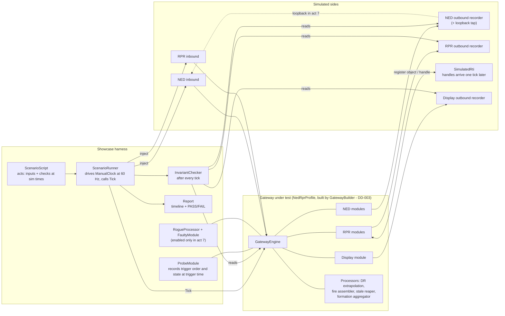
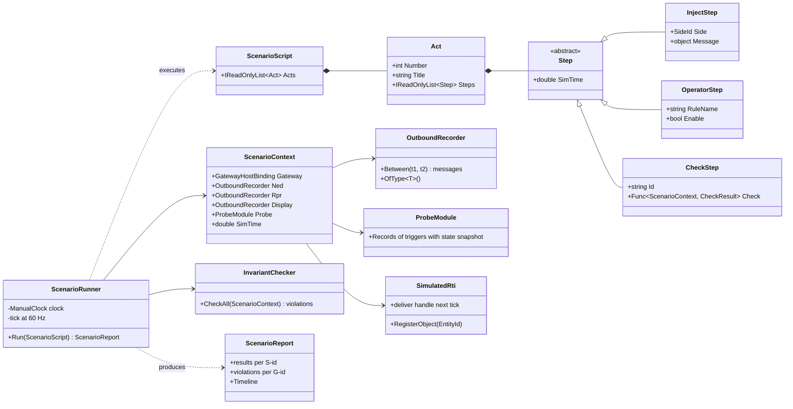
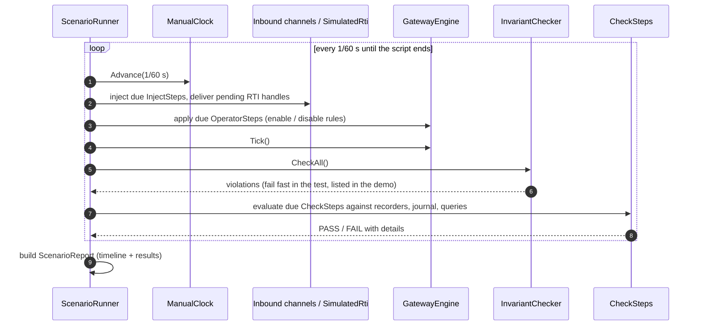
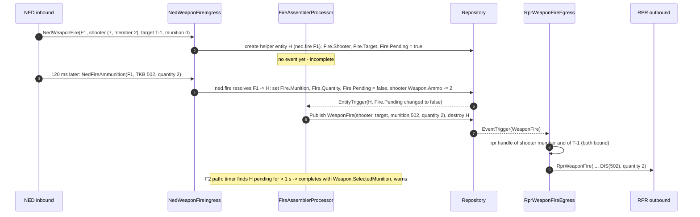

# DD-002: Showcase Scenario "Convoy Ambush"

| | |
|---|---|
| **Status** | approved (R-043 .. R-047); project placement per DD-003 |
| **Tasks** | T-009 (this design), T-010 (implementation) |
| **Rulings honoured** | R-002, R-003, R-006, R-008, R-013 .. R-048 |
| **Date** | 2026-10-24 |

## 1. Purpose

The unit tests of DD-001 section 12 check each mechanism in isolation. This showcase checks that
the mechanisms **work together** when both sides are complex: different vocabularies, entity
cardinality, event/state crossings, different timing, several identity types, asynchronous
identity allocation, out-of-order and looped-back input, failures, operator reconfiguration and
the whole session lifecycle - at a small, readable scale (about 15 entities), so every outbound
message can be checked exactly.

It runs **deterministically** (`ManualClock`, 60 Hz ticks, fixed script) in two forms:

- as an **xUnit acceptance test** (T-010) that fails on the first violated success condition;
- as a **console showcase** (`SimNetGateway.Demo --showcase`) that prints the timeline of every
  act - inputs, outbound messages per side, diagnostics - and a PASS/FAIL table of the success
  conditions.

## 2. The challenge matrix

What makes each side hard, and where the showcase exercises it:

| # | Challenge | NED side (internal, DDS-like) | RPR side (external, HLA-like) | Display side (C2 map) | Act |
|---|---|---|---|---|---|
| C1 | Vocabulary, units, frames | geodetic degrees, TKB type ids, damage 0..3 | ECEF metres, radians, DIS entity types, damage enum | lat/lon, heading, label | all |
| C2 | Attribute granularity | fat descriptors (master, geo-spatial, weapon status, damage) | one object with optional attributes | one position message | 3, 4 |
| C3 | Entity cardinality 1:N | a **formation** = one descriptor carrying 3 members | one platform object per member | one marker per member | 3, 9 |
| C4 | Entity cardinality N:1, references by foreign identity | gets **one formation** message for a red squad | red squad = **AggregateEntity** object listing members by **DIS EntityIdentifier**, plus member platforms | - | 3, 9 |
| C5 | Event -> state crossing | detonation carries target damage | damage is only an attribute (`DamageState`) | - | 5 |
| C6 | State -> event crossing | requires a `NedDamageNotification` event when damage increases | reports damage only as state | - | 5 |
| C7 | Event needing earlier, different data | fire without munition = "selected weapon" from an earlier weapon-status descriptor | fire interaction needs the munition type | - | 5 |
| C8 | Event split over several messages | a fire arrives as `NedWeaponFire` + `NedFireAmmunition` (may be late or missing) | needs one complete fire interaction | - | 5 |
| C9 | Event referring to a part of a coarse entity | target is "formation 7, member 1" | target is a platform object | - | 5 |
| C10 | Different timing | updates thinned by DR (irregular) | heartbeat every 5 s, timeout 12 s | positions at 10 Hz, no DR | 4, 8, 9 |
| C11 | Identity types | `ulong` ids, member key `(formation, index)`, fire id `Guid` | RTI object handle (**asynchronous**), DIS `(site, app, number)` with quarantine | `string` label | 3, 5, 7, 9 |
| C12 | Out-of-order input | geo-spatial before master | members before their aggregate, aggregate referencing unknown members | - | 1, 3 |
| C13 | Looped-back own publications | DDS delivers our own samples back | - | - | 7 |
| C14 | Failures | out-of-range content, unknown message type | allocator exhaustion | - | 7 |
| C15 | Operator reconfiguration (override) | - | customer federation uses damage in percent: default mapping disabled, custom one enabled | - | 6 |
| C16 | Session lifecycle incl. debrief | control messages | freeze/resume interactions; no weapon effects during replay | - | 2, 8, 10, 11 |

## 3. Block diagram

- **ScenarioScript** is a list of acts; each act is a list of steps at sim times: inject a message
  on a side, issue an operator action (enable/disable a rule), or check a success condition.
- **ScenarioRunner** advances the `ManualClock` by 1/60 s, injects the steps that are due, calls
  `Tick()`, runs the **InvariantChecker** and evaluates the checks that are due.
- **Recorders** keep every outbound message with tick, wall time and sim time, so checks can ask
  "exactly which messages went to RPR between t1 and t2".
- **SimulatedRti** models asynchronous registration: `RegisterObject` returns nothing at once;
  the handle is delivered on the next tick, as RTIs do through callbacks.
- **ProbeModule** is a passive test module: it subscribes to triggers and records their order and
  the state visible at that moment (e.g. the shooter's ammo when the fire event is dispatched).
- **RogueProcessor** (a rule that rewrites its own trigger attribute: an infinite cascade) and
  **FaultyModule** (an ingress handler that throws) exist only to prove the guards; their rules
  are enabled only in act 7.

## 4. Cast and timeline

| Who | Side | Model on that side | Pivot |
|---|---|---|---|
| Blue convoy "Viper" | NED | formation 7 with members 0, 1, 2 (one `NedFormation` descriptor) | unit + 3 member entities |
| Blue drone "Hawk" | NED | entity 21 (master + geo-spatial), moving, turns at t=40 s | 1 entity |
| Checkpoint "Gate" | NED | entity 22, static | 1 entity |
| Red tank "T-1" | RPR | platform object | 1 entity |
| Red squad "Wolf" | RPR | AggregateEntity listing 3 members by EntityIdentifier + 3 platform objects | unit + 3 member entities |
| C2 map | Display | receives plain positions | - |

```mermaid
gantt
    title Showcase timeline (sim time, seconds; act 1 runs before Load in wall time)
    dateFormat X
    axisFormat %s
    section Lifecycle
    Act 0 Setup and validation      :a0, 0, 1
    Act 1 Free play (Idle)          :a1, 1, 6
    Act 2 Load and Start            :a2, 6, 7
    section Story
    Act 3 Forces appear             :a3, 7, 20
    Act 4 Movement and timing       :a4, 20, 60
    Act 5 Engagement                :a5, 60, 75
    Act 6 Operator override         :a6, 75, 80
    Act 7 Faults and loopback       :a7, 80, 90
    Act 8 Pause and resume          :a8, 90, 100
    Act 9 Losses and timeouts       :a9, 100, 125
    section Wrap-up
    Act 10 Unload                   :a10, 125, 127
    Act 11 Debrief replay           :a11, 127, 140
```

## 5. Acts, steps and success conditions

Each success condition has an id (`S-a.n`, a = act) used by the test and the report.
"RPR got X" means the RPR outbound recorder contains X in the act's time window, and **nothing
else** unless stated.

### Act 0 - Setup and validation

Register all PoC modules, the showcase protocol extensions (section 7) and the probe.

| Id | Success condition |
|---|---|
| S-0.1 | `Validate()` reports no errors and exactly the expected warnings (none in the PoC configuration). |
| S-0.2 | Identity maps exist: `ned.entity` (`ulong`), `ned.member` (`NedMemberKey`), `ned.fire` (`Guid`), `rpr.handle` (`RprObjectHandle`), `rpr.entityId` (`DisEntityId`), `display.label` (`string`). |

### Act 1 - Free play in Idle (C12, C10)

Hawk's `NedGeoSpatial` arrives **before** its `NedEntityMaster`; Red tank T-1 appears on RPR.

| Id | Success condition |
|---|---|
| S-1.1 | After the geo-spatial only: Hawk exists in the pivot, RPR got **nothing** (type unknown), display got nothing (no label/identity yet). |
| S-1.2 | After the master: RPR registration requested at the SimulatedRti; on the next tick the handle arrives and RPR got **one** full `RprObjectUpdate` for Hawk with ECEF position, geocentric orientation, velocity, DR algorithm, DIS type of Hawk's TKB type. |
| S-1.3 | NED got master + geo-spatial for T-1 with a gateway-range id; T-1 never appears on RPR outbound (echo). |
| S-1.4 | Sim time advanced with wall time (Idle runs free). |

### Act 2 - Load and Start (C16)

NED control: `LoadScenario("Ambush")`, then `Start`.

| Id | Success condition |
|---|---|
| S-2.1 | Session `Idle -> Loaded -> Running`, sim time reset to 0 at Load and frozen until Start. |
| S-2.2 | RPR got exactly one `RprSimulationControl(StartResume)`; NED got no control message (it was the source). |
| S-2.3 | Existing entities survive Load (free-play entities are kept). |

### Act 3 - Forces appear (C2, C3, C4, C11, C12)

Blue: `NedFormation(7, members 0..2)`, Gate master + geo-spatial. Red: Wolf's three member
platforms arrive **first**, then Wolf's AggregateEntity listing their EntityIdentifiers - plus one
identifier that does not exist yet (member 4, arriving 2 s later).

| Id | Success condition |
|---|---|
| S-3.1 | One formation message = **one transaction** creating 4 pivot entities (unit + 3 members) with `Structure.Parent`; the probe sees one `ChangeSetRecord` with 4 deltas. |
| S-3.2 | RPR got 3 platform objects (one per member, distinct handles, distinct DIS EntityIdentifiers) and none for the unit (no position). Updates that happened while a handle was pending were coalesced into the first update after the handle arrived. |
| S-3.3 | Display got 3 member markers + Gate, labelled `Viper-0`, `Viper-1`, `Viper-2`, `Gate`. |
| S-3.4 | Wolf members first exist without parent; when the aggregate arrives they are linked (`ReferencedBy(Structure.Parent, Wolf)` returns 3); NED got **one** `NedFormation` for Wolf with 3 members (not 3 messages). |
| S-3.5 | When member 4 arrives, NED got one updated Wolf formation with 4 members. |

### Act 4 - Movement and timing (C10, DR)

Viper moves along a road (NED sends geo-spatial only when the sender's DR threshold is exceeded:
scripted at irregular times); Hawk flies straight, **turns at t=40 s**; Gate is static and NED
re-sends its unchanged geo-spatial every 10 s.

| Id | Success condition |
|---|---|
| S-4.1 | RPR got Hawk updates only at: the turn, and heartbeats every 5 s; each heartbeat's position is within 1 m of the analytic true position at its send time (predicted to now). |
| S-4.2 | Display got Hawk and Viper members at 10 Hz with positions within 0.01 m of the analytic FPW prediction; Gate only once (static, no change). |
| S-4.3 | Gate's unchanged re-sends: the probe's `OnAttributesWritten` rule fires, every `OnAttributesChanged` rule stays silent, RPR got nothing but heartbeats. |
| S-4.4 | Received `Spatial.*` attributes of Hawk change only at NED inputs (meta `Source = NED`); predictions exist only in `Derived.*` (meta `Source = proc.dr`). |
| S-4.5 | Query at t=50 s: `ChangedWithin(3 s)` returns exactly the entities the script updated in [47, 50]; `NotWrittenWithin(10 s).FromOrigin(RPR)` returns the RPR entities silent for 10 s. |

### Act 5 - Engagement (C5 .. C9, C11)

1. NED `NedWeaponStatus(Viper member 2, selected TKB 501, ammo 30)`.
2. RPR: T-1 fires at the platform of Viper member 1.
3. NED: detonation on Viper member 1 with damage 3 (destroyed).
4. NED: Viper member 2 fires in **two parts**: `NedWeaponFire(fireId F1, target T-1, munition 0)`
   and 120 ms later `NedFireAmmunition(F1, TKB 502, quantity 2)`.
5. NED: Viper member 2 fires again (F2); the ammunition part **never arrives**.
6. RPR: T-1's `DamageState` goes 0 -> 2, later 2 -> 1 (repair).

| Id | Success condition |
|---|---|
| S-5.1 | NED got `NedWeaponFire` for T-1's shot with target **(formation 7, member 1)** - the target platform mapped through `Structure.Parent` to the coarse identity (C9). |
| S-5.2 | RPR got `RprMunitionDetonation` targeting member 1's handle **and** an `RprObjectUpdate` with `DamageState = Destroyed` for that platform; the probe saw the damage change dispatched **before** the detonation event; both share the input's correlation id (`Journal.GetWrites`). |
| S-5.3 | F1: RPR got **one** `RprWeaponFire` only after the ammunition part arrived, with DIS type of TKB 502, quantity 2, firing object = member 2's handle, target = T-1's handle; member 2's `Weapon.Ammo` = 28, visible to the probe when the event fired. |
| S-5.4 | F2: after the assembly timeout (1 s) RPR got one `RprWeaponFire` with the **selected** munition (TKB 501 from step 1) and a diagnostic warning "fire F2 completed by timeout"; the helper entity used for assembly is destroyed and its `Guid` key released. |
| S-5.5 | T-1 damage 0 -> 2: NED got a `NedEntityDamage(2)` descriptor **and** one `NedDamageNotification` event (state -> event, C6); 2 -> 1: descriptor only, **no** notification (condition on old/new value). |
| S-5.6 | No event was sent back to the side it came from. |

### Act 6 - Operator override (C15)

The customer federation uses damage in percent. The operator disables the default contributor
rule `RprEntityEgress/Damage` and enables `CustomerDamagePercent/Damage` (a separate module that
contributes `DamageState` as 0/33/66/100). Then NED reports damage 1 on Gate.

| Id | Success condition |
|---|---|
| S-6.1 | RPR got one `RprObjectUpdate` for Gate with `DamageState = 33` and no other change. |
| S-6.2 | All other attributes of RPR updates still come from the default contributors (a following Hawk heartbeat is unchanged in shape). |
| S-6.3 | `Rules` shows the default rule disabled with its fire count frozen, the custom rule enabled and counting. |

### Act 7 - Faults and loopback (C13, C14)

1. NED damage level 9 (out of range) for Gate -> the module aborts.
2. An unknown NED message type.
3. `FaultyModule` enabled: its handler for `NedIffStatus` throws.
4. `RogueProcessor` enabled for one tick: an infinite cascade.
5. Loopback tap on: every NED outbound message is fed back into NED inbound for 2 s.
6. Red reinforcements: 6 new RPR platforms appear while the **NED gateway id range** (configured
   small for the showcase) has only 4 free ids left, so 2 of the 6 cannot be published to NED.

| Id | Success condition |
|---|---|
| S-7.1 | Aborted message: repository unchanged (journal has no record for it), nothing sent, one transaction-failure diagnostic naming the module and reason. |
| S-7.2 | Unknown message type counted, nothing else happens. |
| S-7.3 | Throwing handler: transaction discarded, diagnostic with exception; the next valid message on the same channel is processed normally. |
| S-7.4 | Rogue cascade: stopped at `MaxCascadeDepth`, cascade-overflow diagnostic, no partially applied change set; all other rules ran normally in that tick. |
| S-7.5 | Loopback: every looped-back message is ignored (echo suppression, C13); repository versions unchanged; no outbound message caused by them. |
| S-7.6 | Exhaustion: NED got 4 of the 6 reinforcements, 2 allocation-failure diagnostics; after act 9 frees ids, the next update of each of the 2 publishes it (retry on next trigger). |

### Act 8 - Pause and resume (C16, C10)

| Id | Success condition |
|---|---|
| S-8.1 | Pause: RPR got `StopFreeze`; sim time frozen; display got **no** position updates during the pause (prediction unchanged = no writes). |
| S-8.2 | Heartbeats continue on wall time during the pause, with the frozen predicted position. |
| S-8.3 | Resume: RPR got `StartResume`; display updates resume within one processor period. |

### Act 9 - Losses and timeouts (C3, C4, C10, C11)

1. Viper member 1 (destroyed) is dropped from the next `NedFormation` message.
2. Wolf member 3 stops sending (no heartbeat).
3. A NED entity published to RPR is disposed and a new one is created within the DIS quarantine.

| Id | Success condition |
|---|---|
| S-9.1 | RPR got `RprObjectRemoved` for member 1's handle; display removed `Viper-1`; member 1's `ned.member` key and DIS identifier released (the identifier only after quarantine). |
| S-9.2 | 12 s after Wolf member 3's last update the reaper destroyed it; NED got **one** Wolf formation message without member 3. |
| S-9.3 | The new entity gets a different DIS entity number during quarantine; after the quarantine a freed number may be reused. |
| S-9.4 | The 2 reinforcements of S-7.6 are now published to NED. |

### Act 10 - Unload (C16)

| Id | Success condition |
|---|---|
| S-10.1 | RPR got `RprObjectRemoved` for every object the gateway had published there; NED got a dispose (or an empty formation) for everything it had received from the gateway; display removed every marker. |
| S-10.2 | Repository empty, every identity map empty, every allocator has all its ids back (DIS ones in quarantine), session `Idle`. |
| S-10.3 | Journal and event log still hold the recent history (inspectable after unload). |

### Act 11 - Debrief replay (C16)

`LoadDebrief("Ambush-recording")`, `Start`, a recorded NED stream replays acts 3 - 5 (subset).

| Id | Success condition |
|---|---|
| S-11.1 | Session `Loaded` with `Mode = Replay`; entities and their states reach RPR and display as in live. |
| S-11.2 | **No** `RprWeaponFire` / `RprMunitionDetonation` is sent during replay (policy: no weapon effects into the federation during a debrief); the events are still dispatched and visible in the event log. |
| S-11.3 | Unload leaves the gateway as in S-10.2. |

## 6. Global invariants (checked after every tick)

| Id | Invariant |
|---|---|
| G-1 | **No echo**: no outbound message to side S describes an entity whose origin is S or an event whose source is S. |
| G-2 | **Identity consistency**: for every map, `TryResolve(TryGetKey(id)) == id`; no key bound to two entities; no destroyed entity resolvable after its removal dispatch. |
| G-3 | **Index consistency** (test-only brute force): recency lists ordered by time, presence sets and the reverse reference index equal a full scan. |
| G-4 | **Received state is never overwritten by derived logic**: every `Spatial.*` slot's meta source is an ingress side. |
| G-5 | **Outbound references are valid**: every RPR message uses a handle that is bound and not yet removed; every NED message uses an id the gateway owns or received. |
| G-6 | **Transaction atomicity**: every journal record is complete (a formation transaction never appears half-applied to any rule - the probe never sees a member without its parent in the same correlation). |
| G-7 | **Diagnostics whitelist**: every warning/error is one the script expects at that act; nothing else. |
| G-8 | **Causality**: correlation ids increase; every `CausedBy` refers to an earlier correlation; state triggers of a correlation precede its events. |

Overall success: all `S-*` conditions pass, no `G-*` invariant is violated at any tick, and the
final state after act 11 equals the empty state of S-10.2.

## 7. PoC additions the showcase needs

These extend DD-001 section 9 (protocols and modules); they are part of this review.

| Addition | Purpose |
|---|---|
| `NedFormation(id, members[index, geo-spatial, tkbType, damage])` and `NedFormationIngress` / `NedFormationEgress` | C3, C4 (already approved as R-042) |
| `RprAggregateEntity(handle, marking, memberIds: DisEntityId[])` and its ingress | C4, references by foreign identity, unknown members |
| `NedWeaponFire.TargetMember` (member index, -1 = none) | C9 |
| `NedFireAmmunition(fireId, munitionTkb, quantity)` and `FireAssemblerProcessor` (helper entity keyed by `IdentityMap<Guid>`, timeout timer) | C8 |
| `NedDamageNotification(id, member, oldLevel, newLevel)` and `NedDamageNotificationEgress` (rule on `Status.Damage` changed with old < new) | C6 |
| `SimulatedRti` with asynchronous handle delivery; `RprEntityEgress` buffers updates until the handle is bound | C11 |
| `RprEntityEgress` split into per-attribute-group **contributor rules** (`Identity`, `Spatial`, `Damage`, ...) filling one pending update per entity, flushed in `OnChangeSetEnd` (and on handle arrival) | C15 override, coalescing |
| `CustomerDamagePercent` module | C15 |
| Replay policy: RPR event egress rules have the condition `Session.Mode == Live` | C16 |
| `NedIffStatus` message (only for `FaultyModule`) | C14 |

## 8. Harness classes

The harness lives in `src/Showcase/SimNetGateway.Showcase` (DD-003), shared by the acceptance test
in `SimNetGateway.Gateway.NedRpr.Tests` and by the demo, so the console prints the same report the
test asserts. Allocations in the harness do
not matter; the engine's own allocation targets are verified by the unit tests (DD-001 section 12).

### 8.1 Runner loop

### 8.2 The hardest act in detail - split fire with asynchronous identities (act 5, F1)

## 9. Proposals

All approved on 2026-10-24: P-23 -> R-043, P-24 -> R-044, P-25 -> R-045, P-26 -> R-046,
P-27 -> R-047.

| ID | Proposal (lean) | Main alternative |
|---|---|---|
| **P-23** | Adopt "Convoy Ambush" (acts 0 - 11, success conditions S-*, invariants G-*) as the acceptance showcase, run as an xUnit test and as `Demo --showcase` with a PASS/FAIL report. | Several independent smaller scenario tests without a story. |
| **P-24** | Extend the PoC protocols and modules as in section 7 (aggregate entity with foreign-identity member list, split fire with assembler processor, damage notification, fire target member, simulated asynchronous RTI, replay policy). | Keep the PoC protocols of DD-001 section 9 and skip C4, C6, C8, C9, asynchronous identities. |
| **P-25** | Restructure `RprEntityEgress` into per-attribute-group contributor rules that fill one pending update per entity, flushed on `OnChangeSetEnd` and on handle arrival, so one group can be disabled and replaced (act 6). | Keep one rule per egress; override only whole modules. |
| **P-26** | Operator reconfiguration in the PoC is rule enable/disable at runtime; adding new modules while running is not part of the PoC. | Also support registering modules while the engine runs. |
| **P-27** | An outbound event that refers to an entity whose RPR handle is still pending (asynchronous registration) is **held** until the handle arrives (at most 1 s, then sent with "no object" and a warning). | Send immediately with "no object". |
