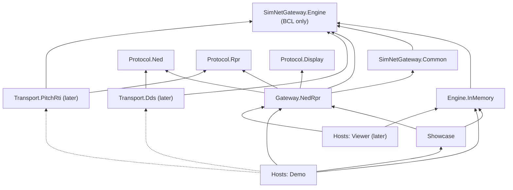
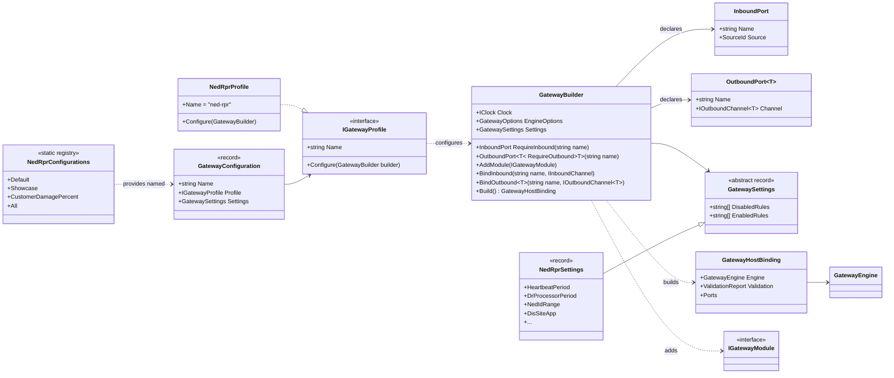
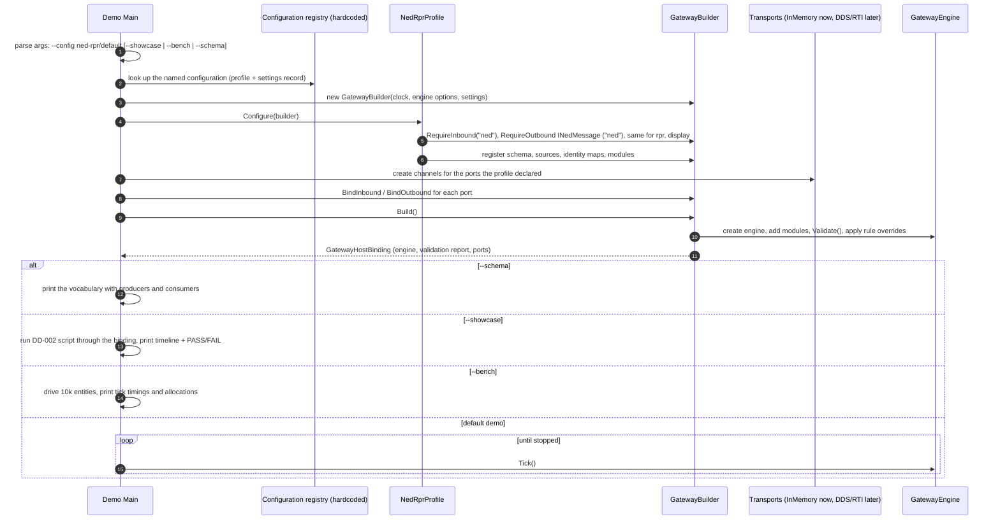

# DD-003: Solution Structure, Gateway Profiles and Host Assembly

| | |
|---|---|
| **Status** | approved (R-049 .. R-054); configuration is hardcoded registries, no JSON (R-054) |
| **Tasks** | T-011 (this design), T-012 (solution skeleton) |
| **Rulings honoured** | R-001, R-002, R-003, R-012, R-032, R-034, R-048 .. R-054 |
| **Date** | 2026-10-24 |

## 1. Purpose

R-048: the solution must keep the **engine separate from the logic of each concrete gateway**,
make it easy to write **custom modules** for a new gateway, and let the **demo console assemble
the pieces**. This document defines the folders and projects, the dependency rules between them,
how a concrete gateway is packaged (a *gateway profile*), how a host binds transports to it, and
how a new gateway is added. It replaces the project layout of DD-001 section 13.

Four kinds of code, kept apart:

| Kind | Knows | Must not know |
|---|---|---|
| **Engine** | repository, transactions, triggers, rules, queries, identities, session | any protocol, vocabulary, network, concrete gateway |
| **Protocol** (wire model of one system) | that system's messages and types | the engine, other protocols, gateways |
| **Gateway** (one concrete pair/set of systems) | the pivot vocabulary and all translation logic between its protocols | transports, hosts |
| **Transport** (how bytes/samples move) | one protocol + the engine's channel interfaces | gateway logic |

A **host** (demo console, later the viewer or a service) is the only place where all four meet.

## 2. Folders and projects

```
SimNetGateway.sln
global.json, Directory.Build.props, Directory.Packages.props   (.NET 8, central package versions)
docs/ scripts/ .claude/ CLAUDE.md

src/
  Engine/
    SimNetGateway.Engine/                 core engine (DD-001); depends on the BCL only
    SimNetGateway.Engine.InMemory/        in-memory channels, ManualClock, recorders (PoC + tests)
  Common/
    SimNetGateway.Common/                 reusable, vocabulary-free building blocks for modules:
                                            Geo (WGS-84, frames), DeadReckoning math,
                                            allocators (Range, Pool with quarantine),
                                            generic processors parameterised by attribute ids
                                            (DR extrapolation, stale-entity reaper)
  Protocols/
    SimNetGateway.Protocol.Ned/           NED message types (wire model only)
    SimNetGateway.Protocol.Rpr/           RPR message and DIS types, SimulatedRti (PoC)
    SimNetGateway.Protocol.Display/       display message types
  Gateways/
    SimNetGateway.Gateway.NedRpr/         the concrete NED <-> RPR (+ display) gateway:
      Schema/                               PivotSchema (vocabulary, R-037)
      Ned/  Rpr/  Display/                  ingress / egress modules per side
      Processors/                           gateway-specific processors (fire assembler, ...)
      NedRprProfile.cs                      the gateway profile (section 4)
  Transports/                             (later: Dds, PitchRti, VrLink - one project each)
  Showcase/
    SimNetGateway.Showcase/               DD-002 harness and "Convoy Ambush" script
  Hosts/
    SimNetGateway.Demo/                   console host: assembles engine + profile + transports;
                                            --showcase, --bench, --schema
    (later) SimNetGateway.Viewer/         raylib-cs ImGui host (T-007)

tests/
  SimNetGateway.Engine.Tests/             engine unit tests (DD-001 section 12, engine part)
  SimNetGateway.Common.Tests/             geo, DR math, allocators, generic processors
  SimNetGateway.Gateway.NedRpr.Tests/     module tests + the showcase acceptance test (DD-002)
  SimNetGateway.Architecture.Tests/       dependency rules of section 3
```

Conventions: folder name = project name = root namespace (Linux is case-sensitive, R-012);
solution folders mirror the directories; package versions only in `Directory.Packages.props`.

## 3. Dependency rules



Arrows point to what a project may reference. The rules:

1. **Engine references nothing** but the BCL.
2. **Protocol projects reference nothing** - not even the engine. They are pure wire models (in
   production possibly generated from IDL or a FOM), with their own types (e.g. RPR's
   `WorldLocation` struct, not the engine's `Vec3`). Translation into engine types is gateway
   logic.
3. **Common references only the engine** and contains nothing specific to any vocabulary or
   protocol: generic processors take their attribute ids as constructor parameters.
4. **A gateway references** the engine, Common and the protocols it connects - **never a
   transport or a host**, and never another gateway.
5. **A transport references** the engine (channel interfaces) and one protocol - **never a
   gateway**.
6. **Only hosts** reference gateways together with transports and assemble them.
7. Test projects mirror the layer they test; `Architecture.Tests` enforces rules 1 - 6 by
   inspecting the assemblies' references, so a violation fails the build pipeline.

## 4. Gateway profiles and ports

A concrete gateway is delivered as a **gateway profile**: one class that knows how to configure an
engine for that gateway. It declares the **ports** it needs - named, typed connection points for
transports - and registers its schema, sources, identity maps and modules. The engine itself has
no notion of profiles; they are a thin composition layer on top of `GatewayEngine.AddModule`.



- **`IGatewayProfile.Configure(builder)`** - registers the `PivotSchema`, the sources
  (`ned`, `rpr`, `display`, processor sources), the identity maps with their allocators, and every
  module. Modules get their outbound port (not a concrete transport) through their constructor.
- **Ports** are declared by the profile (`RequireInbound("ned")`,
  `RequireOutbound<IRprMessage>("rpr")`) and bound by the host
  (`BindInbound("ned", ddsChannel)`). An outbound port is a forwarding `IOutboundChannel<T>` so
  modules can be constructed before the host binds the real channel.
- **`Build()`** fails with a clear message if a declared port is unbound or bound to the wrong
  message type, then runs `GatewayEngine.Validate()` (vocabulary producers/consumers, DD-001 3.5)
  and applies the settings' rule enable/disable lists (the operator override of DD-002 act 6).
- **Settings are typed C# records, configurations are hardcoded registries (R-054).** Each
  gateway defines its settings record (e.g. `NedRprSettings`: thresholds, heartbeat period,
  allocator ranges, DIS site/application, rule enable/disable lists) with defaults, and a static
  registry of **named configurations** (`NedRprConfigurations.Default`, `.Showcase`,
  `.CustomerDamagePercent`, ...), each pairing the profile with a settings instance - variants are
  written as `Default with { ... }`. The host selects one by name. No JSON or other configuration
  files at this stage; a file format can be added later behind the same records.

Engine and gateway projects contain **no** `Main`, no transport construction and no file I/O.

## 5. Host assembly (the demo console)



The demo finds configurations in the static registries of the gateways it references
(`"ned-rpr/default" -> NedRprConfigurations.Default`), so no reflection, plugin loading or
configuration files are involved. The same assembly code is used by the showcase test and,
later, by the viewer.

## 6. Adding a new concrete gateway

1. If a system is new, add `src/Protocols/SimNetGateway.Protocol.<System>/` with its wire types.
2. Create `src/Gateways/SimNetGateway.Gateway.<Name>/` referencing Engine, Common and the protocols.
3. Write its `PivotSchema` (vocabulary shared by its sides, R-032/R-034/R-037), its ingress,
   egress and processor modules, and an `IGatewayProfile` that declares ports and registers them.
4. Add `tests/SimNetGateway.Gateway.<Name>.Tests/`.
5. Add its configurations registry to the demo's list of registries (and later the viewer's).
6. Write the design doc first (R-008): `docs/design/DD-NNN-Gateway-<Name>.md`.

Nothing in the engine, Common or other gateways changes. Extending an **existing** gateway with
a new message kind is a new module in that gateway's project, registered by its profile (R-003).

## 7. Edge cases

- Two profiles in one process (e.g. two gateways side by side) are two engines with their own
  registries - nothing is static or global in the engine.
- A profile that declares a port the host does not provide fails at `Build()`, not at the first
  message.
- A module that needs a transport-specific capability (e.g. asynchronous RTI registration) gets it
  through an interface defined in its **protocol** project (e.g. `IRtiRegistration` in
  `Protocol.Rpr`), implemented by the transport and bound by the host like a port - the gateway
  still references no transport.

## 8. Proposals

Approved on 2026-10-24: P-28 -> R-049, P-29 -> R-050, P-30 -> R-051, P-31 -> R-052 (amended:
hardcoded configuration registries instead of JSON, R-054), P-32 -> R-053.

| ID | Proposal (lean) | Main alternative |
|---|---|---|
| **P-28** | Layered folders and projects as in section 2, with the dependency rules of section 3 enforced by `Architecture.Tests`. | Fewer, larger projects (e.g. one Modules project) with the separation only by folders and convention. |
| **P-29** | Protocol projects are pure wire models referencing nothing, not even the engine; conversion to engine types is gateway logic. | Protocol projects reuse engine types (`Vec3`, ids) for convenience. |
| **P-30** | Concrete gateways are packaged as `IGatewayProfile` + `GatewayBuilder` with named, typed ports declared by the profile and bound by the host; `Build()` checks bindings and runs vocabulary validation. | Hosts construct and register every module by hand. |
| **P-31** | Gateway settings from code defaults plus an optional JSON file read by the host, including rule enable/disable lists; profiles are found through a static table in the host - no runtime plugin (DLL) loading in the PoC. | Load gateway profiles as plugins from DLLs at runtime (`AssemblyLoadContext`). |
| **P-32** | Central package management (`Directory.Packages.props`) and one test project per layer as in section 2; DD-001 section 13 is replaced by this document. | Package versions in each project file; a single test project. |

## 9. As-built notes

Stage 0 (T-012, 2026-10-24). All projects of section 2 exist, empty but compiling, with exactly
the references of the section 3 diagram; `Directory.Packages.props` holds every package version;
`scripts/build.sh` and `scripts/test.sh` wrap `dotnet build` / `dotnet test`. Built and tested on
Linux with .NET SDK 8.0.426. Points where the code goes beyond or interprets the text:

- **Declared references are checked as well as assembly references.** Section 3 rule 7 says
  `Architecture.Tests` inspects the assemblies' references. The C# compiler drops a project
  reference that no code uses from the assembly metadata, so an assembly-only check would accept a
  forbidden reference until the first type is used - in an empty skeleton, always. The tests
  therefore check (a) the `ProjectReference` items of every `.csproj` under `src/`, (b) the
  compiled assemblies' metadata references, and (c) for the BCL-only layers (engine, protocols)
  that every referenced assembly is part of the shared framework and that no NuGet package is
  used. The stage 0 exit check (a `Protocol.Ned -> Engine` reference plus one type using it) failed
  all three; it was reverted. `LayerRulesTests` keeps forbidden/allowed pairs permanently.
- **Rules for the layers the text does not spell out**, taken from the section 3 diagram:
  `Engine.InMemory` ("engine support") may reference only the engine; `Showcase` may reference
  the engine, engine support, Common, protocols and gateways (the transitive references of its
  diagram arrows made explicit), never a transport or a host; a host may reference every layer
  except another host; a gateway may **not** reference `Engine.InMemory` (not in the diagram -
  in-memory channels are bound by hosts and tests). A project's layer is its folder under `src/`;
  an unknown folder, or a reference to a project outside `src/`, fails.
- **Extra convention tests** for section 2: folder name = project name; `AssemblyName` /
  `RootNamespace` / `TargetFramework` not overridden in project files; layer name prefixes
  (`SimNetGateway.Protocol.*` in `Protocols/`, ...); no `Version=` on a `PackageReference`
  (R-053); every project is in the solution; each test project `X.Tests` references its subject
  `X` (rule 7, "test projects mirror the layer they test").
- **Test packages** (xUnit 2.9.2, runner 2.8.2, Test SDK 17.11.1) are referenced once in
  `tests/Directory.Build.props`, which imports the root `Directory.Build.props`.
- **`.sln` paths use `\`** - the solution file format requires it (`dotnet sln` writes it on Linux
  too) and MSBuild normalises it on every OS; this is the one place R-012's "no `\`" cannot apply.
  The file is stored with LF and without BOM; `ConventionTests` normalises when reading it.
- **Not yet created**: the gateway's `Schema/`, `Ned/`, `Rpr/`, `Display/`, `Processors/` folders
  (git keeps no empty folders; they come with stage 5) and `src/Transports/` (later).
- The three layer test projects contain no tests yet; `dotnet test` prints "No test is
  available" for them (not a failure) until stages 1, 4 and 5 fill them.
