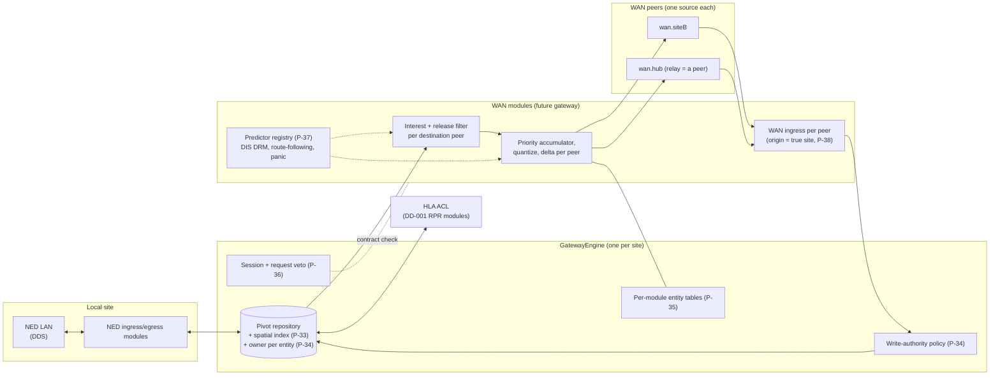
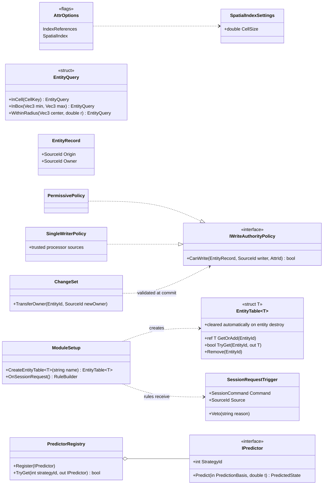
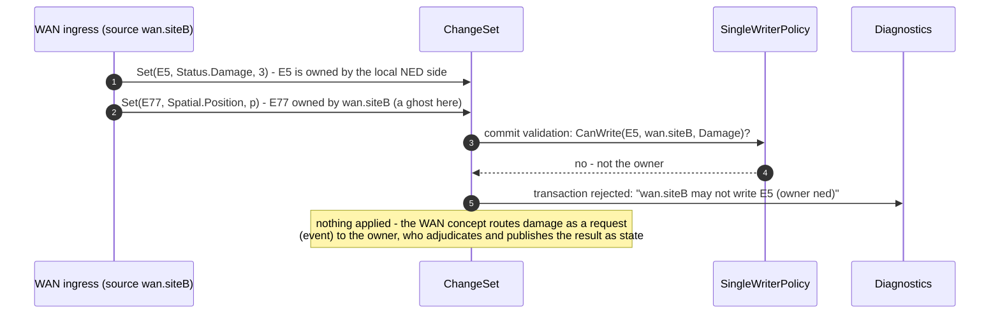
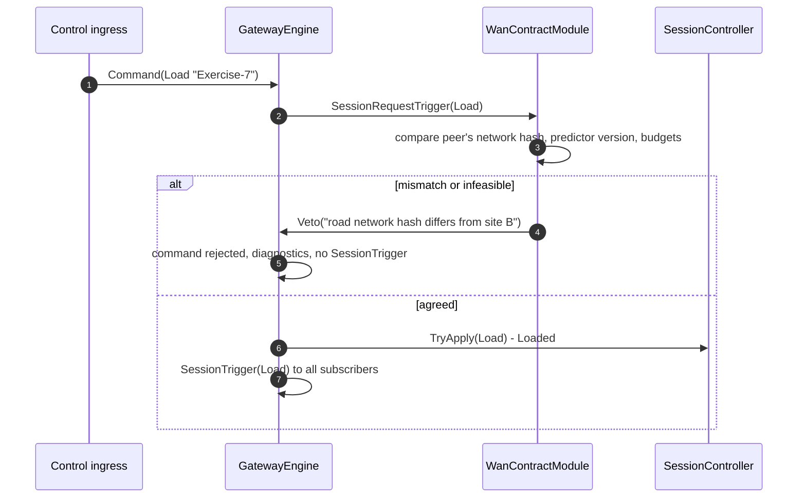

# DD-004: Impact of the Low-Bandwidth WAN Concept on the Engine Design

| | |
|---|---|
| **Status** | approved (R-056 .. R-062); folded into the DD-001 API reference |
| **Tasks** | T-013 (this analysis) |
| **Rulings honoured** | R-002, R-003, R-020, R-021, R-022, R-024, R-033, R-034, R-055 |
| **Input** | "NED-WAN-RTI-Design-Snapshot" (idea snapshot, not settled; not kept in the repository, R-055) |
| **Date** | 2026-10-24 |

## 1. Summary

The WAN concept models a purpose-built low-bandwidth inter-site protocol as a **third
anti-corruption layer on the same pivot**, sibling to NED and HLA. Our engine design already fits
that shape: sides are just sources with ports and modules (DD-003), translation and dead reckoning
are module logic (R-021, R-024), and the hub-is-a-peer topology needs no engine concept.

**Nothing approved so far has to be reversed.** The WAN concept does, however, rely on five
generic capabilities the engine does not yet offer, and it sharpens two existing decisions:

| WAN concept needs | Engine today | Change |
|---|---|---|
| Dynamic interest: "entities in these geo cells", "within R of my entities" (§4.1) | no spatial queries | **P-33** spatial index + queries |
| Single writer per entity, remote entities read-only ghosts, rare explicit transfer (§6) | echo suppression by origin only (R-022) | **P-34** pluggable write-authority policy + owner transfer command |
| Per-subscriber, per-entity egress state: last-acknowledged delta, priority accumulator, DR model per destination (§4.2, §10) | modules keep private dictionaries and must clean them up themselves | **P-35** engine-managed per-module entity tables |
| Session contract: refuse to start on hash/version mismatch or infeasible budget (§10.4, §10.5) | session commands validated only by the state machine | **P-36** session request veto |
| DR as pluggable per-entity-class strategy with a strategy id (route-following, panic predictor) (§5.1, §10.8) | DR helper is a switch over DIS algorithms | **P-37** predictor registry in Common |
| Several peers of the same kind; relayed traffic whose origin is a third site (§2) | sources per side; origin defaults to the change set's source | **P-38** confirm: one source per peer, origin set explicitly |
| WAN protocol, impairment shim, ground-truth oracle (§9) | out of PoC scope | **P-39** separate future design |

It also confirms decisions already taken: no extrapolation in the repository and on-demand
prediction (R-020 - the WAN doc recommends receivers "step lazily on query"), grouped corrections
as one transaction over many entities (R-019, R-041), allocation-free hot path (R-033) for
thousands of ambient entities, and interest/release filtering as declarative egress modules that
can be reviewed on their own (R-003).

## 2. Block diagram - three ACLs on one pivot, several WAN peers

- Each site runs its own gateway engine; the WAN modules are a third set of ingress/egress
  modules on its pivot, like NED and RPR.
- Every WAN peer (a remote site or the hub) is its own `SourceId`. Relayed traffic arrives from
  `wan.hub` but describes entities whose **origin** is the site that owns them (P-38).
- Incoming WAN writes pass the **write-authority policy**: a ghost (remote-owned entity) can only
  be written by its owner's source; a local entity can never be written from the WAN (P-34).
- Per-destination state (what each peer has acknowledged, accrued priority, the DR model that peer
  is running) lives in **engine-managed entity tables** of the WAN modules (P-35).
- The WAN session contract (component set, DR strategies, network hash, predictor version, budget
  feasibility) is checked by a **session request veto** before `Load`/`Start` takes effect (P-36).

## 3. Class diagram - the proposed engine additions

All additions stay vocabulary-free (R-034): the engine indexes *some* `Vec3` attribute registered
with `AttrOptions.SpatialIndex` without knowing it is a position; the authority policy sees only
sources and attribute ids; entity tables hold whatever struct a module defines; the predictor
registry lives in **Common**, not in the engine.

## 4. Sequences

### 4.1 A remote site writes to an entity it does not own

The policy check is one more commit-time validation (R-026), so a bad write never leaves
half-applied state. Ownership transfer is an explicit `TransferOwner` command in a transaction,
issued by whatever module implements the WAN's timeout-bounded request/confirm exchange.

### 4.2 Session contract veto

"Fail loudly at setup rather than degrading twenty minutes in" (WAN doc §10.5) becomes an ordinary
rule on a new trigger; the engine still knows nothing about networks or hashes.

## 5. Notes on other WAN topics

- **Interest and release policy** (deny by default, per destination) is a WAN egress module whose
  rules are reviewable in isolation - the "gateway as a guard" argument of the WAN doc §7.2 is
  satisfied by R-003 and the rule registry.
- **Event redundancy** ("send each event ~3x, dedup by UUID") is transport and module logic: the
  WAN ingress de-duplicates with an `IdentityMap<Guid>` (or a small expiring id set in Common).
- **Events as requests to the owner** and hit adjudication are gateway logic and conventions;
  the engine already routes events to any rule (DD-001 5.2).
- **Ambient tier, replication modes, mode-generation counters, grouped corrections** are pivot
  attributes and WAN module logic; a grouped correction is one transaction over many entities.
- **Impairment profiles "as a data file"** (WAN doc §9.2) conflict with R-054 (no JSON at this
  stage) only in the future WAN harness; when that work starts, profiles start as hardcoded
  registries too and get a file format when recorded traces exist.
- **Ground-truth oracle**: the showcase (DD-002) already measures prediction error against
  analytic truth in a small way (S-4.1, S-4.2); the WAN harness generalises it per tier and mode.

## 6. Proposals

All approved on 2026-10-24: P-33 -> R-056, P-34 -> R-057, P-35 -> R-058, P-36 -> R-059,
P-37 -> R-060, P-38 -> R-061, P-39 -> R-062.

| ID | Proposal (lean) | Main alternative |
|---|---|---|
| **P-33** | Generic **spatial index** for one or more `Vec3` attributes registered with `AttrOptions.SpatialIndex` (uniform grid, cell size per attribute, maintained at commit, allocation-free), with queries `InCell`, `InBox`, `WithinRadius`. Implemented in the engine core (T-003); cheap and needed by interest management. | Defer until the WAN work starts; interest modules scan entities. |
| **P-34** | Entities get an **`Owner`** (defaults to `Origin`) and the engine validates every write at commit against a pluggable **`IWriteAuthorityPolicy`**. PoC default: `PermissivePolicy` (today's behaviour); `SingleWriterPolicy` (owner and listed processor sources only) available and tested. Ownership changes only through a `TransferOwner(id, newOwner)` command. This is the stand-in R-022 anticipated. | No authority checks in the engine; each ingress module checks ownership itself. |
| **P-35** | **Engine-managed per-module entity tables** `EntityTable<T>` (struct `T`, dense, allocation-free, entries removed automatically when the entity is destroyed), created through `ModuleSetup`. Used by the RPR egress (published state), heartbeat, fire assembler, and later per-peer WAN state. | Each module keeps its own dictionaries and handles cleanup in removal rules. |
| **P-36** | New trigger **`OnSessionRequest()`**: rules see a session command before it is applied and may `Veto(reason)`; a vetoed command is rejected like an invalid transition. | Session contract checks outside the engine, before commands reach it. |
| **P-37** | Dead-reckoning math in Common becomes a **predictor registry** (`IPredictor` keyed by strategy id: the DIS algorithms first, route-following and panic models later); the pivot carries a strategy id plus parameters; the DR processor and heartbeat look predictors up. | Keep the fixed DIS-algorithm switch until the WAN work needs more. |
| **P-38** | Confirm: several peers of one kind are **one `SourceId` per peer**; an ingress sets `Origin`/`Owner` to the real originating site for relayed traffic (`CreateEntity(origin)` already allows it); echo suppression and authority then work per peer unchanged. No engine change. | A single `wan` source with peer ids as attributes. |
| **P-39** | The WAN protocol itself (transport, encoding, interest protocol, impairment shim, oracle) stays **out of the PoC**; it gets its own design documents and `Gateway`/`Transport` projects when started. Only P-33 .. P-37 are taken into the current engine design. | Start a WAN prototype as part of the PoC. |
