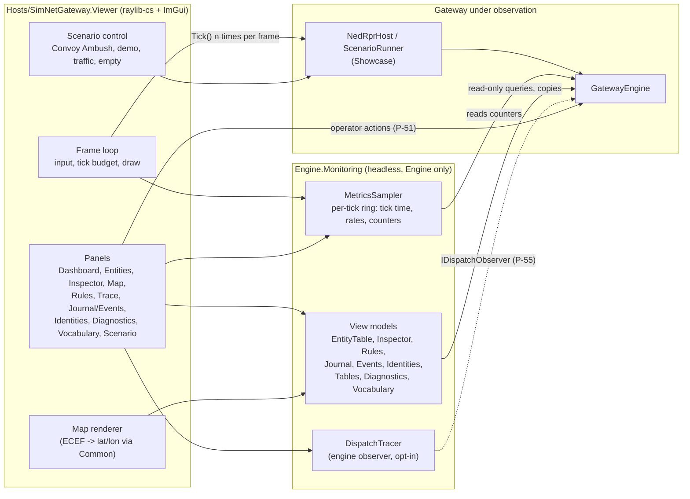
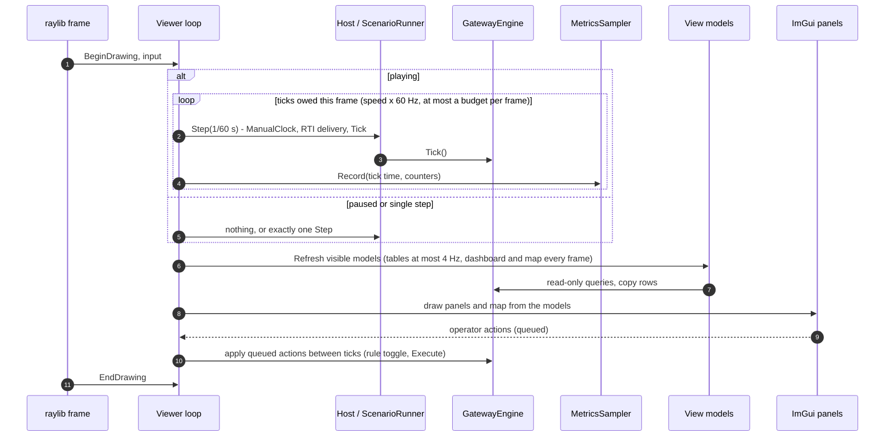
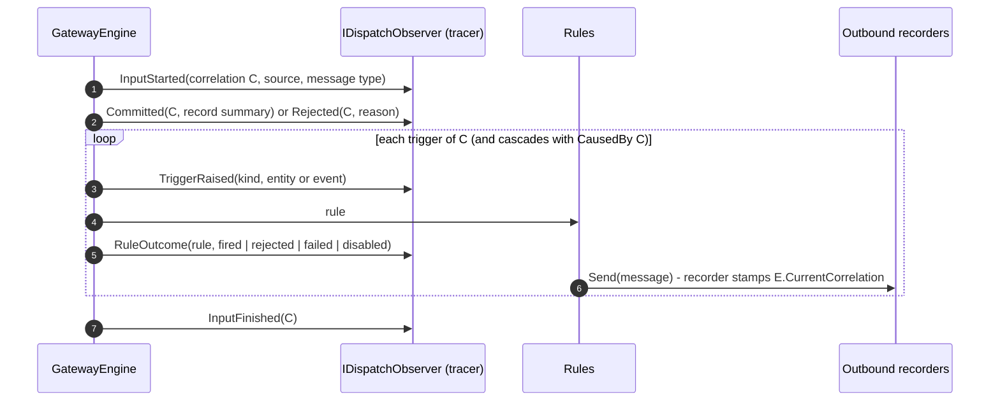
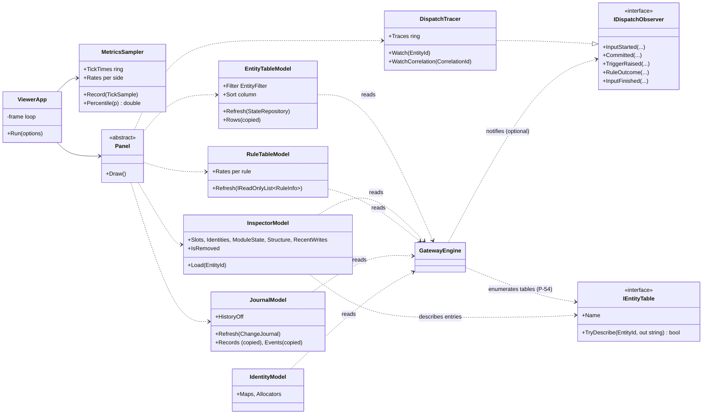

# DD-005: Gateway Monitor and Diagnostics Viewer

| | |
|---|---|
| **Status** | in review - proposals P-48 .. P-55 await the user |
| **Tasks** | T-007 (viewer; this design first) |
| **Rulings honoured** | R-002, R-006, R-012, R-018, R-030, R-033, R-038, R-046, R-049, R-053, R-063 .. R-067, R-070 |
| **Date** | 2026-10-24 |

## 1. Purpose

R-006 asks for an ImGui visualization of the repository with raylib-cs once the engine is proven (it is:
stages 1-7). The user's goal for it: **monitor and diagnose the operation of the gateway**. So the viewer
must answer two kinds of question:

- **Monitoring** - "what is the gateway doing right now": session, rates, tick time, entity counts per
  side, warnings, which rules fire.
- **Diagnosis** - "why": *why did entity X not reach RPR?* (its identities per side, the gateway's
  publication state for it, allocation failures), *why did rule R not fire?* (trigger matched, condition
  rejected, failed, disabled), *what did this input cause?* (correlation trace: input -> change set ->
  triggers -> rules -> outbound messages -> cascades), *where does the predicted position differ from
  the received one?* (map with error vectors).

Everything is generic over the engine (entities, attributes, rules, journal, identities, entity tables,
diagnostics); only the map and the scenario control know the NED-RPR gateway.

## 2. Block diagram



- The **viewer hosts the gateway in-process** (P-48): it builds a configuration through `NedRprHost`
  (or the `ScenarioRunner` for Convoy Ambush) exactly as the demo does, and calls `Tick()` from its frame
  loop - the single-threaded model of R-018 and DD-001 section 13; no locks, no second thread.
- **Engine.Monitoring** is a headless library over the engine's public read APIs (P-49). It turns engine
  state into **copied** view-model rows - never holding journal records, deltas or triggers across frames
  (R-038). It is fully testable without a GPU or display.
- **DispatchTracer** subscribes to an optional engine observer hook (P-55) to record, for chosen entities
  or correlations, which triggers were raised and what each rule did.
- **Panels** render view models with ImGui; the **map** draws entities with raylib 2D primitives.
- **Operator actions** are limited (P-51): viewer play/pause/step/speed, rule enable/disable (R-046),
  session commands through `Execute` with source `operator`, choosing a scenario.

## 3. Panels

| Panel | Monitoring content | Diagnosis content |
|---|---|---|
| **Dashboard** | session state/mode/scenario, sim and wall time, tick count; tick time sparkline with p50/p95/max; messages in per side and out per side per second; entities per origin; journal/event-log fill or "history off" (R-070) | counters of diagnostics (warnings, errors, transaction failures, cascade overflows, unhandled message types, events without subscriber) - each clickable into the Diagnostics panel |
| **Entities** | virtualised table of all entities (10k+): id, name, origin, owner, keys per identity map, last write / change / origin write, attribute count | filters: origin, has/lacks attribute, name text, changed/written within, not-origin-written within (stale candidates, R-068), known/unknown to a side's map, parent; sort by any column |
| **Inspector** | every attribute slot: value, source, correlation, wall/sim time, changed time, version | identities in every map (and "not known to RPR"); **module state** of every `EntityTable` for the entity (P-54 - e.g. the RPR publication state None/Pending/Bound, pending fields, last send); structure (parent, members via `ReferencedBy`); recent journal writes of this entity with old/new; a destroyed entity stays shown as "removed at t" with its last copy |
| **Map** | 2D lat/lon view, pan/zoom, entities coloured by origin, labels, formation links (parent -> members), selection by click | received position vs `Derived.PredictedPosition` with the error vector; static vs moving; highlight of stale candidates |
| **Rules** | all `RuleInfo`: module, name, trigger, enabled, fire count, condition rejects, failures, rate per second | enable/disable toggle (operator, R-046); filter "failed", "rejecting", "never fired"; jump to the rule's last failure in Diagnostics |
| **Trace** | - | for a selected entity or a picked correlation: the input (source, message type), the change set and its deltas, every trigger raised, every rule matched with its outcome (fired / condition rejected / failed / disabled), outbound messages sent while it was dispatched (stamped with the dispatching correlation), cascades with `CausedBy` (P-55) |
| **Journal / Events** | recent change sets (correlation, source, caused-by, entities) and recent events (type, source, payload) | drill-down into deltas (old/new, created/destroyed, owner changes); follow `CausedBy` chains; "history off" when capacity is 0 |
| **Identities** | every identity map: side, key type, bound count | allocators: range in use/free, pool in use / in quarantine / available (exhaustion explains "not published") |
| **Diagnostics** | recent entries, severity filter, text filter | link from an entry to its origin module, rule or entity where it can be resolved |
| **Vocabulary** | `Validate()` result and the schema dump with producers/consumers | warnings highlighted (consumed-never-produced etc.) |
| **Scenario** | choose: Convoy Ambush (with live S-* status and G-* violations), default demo, traffic generator (benchmark population, adjustable size), empty gateway | Convoy Ambush report: which condition failed at which tick, jump to that tick's trace |

## 4. Sequence diagrams

### 4.1 Frame loop



The engine runs on a fixed 60 Hz simulated step (`ManualClock`, as the showcase and benchmark), decoupled
from the render rate: speed x0.25 .. x8 changes how many steps a frame owes; a per-frame budget (e.g. 50 ms
of ticking) keeps the UI responsive when the gateway cannot keep up (the dashboard then shows "behind").
Viewer *Pause* stops ticking altogether (a debugger pause) and is distinct from the session's Pause command,
which the viewer can also send. Operator actions are applied between ticks, never during dispatch.

### 4.2 Diagnosing "why did entity X not reach RPR"

```mermaid
sequenceDiagram
    autonumber
    participant U as User
    participant P as Entities / Inspector
    participant M as InspectorModel
    participant E as Engine
    participant T as DispatchTracer

    U->>P: filter "not known to rpr.handle", select X
    P->>M: Load(X)
    M->>E: slots, identities per map, ReferencedBy, EntityTables (P-54)
    M-->>P: rows: no Identity.TypeTkb; RPR publication state None
    U->>P: "trace this entity"
    P->>T: Watch(X)
    Note over T,E: next inputs touching X are traced
    T-->>P: correlation C: RprEntityEgress/Flush rejected (condition: no type) ...
    U->>P: open Diagnostics - "ned id range exhausted" for X, or none
```

The answer is assembled from generic facts: which identity maps know the entity, which attributes are
present, what the module tables hold for it, and what the rules did when it changed.

### 4.3 Correlation trace (P-55)



The observer is **opt-in**: a null observer costs one branch per call site, so the engine's 0-byte steady
state (R-033) is unchanged when no viewer watches; the tracer filters to watched entities/correlations
and copies what it keeps into a bounded ring.

## 5. Class diagram



Models are plain classes with reusable row lists; panels only read models and enqueue actions.
`IEntityTable.TryDescribe` uses the entry struct's `ToString()` (record structs print their fields), so
module state becomes visible without the engine or the viewer knowing any module type.

## 6. Decisions and rejected alternatives

- In-process hosting - rejected for the PoC: attaching to a separate running gateway (needs a snapshot /
  event protocol and a transport; later, P-48).
- Headless monitoring library + thin rendering host - rejected: putting the models into the viewer project
  (untestable on the Linux VM without a display).
- Copying rows into models - rejected: holding records/deltas/triggers across frames (violates R-038,
  records are recycled; with the journal off they vanish right after dispatch, R-070).
- Opt-in dispatch observer - rejected: always-on tracing in the engine (costs every tick), or tracing by
  diffing journal records afterwards (misses rule outcomes and does not work with the journal off).
- Fixed-step simulated clock in the viewer - rejected: wall-clock ticking (non-reproducible, and the
  showcase depends on deterministic 60 Hz steps).
- Operator limited to rule toggles and session commands - rejected for the PoC: editing attributes or
  destroying entities from the UI (R-046 limits PoC reconfiguration to rule enable/disable).

## 7. Edge cases

- 10k+ entities: table virtualised (ImGui list clipper), filter/sort on a copied index at most 4 Hz; the map
  draws points in one batch and labels only when zoomed in.
- A selected entity is destroyed: the inspector keeps its last copy, marked "removed at t".
- Journal or event log off (R-070): those panels and journal-based parts of the inspector show "history off";
  the trace still works (observer, not journal).
- The gateway cannot keep up at the chosen speed: tick budget per frame, dashboard shows the backlog.
- Rule toggles that cannot take effect as expected are explained in a tooltip (DD-002 section 10: disabling
  `RprEntityEgress/Spatial` before an entity's first position prevents its registration).
- No display (Linux VM, CI): the viewer exits with a clear message; `--headless --frames N` runs the frame
  loop and models without raylib (smoke test).
- Native raylib missing on the platform: a startup check with a clear error (R-012 requires linux-x64 and
  win-x64 natives in the package).

## 8. Test plan

- **Engine.Monitoring** (new test project, headless, deterministic with the showcase or the traffic
  generator): every model equals a brute-force computation from the engine after every tick of a seeded
  run (entity rows and filters, inspector content incl. identities and module state, rule rates, journal
  copies, identity/allocator figures); models never hold engine objects after `Refresh` (records recycled
  with journal capacity 0 still leave models intact); sampler percentiles and rates exact on known input.
- **Dispatch observer**: the tracer's trace of a correlation equals the actual trigger and rule sequence (a
  probe module as reference) for ingress, processor cascades, events, session commands, aborted and rejected
  inputs; with no observer the engine's 0-byte round trip still holds; with the tracer watching nothing,
  allocations stay 0.
- **Viewer**: `--headless --frames N` runs Convoy Ambush through the frame loop with every model refreshed and
  ends with the same PASS report as the acceptance test; operator actions (rule toggle, Execute) applied
  between ticks only.
- Mutation checks per R-065 on models, sampler and tracer.

## 9. Proposals

| ID | Proposal (lean) | Main alternative |
|---|---|---|
| **P-48** | **Scope**: the viewer hosts the gateway in-process (scenarios: Convoy Ambush with live S-*/G-* status, the default demo, the benchmark traffic generator with adjustable size, an empty gateway) and ticks it from its frame loop on a fixed 60 Hz simulated step with play/pause/step/speed. Attaching to a separately running gateway is later work (own design: snapshot/event protocol). | Build the remote-attach protocol now. |
| **P-49** | **Projects**: `src/Engine/SimNetGateway.Engine.Monitoring` (engine-support layer, references only the engine; headless view models, sampler, tracer), `src/Hosts/SimNetGateway.Viewer` (raylib-cs + ImGui rendering, references Monitoring, Showcase, the gateway and Common), new test project `tests/SimNetGateway.Engine.Monitoring.Tests` (one test project per layer, R-053). | Everything in the viewer project. |
| **P-50** | **Packages**: `Raylib-cs` (ships raylib natives for linux-x64 and win-x64), `ImGui.NET` and `rlImgui-cs` (the raylib-ImGui bridge), exact versions pinned in `Directory.Packages.props` at implementation time after checking that the linux-x64 natives are included (R-012). | Silk.NET / Veldrid (larger, not what R-006 names). |
| **P-51** | **Operator actions** in the PoC: viewer play/pause/step/speed, rule enable/disable (R-046), session commands via `Execute` with source `operator`, choosing and restarting a scenario. No editing of attributes or entities from the UI. | Allow state edits (destroy entity, set attribute) as operator transactions. |
| **P-52** | **Panels and refresh policy** as in section 3; tables and inspector refresh at most 4 Hz, dashboard and map every frame; models copy rows, never keep engine objects across frames (R-038). | Refresh everything every frame. |
| **P-53** | **Testing without a display**: models, sampler and tracer tested headless; the viewer gets `--headless --frames N` (frame loop without raylib) used by a smoke test running Convoy Ambush; no GPU/screenshot tests in the suite. | Screenshot tests under a virtual X server. |
| **P-54** | **Module state visible generically**: `IEntityTable` gets `Name` and `TryDescribe(EntityId, out string)` (the entry's `ToString()`), and the engine exposes its entity tables read-only, so the inspector shows every module's per-entity state (e.g. RPR publication None/Pending/Bound) without knowing module types. Small engine addition. | Gateway-specific inspector code in the viewer reaching into module internals. |
| **P-55** | **Opt-in dispatch observer**: `GatewayOptions.DispatchObserver` (`IDispatchObserver`, null by default) notified of input start/finish, commit/reject, triggers raised and rule outcomes (fired / condition rejected / failed / disabled), plus `GatewayEngine.CurrentCorrelation` so outbound recorders can stamp the correlation that caused each message. Null observer = no behaviour or allocation change (tested). Powers the Trace panel. | Diagnose from the journal only (no rule outcomes, nothing when the journal is off). |
