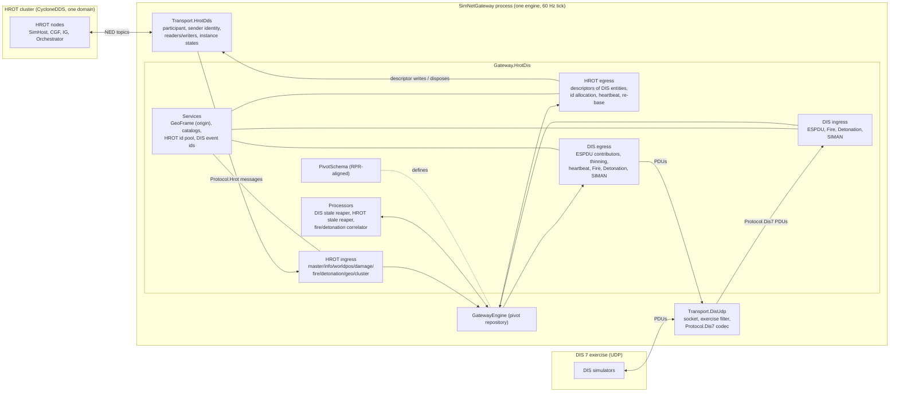
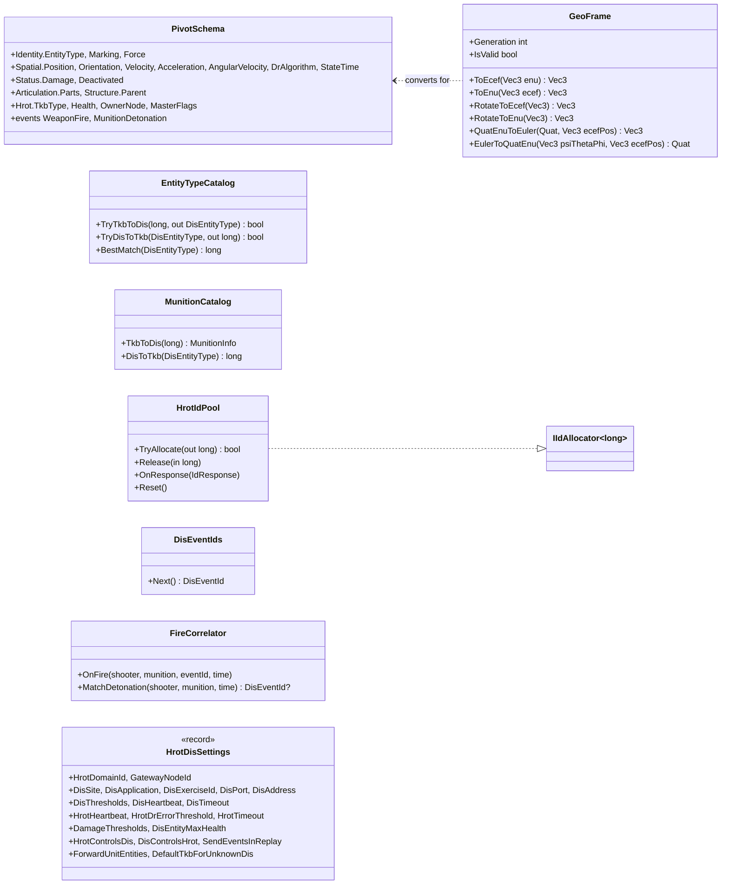
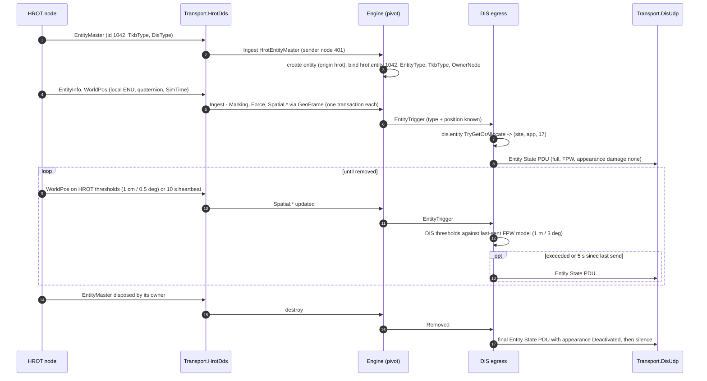
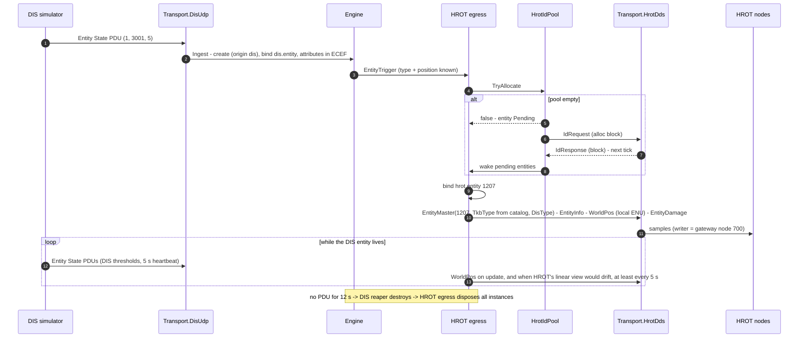
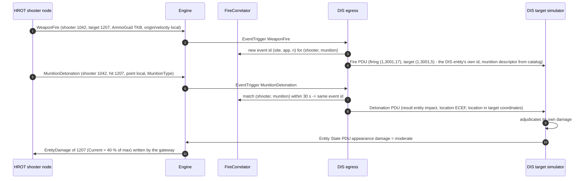
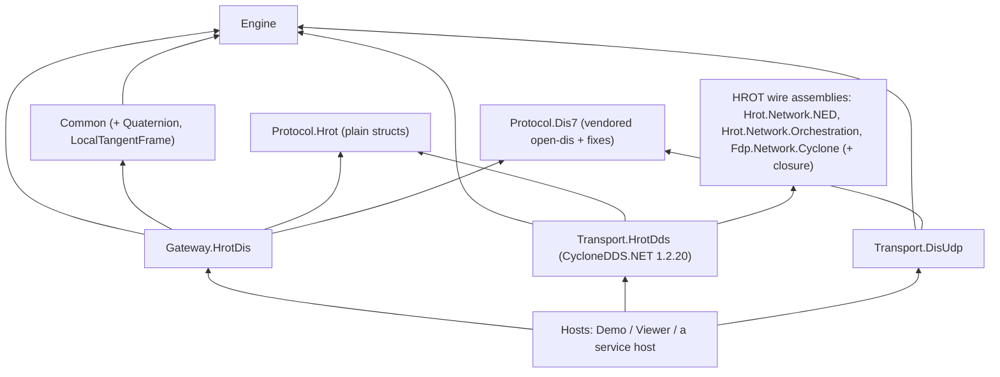

# DD-006: HROT <-> DIS 7 Gateway and its Intermediate Data Model

| | |
|---|---|
| **Status** | approved: P-56 .. P-67 are R-079 .. R-090 (P-59 changed by the user: reference HROT's assemblies); P-68 (how HROT is brought into the build) awaits the user |
| **Tasks** | T-018 (this design) |
| **Rulings honoured** | R-002, R-003, R-012, R-019 .. R-022, R-024, R-028, R-032 .. R-041, R-045, R-050 .. R-055, R-057 .. R-061, R-068 .. R-070 |
| **Inputs** | HROT `coordinator` branch: `docs/reference/NED_DDS_Protocol.md` (written for this gateway), `docs/reference/BDC_NED_SST_Descriptor_Rules.md`, the C# wire types of `Hrot.Network.NED`, `Hrot.Network.Orchestration`, `Fdp.Network.Cyclone`; open-dis-csharp `CSharpDis7` (DIS 7, IEEE 1278.1-2012), compiled and tested |
| **Date** | 2026-10-28 |

## 1. Purpose and scope

A gateway that makes a **HROT cluster** (its "NED" protocol over CycloneDDS) and a **DIS 7** exercise see each
other's entities and weapon effects, both ways, built on the SimNetGateway engine. It is the **precursor of an
HLA gateway** (Pitch pRTI, RPR FOM): the intermediate data model (the pivot, section 3) is therefore aligned with
the RPR FOM 2.0 object and interaction model, so that HLA later becomes a third side on the same pivot without
changing the HROT or DIS modules (section 10).

Translated (both directions unless stated):

| Concern | HROT | DIS 7 |
|---|---|---|
| Entity existence, type, marking, force | `EntityMaster` (+ dispose), `EntityInfo` | Entity State PDU (+ timeout / Deactivated appearance / Remove Entity) |
| Kinematics | `WorldPos` (local ENU, quaternion, velocity, angular velocity, sim-time stamp) | Entity State PDU location/orientation/velocity + DR parameters |
| Health / damage | `EntityDamage` (current / max HP) | Entity State PDU appearance damage bits |
| Turret articulation | `EntityTurretPose` | Entity State PDU articulated-part variable parameters (stage H4) |
| Fire | `WeaponFire` message | Fire PDU |
| Detonation | `MunitionDetonation` message | Detonation PDU |
| Simulation management | `ClusterStateTopic`, `ClusterOpRequest` (pause/resume), time advancing | Start/Resume, Stop/Freeze PDUs |

Not translated (section 9 gives the reasons): HROT missions/AI, navigation, perception/EQS, map/gizmo/UI,
animation (except later stance), weather, file transfer, cluster orchestration beyond pause/resume and the
session state; DIS emissions/IFF/radio/designator, collisions, logistics, minefields, environment PDUs, aggregates.

## 2. Block diagram



- **Transport.HrotDds** makes the gateway a NED node (`NED_DDS_Protocol.md` "What a gateway must do"): one
  participant on the configured domain, sender tracking `(domain id, gateway node id)` enabled before any writer,
  readers and writers with HROT's QoS, and instance-state reporting (alive / disposed / no writers). Its DDS
  threads only **enqueue** into an inbound channel (R-018); writes and disposes leave through an outbound channel.
  It maps DDS samples to the plain structs of **Protocol.Hrot** (R-050).
- **Transport.DisUdp** owns the UDP socket (broadcast or multicast, port 3000 default), filters the exercise id,
  splits datagrams into PDUs and decodes them with **Protocol.Dis7** (the vendored, fixed open-dis-csharp,
  section 7); it drops PDUs whose entity/event site and application are the gateway's own (looped-back echo).
- **Gateway.HrotDis** holds the pivot schema, the modules of both sides, processors and services. HROT and DIS
  vocabulary never meet: each side translates into and out of the pivot (DD-001 3.5).
- The **engine** is unchanged: entities, attributes, transactions, triggers, identities, queries, session.

## 3. The intermediate data model (pivot)

Principles: (1) **canonical frames and units of DIS/RPR** (ECEF metres, geocentric Euler radians, body-axis angular
velocity, DIS DR numbering, DIS enumerations) because both later outputs (DIS, HLA RPR) use them; (2) **side-specific
mirrors** where a side needs a value the other cannot carry (TKB type, HROT health precision, HROT owner node);
(3) **one entity per HROT entity id / DIS entity id**, relations as `EntityRef` attributes (DD-001 3.7); (4) names
follow RPR FOM 2.0 attribute names so an HLA side maps 1:1 (section 10).

### 3.1 Entity attributes (`PivotSchema` of `Gateway.HrotDis`)

| Attribute | Kind | Meaning, unit, frame | RPR FOM 2.0 counterpart | HROT source | DIS source |
|---|---|---|---|---|---|
| `Identity.EntityType` | Int | DIS entity type packed in 64 bits (kind 8, domain 8, country 16, category 8, subcategory 8, specific 8, extra 8) | `BaseEntity.EntityType` | `EntityMaster.DisType` when complete, else catalog(`TkbType`) | ESPDU `EntityType` |
| `Identity.Marking` | String | full name (DIS egress truncates to 11 ASCII characters) | `PhysicalEntity.Marking` | `EntityInfo.Name` | ESPDU `Marking` |
| `Identity.Force` | Int | DIS Force ID (0 other, 1 friendly, 2 opposing, 3 neutral) | `PhysicalEntity.ForceIdentifier` | `EntityInfo.ForceIdentifier` (same numbering) | ESPDU `ForceId` |
| `Spatial.Position` | Vec3 | ECEF metres; spatial index 1 km (R-056) | `Spatial.WorldLocation` | `WorldPos.Position` via the GeoFrame (section 5) | ESPDU `EntityLocation` |
| `Spatial.Orientation` | Vec3 | geocentric Euler psi, theta, phi (rad), DIS body axes x fwd, y right, z down | `Spatial.Orientation` | `WorldPos.OrientationXyz` (quaternion, local ENU) converted | ESPDU `EntityOrientation` |
| `Spatial.Velocity` | Vec3 | ECEF m/s | `Spatial.VelocityVector` | `WorldPos.Velocity` rotated | ESPDU `EntityLinearVelocity` |
| `Spatial.Acceleration` | Vec3 | ECEF m/s² (HROT: absent, 0) | `Spatial.AccelerationVector` | - | DR parameters |
| `Spatial.AngularVelocity` | Vec3 | body axes (DIS x fwd, y right, z down), rad/s | `Spatial.AngularVelocityVector` | `WorldPos.AngularVelocity` (ENU axes) rotated into the body | DR parameters |
| `Spatial.DrAlgorithm` | Int | DIS DR algorithm number (R-060); HROT entities: 2 (FPW) | `Spatial.DeadReckoningAlgorithm` | constant FPW | DR parameters |
| `Spatial.StateTime` | Double | gateway sim time at which the spatial values were valid | (time stamp) | `WorldPos.SimTime` mapped to gateway sim time | receipt time (or absolute DIS timestamp, P-64) |
| `Status.Damage` | Int | DIS damage state 0 none, 1 slight, 2 moderate, 3 destroyed | `PhysicalEntity.DamageState` | `EntityDamage` thresholds (P-62) | appearance bits |
| `Status.Deactivated` | Bool | entity announced as leaving (final ESPDU) | (object delete) | - | appearance "Deactivated" |
| `Articulation.Parts` | Object | immutable list of (part type, azimuth rad, elevation rad, rates) | `PhysicalEntity.ArticulatedParametersArray` | `EntityTurretPose` instances | ESPDU variable parameters (stage H4) |
| `Structure.Parent` | EntityRef (IndexReferences) | ORBAT superior | (aggregate relations, later) | `EntityInfo.CommanderId` | - |
| `Hrot.TkbType` | Int | HROT template id (mirror) | - | `EntityMaster.TkbType` | catalog(`EntityType`) |
| `Hrot.Health` | Vec3 | (current, max, 0) HP (mirror, keeps HROT precision) | - | `EntityDamage` | thresholds back (P-62) |
| `Hrot.OwnerNode` | Int | node id of the `EntityMaster` writer (diagnostics, echo) | - | sender identity | - |
| `Hrot.MasterFlags` | Int | `EntityMasterFlags` (Lightweight entities = replicated rounds) | - | `EntityMaster.Flags` | - |

Event types and payload attributes (RPR interactions):

| Event | Payload (`Event.*`) | RPR FOM 2.0 | HROT | DIS |
|---|---|---|---|---|
| `WeaponFire` | `Id` (Object: DIS event identifier), `Firing` (EntityRef), `Target` (EntityRef, optional), `MunitionEntity` (EntityRef, optional), `MunitionType` (Int, packed DIS type), `MunitionTkb` (Int mirror), `Warhead`, `Fuse`, `Quantity`, `Rate` (Int), `Location` (Vec3 ECEF), `Velocity` (Vec3 ECEF), `Range` (Double) | `WeaponFire` | `WeaponFire` message (`Refusal` 0 only) | Fire PDU |
| `MunitionDetonation` | `Id`, `Firing`, `Target`, `MunitionEntity`, `MunitionType`, `MunitionTkb`, `Warhead`, `Fuse`, `Quantity`, `Location` (ECEF), `RelativeLocation` (Vec3, target body coordinates), `Velocity`, `Result` (Int, DIS detonation result) | `MunitionDetonation` | `MunitionDetonation` message | Detonation PDU |

Session: the engine's session state machine (DD-001 5.3) mirrors the HROT cluster (P-64).

### 3.2 Identity maps

| Map | Key type | Allocator | Notes |
|---|---|---|---|
| `hrot.entity` | `long` (HROT entity id) | `HrotIdPool` - an `IIdAllocator<long>` fed by HROT's id allocator server in blocks (`IdRequest`/`IdResponse`), refilled at a low-water mark | ids restart at 1000 at a world reset: the map is emptied then (section 6.4) |
| `dis.entity` | `DisEntityId` (site, application, entity) | `MappedAllocator<DisEntityId>` over `NumberPool(1..65534, quarantine)` (Common) with the gateway's site/application | bound from the PDU for DIS-origin entities |
| `dis.event` | - | `DisEventIds` service: (site, application, counter) wrapping at 65535 | for events the gateway originates |

Sources: `hrot` (the whole HROT cluster is one side; the writing node is kept in `Hrot.OwnerNode`), `dis` (one
exercise; a later multi-exercise setup is one source per exercise, R-061), `proc.reaper.hrot`, `proc.reaper.dis`,
`proc.correlate`. Write authority: `SingleWriterPolicy` with the processors trusted (R-057).



## 4. HROT side

### 4.1 Being a NED node

1. **GeoReference first**: until a valid `GeoReference` (retained, keyless) with a known `ProtocolVersion` (1) and
   `Frame` 0 has arrived, the GeoFrame is invalid: HROT entities are created and typed but get no position, and
   the gateway publishes no `WorldPos` (a DIS entity waits in the pending state). A higher `Generation` re-bases
   (section 6.4).
2. **Node identity**: a configured gateway node id (default 700, outside HROT's subsystem ranges) or, when
   configured 0, a `NodeIdRequest` -> `NodeIdGrant`; sender tracking with `(domain id, node id)` is enabled before
   any writer exists (`NED_DDS_Protocol.md` §1). The gateway publishes `NodeHeartbeat` and `NodeCapabilities` so
   HROT sees a live node (subsystem name "SimNetGateway").
3. **Entity ids** for DIS entities from the HROT id allocator (`HrotIdPool`, P-60).
4. **Type safety**: every `TkbType` the gateway publishes must exist in the receivers' TKB (an unknown one skips
   the mandatory-descriptor gate, `NED_DDS_Protocol.md` step 3) - the catalog only maps to known templates, an
   unmapped DIS type uses `DefaultTkbForUnknownDis` and warns once.

### 4.2 HROT -> pivot (ingress)

| HROT input | Module | Effect |
|---|---|---|
| `EntityMaster` sample (alive) | `HrotMasterIngress` | resolve/create (origin `hrot`, bind `hrot.entity`); `Hrot.TkbType`, `Hrot.MasterFlags`, `Hrot.OwnerNode` (sender identity); `Identity.EntityType` from `DisType` when all of kind, domain, country, category are non-zero, else from the catalog |
| `EntityMaster` disposed by its owner | `HrotMasterIngress` | destroy (the only delete signal, §6 of the protocol); disposes by others ignored |
| `EntityMaster` not-alive-no-writers | `HrotMasterIngress` | owner gone: mark; HROT reclaims via heartbeats; the HROT stale reaper removes it if nothing is written for `HrotTimeout` |
| `EntityInfo` | `HrotInfoIngress` | `Identity.Marking`, `Identity.Force`, `Structure.Parent` (CommanderId, via `hrot.entity`; unresolved = absent, linked later) |
| `WorldPos` | `HrotWorldPosIngress` | position/velocity/angular velocity/orientation converted through the GeoFrame; `Spatial.DrAlgorithm` = FPW; `Spatial.StateTime` = mapped `SimTime` |
| `EntityDamage` | `HrotDamageIngress` | `Hrot.Health`; `Status.Damage` by thresholds |
| `EntityTurretPose` (stage H4) | `HrotTurretIngress` | `Articulation.Parts` |
| `WeaponFire` (`Refusal` 0) | `HrotFireIngress` | publish `WeaponFire`; munition via `MunitionCatalog`; positions/velocity converted |
| `MunitionDetonation` | `HrotDetonationIngress` | publish `MunitionDetonation`; `Result` = entity impact when `HitEntityId` resolves, else ground impact; `RelativeLocation` from the target's pose |
| `GeoReference` | `HrotGeoIngress` | GeoFrame update / re-base (6.4) |
| `ClusterStateTopic`, `NodeHeartbeat` of the master (`SimTickAdvancing`) | `HrotClusterIngress` | session commands (P-64) |
| `IdResponse` | `HrotIdIngress` | refills `HrotIdPool`; `Resp_Reset` -> world reset (6.4) |
| `OwnershipUpdate` naming a descriptor the gateway owns | `HrotOwnershipIngress` | stop writing that descriptor of that entity, warning (P-63) |

**Echo**: samples written by the gateway's own node, and messages with `SourceNodeId` = the gateway, are dropped
in the transport; an ingress that resolves an id to an entity of origin `dis` ignores the sample (R-022).
`EntityHitDamage` is not translated: DIS targets adjudicate their own damage from the Detonation PDU.

### 4.3 Pivot -> HROT (egress, entities of origin `dis`)

| Rule | Writes |
|---|---|
| `HrotEntityEgress/Introduce` when the entity has `Identity.EntityType` and a position, the GeoFrame is valid and an id is available (else Pending, like the RPR handle, DD-002 R-047 pattern) | `EntityMaster` (id, `TkbType` from the catalog, `DisType`, flags 0) -> `EntityInfo` (marking, force, commander 0) -> `WorldPos` -> `EntityDamage` |
| `HrotEntityEgress/Info` on marking/force change | `EntityInfo` |
| `HrotEntityEgress/Damage` on `Status.Damage` change | `EntityDamage` (`Current` = threshold value x `DisEntityMaxHealth`, `Max` = `DisEntityMaxHealth`) |
| `HrotWorldPosEgress/Update` on a new DIS state | `WorldPos` (local ENU, quaternion, velocities, `SimTime` = state time mapped to HROT sim time) |
| `HrotWorldPosEgress/Keep` (sliced timer, R-069) | re-send `WorldPos` when HROT's linear projection of the last sent sample differs from the DIS DR prediction by more than `HrotDrErrorThreshold` (default 0.5 m / 3 deg), and at least every `HrotHeartbeat` (default 5 s, below HROT's 10 s) |
| `HrotEntityEgress/Remove` on entity removed | dispose every instance written (master included) |
| `HrotFireEgress` on `WeaponFire` from `dis` | `WeaponFire` message (`SourceNodeId` = gateway, `RequestId` 0, `Refusal` 0, `AmmoGuid` from the catalog, `RoundEntityId` via `hrot.entity` when known) |
| `HrotDetonationEgress` on `MunitionDetonation` from `dis` | `MunitionDetonation` message |

HROT receivers project positions **linearly**, while DIS entities may use RVW or body-axis DR; the `Keep` rule
re-sends exactly when HROT's view would drift (P-61). Ownership: the gateway owns every descriptor it writes
(creator keeps everything; no `DeferredTakeOwnership` grants).

## 5. Kinematics conversions (Common + GeoFrame service)

- **Position**: `ECEF = ECEF(origin) + R · local`, `R` columns east, north, up at the origin (the formula given by
  the protocol reference, computed in double); inverse `local = Rᵀ · (ECEF − ECEF(origin))`.
- **Velocity, acceleration**: rotate by `R` / `Rᵀ`.
- **Orientation HROT -> DIS**: rebuild `q_local` (w = +sqrt(max(0, 1 − |v|²))); HROT body axes are x forward,
  y left, z up (FLU, from the ECS convention - **to be verified against HROT**, P-61) and DIS body axes x forward,
  y right, z down (FRD): `C_body_FRD->ECEF = R · C(q_local) · F` with `F = diag(1, −1, −1)`; then extract psi,
  theta, phi (ZYX) from `C` in ECEF (Common `Orientation` helpers, DD-001 15). Inverse for DIS -> HROT, then
  normalise `q` so `w >= 0` (all-zero = identity).
- **Angular velocity**: HROT ENU axes -> body FRD: `ω_body = Fᵀ · C(q_local)ᵀ · ω_enu`; inverse for HROT egress.
- **Time**: pivot `StateTime` for HROT samples = `WorldPos.SimTime` re-based to gateway sim time by a running
  offset (gateway sim time − HROT sim time, measured at receipt of the newest sample; jumps beyond 1 s reset it -
  replay seeks, world reset); HROT egress maps back with the same offset.
- **Precision**: HROT ECS positions are float32; the gateway computes in double; orientations near theta = ±90 deg
  (gimbal lock) are carried with phi = 0 (Common convention).

New in Common (vocabulary-free): `Quaternion` struct and conversions (quaternion <-> DCM <-> Euler), `LocalTangentFrame`
(origin + ENU <-> ECEF for points, vectors and rotations), body-axis flip helpers. `GeoFrame` (gateway service) owns
the current origin and generation.

## 6. Sequences

### 6.1 A HROT entity appears on DIS



HROT's fine thresholds would produce up to 60 Entity State PDUs per second per entity; the DIS egress therefore
applies **DIS's own thresholds** against the DR model it last sent (the standard DIS sender behaviour), and a 5 s
heartbeat with the position predicted to now (R-028).

### 6.2 A DIS entity appears in HROT (with id allocation)



### 6.3 Fire and detonation, HROT shooter at a DIS target



HROT carries no event id and no link from a detonation to its fire; the `FireCorrelator` reuses the fire's DIS
event id for the next detonation of the same shooter and munition within 30 s (FIFO), else allocates a new one.
The reverse (DIS fire at a HROT target) publishes HROT `WeaponFire` / `MunitionDetonation` messages; HROT's health
owner adjudicates and its `EntityDamage` change reaches DIS as appearance.

### 6.4 Origin change and world reset

```mermaid
sequenceDiagram
    autonumber
    participant M as HROT cluster master
    participant G as Gateway (HROT ingress / egress)
    participant E as Engine
    participant D as DIS

    M->>G: GeoReference Generation 2 (new terrain origin)
    G->>E: GeoFrame re-based (one engine transaction marking every DIS-origin entity)
    E->>G: HROT egress re-publishes WorldPos of every DIS entity in the new local frame
    Note over G,E: HROT entities' next WorldPos arrive in the new frame; their ECEF stays correct
    M->>G: ClusterState Unloading / IdResponse Resp_Reset (world boundary)
    G->>E: destroy every HROT-origin entity (DIS gets Deactivated PDUs), empty hrot.entity, reset HrotIdPool
    Note over G,E: DIS-origin entities stay; they are re-introduced to HROT with new ids (ids restart at 1000)
```

### 6.5 Pause and resume

```mermaid
sequenceDiagram
    autonumber
    participant H as HROT operator / master
    participant G as Gateway
    participant D as DIS exercise

    H->>G: master heartbeat SimTickAdvancing false (pause) / ClusterState OperatingLive
    G->>G: session Running -> Paused (sim time frozen; heartbeats continue with frozen predictions)
    opt HrotControlsDis (default on)
        G->>D: Stop/Freeze PDU (receiving entity = all, reason "recess")
    end
    H->>G: SimTickAdvancing true
    G->>G: Paused -> Running
    opt HrotControlsDis
        G->>D: Start/Resume PDU
    end
    D->>G: Stop/Freeze from a DIS manager
    opt DisControlsHrot (default off)
        G->>H: ClusterOpRequest PauseTime
    end
```

## 7. DIS side and the vendored open-dis-csharp

**Protocol.Dis7** = open-dis-csharp `CSharpDis7` (BSD-2, attribution kept) vendored as a protocol project
(references nothing, R-050) with the fixes the evaluation found necessary:

- the missing `DISnet.DataStreamUtilities` stream classes (taken from `CsharpDis6`, namespace adapted), always
  **big-endian**;
- the compile fixes (two global usings, four float literals);
- the **simulation-management duplicate-id bug** fixed (Create/Remove Entity, Start/Resume, Stop/Freeze,
  Acknowledge, Action Request ... marshal 12 bytes too many because both the inherited and the own
  originating/receiving ids are written) - sizes then match IEEE 1278.1-2012 (28/28/44/40/32/40);
- additions: `PduCodec` (dispatch by PDU type, several PDUs per datagram split by `Length`, malformed input
  reported as an error result - never the library's swallowed exception), `DisTimestamp` (relative and absolute
  encodings), `EntityAppearance` (platform/lifeform damage bits, Deactivated, frozen), `EntityMarkingText`
  (11-character ASCII), `ArticulatedPart` packing into `VariableParameter`.

DIS ingress: Entity State (create/update; Deactivated appearance = remove), Fire, Detonation, Remove Entity
(destroy), Start/Resume, Stop/Freeze (P-64); everything else is counted and ignored. DIS egress: the contributor
pattern of R-045 builds **one full Entity State PDU** per send (DIS has no partial update), with DIS thresholds,
5 s heartbeat, damage appearance, Deactivated on removal; Fire and Detonation from pivot events (not in Replay /
Review sessions unless `SendEventsInReplay`); Start/Resume, Stop/Freeze when `HrotControlsDis`.
The **DIS stale reaper** (Common, R-068) removes DIS entities silent for 12 s.

## 8. Projects



The layering of DD-003 holds unchanged: protocols reference nothing, the gateway references no transport, only hosts
assemble. **Transport.HrotDds references HROT's own wire assemblies** (R-082): the DDS types, topic names, and
HROT's wire codecs (`WorldPosCodec`, `EnuWire`, `QuaternionWireCodec`) come from HROT itself, so there is no copy to
drift and no conformance test against a copy. It is the **only** project that sees HROT: it decodes samples with
HROT's codecs into the Protocol.Hrot messages and encodes them back, so the engine, Common, Gateway.HrotDis and
their tests stay HROT-free and build anywhere (R-050). Protocol.Hrot is therefore not a copy of HROT's structs but
the gateway's decoded port contract: only the fields the translation uses, in decoded units (doubles, a unit
quaternion, sim seconds). New configuration `hrot-dis/default` (`HrotDisConfigurations`).

Caption: the diagram shows that the HROT dependency enters at one edge box only; everything the gateway's tests
need sits below it.

### 8.1 Bringing HROT into the build (P-68)

Measured on HROT `coordinator` at `34f249e`: `Hrot.Network.NED` pulls a closure of **22 projects**, all `net8.0`
or `netstandard2.0` (Hrot.Core, Hrot.Common, Hrot.Network.Orchestration, Fdp.Core (+ source generators),
Fdp.ModuleHost, Fdp.Toolkits (+ analyzers, Tkb source generator), Fdp.Toolkits.Spatial.Bepu, Fdp.Diagnostics.*,
Fdp.Network.Cyclone, Fbt/Fhsm kernels, GizmoMap.*, StructEdit.*, Hrot.Blueprints.Schema) and the packages
CycloneDDS.NET (HROT's `$(CycloneDdsNetVersion)`), NLog, K4os LZ4, BepuPhysics, Newtonsoft.Json,
CommandLineParser, Microsoft.Extensions.Logging. No Windows-only project is in it (R-012 holds). HROT does not use
central package management; its projects keep their own `Directory.Build.props` and `global.json` (8.0.408,
`latestFeature`) because MSBuild resolves those from each project's own folder.

Lean (P-68):
1. HROT is a **sibling checkout**, located by the MSBuild property `HrotRoot` (default `../hrot` relative to the
   repository root; overridable), pinned to a commit recorded in `hrot.ref`, checked by `scripts/hrot-check.sh`.
2. The HROT-dependent projects (`Transport.HrotDds`, its tests, the HROT host) are **not** in `SimNetGateway.sln`
   but in `SimNetGateway.Hrot.sln` (all of `SimNetGateway.sln` plus them), built by `scripts/build.sh --hrot` and
   tested by `scripts/test.sh --hrot`. The main solution and its suites keep building on a machine without HROT.
3. Architecture tests: the transport layer may reference projects outside `src/` only from an allow-list
   (`Hrot.*`, `Fdp.*`, `CycloneDDS.NET`), and only `SimNetGateway.Transport.HrotDds` may use it; every other
   project keeps the current rules.

Rejected: git submodule (clones all of HROT, including the Stride tree, into every checkout); HROT-built NuGet
packages (HROT publishes none today - a later option when it does); referencing prebuilt DLLs by path (stale-binary
risk, no source navigation).

## 9. Gaps, limits and decisions

| Gap | Decision |
|---|---|
| HROT has no DR algorithm/parameters, no acceleration | HROT entities are FPW to DIS; DIS entities are kept accurate in HROT by the drift-driven re-send (4.3) |
| No DIS entity id on the HROT wire; HROT ids repeat per world | two identity maps; DIS numbers from a quarantine pool; world reset empties `hrot.entity` |
| `DisType` optional / incomplete in HROT | use it when kind, domain, country and category are set, else the code catalog (R-054) |
| No damage state in HROT | thresholds on `Current/Max` (settings), reverse values per state |
| No event id, no fire<->detonation link, no detonation result, no warhead/fuse | gateway event ids, correlator, result from hit entity, warhead/fuse from the munition catalog (default "other") |
| HROT appearance bits (lights, smoke, stance ...) absent | appearance carries damage and Deactivated only; stance later from the animation topics |
| HROT unit entities (DIS kind 11, not SISO) | not sent to DIS unless `ForwardUnitEntities` |
| Collision, emissions, IFF, radio, designator, aggregates | not translated in either direction (nothing to map to in HROT; counted) |
| `ClusterOpRequest` JSON payload per operation undocumented | only `PauseTime` / `ResumeTime` (no payload) are sent; load/unload are observed, never commanded |
| Orientation body-axis convention is inferred | verified by a test against HROT's own HPR display before release (P-61) |
| CycloneDDS network configuration not documented | the host passes `CYCLONEDDS_URI` through; the gateway documents it as deployment configuration |

## 10. HLA readiness (Pitch pRTI, RPR FOM 2.0)

The pivot uses the RPR FOM's frames, enumerations and attribute names (3.1), so an HLA side is **a third set of
modules on the same pivot**: `Transport.PitchRti` (behind `IInboundChannel`/`IOutboundChannel`, the asynchronous
object registration message pattern of DD-002 B.1), and RPR ingress/egress modules derived from the existing
`Gateway.NedRpr` RPR modules (contributors, heartbeat, held events). HROT's per-descriptor ownership corresponds to
HLA attribute ownership; the pivot keeps one owner per entity today (R-057) - **attribute-group ownership** is the
expected extension when HLA ownership transfer is needed, in its own design.

## 11. Test plan

- **Protocol.Dis7**: golden byte vectors for every PDU used (sizes 144 / 96 / 104 / 28 / 44 / 40 ...), big-endian
  check, round trips, several PDUs in one datagram, malformed input -> error (never a silent half object);
  property test: random field values marshal -> unmarshal identical.
- **Common**: LocalTangentFrame against the protocol reference formula and an independent ECEF implementation;
  quaternion <-> Euler <-> DCM round trips over random attitudes (away from gimbal lock); body flip; HROT HPR
  cross-check vectors (P-61).
- **Gateway (in-memory channels)**: every row of 4.2, 4.3, 7 with the DD-002 invariants after every tick (G-1 echo,
  G-2 identity, G-4 received state not overwritten, G-5 outbound references valid, G-8 causality) plus new ones:
  the gateway writes only HROT descriptors it owns; every DIS-origin entity is re-sent to HROT within
  `HrotHeartbeat` and its HROT linear projection stays within `HrotDrErrorThreshold` of the DIS prediction; every
  HROT-origin entity is re-sent to DIS within 5 s; no PDU before the GeoFrame is valid; origin re-base and world
  reset sequences; replay suppression; session mapping; mutation checks (R-065).
- **Transports**: DDS loopback on a private domain (CycloneDDS.NET native on Linux), UDP loopback, exercise filter,
  own-echo filter; HrotDds codec round trips through HROT's own types and codecs (in `SimNetGateway.Hrot.sln`).
- **Showcase** "Border Crossing": a scripted HROT side (in-memory, protocol-accurate) and a scripted DIS side,
  acts covering appearance, movement with RVW DR, fire both ways, damage, pause, origin change, world reset.
- **Interop (manual, Windows)**: against a real HROT cluster and a DIS tool (e.g. Wireshark's DIS dissector).

## 12. Stages

| Stage | Content | Exit |
|---|---|---|
| H1 | Protocol.Dis7 (vendored + fixes + codec) and Protocol.Hrot; Common quaternion and local tangent frame | golden vectors, conversion properties |
| H2 | Gateway.HrotDis: schema, services, all modules, configuration; in-memory end-to-end tests | all gateway tests and invariants |
| H3 | Transport.DisUdp, Transport.HrotDds (references HROT's assemblies, P-68 build wiring), host wiring | loopback tests; manual run against HROT on the Windows machine |
| H4 | Showcase "Border Crossing", articulation, viewer map attributes | showcase PASS |

## 13. Proposals

| ID | Proposal (lean) | Main alternative |
|---|---|---|
| **P-56** | **Scope and topology**: a bidirectional HROT <-> DIS 7 gateway; the gateway is a full NED node (sender identity, node id 700 or granted, heartbeat and capabilities, id allocator client) and one DIS application (configured site, application, exercise id); translated set and exclusions as in section 1 and 9. | HROT -> DIS only (no DIS entities in HROT). |
| **P-57** | **Pivot data model** of section 3 as the intermediate model, RPR-FOM-aligned: ECEF, geocentric Euler, body-axis angular velocity, DIS DR numbering, packed DIS entity type, DIS damage state and force, plus HROT mirrors (`Hrot.TkbType`, `Hrot.Health`, `Hrot.OwnerNode`, `Hrot.MasterFlags`); events `WeaponFire` and `MunitionDetonation` with RPR payloads. | Store orientation as an ECEF quaternion (no gimbal lock, but needs a non-RPR 4-component value and conversion on both outputs). |
| **P-58** | **Protocol.Dis7** = vendored open-dis-csharp `CSharpDis7` with the stream classes, big-endian, compile fixes, the simulation-management duplicate-id fix, and a tested `PduCodec`, timestamp, appearance, marking and articulation helpers; contribute the fixes upstream later. **Protocol.Hrot** = plain structs of the HROT wire types used. | Write a small own DIS 7 marshaller for the PDUs needed and drop open-dis. |
| **P-59** | ~~Mirror types generated from HROT's IDL~~ **changed by the user (R-082)**: **Transport.HrotDds references HROT's own wire assemblies** (`Hrot.Network.NED`, `Hrot.Network.Orchestration`, `Fdp.Network.Cyclone`) and uses HROT's codecs; maps to Protocol.Hrot. **Transport.DisUdp** with broadcast/multicast, exercise and own-echo filters. | Mirror types generated from HROT's IDL (the original lean - a copy that can drift). |
| **P-60** | **Identities**: `hrot.entity` (long) fed by HROT's id allocator in blocks with pending introduction while empty; `dis.entity` from a site/application number pool with quarantine; gateway DIS event ids; fire<->detonation correlator (same shooter and munition within 30 s); world reset empties the HROT map and re-introduces DIS entities. | Ask HROT to create DIS entities with `CreateEntityRequest` (HROT allocates; but the creator node then owns them, not the gateway). |
| **P-61** | **Kinematics**: GeoFrame from `GeoReference` (refuse unknown version/frame, nothing positional before it, re-base on a new generation); quaternion FLU in ENU <-> DIS Euler FRD in ECEF; HROT -> DIS FPW with DIS thresholds (1 m / 3 deg) and 5 s heartbeat; DIS -> HROT re-send when HROT's linear projection drifts beyond 0.5 m / 3 deg and at least every 5 s; HROT sim time mapped by a running offset. **The FLU body convention is verified against HROT before release** (a test vector set from HROT's `OrientationDisplay`). | Forward HROT samples 1:1 to DIS (up to 60 PDUs/s per entity) and DIS states 1:1 to HROT (HROT drift with RVW entities). |
| **P-62** | **Damage and appearance**: HROT health fraction -> DIS damage (1.0 none, >= 0.5 slight, > 0 moderate, 0 destroyed; settings); DIS -> HROT health (100 / 75 / 40 / 0 % of `DisEntityMaxHealth` = 100); removal = final Entity State with Deactivated; DIS removal by Deactivated, Remove Entity PDU or 12 s timeout. | Map damage through `EntityPartDamage` levels. |
| **P-63** | **Ownership**: the gateway owns all descriptors of the DIS entities it introduces and never writes HROT-owned ones; an `OwnershipUpdate` moving one of its descriptors is obeyed (it stops writing it) with a warning; HROT `EntityHitDamage` on DIS entities is not applied (the DIS target adjudicates). | Refuse ownership changes of gateway-owned descriptors. |
| **P-64** | **Session and time**: the engine session mirrors HROT (`ClusterState` Loading -> Loaded, Operating + time advancing -> Running, not advancing -> Paused, Unloading/Idle -> Unload; Replay/Review -> Replay mode); `HrotControlsDis` (default on) sends Stop/Freeze and Start/Resume; `DisControlsHrot` (default off) maps DIS Stop/Freeze and Start/Resume to `ClusterOpRequest` PauseTime / ResumeTime; no fire/detonation to DIS in Replay/Review unless `SendEventsInReplay`; DIS timestamps relative, inbound state time = receipt time (absolute timestamps optional). | Let DIS control HROT by default. |
| **P-65** | **Catalogs in code** (R-054): TKB <-> DIS entity type table (prefer a complete `EntityMaster.DisType`), munition table (TKB <-> DIS munition type, warhead, fuse), `DefaultTkbForUnknownDis` with one warning per unknown type; unit entities (kind 11) not forwarded by default. | A JSON catalog file (contradicts R-054 for now). |
| **P-66** | **HLA readiness**: no HLA code now; the pivot and module structure keep a Pitch/RPR side a pure addition (section 10); attribute-group ownership deferred to the HLA design. | Design the HLA side now. |
| **P-67** | **Delivery in stages H1 - H4** (section 12) with the test plan of section 11; interop with a real HROT cluster on the Windows machine as a manual acceptance step. | One big stage. |
| **P-68** | **HROT in the build** (section 8.1): sibling checkout via `HrotRoot` pinned by `hrot.ref`; HROT-dependent projects only in `SimNetGateway.Hrot.sln` (`build.sh --hrot` / `test.sh --hrot`); architecture-test allow-list of external references for `Transport.HrotDds` only. Protocol.Hrot is the decoded port contract, not a copy of HROT's structs. | Git submodule; or let Gateway.HrotDis use HROT's types directly (drops Protocol.Hrot, but every gateway test then needs HROT). |

## 14. As-built notes

**H1, part 1 (T-019): `Protocol.Dis7` and the Common frame maths** (Protocol.Hrot is a separate, later part of H1).

- Layout: `src/Protocols/SimNetGateway.Protocol.Dis7/` - `Vendored/` (the 174 files of `CSharpDis7` at open-dis-csharp
  commit `681ba85`, namespace `DISnet`, plus `Vendored/Streams/` from `CsharpDis6`), own code in the project root
  (namespace `SimNetGateway.Protocol.Dis7`): `PduCodec`, `DisTimestamp`, `EntityAppearance`, `EntityMarkingText`,
  `ArticulatedPart`. `LICENSE` and `NOTICE.md` (list of all changes) sit beside the project file. The project has
  `Nullable` and `ImplicitUsings` disabled (the vendored code needs it); own files use `#nullable enable` and explicit
  usings. Tests: `tests/SimNetGateway.Protocol.Dis7.Tests` (new, mirrors the project as the architecture tests require).
- Duplicate-id fix: the duplicate `_originatingID` / `_receivingID` fields of the seven simulation-management PDUs that
  declared them (Create Entity, Remove Entity, Start/Resume, Stop/Freeze, Acknowledge, Action Request, Action Response)
  were removed; `OriginatingID` / `ReceivingID` stay as `[XmlIgnore]` aliases of the inherited
  `OriginatingEntityID` / `ReceivingEntityID`. The Reliable variants did not have the bug.
- Decoded PDU types: 1 Entity State, 2 Fire, 3 Detonation, 4 Collision, 11 .. 17 (Create, Remove, Start/Resume,
  Stop/Freeze, Acknowledge, Action Request, Action Response), 67 Entity State Update; everything else is reported
  Unsupported. **Deviation / limit found:** the vendored `VariableDatum` has no payload bytes (it marshals a fixed 16
  bytes), so it cannot carry the variable-length data of the standard; PDUs with variable datum records (Action
  Request / Response; Comment, Data, Set Data ... would be the same) are refused by the codec (error on decode,
  `ArgumentException` on encode) instead of being mis-framed, and Comment (22) is not decoded. Fixed datums work.
  Needed only if a later stage wants datum-carrying PDUs.
- `DataInputStream.Position` was added to the vendored stream (the PDU classes swallow read errors; the codec reads each
  PDU from an exactly sized slice and requires that all bytes were consumed and the computed size equals `Length`).
- Appearance: damage bits 3-4, smoke bits 5-6 (platforms), Frozen bit 21, State/Deactivated bit 23. Articulated part
  value: IEEE float in the first four bytes of the 8-byte field, last four bytes zero; parameter type = type class +
  metric (REF-010 values `ClassPrimaryTurret1` 4096, `ClassPrimaryGun1` 4416, `MetricAzimuth` 11, `MetricElevation` 13 -
  to be checked against SISO-REF-010 when H4 uses them).
- Common (`Geo/`): `Quaternion` (Hamilton, w first; DCM and ZYX Euler through the existing `Matrix3` / `Orientation`, so
  the gimbal-lock convention phi = 0 stays in one place), `LocalTangentFrame` (ENU basis built from the existing
  `NorthEastDown` columns: east = NED column 1, north = column 0, up = -column 2), `BodyAxes` (F = diag(1,-1,-1)),
  `LocalToGeocentricOrientation` (the composite of section 5 plus the vector-part quaternion and the angular velocity
  conversions), `Matrix3.Determinant()`. The composite takes the frame **at the HROT origin** (the flat-world
  assumption of section 5), not at the entity.
