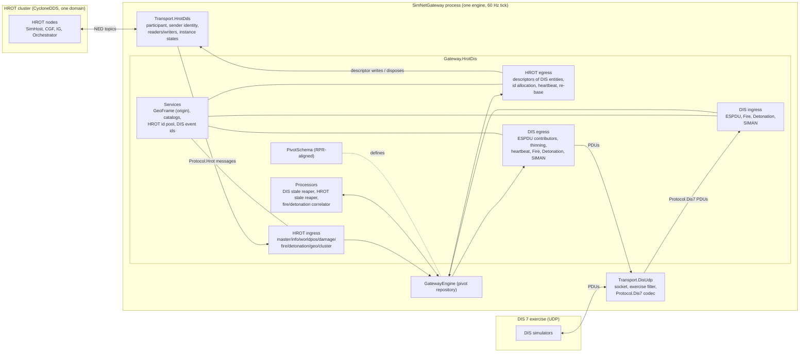
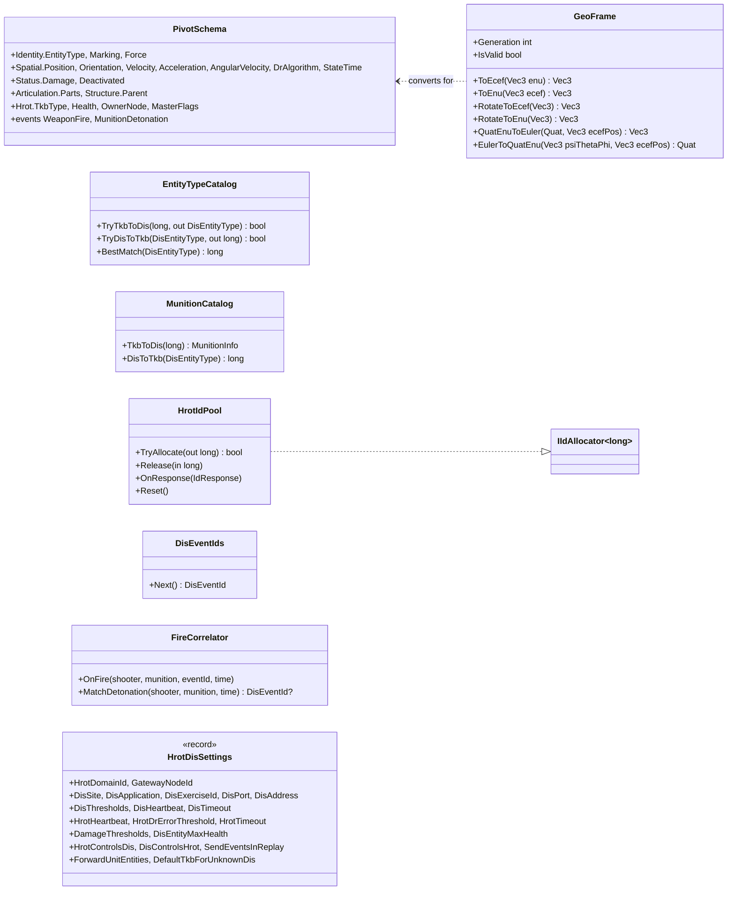
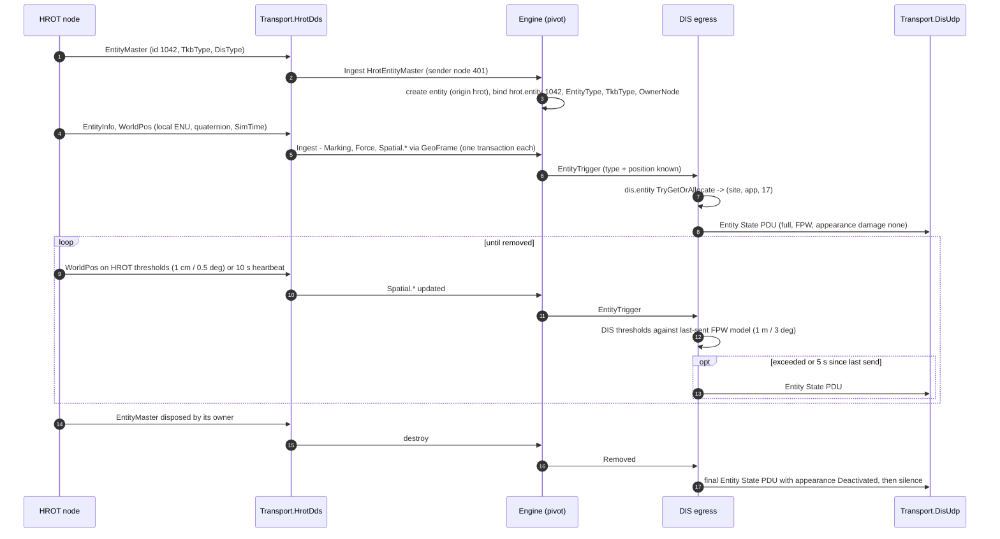
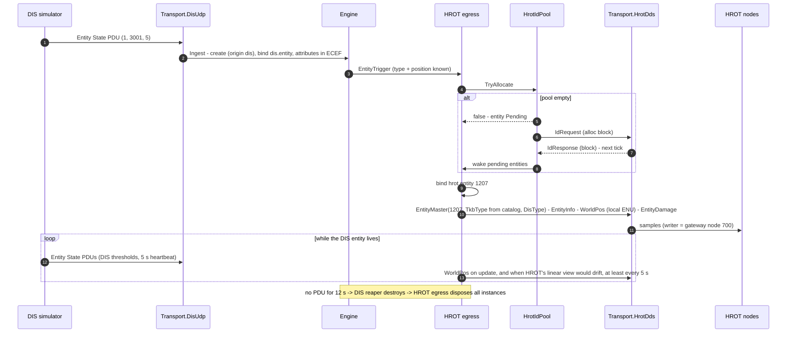
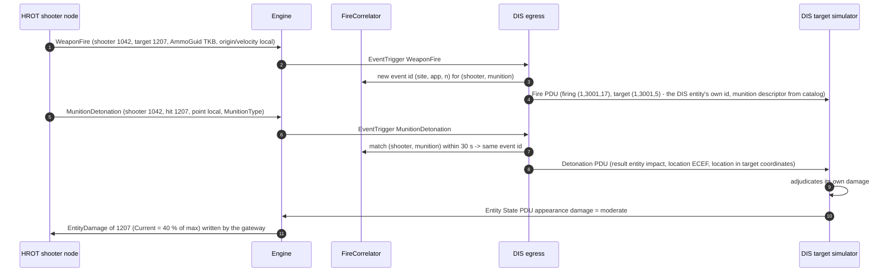
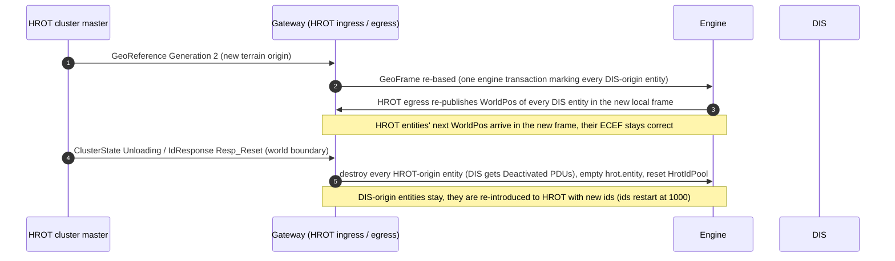
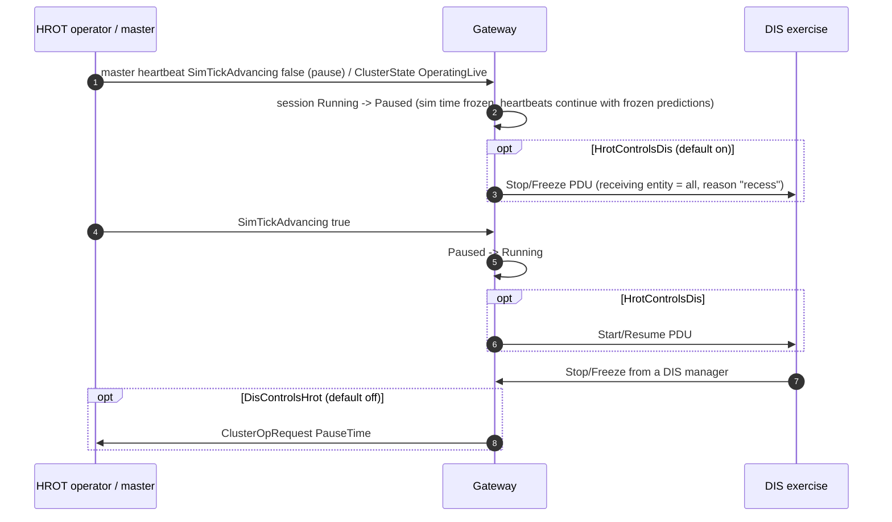
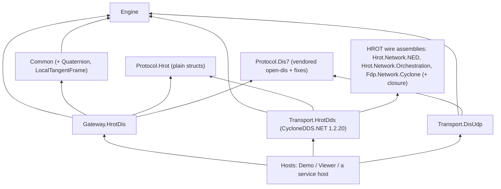

# DD-006: HROT <-> DIS 7 Gateway and its Intermediate Data Model

| | |
|---|---|
| **Status** | approved: P-56 .. P-67 are R-079 .. R-090; **revised by R-091** (the gateway runs in-process in the HROT editor as an ECS-level pack, vendored into HROT): section 0 says what that changes; the HROT side is designed in DD-007 (P-69 .. P-76 in review); P-68 withdrawn |
| **Tasks** | T-018 (this design) |
| **Rulings honoured** | R-002, R-003, R-012, R-019 .. R-022, R-024, R-028, R-032 .. R-041, R-045, R-050 .. R-055, R-057 .. R-061, R-068 .. R-070 |
| **Inputs** | HROT `coordinator` branch: `docs/reference/NED_DDS_Protocol.md` (written for this gateway), `docs/reference/BDC_NED_SST_Descriptor_Rules.md`, the C# wire types of `Hrot.Network.NED`, `Hrot.Network.Orchestration`, `Fdp.Network.Cyclone`; open-dis-csharp `CSharpDis7` (DIS 7, IEEE 1278.1-2012), compiled and tested |
| **Date** | 2026-10-28 |

## 0. Revision 2 - the gateway in-process in the HROT editor (R-091)

The user ruled: *"let's vendored into HROT with ECS-level adapter and reusing HROT stuff, best as separate
installable HROT module pluggable into HROT editor node (i.e. grateway+adapters not being a separate HROT node at
all)"* (R-091). The HROT side is now **DD-007** (the pack). What it changes here:

| Section of this document | Status |
|---|---|
| 1 scope, 3 pivot, 5 conversions (ENU <-> ECEF, quaternion <-> Euler), 7 DIS side, 10 HLA readiness | **unchanged** |
| 2 block diagram - the HROT half ("Transport.HrotDds", NED topics) | **superseded** by DD-007 section 2; the gateway's HROT ports carry `Protocol.Hrot` messages over in-memory channels to the pack |
| 3.2 `hrot.entity` allocator `HrotIdPool` (IdRequest / IdResponse) | **superseded**: an `IIdAllocator<long>` port, implemented in the pack over `HrotNodeContext.IdAllocator` (DD-007 3.3) |
| 4.1 being a NED node (GeoReference topic, node id, heartbeat, capabilities) | **superseded**: HROT services (DD-007 3.8) |
| 4.2 / 4.3 HROT ingress / egress over NED descriptors | **superseded** by the `Protocol.Hrot` contract below; the pivot effects of each row stay the same |
| 4.3 `HrotWorldPosEgress/Keep` re-send rule (0.5 m / 3 deg / 5 s) | **dropped**: the gateway sends a replica state only on a new DIS state; the pack poses per frame (DD-007 3.4) |
| `OwnershipUpdate` handling (P-63 / R-086) | **dropped**: replicas are owned by a reserved DIS owner id (DD-007 3.2) |
| 6.2 DIS entity appears in HROT (id allocation sequence) | **superseded** by DD-007 5.2 |
| 8 projects: `Transport.HrotDds`; 8.1 / P-68 (HROT in our build) | **dropped / withdrawn**: no project here references HROT; HROT vendors ours (DD-007 P-69) |
| 3.2 `HrotDisSettings` (one hardcoded record) | **superseded by R-094**: `GatewayConfiguration` read from `simnetgateway.json`, sections `shared` / `hrot` / `dis` / `hla` (DD-007 section 3a) |
| 12 stages: H3 "Transport.HrotDds" | H3 = `Transport.DisUdp` + vendorability; **H5 = the HROT pack, in HROT** |

**`Protocol.Hrot` is the gateway <-> pack contract** (BCL-only, upstream, tested here without HROT). Units: local
ENU metres (double), HROT body quaternion (x, y, z, w) in ENU, m/s, rad/s, HROT sim seconds.

| Direction | Message | Fields |
|---|---|---|
| pack -> gateway | `HrotOrigin` | lat, lon, alt (deg, deg, m), `Generation` |
| | `HrotSession` | `ClusterPhase` (Idle, Edit, Preview, Live, Replay, Review, Degraded), `Advancing`, `TimeScale`, `SimTime` |
| | `HrotEntityState` | `Id`, `TkbType`, `DisType` (packed, 0 = none), `Marking`, `Force` (HROT `ForceId`), `CommanderId`, `Position`, `Rotation`, `Velocity`, `AngularVelocity`, `HealthCurrent`, `HealthMax`, `SimTime` (a full snapshot) |
| | `HrotEntityRemoved` | `Id` |
| | `HrotTurretPose` (H4) | `Id`, `PartId`, `Azimuth`, `Elevation` |
| | `HrotFire` | `ShooterId`, `TargetId` (0 = none), `MunitionTkb`, `MunitionDisType`, `Origin`, `Velocity`, `Quantity` |
| | `HrotDetonation` | `ShooterId`, `TargetId` (0 = ground), `MunitionTkb`, `MunitionDisType`, `Location`, `Velocity` |
| gateway -> pack | `ReplicaState` | `Id`, `TkbType`, `DisType`, `Marking`, `Force`, DR snapshot (`Position`, `Velocity`, `Acceleration`, `Rotation`, `AngularVelocity`, `DrAlgorithm`, `StateTime`), `HealthCurrent`, `HealthMax`, `Deactivated` |
| | `ReplicaRemoved` | `Id` |
| | `InjectFire` / `InjectDetonation` | as `HrotFire` / `HrotDetonation`, plus `TargetIsHrot` |
| | `TimeRequest` | `Pause` / `Resume` (only with `DisControlsHrot`) |

## 1. Purpose and scope

A gateway that makes a **HROT cluster** (its "NED" protocol over CycloneDDS) and a **DIS 7** exercise see each
other's entities and weapon effects, both ways, built on the SimNetGateway engine. It is the **precursor of an
HLA gateway** (Pitch pRTI, RPR FOM): the intermediate data model (the pivot, section 3) is therefore aligned with
the RPR FOM 2.0 object and interaction model, so that HLA later becomes a third side on the same pivot without
changing the HROT or DIS modules (section 10).

Translated (both directions unless stated):

| Concern | HROT | DIS 7 |
|---|---|---|
| Entity existence, type, marking, force | `EntityMaster` (+ dispose), `EntityInfo` | Entity State PDU (+ timeout / Deactivated appearance / Remove Entity) |
| Kinematics | `WorldPos` (local ENU, quaternion, velocity, angular velocity, sim-time stamp) | Entity State PDU location/orientation/velocity + DR parameters |
| Health / damage | `EntityDamage` (current / max HP) | Entity State PDU appearance damage bits |
| Turret articulation | `EntityTurretPose` | Entity State PDU articulated-part variable parameters (stage H4) |
| Fire | `WeaponFire` message | Fire PDU |
| Detonation | `MunitionDetonation` message | Detonation PDU |
| Simulation management | `ClusterStateTopic`, `ClusterOpRequest` (pause/resume), time advancing | Start/Resume, Stop/Freeze PDUs |

Not translated (section 9 gives the reasons): HROT missions/AI, navigation, perception/EQS, map/gizmo/UI,
animation (except later stance), weather, file transfer, cluster orchestration beyond pause/resume and the
session state; DIS emissions/IFF/radio/designator, collisions, logistics, minefields, environment PDUs, aggregates.

## 2. Block diagram

- **Transport.HrotDds** makes the gateway a NED node (`NED_DDS_Protocol.md` "What a gateway must do"): one
  participant on the configured domain, sender tracking `(domain id, gateway node id)` enabled before any writer,
  readers and writers with HROT's QoS, and instance-state reporting (alive / disposed / no writers). Its DDS
  threads only **enqueue** into an inbound channel (R-018); writes and disposes leave through an outbound channel.
  It maps DDS samples to the plain structs of **Protocol.Hrot** (R-050).
- **Transport.DisUdp** owns the UDP socket (broadcast or multicast, port 3000 default), filters the exercise id,
  splits datagrams into PDUs and decodes them with **Protocol.Dis7** (the vendored, fixed open-dis-csharp,
  section 7); it drops PDUs whose entity/event site and application are the gateway's own (looped-back echo).
- **Gateway.HrotDis** holds the pivot schema, the modules of both sides, processors and services. HROT and DIS
  vocabulary never meet: each side translates into and out of the pivot (DD-001 3.5).
- The **engine** is unchanged: entities, attributes, transactions, triggers, identities, queries, session.

## 3. The intermediate data model (pivot)

Principles: (1) **canonical frames and units of DIS/RPR** (ECEF metres, geocentric Euler radians, body-axis angular
velocity, DIS DR numbering, DIS enumerations) because both later outputs (DIS, HLA RPR) use them; (2) **side-specific
mirrors** where a side needs a value the other cannot carry (TKB type, HROT health precision, HROT owner node);
(3) **one entity per HROT entity id / DIS entity id**, relations as `EntityRef` attributes (DD-001 3.7); (4) names
follow RPR FOM 2.0 attribute names so an HLA side maps 1:1 (section 10).

### 3.1 Entity attributes (`PivotSchema` of `Gateway.HrotDis`)

| Attribute | Kind | Meaning, unit, frame | RPR FOM 2.0 counterpart | HROT source | DIS source |
|---|---|---|---|---|---|
| `Identity.EntityType` | Int | DIS entity type packed in 64 bits (kind 8, domain 8, country 16, category 8, subcategory 8, specific 8, extra 8) | `BaseEntity.EntityType` | `EntityMaster.DisType` when complete, else catalog(`TkbType`) | ESPDU `EntityType` |
| `Identity.Marking` | String | full name (DIS egress truncates to 11 ASCII characters) | `PhysicalEntity.Marking` | `EntityInfo.Name` | ESPDU `Marking` |
| `Identity.Force` | Int | DIS Force ID (0 other, 1 friendly, 2 opposing, 3 neutral) | `PhysicalEntity.ForceIdentifier` | `EntityInfo.ForceIdentifier` (same numbering) | ESPDU `ForceId` |
| `Spatial.Position` | Vec3 | ECEF metres; spatial index 1 km (R-056) | `Spatial.WorldLocation` | `WorldPos.Position` via the GeoFrame (section 5) | ESPDU `EntityLocation` |
| `Spatial.Orientation` | Vec3 | geocentric Euler psi, theta, phi (rad), DIS body axes x fwd, y right, z down | `Spatial.Orientation` | `WorldPos.OrientationXyz` (quaternion, local ENU) converted | ESPDU `EntityOrientation` |
| `Spatial.Velocity` | Vec3 | ECEF m/s | `Spatial.VelocityVector` | `WorldPos.Velocity` rotated | ESPDU `EntityLinearVelocity` |
| `Spatial.Acceleration` | Vec3 | ECEF m/s² (HROT: absent, 0) | `Spatial.AccelerationVector` | - | DR parameters |
| `Spatial.AngularVelocity` | Vec3 | body axes (DIS x fwd, y right, z down), rad/s | `Spatial.AngularVelocityVector` | `WorldPos.AngularVelocity` (ENU axes) rotated into the body | DR parameters |
| `Spatial.DrAlgorithm` | Int | DIS DR algorithm number (R-060); HROT entities: 2 (FPW) | `Spatial.DeadReckoningAlgorithm` | constant FPW | DR parameters |
| `Spatial.StateTime` | Double | time on the gateway engine clock (monotonic wall time, the one time axis of the pivot) at which the spatial values were valid | (time stamp) | the engine clock at ingress (the pack gathers the state in the frame it is valid; `SimTime` is not used) | receipt time (or absolute DIS timestamp, P-64) |
| `Status.Damage` | Int | DIS damage state 0 none, 1 slight, 2 moderate, 3 destroyed | `PhysicalEntity.DamageState` | `EntityDamage` thresholds (P-62) | appearance bits |
| `Status.Deactivated` | Bool | entity announced as leaving (final ESPDU) | (object delete) | - | appearance "Deactivated" |
| `Articulation.Parts` | Object | immutable list of (part type, azimuth rad, elevation rad, rates) | `PhysicalEntity.ArticulatedParametersArray` | `EntityTurretPose` instances | ESPDU variable parameters (stage H4) |
| `Structure.Parent` | EntityRef (IndexReferences) | ORBAT superior | (aggregate relations, later) | `EntityInfo.CommanderId` | - |
| `Hrot.TkbType` | Int | HROT template id (mirror) | - | `EntityMaster.TkbType` | catalog(`EntityType`) |
| `Hrot.Health` | Vec3 | (current, max, 0) HP (mirror, keeps HROT precision) | - | `EntityDamage` | thresholds back (P-62) |
| `Hrot.OwnerNode` | Int | node id of the `EntityMaster` writer (diagnostics, echo) | - | sender identity | - |
| `Hrot.MasterFlags` | Int | `EntityMasterFlags` (Lightweight entities = replicated rounds) | - | `EntityMaster.Flags` | - |

Event types and payload attributes (RPR interactions):

| Event | Payload (`Event.*`) | RPR FOM 2.0 | HROT | DIS |
|---|---|---|---|---|
| `WeaponFire` | `Id` (Object: DIS event identifier), `Firing` (EntityRef), `Target` (EntityRef, optional), `MunitionEntity` (EntityRef, optional), `MunitionType` (Int, packed DIS type), `MunitionTkb` (Int mirror), `Warhead`, `Fuse`, `Quantity`, `Rate` (Int), `Location` (Vec3 ECEF), `Velocity` (Vec3 ECEF), `Range` (Double) | `WeaponFire` | `WeaponFire` message (`Refusal` 0 only) | Fire PDU |
| `MunitionDetonation` | `Id`, `Firing`, `Target`, `MunitionEntity`, `MunitionType`, `MunitionTkb`, `Warhead`, `Fuse`, `Quantity`, `Location` (ECEF), `RelativeLocation` (Vec3, target body coordinates), `Velocity`, `Result` (Int, DIS detonation result) | `MunitionDetonation` | `MunitionDetonation` message | Detonation PDU |

Session: the engine's session state machine (DD-001 5.3) mirrors the HROT cluster (P-64).

### 3.2 Identity maps

| Map | Key type | Allocator | Notes |
|---|---|---|---|
| `hrot.entity` | `long` (HROT entity id) | `HrotIdPool` - an `IIdAllocator<long>` fed by HROT's id allocator server in blocks (`IdRequest`/`IdResponse`), refilled at a low-water mark | ids restart at 1000 at a world reset: the map is emptied then (section 6.4) |
| `dis.entity` | `DisEntityId` (site, application, entity) | `MappedAllocator<DisEntityId>` over `NumberPool(1..65534, quarantine)` (Common) with the gateway's site/application | bound from the PDU for DIS-origin entities |
| `dis.event` | - | `DisEventIds` service: (site, application, counter) wrapping at 65535 | for events the gateway originates |

Sources: `hrot` (the whole HROT cluster is one side; the writing node is kept in `Hrot.OwnerNode`), `dis` (one
exercise; a later multi-exercise setup is one source per exercise, R-061), `proc.reaper.hrot`, `proc.reaper.dis`,
`proc.correlate`. Write authority: `SingleWriterPolicy` with the processors trusted (R-057).

## 4. HROT side

### 4.1 Being a NED node

1. **GeoReference first**: until a valid `GeoReference` (retained, keyless) with a known `ProtocolVersion` (1) and
   `Frame` 0 has arrived, the GeoFrame is invalid: HROT entities are created and typed but get no position, and
   the gateway publishes no `WorldPos` (a DIS entity waits in the pending state). A higher `Generation` re-bases
   (section 6.4).
2. **Node identity**: a configured gateway node id (default 700, outside HROT's subsystem ranges) or, when
   configured 0, a `NodeIdRequest` -> `NodeIdGrant`; sender tracking with `(domain id, node id)` is enabled before
   any writer exists (`NED_DDS_Protocol.md` §1). The gateway publishes `NodeHeartbeat` and `NodeCapabilities` so
   HROT sees a live node (subsystem name "SimNetGateway").
3. **Entity ids** for DIS entities from the HROT id allocator (`HrotIdPool`, P-60).
4. **Type safety**: every `TkbType` the gateway publishes must exist in the receivers' TKB (an unknown one skips
   the mandatory-descriptor gate, `NED_DDS_Protocol.md` step 3) - the catalog only maps to known templates, an
   unmapped DIS type uses `DefaultTkbForUnknownDis` and warns once.

### 4.2 HROT -> pivot (ingress)

| HROT input | Module | Effect |
|---|---|---|
| `EntityMaster` sample (alive) | `HrotMasterIngress` | resolve/create (origin `hrot`, bind `hrot.entity`); `Hrot.TkbType`, `Hrot.MasterFlags`, `Hrot.OwnerNode` (sender identity); `Identity.EntityType` from `DisType` when all of kind, domain, country, category are non-zero, else from the catalog |
| `EntityMaster` disposed by its owner | `HrotMasterIngress` | destroy (the only delete signal, §6 of the protocol); disposes by others ignored |
| `EntityMaster` not-alive-no-writers | `HrotMasterIngress` | owner gone: mark; HROT reclaims via heartbeats; the HROT stale reaper removes it if nothing is written for `HrotTimeout` |
| `EntityInfo` | `HrotInfoIngress` | `Identity.Marking`, `Identity.Force`, `Structure.Parent` (CommanderId, via `hrot.entity`; unresolved = absent, linked later) |
| `WorldPos` | `HrotWorldPosIngress` | position/velocity/angular velocity/orientation converted through the GeoFrame; `Spatial.DrAlgorithm` = FPW; `Spatial.StateTime` = mapped `SimTime` |
| `EntityDamage` | `HrotDamageIngress` | `Hrot.Health`; `Status.Damage` by thresholds |
| `EntityTurretPose` (stage H4) | `HrotTurretIngress` | `Articulation.Parts` |
| `WeaponFire` (`Refusal` 0) | `HrotFireIngress` | publish `WeaponFire`; munition via `MunitionCatalog`; positions/velocity converted |
| `MunitionDetonation` | `HrotDetonationIngress` | publish `MunitionDetonation`; `Result` = entity impact when `HitEntityId` resolves, else ground impact; `RelativeLocation` from the target's pose |
| `GeoReference` | `HrotGeoIngress` | GeoFrame update / re-base (6.4) |
| `ClusterStateTopic`, `NodeHeartbeat` of the master (`SimTickAdvancing`) | `HrotClusterIngress` | session commands (P-64) |
| `IdResponse` | `HrotIdIngress` | refills `HrotIdPool`; `Resp_Reset` -> world reset (6.4) |
| `OwnershipUpdate` naming a descriptor the gateway owns | `HrotOwnershipIngress` | stop writing that descriptor of that entity, warning (P-63) |

**Echo**: samples written by the gateway's own node, and messages with `SourceNodeId` = the gateway, are dropped
in the transport; an ingress that resolves an id to an entity of origin `dis` ignores the sample (R-022).
`EntityHitDamage` is not translated: DIS targets adjudicate their own damage from the Detonation PDU.

### 4.3 Pivot -> HROT (egress, entities of origin `dis`)

| Rule | Writes |
|---|---|
| `HrotEntityEgress/Introduce` when the entity has `Identity.EntityType` and a position, the GeoFrame is valid and an id is available (else Pending, like the RPR handle, DD-002 R-047 pattern) | `EntityMaster` (id, `TkbType` from the catalog, `DisType`, flags 0) -> `EntityInfo` (marking, force, commander 0) -> `WorldPos` -> `EntityDamage` |
| `HrotEntityEgress/Info` on marking/force change | `EntityInfo` |
| `HrotEntityEgress/Damage` on `Status.Damage` change | `EntityDamage` (`Current` = threshold value x `DisEntityMaxHealth`, `Max` = `DisEntityMaxHealth`) |
| `HrotWorldPosEgress/Update` on a new DIS state | `WorldPos` (local ENU, quaternion, velocities, `SimTime` = state time mapped to HROT sim time) |
| `HrotWorldPosEgress/Keep` (sliced timer, R-069) | re-send `WorldPos` when HROT's linear projection of the last sent sample differs from the DIS DR prediction by more than `HrotDrErrorThreshold` (default 0.5 m / 3 deg), and at least every `HrotHeartbeat` (default 5 s, below HROT's 10 s) |
| `HrotEntityEgress/Remove` on entity removed | dispose every instance written (master included) |
| `HrotFireEgress` on `WeaponFire` from `dis` | `WeaponFire` message (`SourceNodeId` = gateway, `RequestId` 0, `Refusal` 0, `AmmoGuid` from the catalog, `RoundEntityId` via `hrot.entity` when known) |
| `HrotDetonationEgress` on `MunitionDetonation` from `dis` | `MunitionDetonation` message |

HROT receivers project positions **linearly**, while DIS entities may use RVW or body-axis DR; the `Keep` rule
re-sends exactly when HROT's view would drift (P-61). Ownership: the gateway owns every descriptor it writes
(creator keeps everything; no `DeferredTakeOwnership` grants).

## 5. Kinematics conversions (Common + GeoFrame service)

- **Position**: `ECEF = ECEF(origin) + R · local`, `R` columns east, north, up at the origin (the formula given by
  the protocol reference, computed in double); inverse `local = Rᵀ · (ECEF − ECEF(origin))`.
- **Velocity, acceleration**: rotate by `R` / `Rᵀ`.
- **Orientation HROT -> DIS**: rebuild `q_local` (w = +sqrt(max(0, 1 − |v|²))); HROT body axes are x forward,
  y left, z up (FLU, from the ECS convention - **to be verified against HROT**, P-61) and DIS body axes x forward,
  y right, z down (FRD): `C_body_FRD->ECEF = R · C(q_local) · F` with `F = diag(1, −1, −1)`; then extract psi,
  theta, phi (ZYX) from `C` in ECEF (Common `Orientation` helpers, DD-001 15). Inverse for DIS -> HROT, then
  normalise `q` so `w >= 0` (all-zero = identity).
- **Angular velocity**: HROT ENU axes -> body FRD: `ω_body = Fᵀ · C(q_local)ᵀ · ω_enu`; inverse for HROT egress.
- **Time** (superseded by the as-built rule, section 14 D2): one time axis in the pivot, the gateway engine clock. `StateTime` of a HROT entity = the engine clock at ingress; HROT sim time (pauses, time scale, replay seeks) never enters it. `ReplicaState.State.StateTime` is on the same axis and the pack poses replicas with that clock. The old running-offset mapping is dropped.
- **Precision**: HROT ECS positions are float32; the gateway computes in double; orientations near theta = ±90 deg
  (gimbal lock) are carried with phi = 0 (Common convention).

New in Common (vocabulary-free): `Quaternion` struct and conversions (quaternion <-> DCM <-> Euler), `LocalTangentFrame`
(origin + ENU <-> ECEF for points, vectors and rotations), body-axis flip helpers. `GeoFrame` (gateway service) owns
the current origin and generation.

## 6. Sequences

### 6.1 A HROT entity appears on DIS

HROT's fine thresholds would produce up to 60 Entity State PDUs per second per entity; the DIS egress therefore
applies **DIS's own thresholds** against the DR model it last sent (the standard DIS sender behaviour), and a 5 s
heartbeat with the position predicted to now (R-028).

### 6.2 A DIS entity appears in HROT (with id allocation)

### 6.3 Fire and detonation, HROT shooter at a DIS target

HROT carries no event id and no link from a detonation to its fire; the `FireCorrelator` reuses the fire's DIS
event id for the next detonation of the same shooter and munition within 30 s (FIFO), else allocates a new one.
The reverse (DIS fire at a HROT target) publishes HROT `WeaponFire` / `MunitionDetonation` messages; HROT's health
owner adjudicates and its `EntityDamage` change reaches DIS as appearance.

### 6.4 Origin change and world reset

### 6.5 Pause and resume

## 7. DIS side and the vendored open-dis-csharp

**Protocol.Dis7** = open-dis-csharp `CSharpDis7` (BSD-2, attribution kept) vendored as a protocol project
(references nothing, R-050) with the fixes the evaluation found necessary:

- the missing `DISnet.DataStreamUtilities` stream classes (taken from `CsharpDis6`, namespace adapted), always
  **big-endian**;
- the compile fixes (two global usings, four float literals);
- the **simulation-management duplicate-id bug** fixed (Create/Remove Entity, Start/Resume, Stop/Freeze,
  Acknowledge, Action Request ... marshal 12 bytes too many because both the inherited and the own
  originating/receiving ids are written) - sizes then match IEEE 1278.1-2012 (28/28/44/40/32/40);
- additions: `PduCodec` (dispatch by PDU type, several PDUs per datagram split by `Length`, malformed input
  reported as an error result - never the library's swallowed exception), `DisTimestamp` (relative and absolute
  encodings), `EntityAppearance` (platform/lifeform damage bits, Deactivated, frozen), `EntityMarkingText`
  (11-character ASCII), `ArticulatedPart` packing into `VariableParameter`.

DIS ingress: Entity State (create/update; Deactivated appearance = remove), Fire, Detonation, Remove Entity
(destroy), Start/Resume, Stop/Freeze (P-64); everything else is counted and ignored. DIS egress: the contributor
pattern of R-045 builds **one full Entity State PDU** per send (DIS has no partial update), with DIS thresholds,
5 s heartbeat, damage appearance, Deactivated on removal; Fire and Detonation from pivot events (not in Replay /
Review sessions unless `SendEventsInReplay`); Start/Resume, Stop/Freeze when `HrotControlsDis`.
The **DIS stale reaper** (Common, R-068) removes DIS entities silent for 12 s.

## 8. Projects

The layering of DD-003 holds unchanged: protocols reference nothing, the gateway references no transport, only hosts
assemble. **Transport.HrotDds references HROT's own wire assemblies** (R-082): the DDS types, topic names, and
HROT's wire codecs (`WorldPosCodec`, `EnuWire`, `QuaternionWireCodec`) come from HROT itself, so there is no copy to
drift and no conformance test against a copy. It is the **only** project that sees HROT: it decodes samples with
HROT's codecs into the Protocol.Hrot messages and encodes them back, so the engine, Common, Gateway.HrotDis and
their tests stay HROT-free and build anywhere (R-050). Protocol.Hrot is therefore not a copy of HROT's structs but
the gateway's decoded port contract: only the fields the translation uses, in decoded units (doubles, a unit
quaternion, sim seconds). New configuration `hrot-dis/default` (`HrotDisConfigurations`).

Caption: the diagram shows that the HROT dependency enters at one edge box only; everything the gateway's tests
need sits below it.

### 8.1 Bringing HROT into the build (P-68) - WITHDRAWN by R-091 (HROT vendors the gateway; see section 0 and DD-007 P-69); kept for the record

Measured on HROT `coordinator` at `34f249e`: `Hrot.Network.NED` pulls a closure of **22 projects**, all `net8.0`
or `netstandard2.0` (Hrot.Core, Hrot.Common, Hrot.Network.Orchestration, Fdp.Core (+ source generators),
Fdp.ModuleHost, Fdp.Toolkits (+ analyzers, Tkb source generator), Fdp.Toolkits.Spatial.Bepu, Fdp.Diagnostics.*,
Fdp.Network.Cyclone, Fbt/Fhsm kernels, GizmoMap.*, StructEdit.*, Hrot.Blueprints.Schema) and the packages
CycloneDDS.NET (HROT's `$(CycloneDdsNetVersion)`), NLog, K4os LZ4, BepuPhysics, Newtonsoft.Json,
CommandLineParser, Microsoft.Extensions.Logging. No Windows-only project is in it (R-012 holds). HROT does not use
central package management; its projects keep their own `Directory.Build.props` and `global.json` (8.0.408,
`latestFeature`) because MSBuild resolves those from each project's own folder.

Lean (P-68):
1. HROT is a **sibling checkout**, located by the MSBuild property `HrotRoot` (default `../hrot` relative to the
   repository root; overridable), pinned to a commit recorded in `hrot.ref`, checked by `scripts/hrot-check.sh`.
2. The HROT-dependent projects (`Transport.HrotDds`, its tests, the HROT host) are **not** in `SimNetGateway.sln`
   but in `SimNetGateway.Hrot.sln` (all of `SimNetGateway.sln` plus them), built by `scripts/build.sh --hrot` and
   tested by `scripts/test.sh --hrot`. The main solution and its suites keep building on a machine without HROT.
3. Architecture tests: the transport layer may reference projects outside `src/` only from an allow-list
   (`Hrot.*`, `Fdp.*`, `CycloneDDS.NET`), and only `SimNetGateway.Transport.HrotDds` may use it; every other
   project keeps the current rules.

Rejected: git submodule (clones all of HROT, including the Stride tree, into every checkout); HROT-built NuGet
packages (HROT publishes none today - a later option when it does); referencing prebuilt DLLs by path (stale-binary
risk, no source navigation).

## 9. Gaps, limits and decisions

| Gap | Decision |
|---|---|
| HROT has no DR algorithm/parameters, no acceleration | HROT entities are FPW to DIS; DIS entities are kept accurate in HROT by the drift-driven re-send (4.3) |
| No DIS entity id on the HROT wire; HROT ids repeat per world | two identity maps; DIS numbers from a quarantine pool; world reset empties `hrot.entity` |
| `DisType` optional / incomplete in HROT | use it when kind, domain, country and category are set, else the code catalog (R-054) |
| No damage state in HROT | thresholds on `Current/Max` (settings), reverse values per state |
| No event id, no fire<->detonation link, no detonation result, no warhead/fuse | gateway event ids, correlator, result from hit entity, warhead/fuse from the munition catalog (default "other") |
| HROT appearance bits (lights, smoke, stance ...) absent | appearance carries damage and Deactivated only; stance later from the animation topics |
| HROT unit entities (DIS kind 11, not SISO) | not sent to DIS unless `ForwardUnitEntities` |
| Collision, emissions, IFF, radio, designator, aggregates | not translated in either direction (nothing to map to in HROT; counted) |
| `ClusterOpRequest` JSON payload per operation undocumented | only `PauseTime` / `ResumeTime` (no payload) are sent; load/unload are observed, never commanded |
| Orientation body-axis convention is inferred | verified by a test against HROT's own HPR display before release (P-61) |
| CycloneDDS network configuration not documented | the host passes `CYCLONEDDS_URI` through; the gateway documents it as deployment configuration |

## 10. HLA readiness (Pitch pRTI, RPR FOM 2.0)

The pivot uses the RPR FOM's frames, enumerations and attribute names (3.1), so an HLA side is **a third set of
modules on the same pivot**: `Transport.PitchRti` (behind `IInboundChannel`/`IOutboundChannel`, the asynchronous
object registration message pattern of DD-002 B.1), and RPR ingress/egress modules derived from the existing
`Gateway.NedRpr` RPR modules (contributors, heartbeat, held events). HROT's per-descriptor ownership corresponds to
HLA attribute ownership; the pivot keeps one owner per entity today (R-057) - **attribute-group ownership** is the
expected extension when HLA ownership transfer is needed, in its own design.

## 11. Test plan

- **Protocol.Dis7**: golden byte vectors for every PDU used (sizes 144 / 96 / 104 / 28 / 44 / 40 ...), big-endian
  check, round trips, several PDUs in one datagram, malformed input -> error (never a silent half object);
  property test: random field values marshal -> unmarshal identical.
- **Common**: LocalTangentFrame against the protocol reference formula and an independent ECEF implementation;
  quaternion <-> Euler <-> DCM round trips over random attitudes (away from gimbal lock); body flip; HROT HPR
  cross-check vectors (P-61).
- **Gateway (in-memory channels)**: every row of 4.2, 4.3, 7 with the DD-002 invariants after every tick (G-1 echo,
  G-2 identity, G-4 received state not overwritten, G-5 outbound references valid, G-8 causality) plus new ones:
  the gateway writes only HROT descriptors it owns; every DIS-origin entity is re-sent to HROT within
  `HrotHeartbeat` and its HROT linear projection stays within `HrotDrErrorThreshold` of the DIS prediction; every
  HROT-origin entity is re-sent to DIS within 5 s; no PDU before the GeoFrame is valid; origin re-base and world
  reset sequences; replay suppression; session mapping; mutation checks (R-065).
- **Transports**: DDS loopback on a private domain (CycloneDDS.NET native on Linux), UDP loopback, exercise filter,
  own-echo filter; HrotDds codec round trips through HROT's own types and codecs (in `SimNetGateway.Hrot.sln`).
- **Showcase** "Border Crossing": a scripted HROT side (in-memory, protocol-accurate) and a scripted DIS side,
  acts covering appearance, movement with RVW DR, fire both ways, damage, pause, origin change, world reset.
- **Interop (manual, Windows)**: against a real HROT cluster and a DIS tool (e.g. Wireshark's DIS dissector).

## 12. Stages

| Stage | Content | Exit |
|---|---|---|
| H1 | Protocol.Dis7 (vendored + fixes + codec) and Protocol.Hrot; Common quaternion and local tangent frame | golden vectors, conversion properties |
| H2 | Gateway.HrotDis: schema, services, all modules, configuration; in-memory end-to-end tests | all gateway tests and invariants |
| H3 | Transport.DisUdp, vendorability of the six projects (DD-007 P-69) - ~~Transport.HrotDds~~ dropped by R-091 | loopback tests; a vendoring dry run builds the six projects under a foreign root props |
| H5 | the HROT pack `Hrot.DisGateway` (DD-007), built in HROT | DD-007 section 8; manual run in the editor against a DIS tool |
| H4 | Showcase "Border Crossing", articulation, viewer map attributes | showcase PASS |

## 13. Proposals

| ID | Proposal (lean) | Main alternative |
|---|---|---|
| **P-56** | **Scope and topology**: a bidirectional HROT <-> DIS 7 gateway; the gateway is a full NED node (sender identity, node id 700 or granted, heartbeat and capabilities, id allocator client) and one DIS application (configured site, application, exercise id); translated set and exclusions as in section 1 and 9. | HROT -> DIS only (no DIS entities in HROT). |
| **P-57** | **Pivot data model** of section 3 as the intermediate model, RPR-FOM-aligned: ECEF, geocentric Euler, body-axis angular velocity, DIS DR numbering, packed DIS entity type, DIS damage state and force, plus HROT mirrors (`Hrot.TkbType`, `Hrot.Health`, `Hrot.OwnerNode`, `Hrot.MasterFlags`); events `WeaponFire` and `MunitionDetonation` with RPR payloads. | Store orientation as an ECEF quaternion (no gimbal lock, but needs a non-RPR 4-component value and conversion on both outputs). |
| **P-58** | **Protocol.Dis7** = vendored open-dis-csharp `CSharpDis7` with the stream classes, big-endian, compile fixes, the simulation-management duplicate-id fix, and a tested `PduCodec`, timestamp, appearance, marking and articulation helpers; contribute the fixes upstream later. **Protocol.Hrot** = plain structs of the HROT wire types used. | Write a small own DIS 7 marshaller for the PDUs needed and drop open-dis. |
| **P-59** | ~~Mirror types generated from HROT's IDL~~ **changed by the user (R-082)**: **Transport.HrotDds references HROT's own wire assemblies** (`Hrot.Network.NED`, `Hrot.Network.Orchestration`, `Fdp.Network.Cyclone`) and uses HROT's codecs; maps to Protocol.Hrot. **Transport.DisUdp** with broadcast/multicast, exercise and own-echo filters. | Mirror types generated from HROT's IDL (the original lean - a copy that can drift). |
| **P-60** | **Identities**: `hrot.entity` (long) fed by HROT's id allocator in blocks with pending introduction while empty; `dis.entity` from a site/application number pool with quarantine; gateway DIS event ids; fire<->detonation correlator (same shooter and munition within 30 s); world reset empties the HROT map and re-introduces DIS entities. | Ask HROT to create DIS entities with `CreateEntityRequest` (HROT allocates; but the creator node then owns them, not the gateway). |
| **P-61** | **Kinematics**: GeoFrame from `GeoReference` (refuse unknown version/frame, nothing positional before it, re-base on a new generation); quaternion FLU in ENU <-> DIS Euler FRD in ECEF; HROT -> DIS FPW with DIS thresholds (1 m / 3 deg) and 5 s heartbeat; DIS -> HROT re-send when HROT's linear projection drifts beyond 0.5 m / 3 deg and at least every 5 s; HROT sim time mapped by a running offset. **The FLU body convention is verified against HROT before release** (a test vector set from HROT's `OrientationDisplay`). | Forward HROT samples 1:1 to DIS (up to 60 PDUs/s per entity) and DIS states 1:1 to HROT (HROT drift with RVW entities). |
| **P-62** | **Damage and appearance**: HROT health fraction -> DIS damage (1.0 none, >= 0.5 slight, > 0 moderate, 0 destroyed; settings); DIS -> HROT health (100 / 75 / 40 / 0 % of `DisEntityMaxHealth` = 100); removal = final Entity State with Deactivated; DIS removal by Deactivated, Remove Entity PDU or 12 s timeout. | Map damage through `EntityPartDamage` levels. |
| **P-63** | **Ownership**: the gateway owns all descriptors of the DIS entities it introduces and never writes HROT-owned ones; an `OwnershipUpdate` moving one of its descriptors is obeyed (it stops writing it) with a warning; HROT `EntityHitDamage` on DIS entities is not applied (the DIS target adjudicates). | Refuse ownership changes of gateway-owned descriptors. |
| **P-64** | **Session and time**: the engine session mirrors HROT (`ClusterState` Loading -> Loaded, Operating + time advancing -> Running, not advancing -> Paused, Unloading/Idle -> Unload; Replay/Review -> Replay mode); `HrotControlsDis` (default on) sends Stop/Freeze and Start/Resume; `DisControlsHrot` (default off) maps DIS Stop/Freeze and Start/Resume to `ClusterOpRequest` PauseTime / ResumeTime; no fire/detonation to DIS in Replay/Review unless `SendEventsInReplay`; DIS timestamps relative, inbound state time = receipt time (absolute timestamps optional). | Let DIS control HROT by default. |
| **P-65** | **Catalogs in code** (R-054): TKB <-> DIS entity type table (prefer a complete `EntityMaster.DisType`), munition table (TKB <-> DIS munition type, warhead, fuse), `DefaultTkbForUnknownDis` with one warning per unknown type; unit entities (kind 11) not forwarded by default. | A JSON catalog file (contradicts R-054 for now). |
| **P-66** | **HLA readiness**: no HLA code now; the pivot and module structure keep a Pitch/RPR side a pure addition (section 10); attribute-group ownership deferred to the HLA design. | Design the HLA side now. |
| **P-67** | **Delivery in stages H1 - H4** (section 12) with the test plan of section 11; interop with a real HROT cluster on the Windows machine as a manual acceptance step. | One big stage. |
| **P-68** | ~~**WITHDRAWN by R-091**~~ **HROT in the build** (section 8.1): sibling checkout via `HrotRoot` pinned by `hrot.ref`; HROT-dependent projects only in `SimNetGateway.Hrot.sln` (`build.sh --hrot` / `test.sh --hrot`); architecture-test allow-list of external references for `Transport.HrotDds` only. Protocol.Hrot is the decoded port contract, not a copy of HROT's structs. | Git submodule; or let Gateway.HrotDis use HROT's types directly (drops Protocol.Hrot, but every gateway test then needs HROT). |

## 14. As-built notes

**H1, part 1 (T-019): `Protocol.Dis7` and the Common frame maths** (Protocol.Hrot is a separate, later part of H1).

- Layout: `src/Protocols/SimNetGateway.Protocol.Dis7/` - `Vendored/` (the 174 files of `CSharpDis7` at open-dis-csharp
  commit `681ba85`, namespace `DISnet`, plus `Vendored/Streams/` from `CsharpDis6`), own code in the project root
  (namespace `SimNetGateway.Protocol.Dis7`): `PduCodec`, `DisTimestamp`, `EntityAppearance`, `EntityMarkingText`,
  `ArticulatedPart`. `LICENSE` and `NOTICE.md` (list of all changes) sit beside the project file. The project has
  `Nullable` and `ImplicitUsings` disabled (the vendored code needs it); own files use `#nullable enable` and explicit
  usings. Tests: `tests/SimNetGateway.Protocol.Dis7.Tests` (new, mirrors the project as the architecture tests require).
- Duplicate-id fix: the duplicate `_originatingID` / `_receivingID` fields of the seven simulation-management PDUs that
  declared them (Create Entity, Remove Entity, Start/Resume, Stop/Freeze, Acknowledge, Action Request, Action Response)
  were removed; `OriginatingID` / `ReceivingID` stay as `[XmlIgnore]` aliases of the inherited
  `OriginatingEntityID` / `ReceivingEntityID`. The Reliable variants did not have the bug.
- Decoded PDU types: 1 Entity State, 2 Fire, 3 Detonation, 4 Collision, 11 .. 17 (Create, Remove, Start/Resume,
  Stop/Freeze, Acknowledge, Action Request, Action Response), 67 Entity State Update; everything else is reported
  Unsupported. **Deviation / limit found:** the vendored `VariableDatum` has no payload bytes (it marshals a fixed 16
  bytes), so it cannot carry the variable-length data of the standard; PDUs with variable datum records (Action
  Request / Response; Comment, Data, Set Data ... would be the same) are refused by the codec (error on decode,
  `ArgumentException` on encode) instead of being mis-framed, and Comment (22) is not decoded. Fixed datums work.
  Needed only if a later stage wants datum-carrying PDUs.
- `DataInputStream.Position` was added to the vendored stream (the PDU classes swallow read errors; the codec reads each
  PDU from an exactly sized slice and requires that all bytes were consumed and the computed size equals `Length`).
- Appearance: damage bits 3-4, smoke bits 5-6 (platforms), Frozen bit 21, State/Deactivated bit 23. Articulated part
  value: IEEE float in the first four bytes of the 8-byte field, last four bytes zero; parameter type = type class +
  metric (REF-010 values `ClassPrimaryTurret1` 4096, `ClassPrimaryGun1` 4416, `MetricAzimuth` 11, `MetricElevation` 13 -
  to be checked against SISO-REF-010 when H4 uses them).
- Common (`Geo/`): `Quaternion` (Hamilton, w first; DCM and ZYX Euler through the existing `Matrix3` / `Orientation`, so
  the gimbal-lock convention phi = 0 stays in one place), `LocalTangentFrame` (ENU basis built from the existing
  `NorthEastDown` columns: east = NED column 1, north = column 0, up = -column 2), `BodyAxes` (F = diag(1,-1,-1)),
  `LocalToGeocentricOrientation` (the composite of section 5 plus the vector-part quaternion and the angular velocity
  conversions), `Matrix3.Determinant()`. The composite takes the frame **at the HROT origin** (the flat-world
  assumption of section 5), not at the entity.

**H1, part 2 and H2a (T-019): `Protocol.Hrot` and the HROT half of `Gateway.HrotDis`** (the DIS-side modules are H2b).

- Layout: `src/Protocols/SimNetGateway.Protocol.Hrot/` (BCL only, `HrotMessages.cs`) with `tests/SimNetGateway.Protocol.Hrot.Tests`;
  `src/Gateways/SimNetGateway.Gateway.HrotDis/` with `Configuration/` (`GatewayConfiguration` records, `GatewayConfigurationFile`),
  `Schema/PivotSchema.cs`, `Services/` (GeoFrame, catalogs, DamageMapping, DisEventIds, FireCorrelator, `HrotIdRangeAllocator`,
  `ReplicaPublisher`, `HrotDisServices`), `Hrot/` (the modules) and `HrotDisProfile.cs` (profile and `HrotDisConfigurations`);
  tests in `tests/SimNetGateway.Gateway.HrotDis.Tests`. References: Engine, Common, Protocol.Hrot, Protocol.Dis7 (only for the
  `Pdu` type of the declared DIS ports). Both new projects are in the architecture tests' project list and layer rules.
- `Protocol.Hrot` is exactly the section 0 table: `HrotOrigin`, `HrotSession`, `HrotEntityState`, `HrotEntityRemoved`,
  `HrotTurretPose`, `HrotFire`, `HrotDetonation` (marker `IHrotToGatewayMessage`) and `ReplicaState`, `ReplicaRemoved`,
  `InjectFire`, `InjectDetonation`, `TimeRequest` (marker `IGatewayToHrotMessage`), `ClusterPhase`, `TimeRequestKind`, the value types
  `HrotVec3`, `HrotQuat` (x, y, z, w; the default is not a rotation, use `Identity`) and `HrotDrSnapshot` (what `ReplicaState.State`
  carries). Snapshot conventions: position and rotation in the ENU frame of the origin current when the message was built; velocity
  and acceleration in ENU for the world-axis DR algorithms (1 .. 5) and in the DIS body axes (FRD, unchanged) for the body-axis ones
  (6 .. 9); angular velocity always in ENU axes. `StateTime` is the pivot's `Spatial.StateTime` (engine clock) unchanged.
- Configuration (R-094, DD-007 3a): `GatewayConfiguration(Shared, Hrot, Dis?, Hla?)`; `GatewayConfigurationFile.TryLoad(path, out config, out errors)`
  (true only for a loaded file), `Load(path)` / `Parse(json, source)` returning a `ConfigurationLoadResult` with the kind
  `Missing` / `Invalid` / `Loaded`, `ResolvePath()` (`SIMNETGATEWAY_CONFIG`, else `simnetgateway.json` in the current directory; an overload takes
  the environment lookup), `ToJson(config)`. Strict: JSON errors, unknown keys at any level, duplicate keys, wrong types, out-of-range
  values and missing required keys (`dis.exerciseId`, `hla.federation`) are errors that all appear together, each as
  `<source>: <dotted.key>: <reason>`. Ranges: ports 1 .. 65535, exercise id 0 .. 255, site / application 0 .. 65535, rates and timeouts and
  `entityMaxHealth` > 0, thresholds >= 0, damage thresholds 0 <= moderate <= slight <= 1, `dis.address` an IP address, `fomModules`
  a non-empty list of non-empty strings.
- Modules (one per message kind, R-003): ingress `HrotOriginIngress`, `HrotSessionIngress`, `HrotEntityStateIngress`,
  `HrotEntityRemovedIngress`, `HrotTurretPoseIngress`, `HrotFireIngress`, `HrotDetonationIngress`; egress `ReplicaStateEgress`
  (rules State, Rebase, Reconcile), `ReplicaRemovedEgress`, `InjectFireEgress`, `InjectDetonationEgress`, `TimeRequestEgress` (rules
  Veto, Request). `HrotDisProfile` declares the ports "hrot" (in: `IHrotToGatewayMessage`; out: `IGatewayToHrotMessage`) and, when the DIS side
  runs, "dis" (in; out: `Pdu`); a configuration without a running side throws "not instantiated". The HROT id allocator is the port
  `IIdAllocator<long>` given to the profile (default: `HrotIdRangeAllocator` 1 000 000 .. 1 999 999 over Common's `RangeAllocator`).
- Deviations and decisions (all are small; the first two want a ruling or a design edit):
  1. **`hla.enabled` defaults to true.** The DD-007 3a example shows `"enabled": false` for the HLA section, but the rule table says a side
     runs "when its section is present and `enabled` is not false", so a missing key means enabled for both sides; the example's `false` is an
     explicit value. (Question for the user: or should `hla.enabled` default to false?)
  2. **One time axis (D2, decided by the coordinator): the gateway engine clock.** `Spatial.StateTime` of a HROT entity is the engine clock's now at ingress (DD-007 section 9 "no offset"); `HrotEntityState.SimTime` is only validated (finite), nothing else reads it, and `HrotSession.SimTime` is ignored. DIS-origin entities carry the same clock, `ReplicaState.State.StateTime` is on it and the pack poses replicas with it. A HROT pause or time-scale change therefore neither makes `StateTime` jump nor stall.
  3. The name `GatewayConfiguration` is also the engine's (profile name + settings); inside `Gateway.HrotDis` it means the file's records,
     the engine's is aliased in `HrotDisConfigurations`.
  4. One internal pivot event `Hrot.FrameRebased` (attribute `Hrot.FrameGeneration`) carries "the origin became valid or changed" from the
     origin ingress to the replica egress, which then re-sends every replica in the new frame. Nothing else uses it.
  5. A replica is shown to HROT in Loaded (Edit), Running and Paused sessions of the Live mode and not in Idle or Replay; **DIS Fire and
     Detonation reach HROT (`Inject*`) only while Running in Live mode** (no authoring-time damage, nothing while paused or in replay). A
     return to Loaded from Running / Paused and any change of mode go through the engine's Unload, which removes every pivot entity (HROT
     reports its entities again, DIS entities come back with their next PDU).
  6. DIS session commands (Pause / Resume of the DIS side, H2b) are vetoed when `dis.disControlsHrot` is false, so the engine session
     mirrors HROT only; with the setting they become `TimeRequest` and the session follows the next `HrotSession`.
  7. Damage to health (replicas): 100 / 75 / 40 / 0 percent of `entityMaxHealth`, moved into the band of the level when custom thresholds leave
     the preferred value outside it, so that the damage reads back from the health for every threshold set. Detonation results use the
     SISO-REF-010 numbering (1 entity impact, 3 ground impact); the DIS warhead 1000 and fuse 8000 of the two catalogue munitions are to be
     checked against SISO-REF-010 when H2b uses them. The catalogue tables are PoC values; the pack's `DisType` comes first.
  8. A DIS entity whose HROT id could not be allocated (range exhausted) is not shown (one warning) and is tried again on its next DIS state.
     There is no HROT stale reaper: HROT removes its entities explicitly (`HrotEntityRemoved`).
  9. A session that never loaded (Idle from the start) keeps the entities it receives; only an Unload clears the pivot.
- Test plan as built: the invariants G-1, G-2, G-4, G-5, G-7 (no rule threw) and G-8 plus "a tick without new input sends nothing to HROT" are checked
  after every step by the test project's `InvariantChecker`; the randomised tests run seeded traffic of both sides (including origin
  changes, session phases, fire and detonation) against a model of "an eligible DIS entity is a replica exactly while the origin is valid
  and the session is open". Counts at the end of H2a: `Protocol.Hrot.Tests` 7, `Gateway.HrotDis.Tests` 383 (configuration, services, ingress, replicas,
  the session table with 196 transitions, events, time requests, 800 seeded conversion samples, 6 seeded random-traffic runs), architecture tests 101.

**H2b (T-019): the DIS half of `Gateway.HrotDis`** (the HROT half and the contract are H2a).

- Layout (`src/Gateways/SimNetGateway.Gateway.HrotDis/`): `Dis/` holds one small module per PDU kind or concern (R-003): ingress `DisEntityStateIngress`,
  `DisFireIngress`, `DisDetonationIngress`, `DisRemoveEntityIngress`, `DisStartResumeIngress`, `DisStopFreezeIngress`; egress `DisEntityStateEgress` (rules Identity,
  Spatial, Damage, Flush, Reconcile, Remove, Drift), `DisHeartbeatEgress`, `DisFireEgress`, `DisDetonationEgress`, `DisSessionEgress` (Siman). The stale reaper is Common's
  `StaleEntityReaper` registered as `DisStaleReaper` (source `proc.reaper.dis`). `Services/` gains `DisIdentities` (`DisEntityKey`, `DisNumbering`), `DisConversions`,
  `DisKinematics` and `DisPublication` (per-entity publication table and send logic, the DIS counterpart of `RprPublication`). `HrotDisMaps` has the `dis.entity` map
  (bound from the PDU for DIS entities, `MappedAllocator` over `NumberPool` with quarantine for HROT entities published to DIS). `HrotDisProfile` exposes `Services`
  (ingress counters) and an optional `DisNumbering` argument. The diagrams of sections 3.2, 6.1, 6.3 - 6.5 are as designed.
- A HROT entity to DIS (6.1): contributor rules only mark groups; rule Flush builds ONE full PDU from the whole current state through every enabled contributor (a disabled
  contributor's group stays zero), position dead-reckoned to now (R-028). Due on: first send (type, position known, origin valid, session Running or Paused, number
  available), identity or damage change, drift of the receiver's model beyond the thresholds (strictly greater), `dis.heartbeatS` since the last send, removal (final
  PDU with Deactivated, exactly once). The receiver's model is the DR prediction of the last PDU as sent (float32 values) by the Common predictor.
- **Decision: the threshold check is on demand, not a time-sliced `DrExtrapolationProcessor`.** It writes nothing to the pivot and is a per-frame comparison. It runs
  in Flush on every spatial change and at the end of every tick (rule Drift), because the two FPW models can drift apart between HROT states. The heartbeat is also a
  tick-end rule, so "last send younger than the heartbeat" holds exactly after every tick.
- Gates (DD-007 section 6): ESPDUs and events only in Running or Paused, Live or Replay; Edit and Idle silent; entities created in Edit get their first PDU at the start
  (Reconcile); an Unload sends every sent entity's Deactivated PDU. Fire and Detonation: Live, or Replay with `shared.sendEventsInReplay`. The event id is the one the
  HROT ingress assigned (the correlator links a detonation to its fire there). A shooter without a DIS id is dropped with one warning (no R-047 hold: numbers are
  allocated synchronously).
- DIS ingress: Entity State creates or updates origin dis, binds `dis.entity`, `Spatial.StateTime` = `ctx.ReceivedAt`, damage from the appearance bits, Deactivated removes and never
  creates; Remove Entity removes the entity its receiving id names, only if origin dis; Fire and Detonation become DIS-side events (munition TKB left to `InjectFireEgress`);
  Start/Resume and Stop/Freeze become Resume / Pause commands of source dis only with `dis.disControlsHrot`, when addressed to the gateway (own or "all") and a valid
  transition. Modules route on the concrete PDU class, so the H3 transport must deliver `Deliver<EntityStatePdu>` and so on, not `Deliver<Pdu>`.
- Echo: no Entity State PDU for origin dis; PDUs whose entity, firing, originating or event id carry the gateway's site and application, and PDUs of another exercise,
  are ignored (counted); the transport filters too, the gateway does not rely on it.
- SIMAN to DIS (`dis.hrotControlsDis`): Start/Resume when HROT starts or resumes, Stop/Freeze (recess) when it pauses; originating (site, application, 0), receiving all.
  Decisions the design left open: only HROT-sourced changes are announced (a DIS-requested pause is not echoed), nothing in Replay mode, Load/Unload send nothing.
- Deviations and decisions (1 - 3 want a ruling): (1) the number quarantine (60 s) and range (1 .. 65534) are code constants, not configuration keys - a `shared.disQuarantineS`
  key?; (2) SIMAN is not announced in Replay mode; (3) no Frozen appearance bit while Paused; (4) the PDU's angles, velocities and accelerations are float32, so "angles 1e-9" means
  equal to the float of the independently converted double (location: double, 1e-6 m); (5) an unknown or "other" DR algorithm is read as Static, body-axis algorithms of a
  hrot-origin entity send body-axis velocity; (6) the platform/lifeform appearance layout is used for every kind; (7) HROT unit entities (kind 11) are not sent unless
  `shared.forwardUnitEntities`; (8) the harness no longer counts a reaper-caused `ReplicaRemoved` as output of a quiet tick.
- Tests (`Gateway.HrotDis.Tests`, 383 to 692): `DisInvariantChecker` runs after every step and at every send: each PDU goes through the real codec and is judged against an
  independent oracle (own FPW arithmetic, own angle measure): full PDU, threshold, heartbeat, no redundant send, one final PDU, numbers and quarantine, session and origin
  gate, G-1, liveness; plus the H2a checker. Suites: `DisEgressTests` 29, `DisIngressTests` 27 (600 random Entity State PDUs to pivot and ReplicaState),
  `DisConversionTests` 5 (600 random HROT states to PDUs), `DisEventTests` 20, `DisSessionTests` 207 (all 196 transitions), `DisReaperTests` 8, `DisProfileTests` 6,
  `DisRandomizedTests` 6 (1500 operations each, model of DIS entities and reaper, small pools, own PDUs looped back). Mutation checks (R-065), each red then restored: heartbeat
  never; threshold ignores orientation; partial PDU (marking omitted, spatial omitted); no quarantine; ESPDUs for dis-origin entities (both guards removed - one alone is
  covered by the other); own-site PDUs accepted; reaper by any-write recency; SIMAN with `hrotControlsDis` off; no final PDU; fresh event id; events in replay; ESPDUs in
  Edit; exercise unfiltered; DIS SIMAN honoured without `disControlsHrot`; no tick-end drift check; Deactivated does not remove; Remove Entity removes HROT entities; no Reconcile.

**H3 (T-019): `Transport.DisUdp` and the vendorability dry run** (R-082, R-092, DD-007 P-69).

- Layout: `src/Transports/SimNetGateway.Transport.DisUdp/` references Engine and `Protocol.Dis7` only (DD-003 rule 5; it does not reference the gateway). `DisUdpSettings` (record,
  built by the host from `dis.address`, `dis.port`, `dis.exerciseId`, `shared.site`, `shared.application`; extra: `ListenPort`, `LocalAddress`, `QueueCapacity` 65536, `MulticastTtl`,
  `MulticastLoopback`), `IDatagramSocket` (the minimal socket surface: `Receive(buffer, timeoutMs)`, `Send`), `UdpDatagramSocket` (the real one), `DisUdpTransport`
  (`IInboundChannel` + `IOutboundChannel<Pdu>` + `IDisposable`), `DisUdpCounters` (snapshot). `DisUdpTransport.Open(settings, source)` builds the real socket and starts the thread; the
  public constructor takes any `IDatagramSocket` (tests), `Start()` starts the thread. The host binds it to the ports "dis" (`BindInbound` and `BindOutbound<Pdu>`).
- Inbound (R-018): the receive thread polls the socket (50 ms slices, so a stop is seen quickly), and for each datagram calls `Ingest`: `PduCodec.Decode`, then per PDU slot, in order:
  Unsupported and Error entries are counted; another exercise id is filtered; an echo is filtered; the rest is ENQUEUED (bounded queue, overflow dropped and counted). `Drain(sink, budget)`
  runs on the engine thread and calls `sink.Deliver` with the **concrete class** (`Deliver<EntityStatePdu>`, `FirePdu`, ... for the 12 decoded types; H2b modules route on it). Nothing reaches the
  engine from the receive thread. The echo filter checks, per kind, the id the gateway's own ingress checks: Entity State / Entity State Update entity id; Fire / Detonation firing id **or** event
  id; Collision issuing id or event id; simulation management originating id. `Ingest` and `WaitForPdus(count, timeout)` (a bounded wait on a monitor, no polling) are public for tests and tools.
- Counters: `DatagramsReceived`, `PdusReceived` (one per PDU slot), `Delivered`, `Pending`, `FilteredExercise`, `FilteredOwn`, `Unsupported`, `DecodeErrors`, `QueueOverflow`, `ReceiveErrors`,
  `Sent`, `EncodeErrors`, `SendErrors`. Invariant `Balanced`: PdusReceived = Delivered + Pending + FilteredExercise + FilteredOwn + Unsupported + DecodeErrors + QueueOverflow.
- Outbound: `Send` encodes with `PduCodec.Encode`, **one PDU per datagram (no bundling)**, `SendTo` the configured address; encode and socket failures are counted, never thrown.
- Socket: `System.Net.Sockets` only. SO_REUSEADDR before bind (several processes on one host share port 3000), broadcast enabled, bind to the wildcard address for multicast (binding to a group
  address is not portable) or to `LocalAddress` / any for unicast and broadcast (a socket bound to a unicast address does not get broadcasts on Linux: leave `LocalAddress` empty for a broadcast
  network), multicast group joined with `AddMembership` and left on dispose, TTL and loopback options, `MulticastInterface` from `LocalAddress`; on Windows the UDP connection-reset ioctl is
  switched off. `Dispose` stops the thread (bounded join, 5 s; a stop is seen within one 50 ms poll slice), then closes the socket; it does not throw and may be called twice.
- Decisions: (1) one address for send and for the multicast join, as `dis.address` is one value; (2) `ListenPort` exists so that two transports on one host can talk by unicast (the same
  unicast port cannot be shared: the kernel gives each datagram to one socket); (3) `receivedAt` is not passed to `Deliver` (the engine stamps its own clock when the drain runs; the
  DIS ingress uses that as `Spatial.StateTime`); (4) the queue holds decoded PDU objects, so a datagram is decoded once, on the receive thread.
- Vendoring dry run (`bash scripts/vendor-dry-run.sh`, DD-007 section 2): the six projects plus the root `Directory.Build.props` build with 0 warnings and 0 errors below a foreign parent with a
  hostile `Directory.Build.props` (net6.0, LangVersion 7.3, TreatWarningsAsErrors), `Directory.Build.targets` (TreatWarningsAsErrors, WarningLevel 9999, GenerateDocumentationFile),
  `Directory.Packages.props` (central package management on) and `.editorconfig` (every analyzer rule an error). **What had to change:** the six projects needed nothing from the repository root
  except `Directory.Build.props` (no packages, no `Directory.Packages.props`), but a host's `.editorconfig` cascades into the vendored folder and a strict one failed the build with IDE / CA errors, so a
  root `.editorconfig` (`root = true`, no rules) was added to the repository root and to the vendored set (DD-007 section 2). The dry run is a script, not a test (about half a minute of builds).
- End-to-end test (`HrotDisUdpLoopbackTests`): the gateway profile, `DisUdpTransport` on 127.0.0.1 and a scripted peer socket; a HROT entity (in-memory `Protocol.Hrot` messages) arrives as
  a Start/Resume and an Entity State at the peer, a peer Entity State becomes a `ReplicaState`, an other-exercise PDU and an echo never reach the gateway. **Test project choice:** it lives in
  `tests/SimNetGateway.Transport.DisUdp.Tests` (the mirror project of the transport, which the architecture tests require); a test project may reference the gateway (the layer rules apply to
  `src/` only, as for `Transport.HlaRpr.Tests` which references both gateways and the showcase), so no host-level test project was needed.
- Tests (`Transport.DisUdp.Tests`, 55): `FilterTests` (seeded random datagrams of 1 - 4 PDUs of five kinds with random exercise, origin and event id plus unsupported and malformed slots against an
  oracle written from the spec, 8 seeds x 400 datagrams: delivered = right exercise, not own, in arrival order, each as its concrete class, counters equal the oracle and balance after every datagram;
  2000 garbage / corrupted datagrams per seed never throw), `ThreadingTests` (nothing reaches the sink except in the drain on the draining thread; 8 producers x 1500 datagrams with concurrent
  random-budget drains lose and duplicate nothing and keep per-producer order; receive errors do not end the loop; dispose bounded, idempotent, tolerant), `LoopbackTests` (127.0.0.1 unicast,
  byte-identical and in order; echo to self filtered; several PDUs plus junk in raw datagrams; broadcast on 127.255.255.255 and multicast 239.255.42.99 with three transports sharing one port via
  SO_REUSEADDR - skipped with the reason when a probe shows the machine cannot do it; dispose frees the port), `HrotDisUdpLoopbackTests` (3).
- Mutation checks (R-065), each red then restored: no exercise filter (14 tests incl. the random runs and the e2e filter test); no echo filter (random runs, echo tests); delivery as `Pdu` (concrete-class
  tests, random runs, e2e); delivery on the receive thread (threading test, stress, e2e, overflow test); only the first PDU of a datagram (multi-PDU tests, random runs, raw-socket test); unsupported
  not counted (random runs, garbage); echo by site only; Fire echo ignoring the event id; queue unbounded; dispose without joining the thread; delivered not counted; Entity State delivered as `Pdu`.
