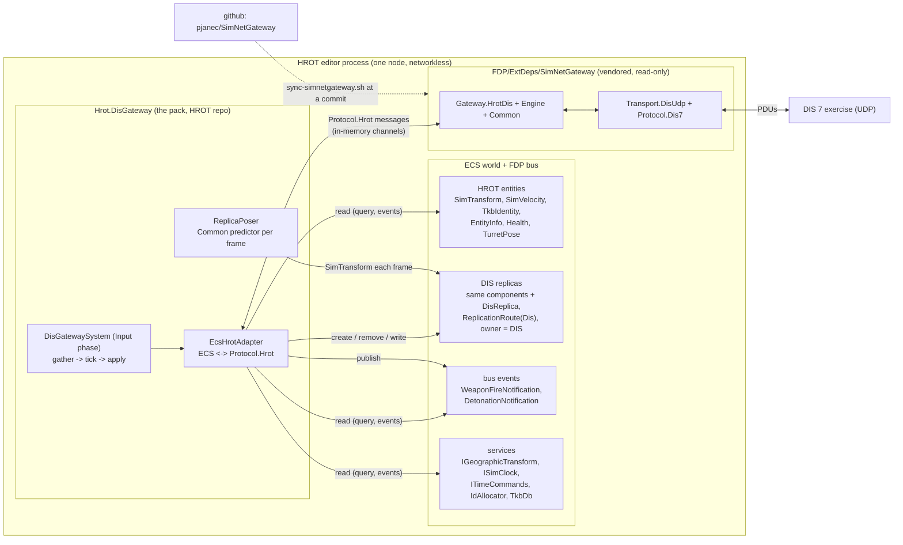
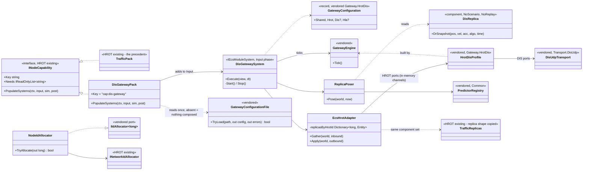
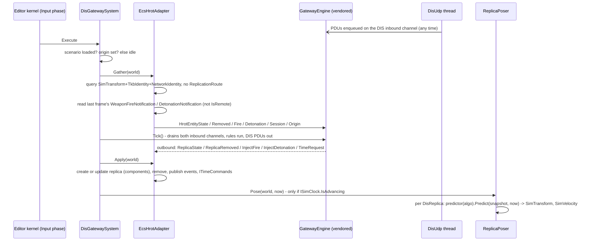
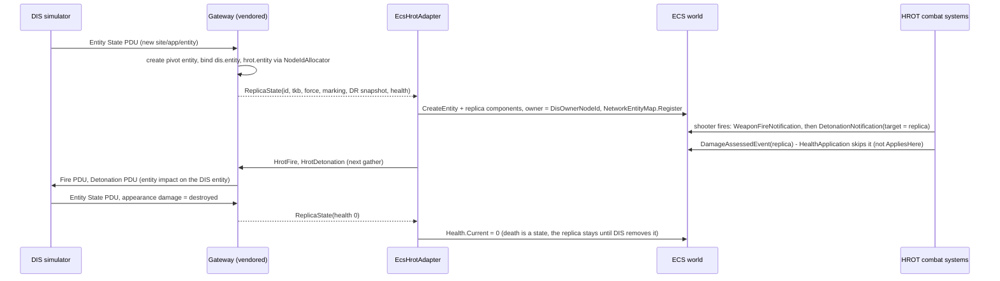
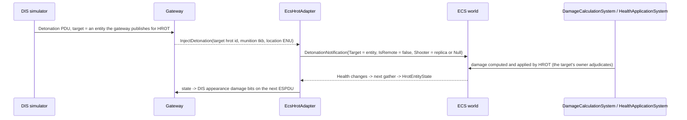
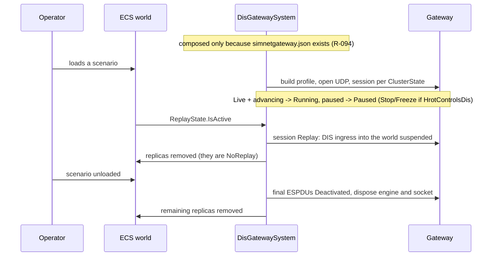
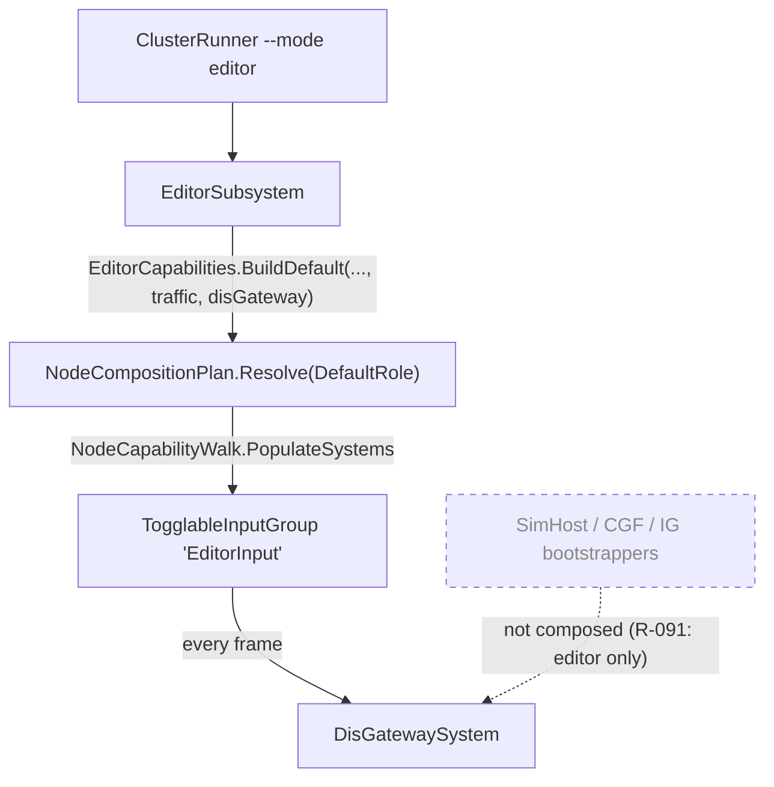

# DD-007: The HROT DIS Gateway Pack (the gateway in-process in the HROT editor)

| | |
|---|---|
| **Status** | approved: P-69, P-70, P-72 .. P-76 are R-092 .. R-099; P-71 replaced by the user's ruling R-094 (configuration file on disk, section 3a); P-87 (file details) awaits the user |
| **Tasks** | T-020 (this design) |
| **Rulings honoured** | R-091 (in-process ECS-level pack, vendored into HROT), R-079 .. R-090 as amended by section 9, R-092 .. R-099, R-012, R-050 .. R-053, R-054 (as limited by R-094), R-057 |
| **Inputs** | HROT `coordinator` @ `34f249e`: `Hrot.Traffic` (the precedent: `TrafficPack`, `TrafficReplicas`, `TrafficBodies`, `TrafficModules`), `Hrot.Common/Infrastructure/NodeCapability.cs`, `Hrot.Editor/EditorSubsystem.cs` + `EditorCapabilities.cs` + `OfflineNetworkFactory.cs`, `Fdp.Toolkits` Combat / Replication / Time / Geographic, `docs/blueprints/Architect_Question_93_Sumo_Traffic_Node.md` (AQ93) section 11, `docs/reference/NED_DDS_Protocol.md` "For a protocol gateway" |
| **Date** | 2026-10-28 |
| **Home** | written here because the gateway side and this pack share one contract (`Protocol.Hrot`); when a HROT lane builds the pack, this document moves to HROT `docs/` (with a pointer left here) |

<!--STATUS
state: LIVE
updated: 2026-10-28
current-answer: whole document
stale-below: none
related-designs:
  - docs/design/DD-006-Gateway-Hrot-Dis.md - the gateway side: pivot, DIS side, open-dis, conversions; its section 0 lists what R-091 changed there
  - HROT docs/blueprints/Architect_Question_93_Sumo_Traffic_Node.md - the precedent this pack copies: vendored ExtDep (section 11), foreign entities as ECS replicas (sections 9, 12)
  - HROT docs/DESIGN_Geo_Origin.md - who sets IGeographicTransform's origin
  - HROT docs/DESIGN_Entity_Genesis_End_To_End.md - the spawn path the pack deliberately does NOT use for replicas (section 3)
-->

## 1. Context and goals

The user ruled (R-091): the SimNetGateway code is **vendored into HROT** and the HROT side of the DIS gateway is an
**ECS-level adapter that reuses HROT**, packaged as a **separate installable HROT module pluggable into the editor
node** - the gateway and its adapters are not a separate HROT node.

What that removes from DD-006: the NED/DDS transport (`Transport.HrotDds`), being a NED node (node id, heartbeat,
capabilities), the HROT id-allocator client, `GeoReference` handling, `OwnershipUpdate` handling and the
DIS -> HROT re-send rule. HROT itself already does all of it: the pack reads and writes **ECS components and FDP bus
events** of the editor's world.

Measured facts this design rests on (file:line in HROT unless stated):

| Fact | Code - how it IS | Design - how it was MEANT |
|---|---|---|
| The editor is networkless: `OfflineNetworkFactory`, `NullReplicationModule`, no DDS participant; `--mode editor` cannot be combined with cluster modes | `Hrot.ClusterRunner/Program.cs:266-271`, `OfflineNetworkFactory.cs:20-23,149-163`, `HrotRunnerConfiguration.cs:276-283` | AQ25 "the editor is a one-node cluster ... networkless by construction"; R-271 "everything works in the networkless editor" |
| Node features are `INodeCapability` instances composed in code; the editor resolves `EditorCapabilities` and walks `PopulateSystems` | `NodeCapability.cs:142-213`, `EditorSubsystem.cs:1780-1791`, `EditorCapabilities.cs:97-120` | DESIGN_Subsystem_Composition_Unification 4.1ac |
| There is **no runtime plugin loading** of capabilities; optional packs are compiled in and idle unless data asks | no reflection scan for `INodeCapability`; `Hrot.Editor.csproj:24` references `Hrot.Traffic` | AQ93 11 V4 (R-4048: build switch dropped), V5 (R-4047: data-driven) |
| Foreign entities become ECS **replicas**: `CreateEntity` + chosen components, owner = the sender (not the local node), `ReplicationRoute` marker, registered in `NetworkEntityMap` | `Hrot.Traffic/TrafficReplicas.cs:275-297` | AQ93 9.1, 8.7 G3 |
| A hit on an entity whose Health another node claims is not applied locally | `Fdp.Toolkits/Combat/HealthOwnership.cs:17-21`, `HealthApplicationSystem.cs:103` | CE-3246 |
| A `DetonationNotification` with `IsRemote=false` is turned into damage by the local `DamageCalculationSystem`; `IsRemote=true` is effects only | `DamageCalculationSystem.cs:52`, `AreaEffectSystem.cs:31` | DESIGN_Orders_Params_Entity_Classes 11.2 |
| Kinematics: `SimTransform` (float, local ENU, X east Y north Z up, quaternion) and `SimVelocity` | `Fdp.Core/CoreComponents/SimComponents.cs:5-52` | NED_DDS_Protocol 11 |
| Origin: `IGeographicTransform` singleton (`Origin`, `ToCartesian`, `ToGeodetic`), on `HrotNodeContext.GeoTransform` | `Fdp.Toolkits/Geographic/IGeographicTransform.cs`, `HrotNodeContext.cs:138` | DESIGN_Geo_Origin 2 |
| Time: `SimClock.Of(view)` (`IsAdvancing`, `TotalTime`, `TimeScale`); commands via `ITimeCommands`; replay via `ReplayState.IsActive` | `Fdp.Toolkits/Time/ISimClock.cs`, `ITimeCommands.cs`, `DamageCalculationSystem.cs:40` | DESIGN_Replay_Time_Axis_And_Review 12l |
| Ids: `HrotNodeContext.IdAllocator` (`INetworkIdAllocator.AllocateId`), main thread only | `TrafficIdReservoir.cs:1-47`, `TrafficPack.cs:79-84` | Deterministic_Network_Ids |
| DIS types already exist in HROT: `DISEntityType`, `DisTypeMask`, `DisNameTable`, `EntityMaster.DisType`; every TKB munition carries a SISO DIS type | `Fdp.Core/DISEntityType.cs`, `Hrot.Core/Tkb/DisNameTable.cs` | RULINGS R-3011 ("the DIS / HLA gateway is planned") |

Graph queries run (codebase-memory CLI, HROT index): `search_graph name_pattern ".*(Mirror|Foreign|External|Gateway|^Dis[A-Z]).*" label Class`
(77 hits: DIS type helpers above, `TrafficReplicas`-family only foreign mirror, no DIS PDU/gateway code); coverage
could not be checked (`check_index_coverage` is not in the CLI).

Out of scope: running the pack in networked HROT nodes (possible later, same pack - section 6), HLA, a runtime
plugin loader (P-70).

## 2. Block diagram



Caption - what the picture shows that prose hid: **nothing crosses a process boundary on the HROT side**; the only
socket is DIS. The pack is the one place that knows both the ECS and `Protocol.Hrot`; the vendored gateway knows
neither the ECS nor HROT.

- **Vendored gateway** (`FDP/ExtDeps/SimNetGateway`): `Engine`, `Common`, `Protocol.Dis7`, `Protocol.Hrot`,
  `Gateway.HrotDis`, `Transport.DisUdp` - all BCL-only, `net8.0`. Copied read-only at a recorded commit by
  `scripts/sync-simnetgateway.sh` (the `sync-sumosharp.sh` shape: scratch clone outside the HROT tree,
  `UPSTREAM.md`, `--check`, `--verify`). Our own `Directory.Build.props` is copied with it, so the vendored
  projects build with SimNetGateway's settings (MSBuild stops at the nearest props file). Tests, viewer, demo and
  showcase stay upstream.
- **The pack** (`Hrot.DisGateway`, a new HROT project referenced by `Hrot.Editor`): the capability, one system,
  the adapter, the poser. It is the "installable module" - one assembly, one line in the editor's capability plan
  (R-093); it contributes nothing unless the gateway configuration file exists (R-094, section 3a).

## 3a. Configuration file (R-094)

The user ruled: *"gateway needs its config on disk, if missing, gateway not instantiated. Nothing in scenario.
Different sections of that config used by different protocol sides (dis/hla), some can be shared."* (R-094; it
limits R-054 - hardcoded configuration - for this gateway's runtime settings.)

```json
{
  "shared": { "site": 1, "application": 3001, "entityMaxHealth": 100,
              "damageThresholds": { "slight": 0.5, "moderate": 0.0 },
              "defaultTkbForUnknown": 0, "forwardUnitEntities": false, "sendEventsInReplay": false },
  "hrot":   { "sampleRateHz": 20, "replicaOwnerNodeId": 65000, "allowZeroOrigin": false },
  "dis":    { "exerciseId": 1, "port": 3000, "address": "255.255.255.255",
              "positionThresholdM": 1.0, "orientationThresholdDeg": 3.0, "heartbeatS": 5, "timeoutS": 12,
              "hrotControlsDis": true, "disControlsHrot": false },
  "hla":    { "rti": "fake", "federation": "RPR", "federateName": "HROT-Gateway",
              "federateType": "SimNetGateway", "fomModules": ["RPR-FOM-2.0"], "createFederation": true,
              "heartbeatS": 5, "timeoutS": 12 }
}
```

| Rule | |
|---|---|
| File missing | the pack contributes no system, no component registration, no socket - the gateway is **not instantiated** |
| File present but invalid (JSON error, unknown key, out-of-range value) | not instantiated; one error naming the file, the key and the reason (log + editor notification) |
| Sections | `shared` - values every side uses (DIS site/application = RPR `EntityIdentifier` federate id, damage and health mapping, unknown-type fallback, replay rule); `hrot` - the pack's own; `dis`, `hla` - one per protocol side; a side runs when its section is present and `enabled` is not false; no side running = not instantiated (warning) |
| Defaults | every key except `dis.exerciseId` and `hla.federation` has the default shown; a missing optional key takes it; `enabled` (per side) defaults to true - `"enabled": false` keeps a section but turns its side off |
| When read | once, when the editor composes its capabilities; a change takes effect at the next start |
| Where (P-87) | `simnetgateway.json` in the process working directory (beside HROT's other configuration files), overridable by the environment variable `SIMNETGATEWAY_CONFIG` (a path) |
| Who parses | the vendored `Gateway.HrotDis` (`GatewayConfiguration` records + `GatewayConfigurationFile.TryLoad`, System.Text.Json from the shared framework), so the pack, the upstream demo/viewer hosts and tests share one parser |

## 3. Key concepts and decisions

1. **One system, three steps, main thread** (`DisGatewaySystem`, Input phase, every frame): (a) *gather* - the
   adapter turns HROT entities and last frame's events into `Protocol.Hrot` messages on the gateway's inbound
   channel; (b) *tick* - `GatewayEngine.Tick` (DIS PDUs queued by the UDP thread are drained here, R-018);
   (c) *apply* - outbound `Protocol.Hrot` messages become replica creations/updates/removals and bus events.
   Rejected: running the engine on its own thread - every ECS access would need a hand-off; the traffic pack's
   threaded stepping exists only because SUMO is slow.
2. **Replicas, not spawns** (traffic precedent): a DIS entity becomes `CreateEntity` + `NetworkIdentity`,
   `NetworkAuthority(primaryOwner = DisOwnerNodeId, local)`, `TkbIdentity`, `ReplicationRoute(Dis)`, `DisReplica`,
   `ScenarioIgnoreTag`, `EntityInfo`, `SimTransform`, `SimVelocity`, `Health`, `PhysicsCollider`, registered in
   `NetworkEntityMap`. No `Locomotion`/`VehicleParams`, so no HROT muscle drives it; owner is not the local node,
   so `HealthOwnership.AppliesHere` is false and HROT never applies damage to it (the DIS owner adjudicates,
   R-086). Rejected: `EntityCreationRequest`/TKB spawn - it applies the full template (capabilities, AI hooks)
   and makes the editor the owner, i.e. HROT would simulate a DIS-owned entity.
3. **Ids from the node** (`HrotNodeContext.IdAllocator`): the gateway's `hrot.entity` allocator port is
   implemented by `NodeIdAllocator` wrapping it; safe because the engine ticks on the main thread. Replaces
   `HrotIdPool` / `IdRequest` (R-083).
4. **DIS -> HROT motion**: the gateway sends a replica state only on a new DIS state (with its DR snapshot:
   position, velocity, acceleration, algorithm, state time); the pack's `ReplicaPoser` extrapolates every frame
   with the vendored `Common` predictor registry and writes `SimTransform` / `SimVelocity` - only while
   `ISimClock.IsAdvancing` (traffic: `TickPolicy.WhenTimeAdvances`). Replaces the 0.5 m / 5 s re-send rule
   (R-084): there is no wire to thin. Rejected: the gateway writing every frame - one transaction per replica per
   frame for a value the predictor computes locally.
5. **HROT -> DIS selection**: entities with `SimTransform` + `TkbIdentity` + `NetworkIdentity` and **without**
   `ReplicationRoute` (skips DIS replicas - echo, R-022 - and SUMO traffic replicas). Gathered at
   `HrotSampleRate` (default 20 Hz, sliced), sent when changed beyond 1 cm / 0.5 deg / 5 cm/s (the NED egress
   thresholds) or once per second; DIS FPW thresholds and heartbeat stay in the gateway (R-084).
6. **DIS types from HROT first**: `Identity.EntityType` from the TKB template's `DISEntityType`; munitions from the
   TKB munition's SISO type (R-3011); the in-code catalog (R-088) is only the fallback and the DIS -> TKB map.
7. **Events**: HROT `WeaponFireNotification` -> `HrotFire`; `DetonationNotification` (not `IsRemote`) ->
   `HrotDetonation`. Inbound DIS Fire -> `WeaponFireNotification{IsRemote=true}` with the replica as shooter
   (effects, sound, shot ledger - never a new shot); inbound DIS Detonation -> `DetonationNotification` with
   `IsRemote=false` when its target resolves to a HROT entity (HROT's own `DamageCalculationSystem` computes the
   damage - DIS receiver adjudication), else `IsRemote=true` (effects only).
8. **Geo and time from services**: origin = `IGeographicTransform.Origin` (+ a generation counter bumped by the
   pack when it changes); no positional output while the origin is unset (0,0,0 is treated as unset unless
   `AllowZeroOrigin`). Gateway clock = monotonic wall clock (DIS is real time); a HROT `TimeScale != 1` while
   Running is reported as a warning (DIS has no time scale).
9. **Session**: `ClusterState` + `ISimClock` -> engine session (table in section 6); `DisControlsHrot` uses
   `ITimeCommands.Pause/Resume`; during replay (`ReplayState.IsActive`) DIS ingress into the world is suspended
   and replicas are removed, HROT -> DIS continues (events only with `SendEventsInReplay`).

## 4. Class diagram



- `DisGatewayPack` is the only type the editor sees: `EditorCapabilities.BuildDefault` gets one more
  `.Capability(...)` line (appended last, so no existing system moves - `EditorCapabilitiesTests` pins the order).
- `DisGatewayPack` reads the configuration file when the editor composes it; absent or invalid, it adds nothing.
- `DisGatewaySystem` owns the engine's lifetime: started when a scenario is loaded and the HROT origin is known,
  stopped when the scenario unloads (final Deactivated states, socket / federation left, replicas removed).
- `EcsHrotAdapter` is the only ECS <-> `Protocol.Hrot` mapping; `ReplicaPoser` the only per-frame writer of replica
  poses.

## 5. Sequence diagrams

### 5.1 One frame



Step (b) sends DIS PDUs synchronously through the vendored UDP transport's outbound channel; the socket send is
non-blocking. Events published in step (c) are read by HROT systems later in the same frame or the next one (the
FDP bus double-buffers - **to be verified by the HROT lane**, P-75).

### 5.2 A DIS tank appears and is hit by a HROT shot



### 5.3 A DIS detonation on a HROT entity



### 5.4 Enable, replay, disable



## 6. Module relationships - who registers it, who calls it each frame



Caption: the frame caller is the editor's own Input group, which runs in every editor mode; the dashed edge is the
deliberate non-edge - networked hosts do not compose the pack now. Composing it there later is one line per
bootstrapper, but replicas carry `ReplicationRoute(Dis)` and so would stay local to that node (other nodes do not
see DIS entities unless they also compose the pack) - a decision for that later design.

| HROT cluster state (+ clock) | Engine session | DIS side |
|---|---|---|
| Idle | Unload | nothing sent, replicas removed |
| Edit | Loaded | nothing sent (authoring positions are not an exercise); DIS replicas shown |
| Preview / Live, advancing | Running | ESPDUs, events; Start/Resume when `HrotControlsDis` |
| Preview / Live, not advancing | Paused | Stop/Freeze when `HrotControlsDis`; ESPDU heartbeats continue (frozen) |
| Replay / Review | Replay | HROT -> DIS continues; events only with `SendEventsInReplay`; no DIS ingress into the world |
| Degraded | Paused | as paused |

## 7. Edge cases and error handling

- **Origin unset or changed**: no HROT -> DIS state and no replica pose while unset; a change bumps the generation:
  the gateway re-bases (DD-006 6.4) and replicas are re-posed from their ECEF snapshots.
- **World reset / scenario reload** (ids restart at `WorldBase`): the pack disposes and rebuilds the gateway engine;
  DIS sees the HROT entities Deactivated and re-appear with new DIS ids (quarantine applies).
- **Unknown DIS type**: replica gets `DefaultTkbForUnknownDis` (one warning per type); a TKB type missing from
  `TkbDb` is never written to `TkbIdentity`.
- **DIS entity silent 12 s**: reaped by the gateway -> `ReplicaRemoved`.
- **Port in use / socket error**: the pack reports it once (log + editor notification), stays idle, retries on the
  next enable; the editor keeps running.
- **Collider size**: from the TKB footprint of the mapped type, else a default box per DIS kind/domain.
- **Many DIS entities**: replicas are created in the Input phase (structural changes there are the traffic
  precedent); budget measured in the H5 acceptance (1000 replicas at 60 Hz editor frame).

## 8. Test plan

- **Upstream (SimNetGateway repo, no HROT)**: `Gateway.HrotDis` against `Protocol.Hrot` in-memory channels - every
  message of section 3 both ways with the DD-002 invariants (DD-006 section 11), plus: a replica state is sent
  only on a new DIS state; the HROT id allocator port is used once per DIS entity; replay suppresses
  `ReplicaState`; nothing is sent before an origin.
- **HROT (`Hrot.DisGateway.Tests`, by the HROT lane)**: a headless editor world (the `EditorHarness` /
  `SubsystemConfig { Headless = true }` pattern) with the pack composed, a loopback DIS peer on a free port:
  replica components and owner; `HealthOwnership.AppliesHere(replica)` is false; a HROT shot at a replica yields
  Fire + Detonation PDUs and no local health change; a DIS detonation on a HROT entity changes its `Health` via
  HROT's own systems; replicas never appear in the HROT -> DIS stream (echo); poses advance only while the clock
  advances; disable removes every replica and closes the socket; `EditorCapabilitiesTests` order rail still passes
  with the pack appended; `sync-simnetgateway.sh --verify` clean.
- **Interop (manual)**: the editor with a `simnetgateway.json` enabling DIS, against a DIS tool (Wireshark dissector, a second
  DIS simulator) on the Windows machine.

## 9. Effect on the DD-006 rulings

| Ruling | Change (proposed in P-69 .. P-76) |
|---|---|
| R-079 scope/topology | the gateway is a pack inside the editor node, not a NED node (R-091) |
| R-082 transports | `Transport.HrotDds` dropped; the HROT side is this pack's ECS adapter (R-091); `Transport.DisUdp` unchanged |
| R-083 identities | `hrot.entity` allocated from `HrotNodeContext.IdAllocator` (no `IdRequest` client); the rest unchanged |
| R-084 kinematics | origin from `IGeographicTransform`; HROT sim time read directly (no offset); DIS -> HROT by per-frame posing from the DR snapshot (no re-send rule); HROT -> DIS unchanged |
| R-086 ownership | replicas owned by `DisOwnerNodeId`; no `OwnershipUpdate` handling; HROT never applies damage to replicas |
| R-087 session/time | from `ClusterState` + `ISimClock`; `DisControlsHrot` via `ITimeCommands`; table of section 6 |
| R-088 catalogs | TKB's `DISEntityType` / munition SISO types first; the code catalog is the fallback |
| R-090 stages | H1 - H2 as before; H3 = Transport.DisUdp + vendorability; **H5 = this pack, in HROT** |

## 10. Proposals awaiting approval

| ID | Proposal (lean) | Main alternative |
|---|---|---|
| **P-69** (approved, R-092) | **Vendoring**: `FDP/ExtDeps/SimNetGateway` holds `Engine`, `Common`, `Protocol.Dis7`, `Protocol.Hrot`, `Gateway.HrotDis`, `Transport.DisUdp` (+ our `Directory.Build.props`, LICENSE/NOTICE), refreshed by `scripts/sync-simnetgateway.sh <ref>` with `UPSTREAM.md`, `--check`, `--verify`; read-only in HROT, changes go upstream first (AQ93 V1 - V3 shape). | Git submodule (a second checkout per session, rejected for SumoSharp too); a NuGet package (a feed to run). |
| **P-70** (approved, R-093) | **"Installable" = a separate compiled-in assembly `Hrot.DisGateway`, composed into the editor plan with one line, idle unless its configuration file exists** (AQ93 V4/V5, R-4047/R-4048; enablement by R-094). No runtime plugin loader. | Runtime loading of capability assemblies from a folder - HROT has no such mechanism (measured); it would be new engine infrastructure with its own design. |
| **P-71** | ~~Enablement by a scenario `DisExercise` entity~~ **REPLACED by the user's ruling R-094**: a configuration file on disk, sections per side (section 3a). | - |
| **P-72** (approved, R-095) | **Replica shape** of section 3 item 2 (the `TrafficReplicas` set + `SimVelocity`, `DisReplica`, owner `DisOwnerNodeId` = a reserved id not equal to any node id, `ReplicationRoute(Dis)` as a new route value). | Spawn through `EntityCreationRequest` with the TKB template (HROT would simulate DIS-owned entities). |
| **P-73** (approved, R-096) | **Motion**: DIS -> HROT by per-frame posing from the DR snapshot with the vendored `Common` predictors while the clock advances; HROT -> DIS gathered at 20 Hz (sliced) with the NED egress change thresholds, DIS thresholds/heartbeat in the gateway. | The gateway writing replica poses every frame through the engine. |
| **P-74** (approved, R-097) | **Events**: HROT fire/detonation -> Fire/Detonation PDUs; DIS Fire -> `WeaponFireNotification{IsRemote}` (effects only); DIS Detonation on a HROT entity -> `DetonationNotification{IsRemote=false}` so HROT computes the damage; on anything else `IsRemote=true`. | Translate DIS detonations straight into `DamageAssessedEvent` with a gateway damage model (duplicates HROT's damage tables). |
| **P-75** (approved, R-098) | **Ownership of the work**: SimNetGateway delivers the vendorable projects and the `Protocol.Hrot` contract with upstream tests (stages H1 - H3); a HROT lane builds `Hrot.DisGateway` (H5) from this design (moved into HROT `docs/`), verifying the three open HROT facts first: FDP bus event visibility between Input and Simulation phases, Input-phase structural changes at 1000 replicas, and that no HROT system acts on an entity without `Locomotion` that carries a non-local owner. | This session builds the HROT pack too (needs push access to HROT and a HROT lane's review; possible on request). |
| **P-76** (approved, R-099) | **Session table** of section 6 (Edit = Loaded and silent to DIS; Replay = HROT -> DIS only, replicas removed). | Publish authoring positions to DIS in Edit (DIS peers would see entities jump while being placed). |
| **P-87** | **Configuration file details** (section 3a): JSON (the format of HROT's own `config.json` / `orchestrator-config.json`), name `simnetgateway.json` in the working directory, `SIMNETGATEWAY_CONFIG` override, sections `shared` / `hrot` / `dis` / `hla`, unknown keys are errors, read once at composition; one parser in the vendored gateway. | Name and path from a HROT command-line option (needs a ClusterRunner change); YAML/INI (a second format in HROT). |
