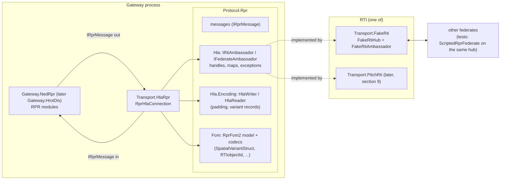
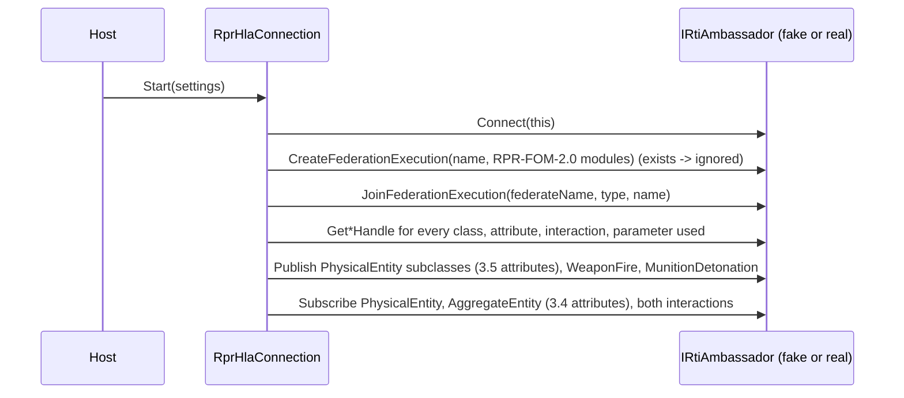
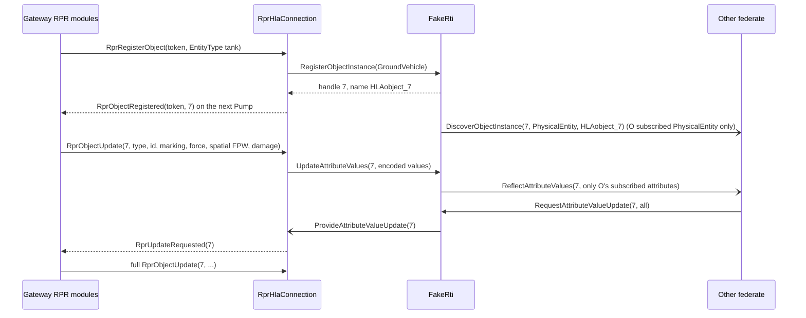
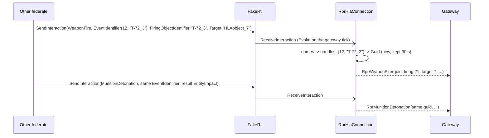
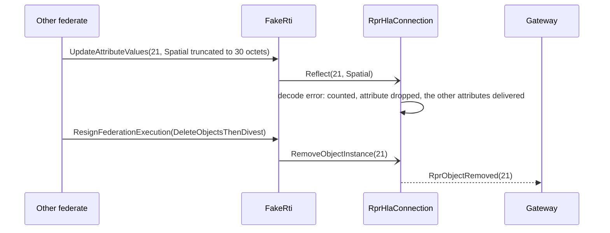
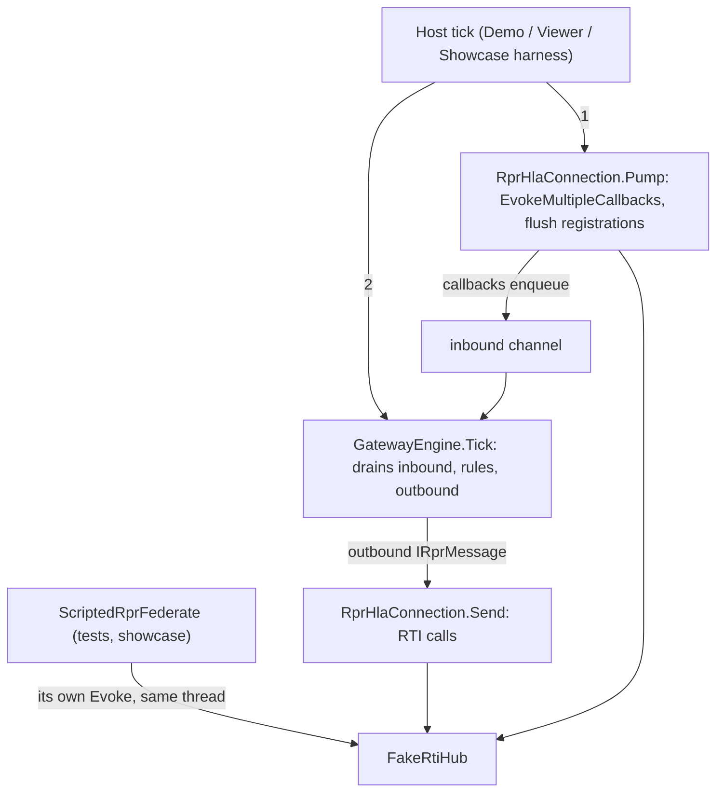

# DD-008: The HLA Side (RPR FOM 2.0 over IEEE 1516-2010) and a Fake In-Memory RTI

| | |
|---|---|
| **Status** | in review - proposals P-77 .. P-86 await the user; stage HLA-1 (port, encoding, FOM model, fake RTI) implemented on the user's go-ahead, see section 12 |
| **Tasks** | T-021 |
| **Rulings honoured** | R-002, R-003, R-012, R-018, R-019 .. R-022, R-045, R-047, R-050, R-051, R-053, R-054, R-063 .. R-067, R-089 (HLA readiness) |
| **Inputs** | RPR FOM 2.0 modules (SISO-STD-001.1-2015 Annex A, copy in `github.com/IVCTool/TS_RPR_FOM`, `RPR-FOM-v2.0/RPR-{Foundation,Base,Physical,Warfare,Enumerations,Aggregate}_v2.0.xml`); IEEE 1516.1-2010 Java/C++ interfaces as copied in `github.com/openlvc/portico` (`codebase/src/java/portico/hla/rti1516e`, `codebase/src/cpp/ieee1516e/include/RTI`); padded encoders of `github.com/Pitch-Technologies/FedProClient` (`cpp/src/fedpro/services-common/encoding`) and `github.com/TNO-MST/object-oriented-rti`; the DIS <-> RPR gateway `github.com/openlvc/disco` |
| **Date** | 2026-10-28 |

<!--STATUS
state: LIVE
updated: 2026-10-28
current-answer: whole document
stale-below: none
related-designs:
  - docs/design/DD-001-Gateway-Engine-PoC.md - engine, channels, the RPR side as the PoC models it (sections 3, 8)
  - docs/design/DD-002-Showcase-Scenario.md - Convoy Ambush and its RPR expectations (Appendix B), which stage HLA-3 runs over the fake RTI
  - docs/design/DD-006-Gateway-Hrot-Dis.md - the RPR-aligned pivot of the HROT gateway; section 10 promised this HLA side
  - docs/design/DD-007-Hrot-Dis-Pack.md - the HROT pack that will host the gateway (and later its HLA side)
-->

## 1. Context and goals

The gateway must later speak HLA through **Pitch pRTI** (R-089). The user has **no pRTI and no Pitch Developer
Studio licence** (2026-10-28) and asked for the design and a **fake RTI** now. HLA's standard API bindings are C++
and Java only; there is no standard C# binding (checked 2026-10-28). Therefore:

1. the HLA side is written against **our own C# port that mirrors the IEEE 1516.1-2010 (1516e) API** - same service
   and callback names, same exceptions, same semantics - so a real binding later is a thin adapter, not a redesign;
2. a **fake RTI** implements that port in memory with the 1516e semantics the RPR side relies on, deterministic and
   single-threaded, so the whole HLA path (encoding included) is tested here;
3. the **RPR FOM 2.0 data encoding** (the bytes inside attribute and parameter values) is real, because a real
   RTI carries values as opaque bytes and other federates decode them: getting it right is not the RTI's job.

Out of scope: time management (RPR federations are receive-ordered), DDM regions, save/restore, ownership
transfer (R-057 keeps one owner; attribute-group ownership is a later design), MOM, the real Pitch binding
(section 9).

Prior art reused (enumerated by grep over `src/` - this repository is small enough that grep sees the whole set;
no codebase-memory index exists for it):

| Existing | Reused as |
|---|---|
| `Protocol.Rpr` messages (`RprObjectUpdate`, `RprWeaponFire`, `RprMunitionDetonation`, `RprRegisterObject`/`RprObjectRegistered`, `RprObjectRemoved`, `RprAggregateEntity`, `RprSimulationControl`) | the gateway <-> HLA-transport contract, extended (section 3.4) - the gateway modules stay as they are |
| `Gateway.NedRpr` RPR modules (`RprPublication` pending/bound pattern, contributors R-045, heartbeat, event hold) | unchanged; they now drive a real HLA path |
| `Protocol.Rpr.SimulatedRti` (53 lines, message-level stand-in that answers registrations) | **retired** in stage HLA-3 once the showcase runs on the fake RTI (no two RTI stand-ins) |

## 2. Block diagram

Caption - what the picture shows that prose hid: the gateway never sees HLA; the transport is the only HLA client;
the RTI is swappable behind the port, and the fake RTI treats values as opaque bytes exactly like a real one, so
encoding errors cannot hide behind it.

- **Protocol.Rpr** (BCL only, R-050) grows three namespaces: `Hla` (the port), `Hla.Encoding` (the 1516.2 basic
  and constructed encodings), `Fom` (the RPR FOM 2.0 subset as a code model plus codecs). One protocol project, so
  a transport still references exactly one protocol (rule 5).
- **Transport.HlaRpr** (Engine + Protocol.Rpr): connects, creates/joins, resolves handles, publishes/subscribes,
  maps `IRprMessage` <-> RTI calls and callbacks, encodes/decodes values. It evokes callbacks from the host tick
  (HLA_EVOKED), so callbacks run on the gateway thread and only enqueue into the inbound channel (R-018).
- **Transport.FakeRti** (Protocol.Rpr only): the in-memory RTI.

## 3. Key concepts and decisions

### 3.1 The port mirrors 1516e

`IRtiAmbassador` / `IFederateAmbassador` use the 1516e service and callback names (Java-style signatures adapted
to C#: `byte[]`/`ReadOnlyMemory<byte>` values, handle structs, `IReadOnlyDictionary`-shaped maps), the 1516e
exception names as typed exceptions (`FederateNotExecutionMember`, `ObjectClassNotPublished`, `AttributeNotOwned`,
`ObjectInstanceNotKnown`, `ObjectInstanceNameInUse`, `ObjectInstanceNameNotReserved`, `NameNotFound`,
`CallNotAllowedFromWithinCallback`, ...), and **only the HLA_EVOKED callback model**. Only the services in
section 4 are in the port - each one is used by the transport. Rejected: a message-level port (what
`SimulatedRti` is) - a real binding would then need a second design; a full 1516e port - hundreds of services
nobody calls.

### 3.2 FOM in code (R-054)

`FomModel` = object class tree (names, attributes with datatype names), interaction class tree (parameters),
built in code by `RprFom2.Model()` from the RPR FOM 2.0 modules (Foundation, Base, Physical, Warfare,
Aggregate - the subset used). Fully qualified names `HLAobjectRoot.BaseEntity.PhysicalEntity.Platform.GroundVehicle`.
`createFederationExecution` / `joinFederationExecution` take module **names** resolved by a code registry
(`FomModules`), not URLs. The real binding (section 9) passes the official XML files instead.

### 3.3 Encoding: the padded 1516.2 rules

`HlaWriter`/`HlaReader` encode each attribute or parameter value from offset 0: basic types big-endian, octet
boundary = size; each element padded **before** it to its own boundary; fixed record boundary = max field
boundary; `HLAvariableArray` = `HLAinteger32BE` count, boundary max(4, element); **variant record = discriminant,
then padding to the largest boundary over all alternatives**, then the alternative; RPR extensions
`RPRnullTerminatedArray` (RTIobjectId: ASCII chars + 0x00, boundary 1) and `RPRlengthlessArray` (elements only).
Derived sizes the tests pin: `EntityTypeStruct` 8, `EntityIdentifierStruct` 6, `MarkingStruct` 12,
`SpatialVariantStruct` Static 48 / FP 60 / RP and FV 72 / RV 84 (1 discriminant octet + 7 pad). Both independent
padded implementations (Pitch FedPro, TNO) agree; Portico's Java encoders do **not** pad and are not followed.
A decoder never returns a half value: a truncated or inconsistent value is a decode error the transport counts and
drops (the DIS codec rule of DD-006).

### 3.4 Mapping the gateway contract to RPR FOM 2.0

| `Protocol.Rpr` message (direction) | HLA |
|---|---|
| `RprRegisterObject(Token, EntityType)` (out) - **gains `EntityType`** (the class depends on it) | `registerObjectInstance(class)` with an RTI-generated name (Disco precedent); the class from the entity type (3.5); answered by `RprObjectRegistered(Token, Handle)` on the next pump; the transport keeps handle <-> name |
| `RprObjectUpdate(Handle, fields)` (out) | `updateAttributeValues`: `EntityType`, `EntityIdentifier`, `Marking` (ASCII, 11), `ForceIdentifier`, `DamageState`, `Spatial` (one variant from the transport's per-object spatial cache: any spatial field change re-encodes the whole variant), `ArticulatedParametersArray` (when present). `DamagePercent` has no RPR 2.0 attribute: dropped, one warning |
| discover + reflect (in) | `RprObjectUpdate(Handle, fields)` with exactly the decoded attributes; on discovery the transport calls `requestAttributeValueUpdate` (Disco precedent) |
| `removeObjectInstance` (in) | `RprObjectRemoved(Handle)` |
| `RprObjectRemoved` / entity removed (out) | `deleteObjectInstance` |
| `provideAttributeValueUpdate` (in) | **new** `RprUpdateRequested(Handle)` -> a new small NedRpr module asks `RprPublication` for a full update (R-003) |
| `RprWeaponFire` / `RprMunitionDetonation` (both ways) - **gain** the RPR fields `FuseType`, `WarheadType`, `RateOfFire`, `InitialVelocity` / `FinalVelocity`, `FireControlSolutionRange`, `RelativeDetonationLocation`, `MunitionObject` | `sendInteraction` / `receiveInteraction` of `HLAinteractionRoot.WeaponFire` / `.MunitionDetonation`; object references (`FiringObjectIdentifier`, `TargetObjectIdentifier`, `MunitionObjectIdentifier`) are **object instance names** (`RTIobjectId`), empty = none; `EventIdentifier` = (`EventCount`, issuing object's name) <-> the message's `Guid` through a bounded correlation map (30 s, like the DIS fire correlator) |
| `RprAggregateEntity` (in) | `HLAobjectRoot.BaseEntity.AggregateEntity` reflections (attribute set taken from `RPR-Aggregate_v2.0.xml` by the implementing agent and recorded in the as-built notes) |
| `RprSimulationControl` | **not carried**: RPR FOM 2.0 has no simulation-management interactions in the modules used; counted and dropped with one warning (verify in HLA-2; P-84) |

`RprDetonationResult` takes the FOM's numbering (Other 0, EntityImpact 1, EntityProximateDetonation 2,
GroundImpact 3, GroundProximateDetonation 4, Detonation 5, None 6) - today it has GroundImpact 2 / Detonation 3;
NedRpr maps through `NedRprConversions.TryResultToRpr`, which is updated with it (no cast exists).
`ForceIdentifierEnum8` values above 3 (`Friendly_2` ...) map inbound to their base force.

### 3.5 Object class from the entity type

| DIS kind / domain | Class registered |
|---|---|
| 1 platform / 1 land | `...Platform.GroundVehicle` |
| 1 / 2 air | `...Platform.Aircraft` |
| 1 / 3 surface | `...Platform.SurfaceVessel` |
| 1 / 4 subsurface | `...Platform.SubmersibleVessel` |
| 1 / 5 space | `...Platform.Spacecraft` |
| 1 / other | `...Platform` |
| 3 lifeform | `...Lifeform.Human` |
| 2 munition | `...Munition` |
| anything else | `...PhysicalEntity` |

The transport subscribes at `PhysicalEntity` (attributes of 3.4) and `AggregateEntity`, so it discovers every
subclass (promotion, 3.6) and reflects only the attributes it decodes.

### 3.6 Fake RTI semantics (the 1516e behaviour reproduced)

| Behaviour | Rule |
|---|---|
| Federations | `FakeRtiHub` holds executions by name; create (duplicate -> `FederationExecutionAlreadyExists`), join (name in use -> `FederateNameAlreadyInUse`), resign (`DeleteObjectsThenDivest` deletes the federate's objects), destroy (joined federates -> `FederatesCurrentlyJoined`) |
| Callbacks | queued per federate, delivered only by `EvokeCallback` (one) / `EvokeMultipleCallbacks` (all queued at call time); time arguments ignored (deterministic); an RTI call from inside a callback -> `CallNotAllowedFromWithinCallback` |
| Publish / subscribe | per class, a later call replaces the attribute set for that class; unpublish/unsubscribe; interaction classes likewise |
| Discovery | a federate discovers an instance registered by another federate when it subscribes (any attribute) to the registered class or a superclass; **known class = the closest such class** (promotion); discovery on register and on late subscription; never of its own instances; once per instance |
| Names | unique per execution; `reserveObjectInstanceName` answers asynchronously (succeeded / failed); `registerObjectInstance(class, name)` needs a reservation (`ObjectInstanceNameNotReserved`); RTI-generated names `HLAobject_<n>` |
| Registration / ownership | needs the class published (`ObjectClassNotPublished`); the registrant owns the instance's attributes it publishes at that class plus `HLAprivilegeToDeleteObject` |
| Updates | owned attributes only (`AttributeNotOwned`), attributes of the registered class only (`AttributeNotDefined`); reflected to every federate that discovered the instance, filtered to its subscription at its known class; nothing when the filtered set is empty; never to the updater |
| Interactions | needs the class published; received by subscribers of the class or a superclass, as the closest subscribed class, with only that class's parameters; never by the sender |
| Attribute value requests | by instance or class -> `provideAttributeValueUpdate` to the owner(s), not to the requester |
| Delete | needs the delete privilege; `removeObjectInstance` to every discoverer |
| Opaque values | the fake RTI never decodes a value (as a real RTI) |
| Test hooks | `FakeRtiHub.Trace` (every service call and callback, for assertions); no randomness |

The discovery promotion rule is the standard's (1516.1 clause 6.9) as commonly implemented; the fetched sources
confirm the behaviour but not the clause text - recorded as known risk, re-checked against a real RTI in HLA-4.

## 4. Class diagram

- `RprHlaConnection` is both the transport (inbound/outbound channels of `IRprMessage`, DD-001 channels) and the
  federate ambassador; its callbacks only enqueue.
- `RprFom2` is the one place that knows RPR names and struct layouts; the fake RTI only knows `FomModel`.

## 5. Sequence diagrams

### 5.1 Join and publish

### 5.2 An entity goes out and is seen by another federate

### 5.3 Fire and detonation from another federate

### 5.4 Bad value and a peer's resign

## 6. Module relationships - who calls what each tick

Caption: every RTI interaction happens on the host thread inside one tick - the fake RTI has no thread and no
timer, so a test is a deterministic sequence of `Tick`s (no sleeping, `ManualClock`).

## 7. Edge cases

- Registration of an entity whose type changes class later: the object keeps its registered class (EntityType is
  `Static` in RPR); a kind/domain change is logged, not re-registered.
- `Spatial` with `DeadReckoningAlgorithm = Other` (no alternative in the FOM): never sent (Static when no velocity,
  FPW otherwise); received -> decode error.
- Names over the RTIobjectId limit or non-ASCII: the fake RTI rejects `IllegalName` like a real one; generated
  names are ASCII.
- An interaction naming an object the gateway has not discovered: the reference is absent in the message (like a
  null handle today); the fire is still delivered.
- The gateway's own objects never come back (no reflection to the updater) - no echo filter needed on HLA.
- Several gateways in one federation: each has its own federate name; DIS site/application stay per gateway.

## 8. Test plan

- **Protocol.Rpr.Tests** (new, one per layer is the convention): encoding golden byte vectors for every struct and
  every Spatial alternative (hand-built, independent of the writer) with the derived sizes of 3.3; round trips of
  random values (seeded); every truncation of every value is an error, never a half value; padding bytes are zero.
- **Transport.FakeRti.Tests**: every rule of 3.6 as an invariant checked after every step of randomized seeded
  scenarios (N federates, random publish/subscribe/register/update/delete/interaction sequences) against a
  brute-force reference model: **a federate's received callbacks equal what the reference computes from the same
  call sequence** (discovery set and known class, filtered attribute sets, no self-reflection, removal only to
  discoverers, interactions to closest subscribed class with that class's parameters, exceptions on every illegal
  call); callbacks only inside Evoke; resign/destroy rules.
- **Transport.HlaRpr.Tests**: the gateway's `IRprMessage` round trip through `RprHlaConnection` + fake RTI + a
  `ScriptedRprFederate` that encodes/decodes with `RprFom2` independently: every row of 3.4 both ways, event
  correlation, class choice 3.5, partial updates re-encode the whole Spatial from the cache, decode errors counted
  and isolated, `provideAttributeValueUpdate` -> full update.
- **Showcase (HLA-3)**: Convoy Ambush runs with the RPR side as a scripted federate on the fake RTI; all 48 checks
  pass; `SimulatedRti` and its tests removed.
- Mutation checks by the implementing agent (R-065): padding removed, variant padding to the chosen instead of the
  largest alternative, no self-reflection filter removed, promotion to the root class instead of the closest,
  attribute filter removed, owner check removed.

## 9. The real RTI later (HLA-4)

`Transport.PitchRti` implements `IRtiAmbassador` over a real RTI. Options, decided when access exists: (a) Pitch
Developer Studio's generated C# (licence); (b) a small C ABI shim over the standard C++ 1516e API, built for
linux-x64 and win-x64 and called through P/Invoke - needs an amendment of R-012's P/Invoke line (raylib already
works this way); OpenRTI (open source, 1516e C++) can run the same shim in CI. The FOM then comes from the official
RPR FOM 2.0 XML modules; `RprFom2.Model()` is checked against them by a test.

## 10. Stages

| Stage | Content | Exit |
|---|---|---|
| HLA-1 | `Protocol.Rpr`: `Hla` port, `Hla.Encoding`, `Fom` (`FomModel`, `RprFom2` model + codecs); `Transport.FakeRti`; test projects | encoding goldens, fake-RTI reference-model invariants |
| HLA-2 | `Transport.HlaRpr`; message additions (3.4); `RprUpdateRequested` module in NedRpr; `RprDetonationResult` renumbered | transport tests; all existing suites green |
| HLA-3 | Convoy Ambush over the fake RTI; `SimulatedRti` retired; Demo/Viewer option to run the RPR side over the fake RTI | 48/48 |
| HLA-4 | real binding (section 9) | interop with a real RTI |

## 11. Proposals awaiting approval

| ID | Proposal (lean) | Main alternative |
|---|---|---|
| **P-77** | **A C# port mirroring 1516e** (names, exceptions, HLA_EVOKED only; services of section 4 only) in `Protocol.Rpr.Hla`. | A message-level port (a second design for the real binding). |
| **P-78** | **One protocol project**: the port, the 1516.2 encoding and the RPR FOM 2.0 model/codecs live in `Protocol.Rpr` (namespaces `Hla`, `Hla.Encoding`, `Fom`). | A separate `Protocol.Hla` - the transport would reference two protocols (rule 5 change). |
| **P-79** | **Padded 1516.2 encoding** (Pitch/TNO behaviour) with the derived RPR sizes of 3.3 pinned by goldens. | Unpadded (Portico Java) - wire-incompatible with Pitch. |
| **P-80** | **Fake RTI semantics** of 3.6, deterministic, single-threaded, opaque values, verified against a brute-force reference model. | A thinner fake (no promotion, no filtering) - would hide the behaviours a real RTI enforces. |
| **P-81** | **RTI-generated object names** (no reservation round trip), names kept by the transport for `RTIobjectId` references. | Reserved deterministic names `site.app.entity` - an extra asynchronous step and collisions to handle. |
| **P-82** | **Mapping of 3.4 / 3.5**: `RprRegisterObject` gains `EntityType`; new `RprUpdateRequested` + module; interaction fields added; `RprDetonationResult` takes the FOM numbering; per-object spatial cache in the transport. | Keep the messages and guess the class at registration (always `PhysicalEntity`) - other federates subscribing to `Platform` would never discover us. |
| **P-83** | **FOM in code** (`RprFom2.Model()`, R-054); the official XML is used only by the real binding, with a test comparing the two. | Ship the RPR XML modules now and parse them (contradicts R-054 for now). |
| **P-84** | `RprSimulationControl` **not carried** over HLA (no RPR 2.0 interaction for it in the used modules); counted and warned. | Map it to a custom interaction class (non-standard). |
| **P-85** | **Retire `SimulatedRti`** in HLA-3 when Convoy Ambush passes on the fake RTI. | Keep both stand-ins (two implementations of one concept). |
| **P-86** | **Stages HLA-1 .. HLA-4** of section 10; the HROT gateway gets the same HLA side when `Gateway.HrotDis` reaches it, by sharing the RPR modules then (their extraction is that stage's design question, not this one). | Build the HLA side for `Gateway.HrotDis` first (it does not exist yet). |

## 12. As-built notes (stage HLA-1, T-021)

Built: `Protocol.Rpr` namespaces `Hla` (port, handles, maps, exceptions), `Hla.Encoding` (`HlaWriter`, `HlaReader`) and `Fom`
(`FomModel`, `FomModelBuilder`, `FomModules`, `RprFom2` model + codecs, plain value structs, enumerations); project
`Transport.FakeRti` (`FakeRtiHub`, `FakeRtiAmbassador`); test projects `Protocol.Rpr.Tests` and `Transport.FakeRti.Tests`
(DD-003 convention: one test project per src project, so no shared "per layer" project). The class diagram of section 4 holds;
deviations and decisions the design left open:

| Topic | As built | Why |
|---|---|---|
| Port surface | section 4 plus `UnpublishObjectClass`, `UnsubscribeObjectClass`, `UnpublishInteractionClass`, `UnsubscribeInteractionClass` and `RequestAttributeValueUpdate(ObjectClassHandle, ...)` (1516e names) | section 3.6 and the HLA-1 exit demand unpublish / unsubscribe and "by instance or class" requests; the diagram had not listed them. An empty set in publish / subscribe also means unpublish / unsubscribe, as in 1516e |
| Exceptions | the list of the brief plus `FederateOwnsAttributes` (resign without divesting while owning) | needed by `ResignAction.NoAction` |
| `FomModules` | lives in `Protocol.Rpr.Fom` (not test-side); `FakeRtiHub.RegisterModule` overrides it per hub | the fake RTI (references only `Protocol.Rpr`) and the later transport share the module names; an unknown module name is `NameNotFound` (1516e has `CouldNotOpenFDD`, not in the port) |
| `Encode*` / `TryDecode*` | `Encode*` throws `ArgumentException` for what the FOM cannot hold (enumerator not in the FOM, `Other` dead reckoning, non-ASCII `RTIobjectId`, marking not 11 octets); `TryDecode*` is strict on enumerators and booleans, requires the value to be consumed completely, does not check padding octets | a decoder that never returns a half value (3.3); the encoder is the only producer of zero padding |
| Variant padding | `HlaWriter.VariantRecordStart` / `VariantAlternativeStart` pad to the largest boundary over all alternatives. In the RPR types every alternative has the same boundary (8 for `SpatialVariantStruct`, 4 for `ParameterValueVariantStruct`), so the rule is only observable on a synthetic variant, which the tests use | honest limit of the golden vectors |
| `ArticulatedParameterStruct` | 20 octets for both alternatives (Change@0, 1 pad, PartAttachedTo@2, ParameterType@4, alternative@8..19); lengthless array = elements only, truncation between elements is a valid shorter array | derived in `EncodingGoldenTests` |
| Handles | 1-based indexes in model order (classes parents first, attributes by declaring class in declaration order); inherited attributes / parameters keep the declaring class's handle; instance handles and `HLAobject_<n>` names use the same counter per federation | deterministic, same FOM = same handles in every federation |
| Ownership | fixed at registration: the registrant owns the attributes published at the registered class plus `HLAprivilegeToDeleteObject`; a later publish / unpublish does not change it (R-057: one owner, no transfer) | simplest deterministic rule; ownership transfer is out of scope |
| Attribute checks | `AttributeNotDefined` for update and value requests is evaluated against the class the caller knows the instance as (the registered class for the registrant) | a federate that knows an instance as `PhysicalEntity` cannot name `Platform` attributes |
| Value requests by class | cover live instances of that class or a subclass that the requester knows | requests are relative to what a federate knows |
| Names | printable ASCII, 1..255 characters, not starting with `HLA`; a reservation by another federate counts as "not reserved" for `RegisterObjectInstance(class, name)`, `ObjectInstanceNameInUse` only for a name bound to an instance; a name is free again when its instance is deleted or its reserver resigns | `HLA`-prefixed names are reserved for RTI-generated ones, so they cannot collide |
| Resign | `DeleteObjects`, `DeleteObjectsThenDivest`, `CancelThenDeleteThenDivest` delete the federate's instances (removal callbacks to discoverers); `UnconditionallyDivestAttributes` leaves them without an owner (nobody can update or delete them, late subscribers still discover them); `NoAction`, `CancelPendingOwnershipAcquisitions` throw `FederateOwnsAttributes` while it owns anything. The resigned federate's callback queue is discarded | 1516e semantics reduced to what exists without ownership transfer |
| Evoke | `EvokeCallback` / `EvokeMultipleCallbacks` need only a connection and return true while callbacks are still pending; callbacks queued during delivery wait for the next evoke | HLA_EVOKED |
| Callback copies | values and tags are cloned per recipient when queued | a sender mutating its arrays later cannot change what was sent |
| `ProtocolTests.Namespaces_equal_the_project_names` | now accepts the three sub-namespaces for `Protocol.Rpr`; message types must still be in the root namespace | DD-008 section 2 puts `Hla`, `Hla.Encoding`, `Fom` into that project |
| Generated sources | `Fom/RprEnumerations.cs` (the seven enumerations) and `Fom/RprFom2.Definitions.cs` (name constants + `BuildModel`) were generated once from `RPR-Enumerations/Base/Physical/Aggregate/Warfare_v2.0.xml`; not regenerated by the build | R-054: no runtime XML; the HLA-4 test compares the model with the official XML |
| Equivalent behaviour noted | the "no reflection to the updater" check in the update loop is redundant by construction (only the registrant can update and it never discovers its own instance); the rule is enforced by "never discover own instances" and tested through that | found by the mutation check |

AggregateEntity (parent `BaseEntity`, module `RPR-Aggregate_v2.0.xml`), attributes in module order: `AggregateMarking`
(AggregateMarkingStruct), `AggregateState` (AggregateStateEnum8), `Dimensions` (DimensionStruct), `EntityIdentifiers`
(RTIobjectIdArray), `ForceIdentifier` (ForceIdentifierEnum8), `Formation` (FormationEnum32), `NumberOfSilentEntities`
(Integer16), `NumberOfVariableDatums` (UnsignedInteger32), `SilentAggregates` (SilentAggregateStructLengthlessArray),
`SilentEntities` (SilentEntityStructLengthlessArray), `SubAggregateIdentifiers` (RTIobjectIdArray), `VariableDatums`
(VariableDatumStructLengthlessArray). The model only names them; no codecs exist for these types yet (HLA-2 decides which are used).
