# DD-008: The HLA Side (RPR FOM 2.0 over IEEE 1516-2010) and a Fake In-Memory RTI

| | |
|---|---|
| **Status** | approved: P-77 .. P-86 are R-100 .. R-109; HLA-1, HLA-2 and HLA-3 built (sections 12, 12a, 12b); P-88, P-89 (found in HLA-3) approved as R-120, R-121 |
| **Tasks** | T-021 |
| **Rulings honoured** | R-002, R-003, R-012, R-018, R-019 .. R-022, R-045, R-047, R-050, R-051, R-053, R-054, R-063 .. R-067, R-089 (HLA readiness) |
| **Inputs** | RPR FOM 2.0 modules (SISO-STD-001.1-2015 Annex A, copy in `github.com/IVCTool/TS_RPR_FOM`, `RPR-FOM-v2.0/RPR-{Foundation,Base,Physical,Warfare,Enumerations,Aggregate}_v2.0.xml`); IEEE 1516.1-2010 Java/C++ interfaces as copied in `github.com/openlvc/portico` (`codebase/src/java/portico/hla/rti1516e`, `codebase/src/cpp/ieee1516e/include/RTI`); padded encoders of `github.com/Pitch-Technologies/FedProClient` (`cpp/src/fedpro/services-common/encoding`) and `github.com/TNO-MST/object-oriented-rti`; the DIS <-> RPR gateway `github.com/openlvc/disco` |
| **Date** | 2026-10-28 |

<!--STATUS
state: LIVE
updated: 2026-10-29
current-answer: whole document; section 12b is the as-built truth of how the showcase, demo and viewer run the RPR side (HLA-3)
stale-below: none
related-designs:
  - docs/design/DD-001-Gateway-Engine-PoC.md - engine, channels, the RPR side as the PoC models it (sections 3, 8)
  - docs/design/DD-002-Showcase-Scenario.md - Convoy Ambush and its RPR expectations (Appendix B), which stage HLA-3 runs over the fake RTI
  - docs/design/DD-006-Gateway-Hrot-Dis.md - the RPR-aligned pivot of the HROT gateway; section 10 promised this HLA side
  - docs/design/DD-007-Hrot-Dis-Pack.md - the HROT pack that will host the gateway (and later its HLA side)
-->

## 1. Context and goals

The gateway must later speak HLA through **Pitch pRTI** (R-089). The user has **no pRTI and no Pitch Developer
Studio licence** (2026-10-28) and asked for the design and a **fake RTI** now. HLA's standard API bindings are C++
and Java only; there is no standard C# binding (checked 2026-10-28). Therefore:

1. the HLA side is written against **our own C# port that mirrors the IEEE 1516.1-2010 (1516e) API** - same service
   and callback names, same exceptions, same semantics - so a real binding later is a thin adapter, not a redesign;
2. a **fake RTI** implements that port in memory with the 1516e semantics the RPR side relies on, deterministic and
   single-threaded, so the whole HLA path (encoding included) is tested here;
3. the **RPR FOM 2.0 data encoding** (the bytes inside attribute and parameter values) is real, because a real
   RTI carries values as opaque bytes and other federates decode them: getting it right is not the RTI's job.

Out of scope: time management (RPR federations are receive-ordered), DDM regions, save/restore, ownership
transfer (R-057 keeps one owner; attribute-group ownership is a later design), MOM, the real Pitch binding
(section 9).

Prior art reused (enumerated by grep over `src/` - this repository is small enough that grep sees the whole set;
no codebase-memory index exists for it):

| Existing | Reused as |
|---|---|
| `Protocol.Rpr` messages (`RprObjectUpdate`, `RprWeaponFire`, `RprMunitionDetonation`, `RprRegisterObject`/`RprObjectRegistered`, `RprObjectRemoved`, `RprAggregateEntity`, `RprSimulationControl`) | the gateway <-> HLA-transport contract, extended (section 3.4) - the gateway modules stay as they are |
| `Gateway.NedRpr` RPR modules (`RprPublication` pending/bound pattern, contributors R-045, heartbeat, event hold) | unchanged; they now drive a real HLA path |
| `Protocol.Rpr.SimulatedRti` (53 lines, message-level stand-in that answers registrations) | **retired** in stage HLA-3 (done, section 12b): the showcase runs on the fake RTI, no two RTI stand-ins |

## 2. Block diagram

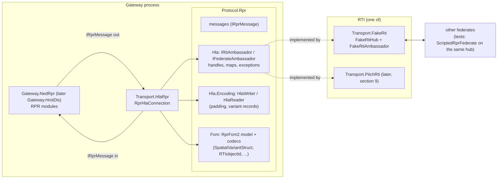

Caption - what the picture shows that prose hid: the gateway never sees HLA; the transport is the only HLA client;
the RTI is swappable behind the port, and the fake RTI treats values as opaque bytes exactly like a real one, so
encoding errors cannot hide behind it.

- **Protocol.Rpr** (BCL only, R-050) grows three namespaces: `Hla` (the port), `Hla.Encoding` (the 1516.2 basic
  and constructed encodings), `Fom` (the RPR FOM 2.0 subset as a code model plus codecs). One protocol project, so
  a transport still references exactly one protocol (rule 5).
- **Transport.HlaRpr** (Engine + Protocol.Rpr): connects, creates/joins, resolves handles, publishes/subscribes,
  maps `IRprMessage` <-> RTI calls and callbacks, encodes/decodes values. It evokes callbacks from the host tick
  (HLA_EVOKED), so callbacks run on the gateway thread and only enqueue into the inbound channel (R-018).
- **Transport.FakeRti** (Protocol.Rpr only): the in-memory RTI.

## 3. Key concepts and decisions

### 3.1 The port mirrors 1516e

`IRtiAmbassador` / `IFederateAmbassador` use the 1516e service and callback names (Java-style signatures adapted
to C#: `byte[]`/`ReadOnlyMemory<byte>` values, handle structs, `IReadOnlyDictionary`-shaped maps), the 1516e
exception names as typed exceptions (`FederateNotExecutionMember`, `ObjectClassNotPublished`, `AttributeNotOwned`,
`ObjectInstanceNotKnown`, `ObjectInstanceNameInUse`, `ObjectInstanceNameNotReserved`, `NameNotFound`,
`CallNotAllowedFromWithinCallback`, ...), and **only the HLA_EVOKED callback model**. Only the services in
section 4 are in the port - each one is used by the transport. Rejected: a message-level port (what
`SimulatedRti` is) - a real binding would then need a second design; a full 1516e port - hundreds of services
nobody calls.

### 3.2 FOM in code (R-054)

`FomModel` = object class tree (names, attributes with datatype names), interaction class tree (parameters),
built in code by `RprFom2.Model()` from the RPR FOM 2.0 modules (Foundation, Base, Physical, Warfare,
Aggregate - the subset used). Fully qualified names `HLAobjectRoot.BaseEntity.PhysicalEntity.Platform.GroundVehicle`.
`createFederationExecution` / `joinFederationExecution` take module **names** resolved by a code registry
(`FomModules`), not URLs. The real binding (section 9) passes the official XML files instead.

### 3.3 Encoding: the padded 1516.2 rules

`HlaWriter`/`HlaReader` encode each attribute or parameter value from offset 0: basic types big-endian, octet
boundary = size; each element padded **before** it to its own boundary; fixed record boundary = max field
boundary; `HLAvariableArray` = `HLAinteger32BE` count, boundary max(4, element); **variant record = discriminant,
then padding to the largest boundary over all alternatives**, then the alternative; RPR extensions
`RPRnullTerminatedArray` (RTIobjectId: ASCII chars + 0x00, boundary 1) and `RPRlengthlessArray` (elements only).
Derived sizes the tests pin: `EntityTypeStruct` 8, `EntityIdentifierStruct` 6, `MarkingStruct` 12,
`SpatialVariantStruct` Static 48 / FP 60 / RP and FV 72 / RV 84 (1 discriminant octet + 7 pad). Both independent
padded implementations (Pitch FedPro, TNO) agree; Portico's Java encoders do **not** pad and are not followed.
A decoder never returns a half value: a truncated or inconsistent value is a decode error the transport counts and
drops (the DIS codec rule of DD-006).

### 3.4 Mapping the gateway contract to RPR FOM 2.0

| `Protocol.Rpr` message (direction) | HLA |
|---|---|
| `RprRegisterObject(Token, EntityType)` (out) - **gains `EntityType`** (the class depends on it) | `registerObjectInstance(class)` with an RTI-generated name (Disco precedent); the class from the entity type (3.5); answered by `RprObjectRegistered(Token, Handle)` on the next pump; the transport keeps handle <-> name |
| `RprObjectUpdate(Handle, fields)` (out) | `updateAttributeValues`: `EntityType`, `EntityIdentifier`, `Marking` (ASCII, 11), `ForceIdentifier`, `DamageState`, `Spatial` (one variant from the transport's per-object spatial cache: any spatial field change re-encodes the whole variant), `ArticulatedParametersArray` (as built: not carried, no message field has it; see section 12a). `DamagePercent` has no RPR 2.0 attribute: dropped, one warning |
| discover + reflect (in) | `RprObjectUpdate(Handle, fields)` with exactly the decoded attributes; on discovery the transport calls `requestAttributeValueUpdate` (Disco precedent) |
| `removeObjectInstance` (in) | `RprObjectRemoved(Handle)` |
| `RprObjectRemoved` / entity removed (out) | `deleteObjectInstance` |
| `provideAttributeValueUpdate` (in) | **new** `RprUpdateRequested(Handle)` -> a new small NedRpr module asks `RprPublication` for a full update (R-003) |
| `RprWeaponFire` / `RprMunitionDetonation` (both ways) - **gain** the RPR fields `FuseType`, `WarheadType`, `RateOfFire`, `InitialVelocity` / `FinalVelocity`, `FireControlSolutionRange`, `RelativeDetonationLocation`, `MunitionObject` | `sendInteraction` / `receiveInteraction` of `HLAinteractionRoot.WeaponFire` / `.MunitionDetonation`; object references (`FiringObjectIdentifier`, `TargetObjectIdentifier`, `MunitionObjectIdentifier`) are **object instance names** (`RTIobjectId`), empty = none; `EventIdentifier` = (`EventCount`, issuing object's name) <-> the message's `Guid` through a bounded correlation map (30 s, like the DIS fire correlator) |
| `RprAggregateEntity` (in) | `HLAobjectRoot.BaseEntity.AggregateEntity` reflections (attribute set taken from `RPR-Aggregate_v2.0.xml` by the implementing agent and recorded in the as-built notes) |
| `RprSimulationControl` | **not carried**: RPR FOM 2.0 has no simulation-management interactions in the modules used; counted and dropped with one warning (verified in HLA-2 against the official RPR FOM 2.0 modules: the only interaction classes are `Collision`, `WeaponFire` and `MunitionDetonation`; R-107) |

`RprDetonationResult` takes the FOM's numbering (Other 0, EntityImpact 1, EntityProximateDetonation 2,
GroundImpact 3, GroundProximateDetonation 4, Detonation 5, None 6) - today it has GroundImpact 2 / Detonation 3;
NedRpr maps through `NedRprConversions.TryResultToRpr`, which is updated with it (no cast exists).
`ForceIdentifierEnum8` values above 3 (`Friendly_2` ...) map inbound to their base force.

### 3.5 Object class from the entity type

| DIS kind / domain | Class registered |
|---|---|
| 1 platform / 1 land | `...Platform.GroundVehicle` |
| 1 / 2 air | `...Platform.Aircraft` |
| 1 / 3 surface | `...Platform.SurfaceVessel` |
| 1 / 4 subsurface | `...Platform.SubmersibleVessel` |
| 1 / 5 space | `...Platform.Spacecraft` |
| 1 / other | `...Platform` |
| 3 lifeform | `...Lifeform.Human` |
| 2 munition | `...Munition` |
| anything else | `...PhysicalEntity` |

The transport subscribes at `PhysicalEntity` (attributes of 3.4) and `AggregateEntity`, so it discovers every
subclass (promotion, 3.6) and reflects only the attributes it decodes.

### 3.6 Fake RTI semantics (the 1516e behaviour reproduced)

| Behaviour | Rule |
|---|---|
| Federations | `FakeRtiHub` holds executions by name; create (duplicate -> `FederationExecutionAlreadyExists`), join (name in use -> `FederateNameAlreadyInUse`), resign (`DeleteObjectsThenDivest` deletes the federate's objects), destroy (joined federates -> `FederatesCurrentlyJoined`) |
| Callbacks | queued per federate, delivered only by `EvokeCallback` (one) / `EvokeMultipleCallbacks` (all queued at call time); time arguments ignored (deterministic); an RTI call from inside a callback -> `CallNotAllowedFromWithinCallback` |
| Publish / subscribe | per class, a later call replaces the attribute set for that class; unpublish/unsubscribe; interaction classes likewise |
| Discovery | a federate discovers an instance registered by another federate when it subscribes (any attribute) to the registered class or a superclass; **known class = the closest such class** (promotion); discovery on register and on late subscription; never of its own instances; once per instance |
| Names | unique per execution; `reserveObjectInstanceName` answers asynchronously (succeeded / failed); `registerObjectInstance(class, name)` needs a reservation (`ObjectInstanceNameNotReserved`); RTI-generated names `HLAobject_<n>` |
| Registration / ownership | needs the class published (`ObjectClassNotPublished`); the registrant owns the instance's attributes it publishes at that class plus `HLAprivilegeToDeleteObject` |
| Updates | owned attributes only (`AttributeNotOwned`), attributes of the registered class only (`AttributeNotDefined`); reflected to every federate that discovered the instance, filtered to its subscription at its known class; nothing when the filtered set is empty; never to the updater |
| Interactions | needs the class published; received by subscribers of the class or a superclass, as the closest subscribed class, with only that class's parameters; never by the sender |
| Attribute value requests | by instance or class -> `provideAttributeValueUpdate` to the owner(s), not to the requester |
| Delete | needs the delete privilege; `removeObjectInstance` to every discoverer |
| Opaque values | the fake RTI never decodes a value (as a real RTI) |
| Test hooks | `FakeRtiHub.Trace` (every service call and callback, for assertions); no randomness |

The discovery promotion rule is the standard's (1516.1 clause 6.9) as commonly implemented; the fetched sources
confirm the behaviour but not the clause text - recorded as known risk, re-checked against a real RTI in HLA-4.

## 4. Class diagram

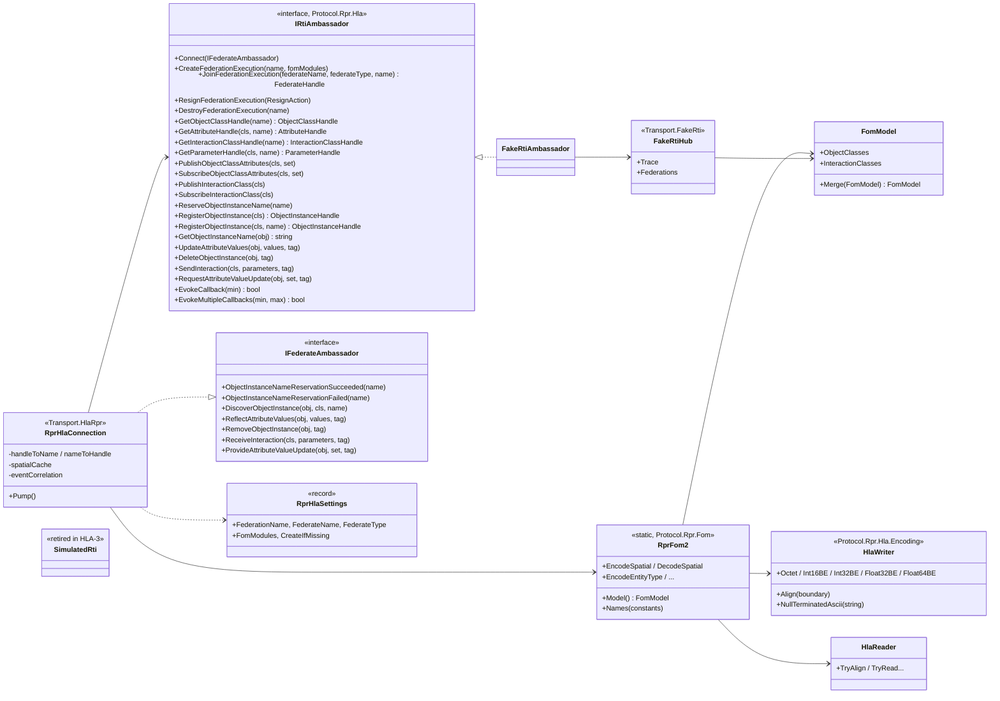

- `RprHlaConnection` is both the transport (inbound/outbound channels of `IRprMessage`, DD-001 channels) and the
  federate ambassador; its callbacks only enqueue.
- `RprFom2` is the one place that knows RPR names and struct layouts; the fake RTI only knows `FomModel`.

## 5. Sequence diagrams

### 5.1 Join and publish

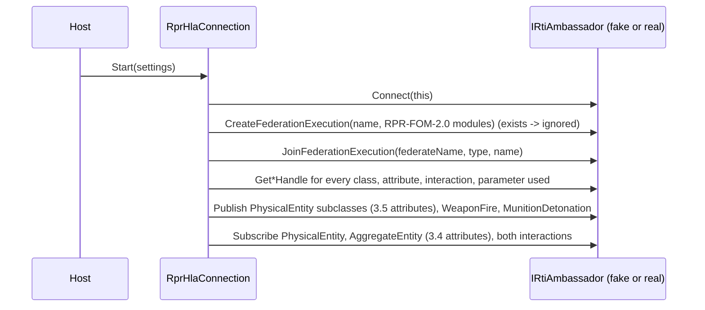

### 5.2 An entity goes out and is seen by another federate

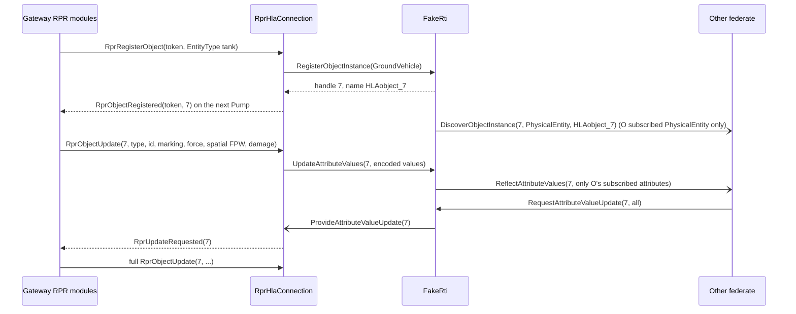

### 5.3 Fire and detonation from another federate

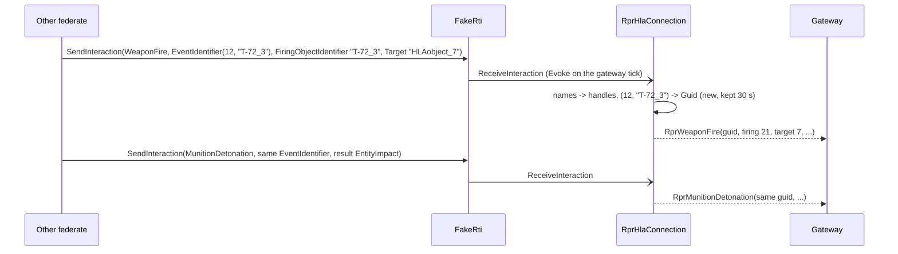

### 5.4 Bad value and a peer's resign

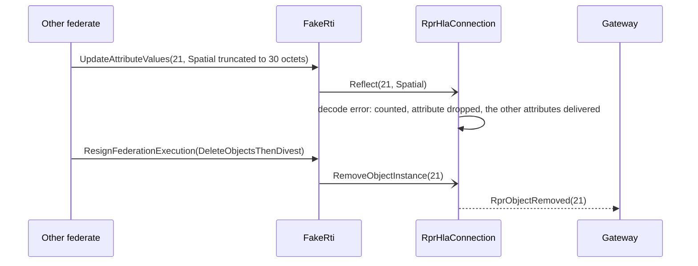

## 6. Module relationships - who calls what each tick

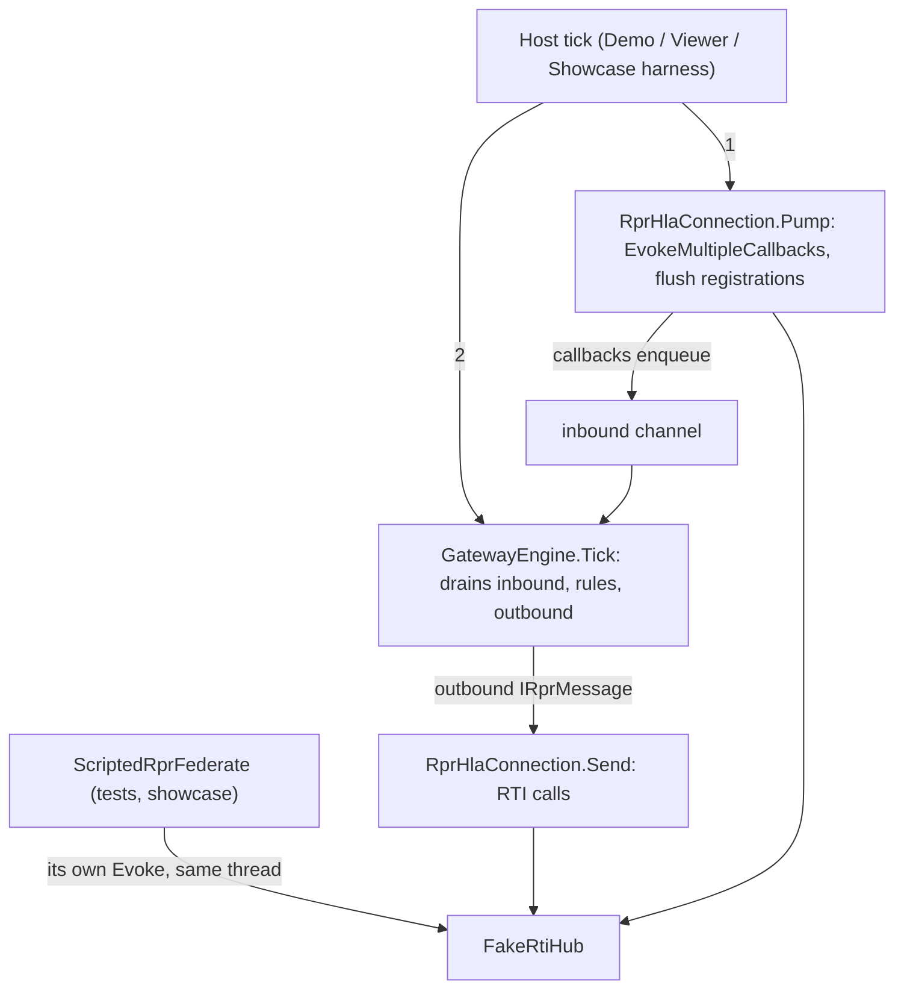

Caption: every RTI interaction happens on the host thread inside one tick - the fake RTI has no thread and no
timer, so a test is a deterministic sequence of `Tick`s (no sleeping, `ManualClock`).

## 7. Edge cases

- Registration of an entity whose type changes class later: the object keeps its registered class (EntityType is
  `Static` in RPR); a kind/domain change is logged, not re-registered.
- `Spatial` with `DeadReckoningAlgorithm = Other` (no alternative in the FOM): never sent (Static when no velocity,
  FPW otherwise); received -> decode error.
- Names over the RTIobjectId limit or non-ASCII: the fake RTI rejects `IllegalName` like a real one; generated
  names are ASCII.
- An interaction naming an object the gateway has not discovered: the reference is absent in the message (like a
  null handle today); the fire is still delivered.
- The gateway's own objects never come back (no reflection to the updater) - no echo filter needed on HLA.
- Several gateways in one federation: each has its own federate name; DIS site/application stay per gateway.

## 8. Test plan

- **Protocol.Rpr.Tests** (new, one per layer is the convention): encoding golden byte vectors for every struct and
  every Spatial alternative (hand-built, independent of the writer) with the derived sizes of 3.3; round trips of
  random values (seeded); every truncation of every value is an error, never a half value; padding bytes are zero.
- **Transport.FakeRti.Tests**: every rule of 3.6 as an invariant checked after every step of randomized seeded
  scenarios (N federates, random publish/subscribe/register/update/delete/interaction sequences) against a
  brute-force reference model: **a federate's received callbacks equal what the reference computes from the same
  call sequence** (discovery set and known class, filtered attribute sets, no self-reflection, removal only to
  discoverers, interactions to closest subscribed class with that class's parameters, exceptions on every illegal
  call); callbacks only inside Evoke; resign/destroy rules.
- **Transport.HlaRpr.Tests**: the gateway's `IRprMessage` round trip through `RprHlaConnection` + fake RTI + a
  `ScriptedRprFederate` that encodes/decodes with `RprFom2` independently: every row of 3.4 both ways, event
  correlation, class choice 3.5, partial updates re-encode the whole Spatial from the cache, decode errors counted
  and isolated, `provideAttributeValueUpdate` -> full update.
- **Showcase (HLA-3)**: Convoy Ambush runs with the RPR side as a scripted federate on the fake RTI; all 48 checks
  pass; `SimulatedRti` and its tests removed.
- Mutation checks by the implementing agent (R-065): padding removed, variant padding to the chosen instead of the
  largest alternative, no self-reflection filter removed, promotion to the root class instead of the closest,
  attribute filter removed, owner check removed.

## 9. The real RTI later (HLA-4)

`Transport.PitchRti` implements `IRtiAmbassador` over a real RTI. Options, decided when access exists: (a) Pitch
Developer Studio's generated C# (licence); (b) a small C ABI shim over the standard C++ 1516e API, built for
linux-x64 and win-x64 and called through P/Invoke - needs an amendment of R-012's P/Invoke line (raylib already
works this way); OpenRTI (open source, 1516e C++) can run the same shim in CI. The FOM then comes from the official
RPR FOM 2.0 XML modules; `RprFom2.Model()` is checked against them by a test.

## 10. Stages

| Stage | Content | Exit |
|---|---|---|
| HLA-1 | `Protocol.Rpr`: `Hla` port, `Hla.Encoding`, `Fom` (`FomModel`, `RprFom2` model + codecs); `Transport.FakeRti`; test projects | encoding goldens, fake-RTI reference-model invariants |
| HLA-2 (built) | `Transport.HlaRpr`; message additions (3.4); `RprUpdateRequested` module in NedRpr; `RprDetonationResult` renumbered | transport tests; all existing suites green |
| HLA-3 (built, section 12b) | Convoy Ambush over the fake RTI; `SimulatedRti` retired; Demo/Viewer run the RPR side over the fake RTI (one wiring, `NedRprHost`) | 48/48 |
| HLA-4 | real binding (section 9) | interop with a real RTI |

## 11. Proposals awaiting approval

| ID | Proposal (lean) | Main alternative |
|---|---|---|
| **P-77** (approved, R-100) | **A C# port mirroring 1516e** (names, exceptions, HLA_EVOKED only; services of section 4 only) in `Protocol.Rpr.Hla`. | A message-level port (a second design for the real binding). |
| **P-78** (approved, R-101) | **One protocol project**: the port, the 1516.2 encoding and the RPR FOM 2.0 model/codecs live in `Protocol.Rpr` (namespaces `Hla`, `Hla.Encoding`, `Fom`). | A separate `Protocol.Hla` - the transport would reference two protocols (rule 5 change). |
| **P-79** (approved, R-102) | **Padded 1516.2 encoding** (Pitch/TNO behaviour) with the derived RPR sizes of 3.3 pinned by goldens. | Unpadded (Portico Java) - wire-incompatible with Pitch. |
| **P-80** (approved, R-103) | **Fake RTI semantics** of 3.6, deterministic, single-threaded, opaque values, verified against a brute-force reference model. | A thinner fake (no promotion, no filtering) - would hide the behaviours a real RTI enforces. |
| **P-81** (approved, R-104) | **RTI-generated object names** (no reservation round trip), names kept by the transport for `RTIobjectId` references. | Reserved deterministic names `site.app.entity` - an extra asynchronous step and collisions to handle. |
| **P-82** (approved, R-105) | **Mapping of 3.4 / 3.5**: `RprRegisterObject` gains `EntityType`; new `RprUpdateRequested` + module; interaction fields added; `RprDetonationResult` takes the FOM numbering; per-object spatial cache in the transport. | Keep the messages and guess the class at registration (always `PhysicalEntity`) - other federates subscribing to `Platform` would never discover us. |
| **P-83** (approved, R-106) | **FOM in code** (`RprFom2.Model()`, R-054); the official XML is used only by the real binding, with a test comparing the two. | Ship the RPR XML modules now and parse them (contradicts R-054 for now). |
| **P-84** (approved, R-107) | `RprSimulationControl` **not carried** over HLA (no RPR 2.0 interaction for it in the used modules); counted and warned. | Map it to a custom interaction class (non-standard). |
| **P-85** (approved, R-108) | **Retire `SimulatedRti`** in HLA-3 when Convoy Ambush passes on the fake RTI. | Keep both stand-ins (two implementations of one concept). |
| **P-86** (approved, R-109) | **Stages HLA-1 .. HLA-4** of section 10; the HROT gateway gets the same HLA side when `Gateway.HrotDis` reaches it, by sharing the RPR modules then (their extraction is that stage's design question, not this one). | Build the HLA side for `Gateway.HrotDis` first (it does not exist yet). |
| **P-88** (found in HLA-3, approved, R-120) | **The showcase layer may reference transports** (`LayerRules`: `Showcase` -> `Transport` allowed; `Host` and the rest unchanged). `NedRprHost` is the one host assembly of the demo, the viewer, the benchmark and the tests (DD-003 section 5), so the HLA wiring lives there once. | Hosts wire the transport and hand the showcase the channels by interface: `ScenarioRunner`, `DemoScenario` and ~20 test classes construct the host themselves, a host may not reference another host (Demo and Viewer would each carry a copy), and a factory would have to be threaded through every caller. |
| **P-89** (found in HLA-3, approved, R-121) | **A re-sent aggregate does not write the members it already links** (`RprAggregateEntityIngress`: same unit and same index = no write). The heartbeat of an HLA unit is an aggregate reflection, always delivered as `RprAggregateEntity`; without this a live unit refreshes every member and a silent member of a live unit never ages out (R-068, S-4.5, S-9.2). | Keep the write and change the showcase: S-4.5 and S-9.2 cannot be expressed over HLA (a marking-only unit refresh has no HLA form); or a transport rule "an aggregate reflection that carries only the marking is an `RprObjectUpdate`" (contradicts section 3.4). |

## 12. As-built notes (stage HLA-1, T-021)

Built: `Protocol.Rpr` namespaces `Hla` (port, handles, maps, exceptions), `Hla.Encoding` (`HlaWriter`, `HlaReader`) and `Fom`
(`FomModel`, `FomModelBuilder`, `FomModules`, `RprFom2` model + codecs, plain value structs, enumerations); project
`Transport.FakeRti` (`FakeRtiHub`, `FakeRtiAmbassador`); test projects `Protocol.Rpr.Tests` and `Transport.FakeRti.Tests`
(DD-003 convention: one test project per src project, so no shared "per layer" project). The class diagram of section 4 holds;
deviations and decisions the design left open:

| Topic | As built | Why |
|---|---|---|
| Port surface | section 4 plus `UnpublishObjectClass`, `UnsubscribeObjectClass`, `UnpublishInteractionClass`, `UnsubscribeInteractionClass` and `RequestAttributeValueUpdate(ObjectClassHandle, ...)` (1516e names) | section 3.6 and the HLA-1 exit demand unpublish / unsubscribe and "by instance or class" requests; the diagram had not listed them. An empty set in publish / subscribe also means unpublish / unsubscribe, as in 1516e |
| Exceptions | the list of the brief plus `FederateOwnsAttributes` (resign without divesting while owning) | needed by `ResignAction.NoAction` |
| `FomModules` | lives in `Protocol.Rpr.Fom` (not test-side); `FakeRtiHub.RegisterModule` overrides it per hub | the fake RTI (references only `Protocol.Rpr`) and the later transport share the module names; an unknown module name is `NameNotFound` (1516e has `CouldNotOpenFDD`, not in the port) |
| `Encode*` / `TryDecode*` | `Encode*` throws `ArgumentException` for what the FOM cannot hold (enumerator not in the FOM, `Other` dead reckoning, non-ASCII `RTIobjectId`, marking not 11 octets); `TryDecode*` is strict on enumerators and booleans, requires the value to be consumed completely, does not check padding octets | a decoder that never returns a half value (3.3); the encoder is the only producer of zero padding |
| Variant padding | `HlaWriter.VariantRecordStart` / `VariantAlternativeStart` pad to the largest boundary over all alternatives. In the RPR types every alternative has the same boundary (8 for `SpatialVariantStruct`, 4 for `ParameterValueVariantStruct`), so the rule is only observable on a synthetic variant, which the tests use | honest limit of the golden vectors |
| `ArticulatedParameterStruct` | 20 octets for both alternatives (Change@0, 1 pad, PartAttachedTo@2, ParameterType@4, alternative@8..19); lengthless array = elements only, truncation between elements is a valid shorter array | derived in `EncodingGoldenTests` |
| Handles | 1-based indexes in model order (classes parents first, attributes by declaring class in declaration order); inherited attributes / parameters keep the declaring class's handle; instance handles and `HLAobject_<n>` names use the same counter per federation | deterministic, same FOM = same handles in every federation |
| Ownership | fixed at registration: the registrant owns the attributes published at the registered class plus `HLAprivilegeToDeleteObject`; a later publish / unpublish does not change it (R-057: one owner, no transfer) | simplest deterministic rule; ownership transfer is out of scope |
| Attribute checks | `AttributeNotDefined` for update and value requests is evaluated against the class the caller knows the instance as (the registered class for the registrant) | a federate that knows an instance as `PhysicalEntity` cannot name `Platform` attributes |
| Value requests by class | cover live instances of that class or a subclass that the requester knows | requests are relative to what a federate knows |
| Names | printable ASCII, 1..255 characters, not starting with `HLA`; a reservation by another federate counts as "not reserved" for `RegisterObjectInstance(class, name)`, `ObjectInstanceNameInUse` only for a name bound to an instance; a name is free again when its instance is deleted or its reserver resigns | `HLA`-prefixed names are reserved for RTI-generated ones, so they cannot collide |
| Resign | `DeleteObjects`, `DeleteObjectsThenDivest`, `CancelThenDeleteThenDivest` delete the federate's instances (removal callbacks to discoverers); `UnconditionallyDivestAttributes` leaves them without an owner (nobody can update or delete them, late subscribers still discover them); `NoAction`, `CancelPendingOwnershipAcquisitions` throw `FederateOwnsAttributes` while it owns anything. The resigned federate's callback queue is discarded | 1516e semantics reduced to what exists without ownership transfer |
| Evoke | `EvokeCallback` / `EvokeMultipleCallbacks` need only a connection and return true while callbacks are still pending; callbacks queued during delivery wait for the next evoke | HLA_EVOKED |
| Callback copies | values and tags are cloned per recipient when queued | a sender mutating its arrays later cannot change what was sent |
| `ProtocolTests.Namespaces_equal_the_project_names` | now accepts the three sub-namespaces for `Protocol.Rpr`; message types must still be in the root namespace | DD-008 section 2 puts `Hla`, `Hla.Encoding`, `Fom` into that project |
| Generated sources | `Fom/RprEnumerations.cs` (the seven enumerations) and `Fom/RprFom2.Definitions.cs` (name constants + `BuildModel`) were generated once from `RPR-Enumerations/Base/Physical/Aggregate/Warfare_v2.0.xml`; not regenerated by the build | R-054: no runtime XML; the HLA-4 test compares the model with the official XML |
| Equivalent behaviour noted | the "no reflection to the updater" check in the update loop is redundant by construction (only the registrant can update and it never discovers its own instance); the rule is enforced by "never discover own instances" and tested through that | found by the mutation check |

AggregateEntity (parent `BaseEntity`, module `RPR-Aggregate_v2.0.xml`), attributes in module order: `AggregateMarking`
(AggregateMarkingStruct), `AggregateState` (AggregateStateEnum8), `Dimensions` (DimensionStruct), `EntityIdentifiers`
(RTIobjectIdArray), `ForceIdentifier` (ForceIdentifierEnum8), `Formation` (FormationEnum32), `NumberOfSilentEntities`
(Integer16), `NumberOfVariableDatums` (UnsignedInteger32), `SilentAggregates` (SilentAggregateStructLengthlessArray),
`SilentEntities` (SilentEntityStructLengthlessArray), `SubAggregateIdentifiers` (RTIobjectIdArray), `VariableDatums`
(VariableDatumStructLengthlessArray). HLA-1 only named them; HLA-2 uses `AggregateMarking`, `EntityType`, `ForceIdentifier` and `EntityIdentifiers` (codecs added, see the HLA-2 notes below); the rest is not decoded.

## 12a. As-built notes (stage HLA-2, T-021)

Built: `Transport.HlaRpr` (`RprHlaConnection`, `RprHlaSettings`, `RprHlaClasses`; internal `RprHlaHandles`, `SpatialCache`,
`EventCorrelation`), the message changes of 3.4, the NedRpr module `RprUpdateRequestedResponder`, the renumbered
`RprDetonationResult`, new codecs in `Protocol.Rpr.Fom`, test project `Transport.HlaRpr.Tests` with the `ScriptedRprFederate`
peer. `Showcase` / `NedRprHost` still run on `SimulatedRti` (HLA-3 retired it, section 12b).

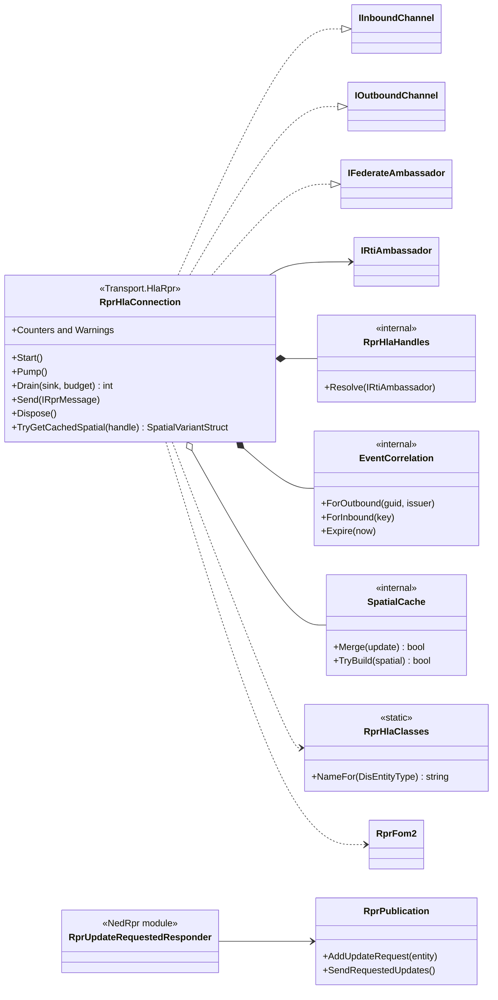

Caption - what the picture shows that prose hid: the transport is one class (split over three files by direction) with three small
helpers; the only state that survives a message is the two name/handle maps, the per-object `SpatialCache` and the
`EventCorrelation`; the gateway side of the new feature is one module plus two members of `RprPublication` (no second way to build a
full update).

The class diagram of section 4 holds. Deviations and decisions the design left open:

| Topic | As built | Why |
|---|---|---|
| Message fields (3.4) | the new RPR fields are **init-only properties** on `RprWeaponFire` / `RprMunitionDetonation` (the positional constructors are unchanged, so no caller changed): `FuseType`, `WarheadType`, `RateOfFire` as `ushort?`, `InitialVelocity` / `FinalVelocity` / `RelativeDetonationLocation` as `RprVector?`, `FireControlSolutionRange` as `float?`, `MunitionObject` as `RprObjectHandle?`. Null = not known: the transport sends the FOM default (Other, 0, zero vector, empty reference) and delivers null for a parameter the peer did not send or that did not decode. The NED-RPR gateway fills none of them | the gateway does not know them; a DD-008 3.4 "optional where the gateway may not know them" |
| `QuantityFired` of a detonation | `RprMunitionDetonation` has no quantity; the transport sends 1 | the DIS-aligned message never carried one |
| `RprDetonationResult` | 7 enumerators (FOM 0 .. 6). FOM codes 7 .. 33 inbound become `Other`. `NedRprConversions.TryResultToRpr` maps pivot 0, 1, 2, 3 to 0, 1, 3, 5; `TryResultFromRpr` is its inverse and rejects 2, 4, 6 (no pivot counterpart; nothing calls it for production traffic) | NED-visible behaviour unchanged: the NED side and the pivot keep their numbering (`NedRprConversions` tests, the event tests by enumerator name) |
| `RprRegisterObject.EntityType` | filled by `RprPublication.TryRegister` from the entity's TKB through `ToDis` (the catalogue default with the usual one-time warning for an unknown TKB) | the class depends on it (3.5) |
| `RprUpdateRequestedResponder` | one module: the ingress handler notes the entity (only a publication of ours: `Echo` resolution; unknown handle or RPR-origin entity ignored) and publishes the internal event `RprPublication.UpdateRequested`; its rule "Send" calls `RprPublication.SendRequestedUpdates`, which sends the same full update as the heartbeat (`BuildFull(predictToNow: true)`, pending fields folded in) and counts as a send for the heartbeat. A pending (not bound) entity is not answered. Each request message is answered; the engine does not collapse requests | R-003 (new small module); ingress cannot send, the same pattern as the registration answer |
| Duplicate requests | the transport collapses `RprUpdateRequested` for a handle that is still waiting in its inbound queue (several federates asking in one pump = one message) | cheap, keeps a request storm out of the engine |
| Pump order | answers of the registrations made since the last pump are queued first, then `EvokeMultipleCallbacks`, then the callbacks are processed in arrival order (discovery -> value request, reflect -> update, interaction -> event, provide -> request), then the correlations are aged. Callbacks only enqueue (R-018); the value request after a discovery is an RTI call made after the evoke, never inside a callback | the fake RTI throws `CallNotAllowedFromWithinCallback`; 5.2 and 6 |
| Registration failure | an RTI exception while registering is counted (`SendErrors`) and no `RprObjectRegistered` follows; the entity stays pending (the gateway has no failure answer) | no message type for it; a real federate that cannot register has nothing to run |
| Spatial | `SpatialCache` merges the spatial fields of every update. The variant needs a position: without one nothing is sent for `Spatial` (the other attributes of the update are), unknown orientation / vectors are zero, `IsFrozen` is false. The algorithm is the gateway's when it is DIS 1 .. 9, otherwise Static without a known velocity and FPW with one (so Other, absent and 10+ never reach the wire). Fields the algorithm does not carry are zeroed in the cache, so the cache equals what a peer decodes (`TryGetCachedSpatial`) | 3.4; success condition a |
| Inbound spatial | the update carries location, orientation and algorithm, and a velocity / acceleration / angular velocity only when the algorithm carries it (a switch from FPW to Static does not clear a stored velocity on the gateway side) | "exactly the decoded attributes" |
| Attribute sets | published at each of the nine classes of 3.5: `EntityType`, `EntityIdentifier`, `Spatial`, `Marking`, `ForceIdentifier`, `DamageState`. Subscribed at `PhysicalEntity` the same six; at `AggregateEntity`: `AggregateMarking`, `EntityType`, `ForceIdentifier`, `EntityIdentifiers`. **`ArticulatedParametersArray` is neither published nor subscribed** (no message field carries it); `DamagePercent` is dropped (one warning, counted) | a message has to carry what the transport sends |
| New codecs (`RprFom2.Hla2.cs`) | `AggregateMarkingStruct` (encoding octet + 31 octets, 32 octets, checked against `RPR-Aggregate_v2.0.xml`), `RTIobjectIdArray` (HLAvariableArray of null terminated names: int32 count then the names, no padding; checked against `RPR-Foundation_v2.0.xml`), `UnsignedInteger16`, `UnsignedInteger32`, `LengthMeterFloat32`; goldens and the random round-trip / truncation properties in `Protocol.Rpr.Tests` | needed by the aggregate and interaction mappings |
| Aggregates | one `RprAggregateEntity` per reflection that decoded any aggregate attribute; the state (marking, type, force, member names) is kept per object across partial reflections. The member names are mapped to DIS ids learnt from the members' reflected `EntityIdentifier` (a member not known yet is left out); when a member's id becomes known, every aggregate that names it is emitted again, after the member's own update | the NED-RPR linker links late members itself, this makes the member list complete as early as the transport can |
| Interactions out | every FOM parameter is sent: those the message has, else FOM defaults (`FireMissionIndex` 0, `QuantityFired` of a detonation 1, `RateOfFire` 0, `FuseType` / `WarheadType` Other when null or not a FOM enumerator, empty `MunitionObjectIdentifier`, empty `ArticulatedPartData`). A handle the transport cannot name (unknown, or null) is the empty reference | a receiver decodes whole interactions |
| Event correlation | ONE map for both directions (`Guid` <-> (count, issuing object name)) so a peer that answers a gateway fire with a detonation of the same identifier gets the gateway's `Guid`. An entry lives 30 s of the connection's clock from its creation (age >= 30 s is gone, no refresh on use), at most 4096 entries. Outbound counts are per issuing object (the firing object's RTI name, empty when none or unknown). An inbound identifier that is missing or does not decode cannot be correlated: the event gets a `Guid` of its own and the error is counted | 3.4 |
| Counters, warnings | the transport has no engine diagnostics: counters (`DecodeErrors`, `EncodeErrors`, `SendErrors`, `CallbackErrors`, `DroppedDamagePercent`, `DroppedSimulationControl`, `RejectedOutbound`, `UnknownObjectCallbacks`) and a `Warning` event plus `Warnings` list (each kind once). A host that wants them in the engine's diagnostics forwards the event | a transport references the engine's ports only |
| `Inbound` source / name | the channel takes its `SourceId` and name in the constructor (the host builds the builder first and reads the port's source) | the engine checks that the bound channel reports the port's source |
| `Showcase` / `NedRprHost` | unchanged; the end-to-end tests of this stage build their own host in `Transport.HlaRpr.Tests` (builder, `RprHlaConnection` bound as inbound and outbound `rpr` port, host tick = pump, engine tick, peer evoke) | HLA-3 does the showcase |
| Peer detonation does not reach NED | the NED-RPR gateway has **no inbound handler for `RprMunitionDetonation`**: this matches its approved design (DD-001 mapping table: detonations go NED -> RPR only; the PoC adjudicates damage on the NED side), so nothing is added; the transport delivers it (`EndToEndTests`). Success condition g of the HLA-2 brief over-asked here (reviewer's note). The HROT gateway handles inbound detonations (R-097) | resolved by the reviewer against DD-001, not a user question |
| Existing tests changed | `ProfileTests` module / rule lists (the new module), `ProtocolTests` message inventory and enum numbering, `ConversionTests` detonation mapping, `SimulatedRtiTests` (constructor argument), `Engine.Monitoring.Tests.IntegrationTests` (one rule more: "46 rules" replaces "45 rules" in the observed report) | mechanical consequences of the new module / fields |

Test inventory and the mutation checks (R-064 / R-065): see the T-021 row of `docs/TASKS.md` and the report of the commit; the
mutation table of this stage is:

| Mutation | Failing tests |
|---|---|
| spatial cache merge dropped (each update starts from an empty cache) | partial-update property test (300 seeds) + 3 directed spatial tests |
| Aircraft domain registered as GroundVehicle | class-choice theory, interleaved-registration test |
| event count not incremented (distinct events collide) | distinct-events test, both expiry tests |
| inbound correlation key ignores the count | inbound same-Guid / distinct-events test |
| detonation gets a fresh EventIdentifier instead of the correlated one | fire/detonation identifier tests, end-to-end NED fire + detonation |
| registration answer queued inside Send | answer-on-next-pump test |
| a decode error aborts the whole reflection | corrupt-attribute, all-corrupt, random-corruption (300 seeds), garbage (300 seeds) |
| ForceIdentifier Friendly_2 mapped to Other | force-table test, Friendly_2 test, random reflections, aggregate test |
| correlation never expires | inbound and outbound expiry tests |
| correlation expires one instant late (< instead of <=) | exact-30-second boundary tests |
| warning given every time | DamagePercent and RprSimulationControl one-warning tests |
| no value request after discovery | discovery/value-request test, aggregate request test, lifecycle tests |
| provide callback ignored | RprUpdateRequested tests, end-to-end value request |
| dead reckoning Other sent | partial-update property test, DR rule test |
| inbound spatial delivers vectors the algorithm does not carry | spatial-fields test, random reflections |
| aggregate not re-emitted when a late member becomes known | late-member aggregate test |
| object removal does not delete the RTI instance | removal test |
| unknown object name mapped to a handle | inbound fire / detonation tests |
| DamagePercent sent as a damage state | DamagePercent test |
| registration answers not cleared (delivered on every pump) | 49 tests (answers exactly once) |
| duplicate value requests not collapsed | request-collapsing test |
| NedRpr: responder sends nothing | 4 UpdateRequestedTests + end-to-end value request |
| NedRpr: detonation result keeps the old numbering | ConversionTests, the NED detonation-result theory, end-to-end NED detonation |
| NedRpr: RprRegisterObject without the entity type | end-to-end class test |

## 12b. As-built notes (stage HLA-3, T-021)

Built: the RPR side of the host assembly `NedRprHost` (`src/Showcase`) is the HLA transport on the fake RTI plus the scripted RPR
federate; Convoy Ambush, the demo, the benchmark, the viewer and the gateway tests all run on that one wiring. `SimulatedRti` and its
tests are gone from the code (R-108); this document and DD-001 / DD-002 / DD-003 mention it only as history.

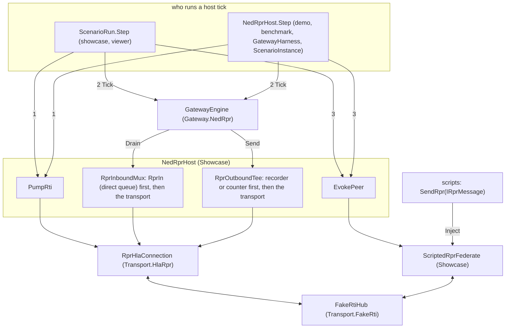

Caption - what the picture shows that prose hid: there is exactly one path between the gateway and the RPR side, through the RTI; the
numbers are the tick order of section 6 (pump, engine tick, the federate's evoke). The direct queue `RprIn` is the only other way into
the engine's "rpr" port and nothing in `src/` outside `NedRprHost` uses it.

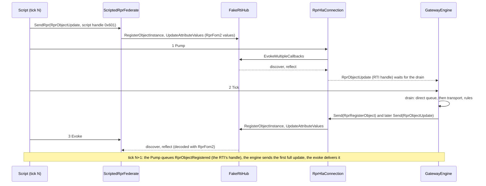

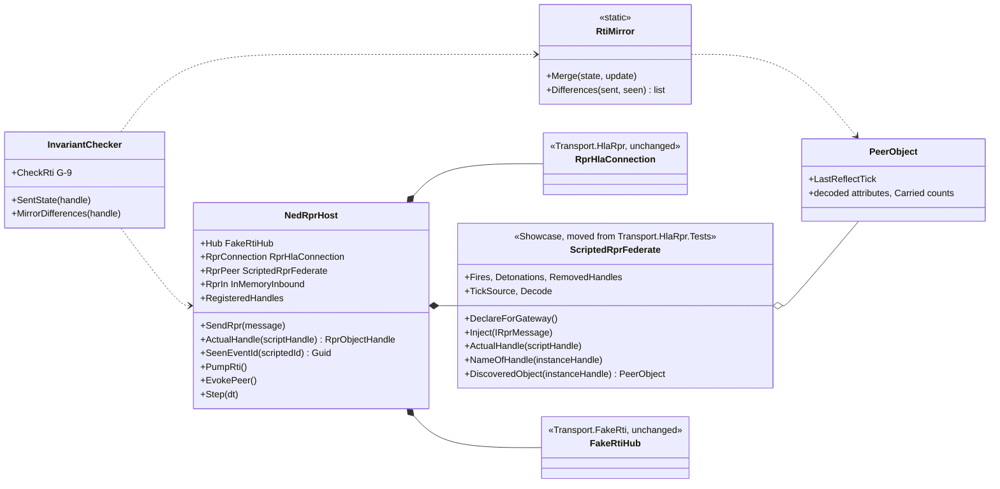

The class diagram of section 4 holds; `RprHlaConnection` and `FakeRti` did not change. Decisions and deviations:

| Topic | As built | Why |
|---|---|---|
| Layer rule (**P-88**) | `LayerRules`: `Showcase` may reference `Transport` (the only rule change; `LayerRulesTests` moves the pair from forbidden to allowed). `Showcase` now references `Transport.HlaRpr` and `Transport.FakeRti` | `NedRprHost` is the shared host assembly; see P-88 for the rejected alternative. DD-003 sections 3 and 9 carry a note |
| One federate for everyone | `ScriptedRprFederate` (with `PeerObject`, `PeerFire`, `PeerDetonation`) moved from `tests/Transport.HlaRpr.Tests` to `src/Showcase`; the transport tests reference the Showcase project and use that one class. New: `DeclareForGateway`, the message level API `Inject`, `TickSource` (tick stamps on what it receives), `Decode` (off = drain only), `ActualHandle` / `NameOfHandle` / `DiscoveredObject` / `EventIdentifierOf` | the brief: one implementation for showcase, viewer and tests. The low level API is unchanged |
| `Inject` | `RprObjectUpdate` -> register on the first message of a script handle (class from the entity type, `PhysicalEntity` without one) + `updateAttributeValues` with `RprFom2` values (the spatial variant re-encoded from the federate's own merged state, same rule as 3.4); `RprAggregateEntity` -> `AggregateEntity` object, members named by the RTI names of the objects with those DIS identifiers, a member that does not exist yet gets a **reserved name** that its later registration takes; `RprObjectUpdate` on a unit = its aggregate attributes (the unit's keep-alive); `RprObjectRemoved` -> `deleteObjectInstance` (an unknown handle sends nothing: a federate cannot delete what it never registered); fire / detonation -> `sendInteraction`, references are RTI names, `EventIdentifier` = (count per issuing object, issuer), the same scripted id gets the same identifier, an event without a firing object is issued by the federate itself (two federates must not share an identifier). A damage percentage is never sent | the scripts keep their message-level wording; everything crosses the RTI |
| Script handles | the handle numbers in the RPR messages of a script (0x601, 0x700, ...) are **keys**; the RTI assigns the real handles (1-based counter of the federation). `NedRprHost.ActualHandle(script)` and `ScenarioContext.RprEntity(script)` translate; a number the federate never registered is taken as an RTI handle (the gateway's own objects, as in fires at them) | handles are assigned by the RTI (the brief) |
| Registration | answered by the next `Pump` (tick + 1, as before); the order of answers is `NedRprHost.RegisteredHandles`; G-5 asks `IsRegisteredHandle` | replaces `Rti.Registered` |
| Event ids | HLA carries no guid: the transport makes one per (count, issuer). `NedRprHost.SeenEventId(scriptedId)` is the id the gateway saw for an injected event (FIFO of injected events against the transport's deliveries); the checker's `OnRprReceived` gets what the engine receives (`OnRprDelivered`) | G-1 and the event checks compare the ids the gateway works with |
| Direct queue | `NedRprHost.RprIn` stays as a test seam: a message enqueued there reaches the engine without the RTI (drained before the transport's). Used only by the gateway module tests that need an exact message (a handle of their own choosing); `DeliverRti = false` now means "the transport is not pumped" | no RTI stand-in is involved; it is the engine's input channel |
| Pump / evoke | `NedRprHost.Step`, `ScenarioRun.Step`, the viewer's `StepHost` run `PumpRti`, `Engine.Tick`, `EvokePeer`; the engine tick count stamps what the federate receives | section 6 |
| **G-9** (DD-002 section 6) | new invariant, on in the showcase runner (`InvariantChecker.CheckRti`): every tick, what the gateway sent to the RPR side (registrations, attribute updates merged per object, removals, fires, detonations) equals what the federate decoded (`RtiMirror`: exact, float32 against the same cast), updates are reflected in the tick they were sent, one event id = one RTI event identifier, the transport counted no loss and dropped exactly the damage percentages and simulation controls the gateway sent | "the script's RPR expectations are checked on what the RPR side actually receives" |
| **P-89**, gateway | `RprAggregateEntityIngress` writes `Structure.Parent` / `MemberIndex` of a listed member only when they differ (6 lines) | an HLA unit's heartbeat is an aggregate reflection (always `RprAggregateEntity`); the old script refreshed the unit with a marking-only `RprObjectUpdate`, which has no HLA form. Without P-89 a live unit would refresh every member: S-4.5 (Wolf-1 / Wolf-2 silent for 10 s) and S-9.2 (Wolf-3 reaped) would fail; the unit's own write still counts. Tests: `AggregateTests` (2); mutation below |
| Not carried (as designed) | `RprSimulationControl` (R-107) and `DamagePercent` (R-105): the gateway's output is unchanged, the transport counts them dropped, the federate receives nothing; S-2.2, S-8.1, S-8.3, S-11.1 (controls) and S-6.1 (percent) assert the counters and that nothing arrived | the success conditions keep their intent: "the gateway sends it"; see DD-002 as-built |
| Benchmark / traffic | `NedRprHostOptions.PeerDecodes` follows `Record`: the benchmark host drains the federate's callbacks without decoding. The 10k benchmark runs over the RTI (Debug, 5 s: 1.1x real time, 14.9 KB per inbound message, 0 diagnostics) | the benchmark has no `SimulatedRti` to fall back on; the Release numbers of stage 6 are not comparable |
| Unchanged | transport, fake RTI, protocol and every other module; the NED, display and RPR output of Convoy Ambush (below) | |

Result of Convoy Ambush on the fake RTI: **48 of 48 conditions PASS, no G-1 .. G-9 violation in 8,400 ticks**, final state empty (the federate holds none of the
gateway's objects), the report identical in two runs. What the gateway sent, compared with the run before this stage (the message-level SimulatedRti),
pinned as golden files in `tests/SimNetGateway.Gateway.NedRpr.Tests/Golden` (`ConvoyAmbushOverHlaTests`): NED 46 messages identical (ticks and text), display 5,334 messages
identical (SHA-256), RPR 160 messages identical up to the numbers of the handles (0x2A01.. before, the RTI's 1.. now) - the only difference anywhere is the
first 8 hex digits of the guid of the RPR fire E1 on the NED side (`e1000000` before, `00000001` now: the transport's event guid).

Mutation checks of this stage (R-065); each was restored:

| Mutation | Failing |
|---|---|
| the host never evokes the federate (`EvokePeer` empty) | 41 tests: S-1.2, S-3.2, S-4.1, S-5.1 .. S-5.4, S-5.6, S-6.1, S-9.1, S-9.3, S-9.5, S-10.1, S-11.1, G-9 in the acceptance test and in 12 random-traffic seeds, `HlaShowcaseTests` |
| the host pumps after the engine tick instead of before | S-1.3 (NED got the RPR object one tick late), the golden NED and display tests, the `HlaShowcaseTests` tick-order and pump tests, 2 `NedToRprTests` |
| the transport drops the spatial cache merge | G-9 in `HlaShowcaseTests.G9_a_static_entity_that_moves_...` and 4 `Transport.HlaRpr.Tests`; **not** the 48 conditions: Convoy Ambush never sends a location-only update, so the added G-9 test covers it |
| `RprAggregateEntityIngress` rewrites linked members again | S-4.5, S-9.2, golden NED, `AggregateTests` |
| `RtiMirror.Differences` always empty | 13 tests (`RtiMirrorTests`, `G9_detects_an_update_the_federate_does_not_hold`) |
| the federate names a not-yet-existing member without reserving the name | S-3.5, S-7.6, S-9.2, `PeerInjectionTests` (aggregate) |
| the scripted event id is not mapped to the transport's | S-5.1, S-5.6, S-10.3, `HlaShowcaseTests` (event ids) |
| the host does not remember the registration answers | 228 tests (G-5 on every RPR handle) |
| the federate's removal does not delete the object | S-9.1, S-10.1 and 21 more, `PeerInjectionTests` |

Test inventory: `Transport.HlaRpr.Tests` 98 (78 + 20 `PeerInjectionTests`: registration once per script handle, partial updates, 9 seeded random sequences against the independent `SpatialModel`,
aggregates with reserved names, fire / detonation event identifiers, removals, tick stamps, `Decode` off); `Gateway.NedRpr.Tests` 601 (566 - 8 `SimulatedRtiTests` + 43: `HlaShowcaseTests` 16, `RtiMirrorTests` 19,
`ConvoyAmbushOverHlaTests` 6, 2 `AggregateTests`); `Architecture.Tests` 97 (the Showcase -> Transport pair moved from forbidden to allowed); the viewer's headless smoke 94, unchanged.
