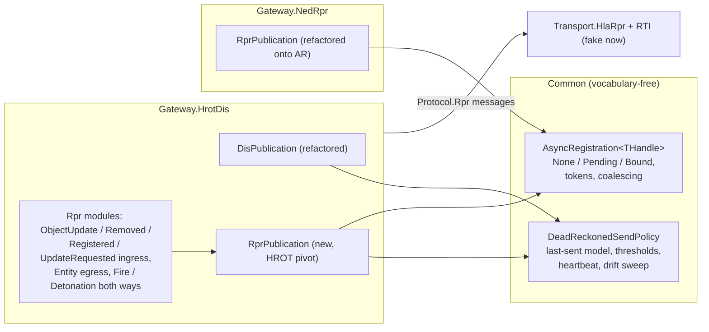
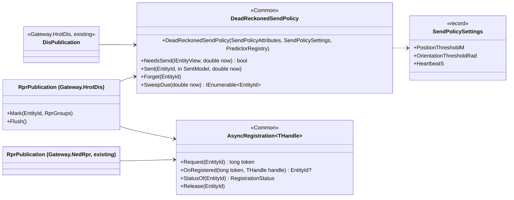
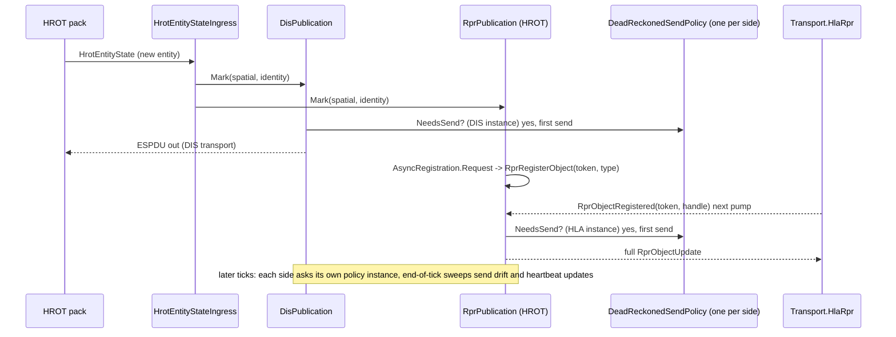
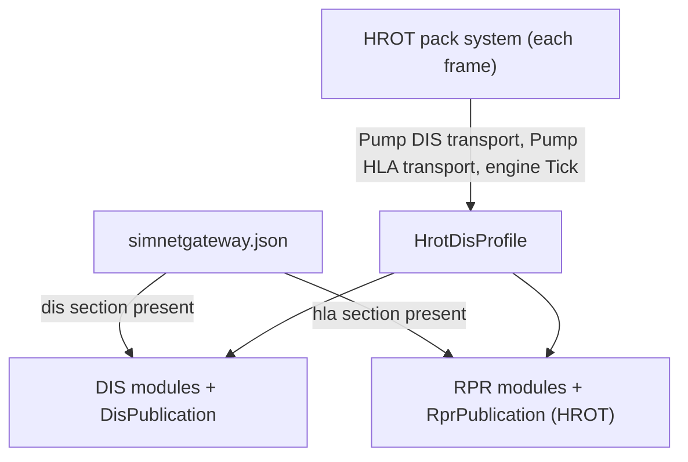

# DD-009: The HLA Side of the HROT Gateway and the Shared Publication Logic

| | |
|---|---|
| **Status** | in review - proposals P-90 .. P-94 await the user |
| **Tasks** | T-024 |
| **Rulings honoured** | R-003, R-045, R-047, R-068, R-069, R-079 .. R-113 (esp. R-094 configuration file, R-100 .. R-109 HLA side) |
| **Inputs** | DD-006 section 14 (as-built H2a / H2b: `DisPublication` with dead-reckoned send policy), DD-008 sections 3.4 - 3.6 and 12 - 12b (HLA transport, fake RTI, Convoy Ambush over HLA), `Gateway.NedRpr/Services/RprPublication.cs` (asynchronous registration None -> Pending -> Bound) |
| **Date** | 2026-10-29 |

<!--STATUS
state: LIVE
updated: 2026-10-29
current-answer: whole document
stale-below: none
related-designs:
  - docs/design/DD-006-Gateway-Hrot-Dis.md - the HROT gateway's pivot and DIS side; this design adds its HLA side
  - docs/design/DD-007-Hrot-Dis-Pack.md - the HROT pack that hosts both sides; its config section `hla` (3a) is consumed here
  - docs/design/DD-008-Hla-Rpr-Side-And-Fake-Rti.md - the HLA transport, `Protocol.Rpr` contract and fake RTI both gateways use
  - docs/design/DD-001-Gateway-Engine-PoC.md - NED-RPR gateway whose RPR publication is refactored onto the shared helper
-->

## 1. Context and goals

The HROT gateway's configuration has an `hla` section (R-094), and R-109 said the HROT gateway gets the HLA side
"by sharing the RPR modules". Measured on the code (`wc`, file reads, 2026-10-29):

| Existing | Where | What is protocol-neutral in it |
|---|---|---|
| `DisPublication` (455 lines) | `Gateway.HrotDis/Services` | the **dead-reckoned send policy**: last-sent model (position, velocity, acceleration, orientation, angular velocity, algorithm), position / orientation thresholds, heartbeat, end-of-tick drift sweep, one full send per entity per tick |
| `RprPublication` (519 lines) | `Gateway.NedRpr/Services` | the **asynchronous registration** state machine None -> Pending -> Bound with tokens, coalesced pending fields, "handle bound" event; its send policy is heartbeat-only |

The RPR FOM is DIS-aligned (same frames, DR numbering, thresholds and 5 s heartbeat practice), so the HROT gateway's
RPR side needs **the same send policy as its DIS side plus RPR's asynchronous registration**. Copying either piece
would create the second implementation the user's rule forbids. Goal: extract both pieces once, use them in both
gateways, and add the HROT gateway's RPR modules on top.

Out of scope: a real RTI (DD-008 HLA-4); HLA in networked HROT nodes (DD-007 section 6).

## 2. Block diagram

Caption - what the picture shows that prose hid: each concept has one box. The send policy is used by two sides of
one gateway, the registration machine by two gateways; nothing RPR- or DIS-specific is in `Common`.

## 3. Decisions

1. **`DeadReckonedSendPolicy` in Common**, extracted from `DisPublication`: per-entity last-sent DR model in pivot
   frames (ECEF, geocentric Euler), configured by the attribute ids it reads and a `SendPolicySettings` (position
   threshold, orientation threshold, heartbeat); answers `NeedsSend(entity, now)` (drift or heartbeat), records
   `Sent(entity, model, now)`, and offers the end-of-tick sweep. It uses Common's `PredictorRegistry` (R-060).
   Rejected: keep it inside `DisPublication` and call it from the RPR side - a gateway service owned by the DIS
   side would make the RPR side depend on DIS being enabled.
2. **`AsyncRegistration<THandle>` in Common**, extracted from NedRpr's `RprPublication`: None -> Pending -> Bound,
   token allocation, coalescing of what arrives while pending, bound event, release on removal. Protocol-free:
   the caller sends the register message and feeds the answer.
3. **HROT gateway RPR side** (`Gateway.HrotDis/Rpr`, one small module per message kind, R-003), mirroring the DIS
   side's semantics on `Protocol.Rpr` messages:

   | Message | Module | Pivot effect |
   |---|---|---|
   | `RprObjectUpdate` (in) | `RprObjectUpdateIngress` | create/update entity of origin `rpr`, bound to `rpr.handle`; fields map 1:1 (pivot is RPR-aligned); `StateTime` = engine clock |
   | `RprObjectRemoved` (in) | `RprObjectRemovedIngress` | destroy |
   | `RprObjectRegistered` (in) | `RprObjectRegisteredIngress` | bind handle, flush coalesced update |
   | `RprUpdateRequested` (in) | `RprUpdateRequestedResponder` | force a full update |
   | `RprWeaponFire` / `RprMunitionDetonation` (in) | `RprFireIngress` / `RprDetonationIngress` | pivot events (HROT pack injects them, R-097) |
   | entity of origin `hrot` (out) | `RprEntityEgress` via `RprPublication` | register (with entity type) then full updates when the send policy says so |
   | pivot events of origin `hrot` (out) | `RprFireEgress` / `RprDetonationEgress` | interactions; replay rule from `shared.sendEventsInReplay` |
4. **Three origins, one rule**: an entity's origin is `hrot`, `dis` or `rpr`. Only `hrot` entities are published to
   DIS and HLA; `dis` and `rpr` entities are both shown in HROT as replicas (`ReplicaState`); `dis` entities are not
   forwarded to HLA nor `rpr` to DIS (P-92). Rejected: a three-way bridge DIS <-> HLA through the gateway - a
   DIS/HLA bridge is a product of its own (Disco, Pitch), and relaying would need relayed-origin handling (R-061).
5. **Settings from the config file**: `hla.heartbeatS`, `hla.timeoutS` plus new `hla.positionThresholdM` /
   `hla.orientationThresholdDeg` (defaults 1 m / 3 deg, like DIS); stale `rpr` entities reaped after `hla.timeoutS`
   (Common `StaleEntityReaper`, R-068).
6. **NedRpr behaviour unchanged**: its `RprPublication` keeps heartbeat-only sending; only the registration machine
   moves to Common. Proven by the HLA-3 golden sequences (NED 46 messages, display SHA-256, RPR 160 messages).

## 4. Class diagram

## 5. Sequence - a HROT entity reaches DIS and HLA

## 6. Module relationships

Caption: both sides are registered by the one profile from the one file; the pack's frame calls one engine tick
with both transports pumped first (DD-008 section 6 order).

## 7. Edge cases

- Only HLA enabled: DIS modules absent; the send policy instance exists for HLA alone.
- An `rpr` entity and a `dis` entity for the same real vehicle (a federation that also bridges DIS): both shown in
  HROT as two replicas - the gateway cannot know they are the same; documented limit.
- Registration answer after the entity was removed: `AsyncRegistration` returns null and the transport's object
  is deleted.

## 8. Test plan

- Common: `DeadReckonedSendPolicy` property tests (send iff drift beyond threshold or heartbeat due; never twice in a
  tick) against a brute-force oracle; `AsyncRegistration` state machine model-checked over random sequences.
- Gateway.HrotDis: the H2b invariant suite unchanged and green after the refactor (DIS behaviour identical); RPR
  side: every row of 3.3 both ways, origin rule of 3.4 (no `dis` -> HLA, no `rpr` -> DIS, no echo), threshold
  invariant per side, end to end with `Transport.HlaRpr` + fake RTI + `ScriptedRprFederate`.
- Gateway.NedRpr: all suites and the HLA-3 goldens identical.

## 9. Proposals awaiting approval

| ID | Proposal (lean) | Main alternative |
|---|---|---|
| **P-90** | Extract **`DeadReckonedSendPolicy`** into Common from `DisPublication`; DIS and RPR sides of the HROT gateway each use an instance. | Leave it in `DisPublication` and let the RPR side call it (RPR then depends on DIS being enabled). |
| **P-91** | Extract **`AsyncRegistration<THandle>`** into Common from NedRpr's `RprPublication`; both gateways use it; NedRpr behaviour proven unchanged by the HLA-3 goldens. | Copy the state machine into the HROT gateway (two implementations). |
| **P-92** | **Origin rule**: only `hrot` entities and events go to DIS and HLA; `dis` and `rpr` both become HROT replicas; no DIS <-> HLA relaying. | Relay DIS <-> HLA through the gateway (a bridge product of its own; relayed-origin handling). |
| **P-93** | **HROT gateway RPR modules** of 3.3 in `Gateway.HrotDis/Rpr`, configured by the `hla` section with new keys `positionThresholdM` / `orientationThresholdDeg`, stale reaping after `hla.timeoutS`. | Reuse NedRpr's modules directly (they are bound to the NED pivot). |
| **P-94** | **Stage** `HLA-H` (T-024): extraction + refactor first (both gateways green, goldens identical), then the HROT RPR side; the HROT pack (H5) composes the HLA transport when `hla` is present, with `rti: "fake"` the only value until HLA-4. | HROT pack DIS-only until a real RTI exists. |
