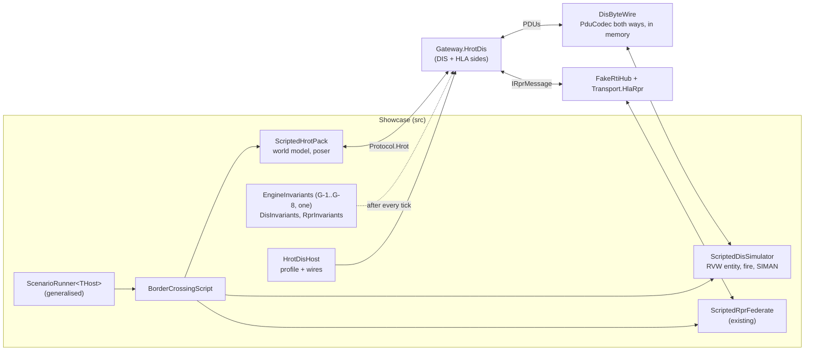
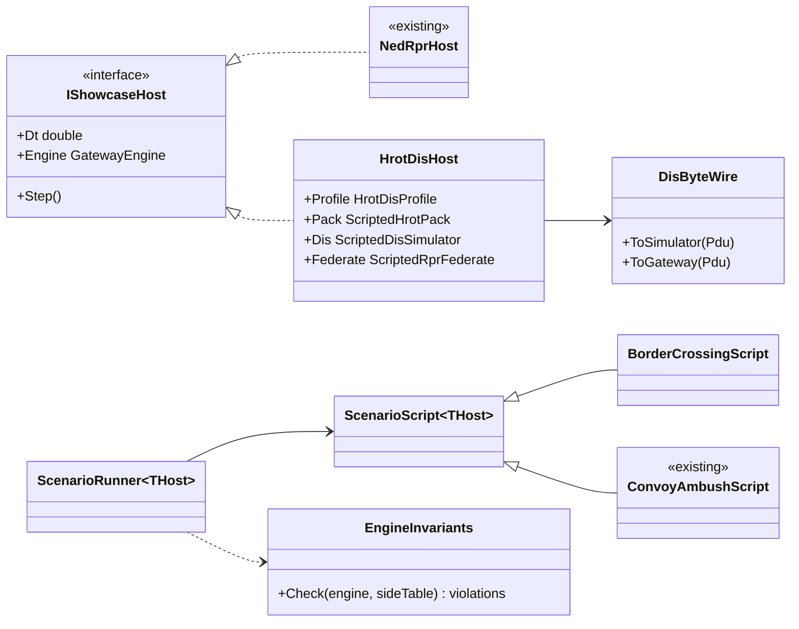
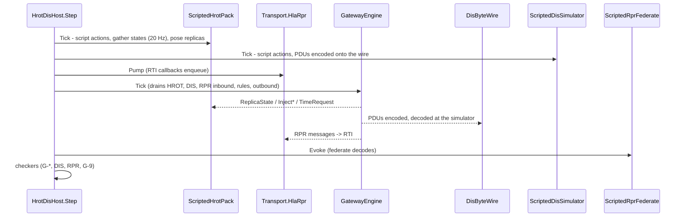

# DD-010: Showcase "Border Crossing" - the HROT gateway end to end (stage H4)

| | |
|---|---|
| **Status** | in review - proposals P-95 .. P-101 await the user |
| **Tasks** | T-025 |
| **Rulings honoured** | R-071 .. R-076 (viewer), R-079 .. R-121 (HROT gateway, config file, HLA side, shared publication), R-012, R-063 .. R-067 |
| **Inputs** | DD-002 (Convoy Ambush: acts, success conditions, G-invariants, harness), DD-006 sections 0, 3, 7, 11, 12 (H4 row), 14, DD-007 (pack contract), DD-008 (HLA), DD-009 (HLA side of the HROT gateway); code: `src/Showcase` (harness bound to `NedRprHost`), `tests/SimNetGateway.Gateway.HrotDis.Tests` (`InvariantChecker`, `DisInvariantChecker`, `RprInvariantChecker`, `HrotDisHarness`) |
| **Date** | 2026-10-29 |

<!--STATUS
state: LIVE
updated: 2026-10-29
current-answer: whole document
stale-below: none
related-designs:
  - docs/design/DD-002-Showcase-Scenario.md - the first showcase; its harness and G-invariants are generalised here, not copied
  - docs/design/DD-006-Gateway-Hrot-Dis.md - the gateway under test; H4 row of its stage table
  - docs/design/DD-007-Hrot-Dis-Pack.md - the HROT pack the scripted HROT side stands in for
  - docs/design/DD-009-Hrot-Hla-Side-And-Shared-Publication.md - the HLA side exercised by acts 3 - 5
  - docs/design/DD-005-Gateway-Monitor-Viewer.md - the viewer that gets the scenario
-->

## 1. Purpose

Show and prove, in one deterministic scripted run, that the HROT gateway (DD-006/DD-009) does everything the
rulings ask - **all three sides at once**: a scripted HROT pack (Protocol.Hrot messages, the contract the real pack
will use), a scripted DIS simulator (real PDU bytes) and a scripted HLA federate (RPR FOM 2.0 over the fake RTI).
It is also the acceptance run for H4's remaining feature, **turret articulation**, and the scenario the viewer
shows for the HROT gateway.

Measured prior art (file reads 2026-10-29): the showcase harness (`ScenarioRunner`, `ScenarioScript`, `Step`,
`ScenarioContext`, `ScenarioReport`) is bound to `NedRprHost`; **G-1 .. G-8 exist twice** - `src/Showcase/InvariantChecker`
(NED-RPR) and `tests/.../Gateway.HrotDis.Tests/InvariantChecker` (H2a); the DIS and RPR invariant checkers and the
HROT harness live in a test project, out of reach of the showcase and the viewer.

## 2. Block diagram

Caption - what the picture shows that prose hid: the three foreign sides are scripted peers that only see their
own protocol (HROT messages, PDU bytes, RTI callbacks); the checkers see everything. DIS goes through real
encode/decode on an in-memory byte wire (deterministic), not a socket.

## 3. Decisions

1. **One generic harness** (P-95): `ScenarioRunner<THost>`, `ScenarioScript<THost>`, `ScenarioContext<THost>` with an
   `IShowcaseHost` (Step, Dt, engine, outbound recorders); `NedRprHost` and the new `HrotDisHost` implement it;
   Convoy Ambush is unchanged in behaviour (48/48, its goldens identical). Rejected: a second runner for the HROT
   gateway - a copy of 2 300 lines.
2. **One engine-invariant checker** (P-96): G-1, G-2, G-4, G-5, G-8 become `EngineInvariants` in `src/Showcase`,
   parameterised by the side/origin table; both showcases and both gateway test projects use it; the HROT
   `DisInvariantChecker` / `RprInvariantChecker` and `HrotDisHarness` move from the test project into `src/Showcase`
   (the viewer and the showcase need them). Rejected: keep the duplicate - two checkers of one rule drift.
3. **DIS on an in-memory byte wire** (P-97): `DisByteWire` encodes every outbound PDU with `PduCodec`, the simulator
   decodes it; the simulator's PDUs are encoded and decoded the same way into the gateway's DIS port - real wire
   format, no socket, deterministic. Real UDP stays covered by `Transport.DisUdp` tests and the manual interop.
4. **Scripted HROT pack** (P-98): `ScriptedHrotPack` holds a small world model (entities with ENU pose, velocity,
   health, turret), sends `HrotOrigin` / `HrotSession` / `HrotEntityState` (at 20 Hz with the pack's change
   thresholds, DD-007 3.5) / `HrotTurretPose` / `HrotFire` / `HrotDetonation` / `HrotEntityRemoved`; applies
   `ReplicaState` (poses replicas each tick with the Common predictor - the pack's `ReplicaPoser` behaviour),
   `InjectDetonation` with `TargetIsHrot` (applies a scripted damage table, as HROT's damage system would) and
   `TimeRequest`. It is the reference behaviour the real pack (H5) is tested against later.
5. **Articulation out only** (P-99): HROT turret pose -> pivot `Articulation.Parts` -> DIS ESPDU articulated-part
   variable parameters (azimuth and elevation of the primary turret / gun, SISO-REF-010 numbering verified from a
   public source and cited) and RPR `ArticulatedParametersArray` (new optional `Articulation` field on
   `RprObjectUpdate`, encoded with the existing `RprFom2` codec). Inbound articulation (DIS/HLA -> pivot) is
   stored but **not** sent to HROT: a HROT turret is a part entity of the replica (`TurretPose` on a `PartMetadata`
   entity) - a pack feature for H5. Sends: an articulation change counts for the send policy only through the
   heartbeat and other changes (DIS practice) unless it changes by more than `ArticulationThresholdDeg` (3 deg).
6. **Viewer** (P-100): Border Crossing is a viewer scenario (R-071) through `HrotDisHost`; the map colours entities
   by origin (hrot / dis / rpr); the inspector shows the DIS and RPR publication state (R-077 already generic).

## 4. Cast and timeline (simulated seconds, 60 Hz)

| Side | Cast |
|---|---|
| HROT (scripted pack) | `Lion-1..3` tanks (Lion-1 with turret), `Hawk` helicopter; origin lat 49.0, lon 14.0 |
| DIS (exercise 1, site 7, app 70) | `Bear` tank with RVW dead reckoning |
| HLA (federate "Allied", fake RTI) | `Eagle` aircraft (FPW) |

## 5. Acts and success conditions

| Act | t (s) | What happens | Success conditions |
|---|---|---|---|
| 0 Config | 0 | the runner writes `simnetgateway.json` (both sides) into a temp folder and loads it; a missing path yields "not instantiated" | B-0.1 missing file -> no profile built; B-0.2 a corrupted key -> Invalid naming it; B-0.3 the valid file loads with both sides |
| 1 Origin and session | 1 - 5 | pack sends Edit, then origin, then Live + advancing | B-1.1 nothing positional on any side before the origin; B-1.2 Edit: no PDU / RPR update sent; B-1.3 Running: Start/Resume PDU sent once |
| 2 HROT forces appear | 5 - 8 | Lion-1..3, Hawk | B-2.1 each appears as ESPDU and as RPR object with the SAME entity identifier (DD-009 review rule); B-2.2 class per entity type (GroundVehicle, Aircraft); B-2.3 marking, force, type equal on both sides |
| 3 Foreign forces appear | 8 - 12 | Bear (DIS, RVW), Eagle (HLA) | B-3.1 one `ReplicaState` each, origin dis / rpr; B-3.2 Bear never on HLA, Eagle never on DIS (R-116); B-3.3 replica poses at the pack match the DIS/HLA dead reckoning within 0.1 m over 3 s without new ReplicaState |
| 4 Movement and turret | 12 - 30 | Lions move and turn, Lion-1 traverses its turret, Bear manoeuvres | B-4.1 per side: threshold invariant every tick (DIS 1 m / 3 deg, HLA settings), no redundant send; B-4.2 heartbeat 5 s for a parked Lion; B-4.3 Lion-1's turret azimuth/elevation arrive in the ESPDU articulated parameters and in the RPR `ArticulatedParametersArray` within 3 deg; B-4.4 a new Bear state yields exactly one ReplicaState |
| 5 Engagement | 30 - 45 | Lion-1 fires at Bear; Bear fires at Lion-2; Eagle fires at Hawk | B-5.1 Fire + Detonation PDUs and the two RPR interactions for Lion-1's shot, same event identifier per protocol; B-5.2 DIS answers Bear destroyed -> ReplicaState health 0; B-5.3 Bear's detonation -> `InjectDetonation` TargetIsHrot -> the pack's damage -> Lion-2's ESPDU damage bits and RPR DamageState; B-5.4 Eagle's interactions -> InjectFire / InjectDetonation; HROT never applies damage to Bear (owner rule, DD-007 3.2) |
| 6 Pause and resume | 45 - 55 | pack pauses / resumes; DIS sends Stop/Freeze | B-6.1 Stop/Freeze then Start/Resume to DIS (hrotControlsDis); B-6.2 DIS Stop/Freeze ignored (disControlsHrot off): no TimeRequest; B-6.3 no replica pose change while paused |
| 7 Origin change | 55 - 60 | pack sends a new origin generation | B-7.1 every replica re-sent in the new ENU frame; B-7.2 ECEF on DIS / HLA unchanged for parked entities |
| 8 Losses and timeouts | 60 - 80 | Hawk removed; Bear silent; Eagle's federate deletes it | B-8.1 Hawk: Deactivated ESPDU once and RPR delete; its number in quarantine; B-8.2 Bear reaped after 12 s, ReplicaRemoved; B-8.3 Eagle -> ReplicaRemoved immediately |
| 9 Replay | 80 - 90 | pack switches to Replay | B-9.1 no Fire/Detonation PDUs or interactions; B-9.2 replicas removed, no ReplicaState; B-9.3 HROT states still go out |
| 10 Unload | 90 - 92 | pack sends Idle | B-10.1 final Deactivated for every published entity; B-10.2 empty pivot |

Global, every tick: G-1, G-2, G-4, G-5, G-8 (`EngineInvariants`), the DIS and RPR invariant checkers (DD-006 14 /
DD-009 10), and G-9 (what the DIS simulator and the federate decoded equals what the gateway sent).

## 6. Class diagram

## 7. Sequence - one tick of HrotDisHost

## 8. Test plan

- `BorderCrossingTests`: the run passes every B-* condition with no invariant violation; deterministic (two runs
  produce identical reports); goldens of the three outbound streams.
- Convoy Ambush: 48/48 and its HLA-3 goldens identical after the harness generalisation (P-95).
- Both gateway test projects green with the shared `EngineInvariants` (P-96).
- Articulation: codec goldens for the ESPDU parameters (SISO-REF-010 values cited) and the RPR array.
- Viewer headless smoke runs Border Crossing (R-076).
- Mutation checks by the implementing agent: articulation not sent, replica relayed to the other protocol, Edit
  not silent, re-base without re-send, pack poser ignoring pause.

## 9. Proposals awaiting approval

| ID | Proposal (lean) | Main alternative |
|---|---|---|
| **P-95** | **Generalise the showcase harness** over `IShowcaseHost` (generic runner/script/context); Convoy Ambush unchanged (48/48, goldens identical). | A second runner for the HROT gateway (a 2 300-line copy). |
| **P-96** | **One engine-invariant checker** (G-1, G-2, G-4, G-5, G-8) in `src/Showcase`, used by both showcases and both gateway test projects; the HROT DIS / RPR checkers and harness move from the test project into `src/Showcase`. | Keep two G-checkers (drift) and test-only HROT checkers (viewer and showcase cannot use them). |
| **P-97** | **DIS on an in-memory byte wire** through `PduCodec` in the showcase; real UDP only in transport tests and manual interop. | UDP loopback in the showcase (timing non-determinism, port clashes in CI). |
| **P-98** | **`ScriptedHrotPack`** as the stand-in and reference behaviour for the real pack (20 Hz gather with change thresholds, per-frame replica posing, scripted damage table, TimeRequest handling). | Drive the gateway with raw Protocol.Hrot messages per act (no pack behaviour to compare H5 against). |
| **P-99** | **Articulation outbound only**: HROT turret -> DIS ESPDU parameters and RPR `ArticulatedParametersArray` (new optional field on `RprObjectUpdate`); inbound stored in the pivot, not sent to HROT (pack feature, H5); a 3 deg articulation threshold triggers a send. | Both directions now (needs part entities on HROT replicas - pack work). |
| **P-100** | **Acts and conditions** of section 5 as the H4 acceptance. | A smaller smoke scenario (would not cover the rulings end to end). |
| **P-101** | **Viewer**: Border Crossing as a scenario, map coloured by origin, publication state in the inspector. | Showcase console only. |
