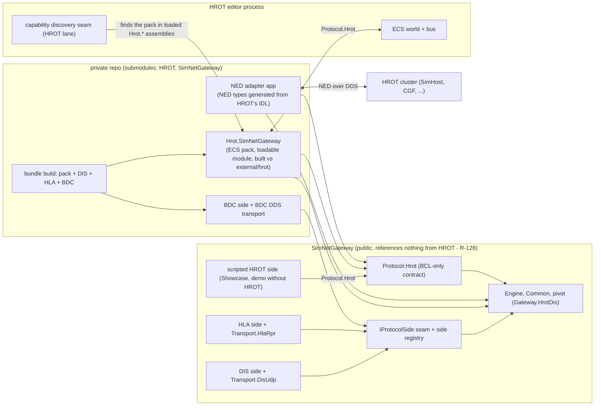
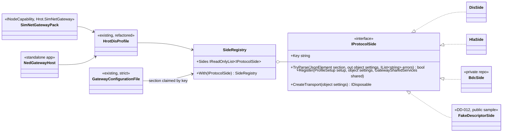
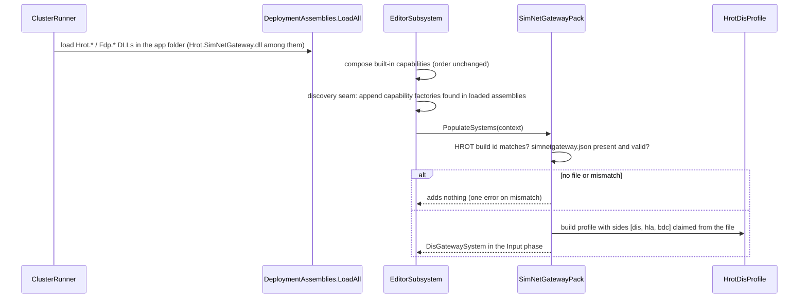
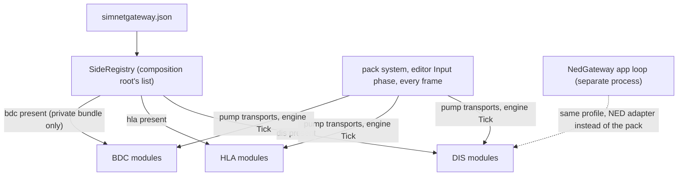

# DD-011: Two HROT Adapters, the Loadable HROT Module and the Protocol-Side Seam

| | |
|---|---|
| **Status** | approved (R-129) as revised by R-128: SimNetGateway references nothing from HROT; the pack / loadable module, HROT seam and NED adapter live in the private gateway repository |
| **Tasks** | T-026 |
| **Rulings honoured** | R-122 (two HROT adapters behind `Protocol.Hrot`, pivot and DIS/HLA unchanged, sibling HROT checkout acceptable), R-094/R-119 (configuration file), R-100 .. R-121, R-012, R-050 .. R-053 |
| **Inputs** | user 2026-10-30: BDC is proprietary and lives in a private repository with HROT and SimNetGateway as submodules; "count with this BDC as the third protocol"; the gateway pluggable into the HROT editor as a loadable module connected to the ECS. HROT `coordinator` @ `3991e0ce0`: `Hrot.Common/Infrastructure/DeploymentAssemblies.cs` (`LoadAll`), `ClusterRunner/SubsystemFactory.Scan`, `NodeCapability.cs`, `EditorCapabilities.cs`, `docs/reference/NED_DDS_Protocol.md` step 0a and Concepts 15 (IDL, derived topic names), R-4095 (HROT's own BDC stack removed). SimNetGateway: `Gateway.HrotDis/HrotDisProfile.cs:70-92` (sides switched by hard-coded `if`), `GatewayConfigurationFile.cs:29` (strict reader) |
| **Date** | 2026-10-30 |

<!--STATUS
state: LIVE
updated: 2026-10-30
current-answer: whole document
stale-below: none
related-designs:
  - docs/design/DD-007-Hrot-Dis-Pack.md - the ECS pack this makes loadable; its vendoring (R-092) is superseded here
  - docs/design/DD-006-Gateway-Hrot-Dis.md - the pivot and the Protocol.Hrot contract both adapters speak; its section 4 (NED node) returns for the NED adapter
  - docs/design/DD-009-Hrot-Hla-Side-And-Shared-Publication.md - the HLA side moved onto the side seam
  - docs/design/DD-012-Descriptor-Protocol-Side-And-Partial-Ownership.md - the third side (the fake BDC) that proves the seam from outside
-->

## 1. Goals

1. The gateway core, pivot, DIS and HLA stay as built (R-122); HROT is reached through **one of two adapters** behind
   `Protocol.Hrot`.
2. The in-editor adapter is a **loadable HROT module** - no gateway code in HROT sources.
3. A protocol side can be added **from another repository** compiled against SimNetGateway sources (the private
   BDC repository), without editing SimNetGateway.

## 2. Block diagram

Caption - what the picture shows that prose hid: BDC reaches the core only through the same seam DIS and HLA use;
the pack and the NED app are the only two things that know HROT, both live in the private repo (R-128), and only the
pack runs inside HROT. SimNetGateway alone builds and demos through the scripted HROT side on the same `Protocol.Hrot`
contract. The NED app knows only the NED wire (IDL-generated types), not HROT's ECS or assemblies.

## 3. Decisions

1. **`IProtocolSide`** (P-102): a side has a key (`dis`, `hla`, `bdc`), parses its own config section, registers its
   modules, identity maps, services and ports with the profile, and creates its transport. `HrotDisProfile` asks a
   **side registry** (code list, R-052 kept) instead of `if (config.DisRuns)`. DIS and HLA move onto it unchanged in
   behaviour (their suites and goldens identical). The config reader stays strict: a section is known when a
   registered side claims it; an unclaimed section is an error.
2. **Side registration from outside** (P-103): the bundle's composition root (the pack, or a host) passes the side
   list; the private repo adds `BdcSide` to that list. No reflection, no DLL scanning in the gateway: the bundle is
   compiled together from sources (submodules), so the "API" is source-level and versioned by the submodule pin.
3. **Loadable HROT module** (P-104): `Hrot.SimNetGateway` (the DD-007 pack, renamed from `Hrot.DisGateway` because
   it hosts all sides) is an `INodeCapability` with a factory type the editor discovers. HROT change (HROT lane, one
   small seam): when composing its capabilities, the editor appends every capability factory found in the loaded
   `Hrot.*` assemblies (HROT already loads them all, `DeploymentAssemblies.LoadAll`, and already scans for
   `ISubsystem`). The bundle is installed by copying its DLLs next to HROT's; it records the HROT commit it was built
   against and refuses to compose against another (fail fast, one error). Without `simnetgateway.json` it adds
   nothing (R-094).
4. **Build** (P-105, REPLACED by R-128: the pack, the HROT seam client and the NED adapter are built in the private
   repo from its `external/hrot` and `external/SimNetGateway` submodules; SimNetGateway has no HROT build at all. Original
   text kept for history:) SimNetGateway gets `SimNetGateway.Hrot.sln` (everything plus the pack) built against a sibling
   HROT checkout (`HrotRoot`, default `../hrot`) - the withdrawn P-68 shape, now for the pack only; the main
   solution stays HROT-free. The private repo builds the same projects from its submodules. The bundle uses HROT's
   pinned CycloneDDS.NET version (one version per process).
5. **NED adapter** (P-106): `Transport.Ned` + host `SimNetGateway.NedGateway` (a standalone application). NED types
   are **generated from HROT's build IDL** by a script, kept in `Protocol.Ned2` (the existing `Protocol.Ned` is the
   PoC's simplified NED), checked against the IDL by a test. The gateway is a NED node: DD-006 section 4.1 (origin
   from `GeoReference`, node identity, heartbeat, id allocator client, `OwnershipUpdate`) comes back for this
   adapter only. It reaches HROT clusters, never the networkless editor.
6. **Order** (P-107): seam + DIS/HLA moved (T-026a) -> fake BDC side through the seam (DD-012) -> loadable pack and
   the HROT seam (with a HROT lane) -> NED adapter last (no user need named yet beyond "decouple").

## 4. Class diagram

## 5. Sequence - the editor loads the bundle

## 6. Module relationships

Caption: the pack's frame and the NED app's loop are the only two callers; a side never runs without one of them.

## 7. Test plan

- Seam: DIS and HLA suites and the HLA-3 / H2b goldens identical after moving onto `IProtocolSide`; config: an
  unclaimed section is an error naming it; a registered external side's section parses.
- External side compiled only against public seams (DD-012's fake side lives in `samples/` and references no internal
  type - an architecture test enforces it).
- Pack: HROT-build mismatch -> nothing composed, one error; no file -> nothing composed (HROT lane, headless editor).
- NED adapter: generated types equal HROT's IDL (test); loopback against a scripted NED peer on a private DDS domain.

## 8. Proposals awaiting approval

| ID | Proposal (lean) | Main alternative |
|---|---|---|
| **P-102** (approved, R-129) | **`IProtocolSide` + side registry**; DIS and HLA moved onto it with identical behaviour; strict config with sections claimed by side key. | Keep the hard-coded `if`s and fork `HrotDisProfile` in the private repo (two profiles drift). |
| **P-103** (approved, R-129) | **Sides passed by the composition root** (code list, compiled from sources via submodules); no runtime DLL scanning in the gateway. | Gateway-side DLL plugins (public binary API over the pivot - the cons you saw). |
| **P-104** (approved, R-129; lives in the private repo, R-128) | **Loadable HROT module** `Hrot.SimNetGateway` found by a small HROT discovery seam (HROT lane); refuses a HROT build it was not compiled against; supersedes vendoring (R-092) and the compiled-in pack (R-093). | Keep vendoring (gateway code in HROT sources). |
| **P-105** (REPLACED by R-128: no HROT build in SimNetGateway) | **`SimNetGateway.Hrot.sln` against a sibling HROT checkout** for the pack; main solution HROT-free; HROT's CycloneDDS.NET version pinned in the bundle. | HROT NuGet packages (HROT publishes none). |
| **P-106** (approved, R-129; in the private repo, R-128) | **NED adapter** as a standalone app with NED types generated from HROT's IDL; DD-006 section 4.1 (NED node duties) revived for it. | Reference HROT's assemblies (imports HROT's ECS closure). |
| **P-107** (approved, R-129) | **Order**: seam -> fake BDC side (DD-012) -> loadable pack with the HROT lane -> NED adapter. | NED adapter first. |
