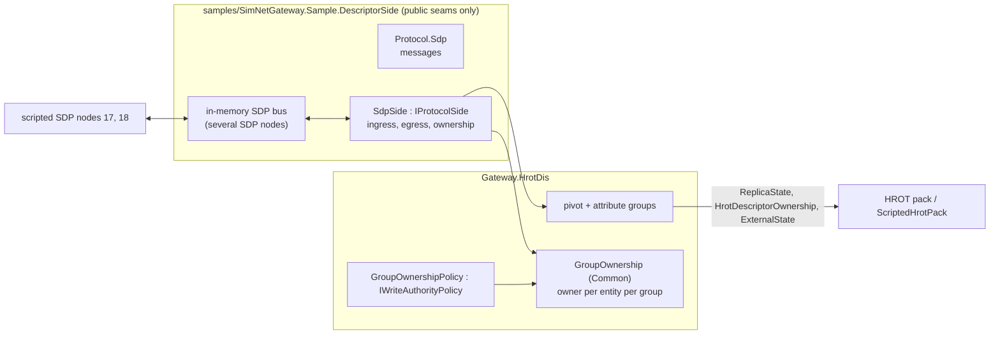
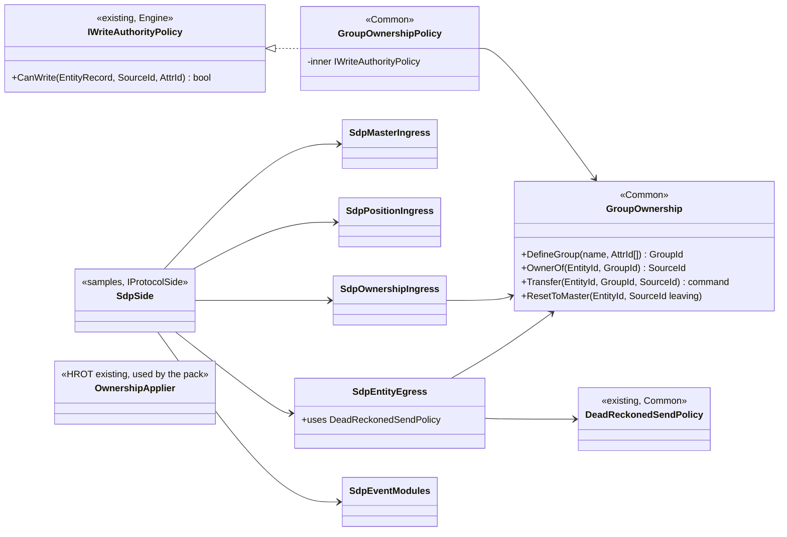
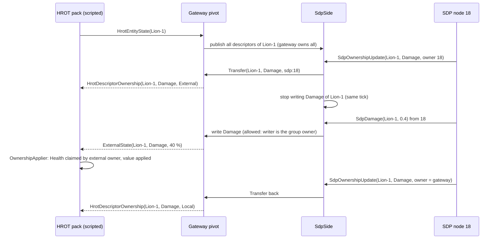
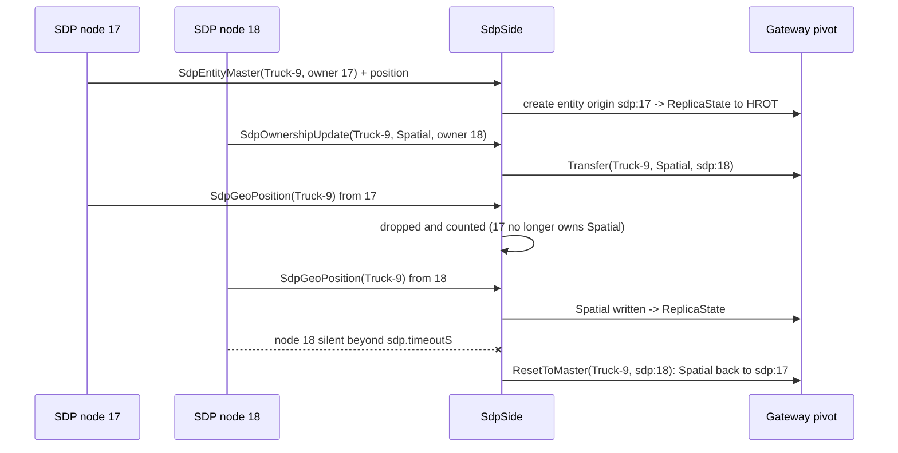
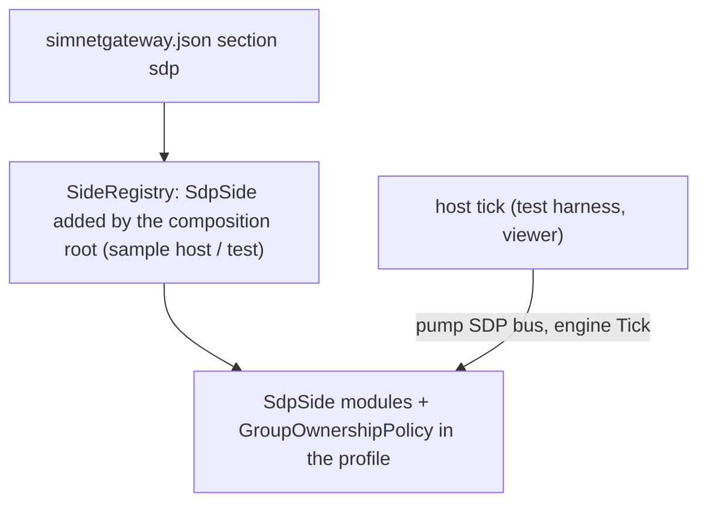

# DD-012: A Fake BDC-like Descriptor Protocol Side and Per-Descriptor Ownership (POC)

| | |
|---|---|
| **Status** | approved with changes (R-130): built in the private repository on the real generated types; SDP dropped; range-based ids; DDS transport + in-memory bus; the public parts are GroupOwnership/policy (Common) and the Protocol.Hrot ownership messages |
| **Tasks** | T-027 |
| **Rulings honoured** | R-122, R-057 (extended, not replaced), R-061 (one source per peer), R-068, R-094, R-114 .. R-118 (shared send policy and registration), R-116 (origin rule) |
| **Inputs** | user 2026-10-30: BDC is proprietary (private repository); build a fake from the description and adapt it to the real BDC later: "they use similar EntityMaster, they have different descriptor for position (similar to what NED used to have before we unified all to local coordinates), they have fire and detonation inspired by HLA RPR and they have same multi-instance descriptor concept used for articulated parts, same way of partial ownership per descriptor". HROT: `docs/reference/BDC_NED_SST_Descriptor_Rules.md` (entities as descriptors, per-descriptor owner, `OwnershipUpdate`, default-to-master), `Fdp.Toolkits/Replication/Services/OwnershipApplier.cs` ("the ONE way a node applies descriptor key K of entity E is now owned by node N") and `DescriptorOwnershipMap.cs`. SimNetGateway: `Engine/Authority/IWriteAuthorityPolicy.cs` (`CanWrite(entity, writer, attr)` - already per attribute) |
| **Date** | 2026-10-30 |

<!--STATUS
state: LIVE
updated: 2026-10-30
current-answer: whole document
stale-below: none
related-designs:
  - docs/design/DD-011-Hrot-Adapters-Loadable-Module-And-Protocol-Sides.md - the side seam this side is built against (from samples/, as an external repo would)
  - docs/design/DD-006-Gateway-Hrot-Dis.md - pivot, Protocol.Hrot contract (extended here with ownership messages)
  - docs/design/DD-004-WAN-Readiness.md - R-057 single owner per entity, which this extends to attribute groups
  - docs/design/DD-010-Border-Crossing-Showcase.md - ScriptedHrotPack, which models the HROT side of ownership here
-->

## 1. Purpose and scope

Prove, before the real BDC wire exists, that the gateway can carry a **third, NED-family descriptor protocol**:
EntityMaster-based entities, a geodetic position descriptor, RPR-like fire / detonation, multi-instance articulated
part descriptors and **per-descriptor ownership** with `OwnershipUpdate`. The fake is called **SDP ("Sample
Descriptor Protocol")** - it is invented from the user's description and HROT's public BDC/NED rules, contains
nothing proprietary, and lives in the public repository under `samples/`, built **only against public seams**
exactly as the private BDC repository will be. Adapting to the real BDC later = replace `Protocol.Sdp` and the
mapping inside the side; the seams, the pivot ownership and the HROT contract stay.

Out of scope: a DDS transport for SDP (the real BDC transport is the private repo's); ownership moves initiated by
HROT itself (the editor owns everything it has; cluster ownership comes with the NED adapter).

## 2. Block diagram

Caption - what the picture shows that prose hid: ownership is held once, in the gateway (`GroupOwnership`), and
enforced at commit by the engine's existing per-attribute policy hook; the side only translates `OwnershipUpdate`
both ways.

## 3. The fake protocol (SDP) - chosen to match the description

| Message | Fields | Modelled on |
|---|---|---|
| `SdpEntityMaster` | `EntityId` (int64), `TkbType`, `OwnerNode`, `Flags`, `Disposed` | NED `EntityMaster` |
| `SdpGeoPosition` | `EntityId`, `LatDeg`, `LonDeg`, `AltM` (double, WGS84), `HeadingDeg`, `PitchDeg`, `RollDeg` (body in the local north-east-down frame), velocity north/east/down m/s, `Time` | "NED before the move to local coordinates" |
| `SdpEntityInfo` | `EntityId`, `Marking`, `Force` | NED `EntityInfo` |
| `SdpDamage` | `EntityId`, `HealthFraction` | NED `EntityDamage` |
| `SdpArticulatedPart` | `EntityId`, `InstanceId`, `PartType`, `AzimuthRad`, `ElevationRad` - **multi-instance** | NED multi-instance descriptors |
| `SdpWeaponFire` / `SdpDetonation` | `EventCount` + `IssuerNode`, `Firing`, `Target`, `MunitionTkb`, geodetic location, velocity, `Result` (detonation) | RPR `WeaponFire` / `MunitionDetonation` |
| `SdpOwnershipUpdate` | `EntityId`, `Descriptor` (kind), `InstanceId`, `NewOwnerNode` | BDC/NED `OwnershipUpdate` |
| `SdpDescriptorDispose` | `EntityId`, `Descriptor`, `InstanceId` | descriptor-level dispose |

Every sample carries `SenderNode`; each SDP node is its own pivot source `sdp:<node>` (R-061). The gateway is SDP node
`sdp.nodeId` (config) and allocates entity ids from a configured block (`sdp.entityIdBase`, `sdp.entityIdCount`).

## 4. Per-descriptor ownership in the gateway

1. **Attribute groups** (P-109): the pivot declares groups = descriptors: `Master` (type, existence), `Spatial`,
   `Info`, `Damage`, `Articulation:<instance>`. A group is a set of `AttrId`s (articulation instances share attributes
   keyed by instance inside `Articulation.Parts`, so an instance group is checked by the articulation writer).
2. **`GroupOwnership`** (Common, P-110): per entity an `EntityTable` entry with the owner `SourceId` per group; a group
   without an entry is owned by the entity's `Owner` (default-to-master, the BDC/NED rule). `Transfer(entity, group,
   newOwner)` is a gateway command applied in a transaction (all-or-nothing, journaled).
3. **`GroupOwnershipPolicy`** decorates the configured `IWriteAuthorityPolicy`: a write of an attribute of group G is
   allowed iff the writer is G's owner or a trusted processor. The engine is unchanged (`CanWrite` is already per
   attribute). R-057's entity `Owner` stays the master owner.
4. **SDP side rules**: inbound descriptor samples are accepted only from the descriptor's owner node (others counted
   and dropped); the egress never writes a descriptor the gateway does not own and stops in the tick ownership
   leaves; an `SdpOwnershipUpdate` moves the pivot group; when the owner node of a descriptor disposes the entity or
   goes silent, the descriptor returns to the master owner (spec: default-to-master).
5. **HROT entities and external ownership** (P-111): an SDP node may take a descriptor of a HROT entity (for example
   `Damage`). The gateway then forwards that node's values into the pivot and tells the HROT side through two new
   `Protocol.Hrot` messages: `HrotDescriptorOwnership(Id, Group, External)` and `ExternalState(Id, Group, values)`.
   The pack applies them with HROT's own `OwnershipApplier` (owner = the reserved external node id of DD-007 3.2), so
   HROT systems stop writing that component while the gateway writes it. In this POC the `ScriptedHrotPack` (DD-010)
   implements that behaviour; the real pack mapping is part of H5 (HROT lane).
6. **DIS and HLA** read the pivot as before: a HROT entity whose damage an SDP node owns is still published to DIS
   and HLA with the pivot value. No relaying between SDP, DIS and HLA entities (R-116 extended: only `hrot` goes out).

## 5. Class diagram

## 6. Sequences

### 6.1 An SDP node takes the damage descriptor of a HROT tank

### 6.2 An SDP entity with split ownership, and a node leaving

## 7. Module relationships

## 8. Test plan (POC acceptance)

- `GroupOwnership` + policy: randomized seeded sequences (transfers, writes by random sources, resets) against a
  brute-force model - **a write commits iff its writer owns the attribute's group**; exactly one owner per group;
  default-to-master; transfers all-or-nothing.
- SDP side: two scripted SDP nodes plus `HrotDisHarness` (in-memory): every message row both ways with geodetic <->
  ECEF/ENU conversions (1e-6 m, 1e-9 rad), articulated instances created/updated/disposed per instance, fire/detonation
  with event correlation, the ownership sequences of section 6 including the gateway stopping in the same tick and
  default-to-master on node loss; invariants every tick: the gateway never writes a descriptor it does not own, never
  accepts a sample from a non-owner, no relaying between SDP/DIS/HLA entities, G-1/G-2/G-4/G-5/G-8.
- The sample references only public seams (architecture test).
- Mutation checks (R-065): owner check removed, egress keeps writing after losing ownership, no reset on node loss,
  external ownership not reported to HROT.

## 9. Proposals awaiting approval

| ID | Proposal (lean) | Main alternative |
|---|---|---|
| **P-108** (DROPPED by R-130: real types exist) | **SDP**, the fake protocol of section 3, in `samples/` built only against public seams; replaced by the real BDC in the private repo later. | Wait for the real wire. |
| **P-109** (approved, R-130) | **Descriptors = pivot attribute groups** (`Master`, `Spatial`, `Info`, `Damage`, `Articulation:<instance>`). | Ownership per single attribute (no descriptor meaning). |
| **P-110** (approved, R-130) | **`GroupOwnership` + `GroupOwnershipPolicy` in Common**, enforced through the engine's existing per-attribute `CanWrite`; R-057's entity owner stays the master owner; no engine change. | Change the engine's owner model (larger blast radius). |
| **P-111** (approved, R-130) | **External ownership of HROT entities' descriptors** through `HrotDescriptorOwnership` / `ExternalState` in `Protocol.Hrot`, applied by the pack with HROT's `OwnershipApplier`; modelled by `ScriptedHrotPack` now, real pack mapping in H5. | Refuse ownership requests for HROT entities (would not match "same way of partial ownership"). |
| **P-112** (approved as range-based ids, R-130) | **Sample entity ids from a configured block** and a configured gateway node id; the real BDC's allocation replaces it. | Model an id-allocator service in the fake. |
| **P-113** (CHANGED by R-130: DDS transport + in-memory bus) | **In-memory SDP bus only** in the POC; the DDS transport belongs to the private BDC repo. | Also a DDS transport for SDP (CycloneDDS in tests). |
| **P-114** (approved, R-130) | **Stage T-027 after T-026a** (the side seam), before the loadable pack. | Build the fake inside `Gateway.HrotDis` (would not prove the external path). |
