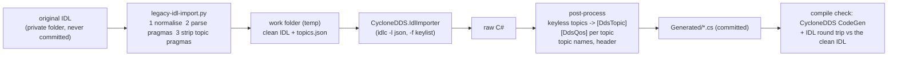

# DD-013: Importing Legacy (keylist-pragma) IDL into CycloneDDS.NET C# - first use: BDC

| | |
|---|---|
| **Status** | in review - proposals P-115 .. P-119 await the user |
| **Tasks** | T-028 |
| **Rulings honoured** | R-012, R-122; user 2026-10-31: the original BDC IDL files are proprietary and are never committed; a C# representation produced by the CycloneDDS.NET IDL importer may be committed; a script preprocesses the original IDL for the importer and is re-run when BDC evolves; importer problems found on the way are collected so the importer can be fixed later |
| **Inputs** | CycloneDDS.NET 1.2.20 (`github.com/pjanec/cyclonedds.net` @ `416c68b`, `IDL-IMPORT.md`, `tools/CycloneDDS.IdlImporter`; the NuGet package ships `tools/idlc` 11.0.1 for linux-x64 with the JSON plugin, and `tools/CycloneDDS.IdlImporter.dll`); the three BDC IDL files the user provided (kept outside every repository) |
| **Date** | 2026-10-31 |

<!--STATUS
state: LIVE
updated: 2026-10-31
current-answer: whole document
stale-below: none
related-designs:
  - docs/design/DD-012-Descriptor-Protocol-Side-And-Partial-Ownership.md - the BDC-like side; the imported types replace its invented SDP messages
  - docs/design/DD-011-Hrot-Adapters-Loadable-Module-And-Protocol-Sides.md - where the BDC side and its DDS transport plug in
  - docs/IDL-IMPORTER-ISSUES.md - the importer problems found (input for fixing CycloneDDS.NET)
-->

## 1. What the original IDL looks like (measured, constructs only)

| Construct | Count / form | Handled by |
|---|---|---|
| line endings | CRLF | preprocess: LF |
| `#include "..\X\Y.idl"` | Windows separators; targets `BuiltInTypes.idl`, `Common.idl` **not provided** | preprocess: `/`; the two files are needed from the user (section 5) |
| `#pragma keylist T k1 [k2 ...]` | on every topic, also **with no keys** (messages, `ExerciseTime`) | kept; idlc reads it with `-f keylist` |
| `#pragma topic` QoS | two spellings: one line per policy (`reliability best_effort`, `durability transient_local`, `history keep_last 1`) and compact (`reliable transient_local keep_last 1`, `reliable volatile keep_all 1`); bare `#pragma topic` | preprocess parses into a topic table; lines removed before idlc |
| annotations mixed with keylist pragmas | `@bit_bound`, `@value` in one file | idlc refuses the mix unless `-f keylist` (always passed) |
| modules, enums, structs, a union, `sequence<T>`, `string`, nested struct members, typedef from the include | 3 files, ~1 500 lines | importer |

## 2. Pipeline

Caption - what the picture shows that prose hid: everything proprietary stays left of the work folder; the committed
output is the post-processed C#, and its correctness is checked by compiling it and comparing the IDL the code
generator emits back with the cleaned input.

## 3. Decisions

1. **One script, generic** (P-115): `scripts/legacy-idl-import.py` (+ `.sh` wrapper, R-012) for any IDL written for
   keylist-pragma DDS implementations; nothing BDC-specific in it except a small profile (topic naming, include
   roots, namespace prefix) given on the command line. Re-running it after BDC changes regenerates everything.
2. **Import everything, not a stripped subset** (P-116): "functionally identical" is easiest to guarantee when every
   type is imported; the gateway's BDC side uses only the subset it supports. An optional `--only` list stays
   available.
3. **Work around importer gaps in a post-pass, and log each one** (P-117): QoS and keyless topics are added by the
   post-pass from the script's own topic table (the importer drops them - issues I-2, I-3, I-4). Each workaround
   names its issue id so it can be deleted when the importer is fixed.
4. **Where the output lives** (P-118): `src/Transports/SimNetGateway.Transport.BdcDds/Generated/` - DDS types need
   `CycloneDDS.Schema` attributes, so they cannot be in a BCL-only protocol project (R-050); a transport may
   reference the package. Each file carries a header: generated, source file name and SHA-256, script version.
5. **Verification** (P-119): the generated code must compile through CycloneDDS.NET's code generator, and the IDL the
   generator emits for each type must match the cleaned input type by type (members, types, keys, extensibility);
   QoS checked against the topic table. A test in the repository runs the pipeline on **synthetic** IDL fixtures that
   use every construct of section 1 (never on the proprietary files).

## 4. Test plan

- Synthetic fixtures (committed): CRLF, `..\` includes, both QoS spellings, bare `#pragma topic`, keyless and
  multi-key keylists, annotations mixed with keylists, unions, sequences, enums with `@bit_bound`/`@value`.
- Assertions: topic table parsed exactly; every keylist type is a `[DdsTopic]` with the right keys (none for
  keyless); `[DdsQos]` equals the pragma; generated code compiles; IDL round trip matches; re-running is idempotent
  (byte-identical output).
- Real run (local only): the user's files plus their two includes; the result is committed only after the round trip
  passes.

## 5. Proposals awaiting approval

| ID | Proposal (lean) | Main alternative |
|---|---|---|
| **P-115** | **Generic preprocessing script** with a BDC profile on the command line. | A BDC-only script. |
| **P-116** | **Import every type**; the gateway uses a subset. | Strip the IDL to the supported subset (less code, but "identical" is harder to show and every re-import has to repeat the cut). |
| **P-117** | **Post-pass workarounds** for importer gaps, each tagged with its issue id; the issues logged in `docs/IDL-IMPORTER-ISSUES.md` for a CycloneDDS.NET fix. | Fix the importer first. |
| **P-118** | **Output in `Transport.BdcDds/Generated/`** of SimNetGateway with a provenance header. | A separate private repository (the C# is a functional copy of the protocol). |
| **P-119** | **Compile + IDL round-trip verification**, synthetic fixtures in tests, real files only locally. | Trust the importer's output. |

## 6. As-built notes

Built under T-028 (not yet approved proposals P-115 .. P-119: implemented as leaned, to be confirmed in review).

- **Files**: `scripts/legacy-idl-import.py` (+ `.sh` wrapper, + `scripts/legacy-idl-import-test.sh`), tests in `tests/legacy-idl-import/`
  (Python `unittest`, synthetic fixtures with invented names; not part of the .NET suite, needs no network when
  `LEGACY_IDL_TOOLS` / `LEGACY_IDL_PACKAGE_SOURCE` point at a local copy). No project was added to the solution.
- **CLI**: `--input <dir|files> --include-dir <dir>... --work <dir> --output <dir> --tools <dir> [--namespace-map A=B]
  [--topic-name scoped|underscore|bare|typename] [--only T1,T2] [--doc-comments] [--keep-work] [--verify]
  [--package-source <folder|url>] [--package-version 1.2.20]`; `--tools` and the package source also come from the environment
  (`LEGACY_IDL_TOOLS`, `LEGACY_IDL_PACKAGE_SOURCE`). Each input or include folder is copied to `<work>/src/<folder name>`, so
  `#include "..\Other\X.idl"` between sibling folders keeps resolving.
- **Topic table** (`<work>/topics.json`, sorted by type): `type` (scoped `A::B::T`), `keys` (as written, dotted paths allowed), `reliability`,
  `durability`, `history`, `history_depth` (each `null` when the pragmas do not say), `has_topic_pragma`, `source`, `line`.
  Unspecified policies are not emitted: `[DdsQos]` carries only what the pragma says (the attribute's own defaults apply to the rest);
  a topic without policies gets no `[DdsQos]`.
- **Pragma grammar found in the real files and handled**: a bare `#pragma topic` may open the group *before* its `#pragma keylist` (it then
  belongs to the next keylist); policy lines follow either spelling; trailing `//` comments on pragma lines are ignored; `keep_all 1` keeps
  `HistoryKind = KeepAll` only (a depth is meaningless).
- **Verification**: builds a throwaway project in `<work>/verify` against the CycloneDDS.NET package (its CodeGen runs in the build),
  parses the IDL the generator emits (`obj/**/CycloneDdsGenerated/*.idl`) with the script's own IDL reader, expands typedefs and flattens
  arrays on both sides and compares per type: kind, extensibility, members with types / `@key` / `@optional` / explicit `@id`, enum
  `bit_bound` and values, union discriminator and case labels (as values). It also checks `@topic`, the `[DdsTopic]` name and `[DdsQos]` against
  the table. Key *order* cannot be expressed in C# (I-10) and prints a NOTE; a dotted key (I-9) is a NOTE when exact and a difference when widened.
- **Deviations / additions**: `--namespace-map` renames C# namespaces, which also changes XTypes type names (documented in `--help`);
  `typename` topic names are the dotted form `A.B.T`; the post-pass uses a small C# block splitter (the importer's output layout is regular)
  and an own IDL reader (no dependency on idlc's JSON); `--only` keeps the named types plus the types they reference.
- **Hints in comments** (`// [XxxTypeMap("...")]` above typedefs in the originals, a mapping their own C# tooling used): not honoured;
  the importer maps `typedef octet X[16]` to `fixed byte` and `typedef char N[n]` to `[DdsChar] fixed byte`, which `--verify` shows to be
  wire-identical. Honouring a hint would be a profile decision (e.g. `Guid`), recorded in I-11.
- **Real run (local only, never committed)**: see the T-028 report; the result is committed only once the includes and a decision on I-9 / I-10 are in.

