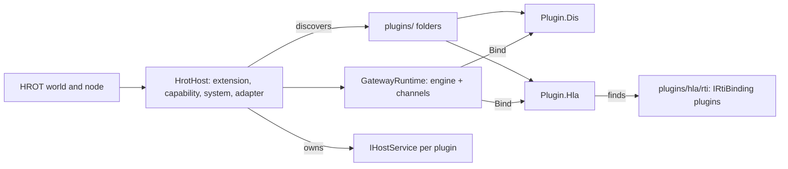
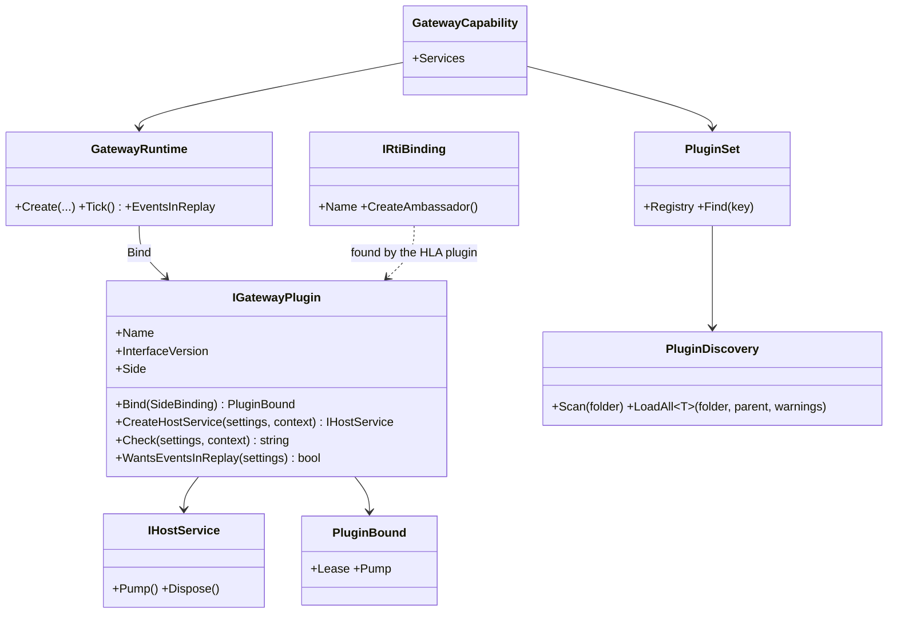
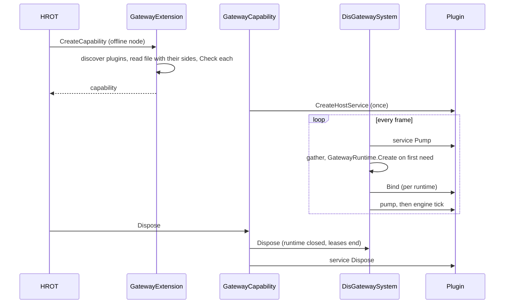

# DD-016: HROT host and side plugins

| | |
|---|---|
| **Status** | implemented |
| **Tasks** | T-014 |
| **Rulings honoured** | R-049, R-050 (layer rules), R-053 (central package versions) |
| **Date** | 2026-11-18 |

## 1. Context and goals

The gateway runs inside a HROT process as a node extension: it reads the HROT world, publishes it on the protocol sides and applies what the sides bring back.
Until now the extension and the transports of every side were composed in one project, so a side that is not part of this repository could not take part.

Goals:

- The HROT host (node extension, capability, world reader, replay handling, replica poser) is part of this repository: `SimNetGateway.HrotHost`, built against a HROT checkout.
- Every protocol side is a plugin of one shape: DIS and HLA here; a product that builds on this repository adds its own the same way.
- One gateway instance per HROT process loads whatever plugins sit in its folder: one world read, one id space for all of them.
- HLA is tied to an RTI product, so the HLA plugin has one binding plugin per RTI; the in-memory fake RTI is one of them.

Out of scope: running in nodes other than the offline one (unchanged, DD-003 P-15), a plugin ordering mechanism (plugins are ordered by folder name).

## 2. Block diagram

- The host reads the configuration file with the registry made of the sides of the discovered plugins; a section whose plugin is missing is an invalid file that names the section.
- The runtime is one gateway engine with the port `hrot` and one set of ports per running side; the host asks each running plugin to bind its ports.
- A host service lives as long as the capability (it survives world boundaries) and is pumped every frame, also while no runtime exists.

## 3. Key concepts and decisions

- **Plugin contract in the gateway layer.** `IGatewayPlugin`, `SideBinding`, `PluginBound`, `IHostService` and the loader live in `SimNetGateway.Gateway.HrotDis` (a gateway may reference engine, common and protocols; a host may not reference another host, so the host loads plugins dynamically and no plugin references the host). Rejected: a separate contract project (the layer rules know no such layer).
- **One interface version.** `PluginInterface.Version`; a plugin of another version is skipped with one warning. Rejected: loading anyway (a binary mismatch fails late and obscurely).
- **A folder with a manifest.** A plugin folder holds `plugin.json` (`{ "assembly": "Name.dll" }`) and the plugin's own assemblies. Rejected: scanning every dll (loads unrelated libraries).
- **One load context per plugin.** An assembly is looked up in the host first (one type identity for the contract, the engine, the protocols; one native DDS runtime), then in the parent plugin (a binding sees its HLA plugin), then in the plugin's own folder. Rejected: the default context for everything (two plugins could not carry different versions of a private library).
- **The side stays the unit of configuration.** The side object (`IProtocolSide`) is unchanged; the plugin adds what a host does for it: open transports for one runtime (`Bind`), an object that outlives runtimes (`CreateHostService`), a refusal of a configuration it cannot run (`Check`), whether it shows events during a replay (`WantsEventsInReplay`).
- **Shutdown order.** The system closes its runtime (leases of the plugins end: their objects are removed), then the host services are disposed in reverse order of creation.
- **RTI bindings.** `IRtiBinding` (in `SimNetGateway.Transport.HlaRpr`) is a name plus an ambassador factory; the HLA plugin finds the binding that `hla.rti` names among the plugins of `plugins/hla/rti/`; none found is a refusal naming `hla.rti`.

## 4. Class diagram

## 5. Sequence diagrams

## 6. Edge cases and error handling

- A configuration file that is missing: no gateway, no error. Invalid, a refusal by a plugin, or no enabled side: one line in the extension's errors and on stderr, no gateway.
- A plugin that fails to load or has another interface version: one warning, the others load.
- Two plugins with the same side key: the second is skipped with a warning.
- A failing host service does not stop the others (logged); a failing close does not leave the others open.
- A transport that cannot start (port in use): reported once, idle until the phase changes.

## 7. Test plan

`SimNetGateway.Gateway.HrotDis.Tests` (contract, discovery), `SimNetGateway.HrotHost.Tests` (extension composition and refusals, world reader rows, plugin service order, replay flag, the HLA plugin on the fake RTI, the packaged folder), architecture tests (layers; only hosts reference the product they extend).

## 8. Proposals awaiting approval

None.

## 9. As-built notes

- The package script (`scripts/package-extension.sh`) publishes the host and each plugin and removes from a plugin folder every file the host (or the parent plugin) already holds. A product adds plugins through `SIMNETGATEWAY_EXTRA_PLUGINS` and a post step through `SIMNETGATEWAY_PACKAGE_HOOK`.
- Transport.HlaRpr is shipped in the HLA plugin folder (not at the top): the binding plugins see it through their parent plugin.
- The by-path load of the packaged folder into a HROT editor is covered by the product repository that owns the full bundle; here the layout and the discovery from the packaged folder are tested.
