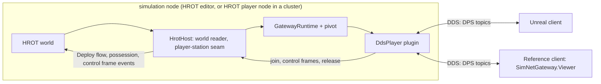
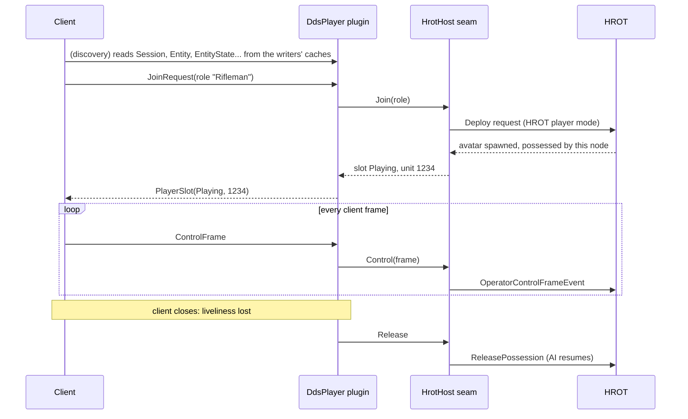

# DD-017: DPS - the DDS Player Station protocol

| | |
|---|---|
| **Status** | approved (R-132) |
| **Tasks** | T-034 |
| **Rulings honoured** | R-049, R-050 (layer rules), DD-016 (host and side plugins) |
| **Date** | 2026-11-18 |

## 1. Context and goals

DPS (DDS Player Station) is a DDS contract between a simulation and an external **player station**: a program that shows the simulated
world in 3-D (an image generator), may draw gizmos, and may let one human play one unit of the simulation (first person). The first client
is an Unreal Engine plugin; nothing in the contract is specific to Unreal, and nothing in it exposes HROT's internals (the HROT host is the
first producer; another simulator could feed the same topics through its own host).

The owner's requirements (2026-11-18):

- A station can be plugged into a running simulation at any time and can go away at any time. The simulation does not need to know
  whether a station is there ("the less HROT cares, the better"). The gateway behaves as if the station were always there, passively.
- The station possesses a soldier of the simulation. The simulation's own player mode applies: a player either takes over a placed
  playable unit or has an avatar spawned for him and possesses it.
- One player per station. Several players = several stations.
- How people look and move (animation, clothing, equipment, how they use it) is critical for acceptance, so the simulation must provide
  enough information for a high-quality renderer.
- Everything is public: the contract, the plugin, a reference client. It works in the HROT editor (offline node) as well as in a cluster.

Goals:

- **G-1** Public DDS types (C#, CycloneDDS.NET; the IDL is generated, module `DdsPlayer`) with the world-to-station topics, the station-to-world topics and the gizmo topics.
- **G-2** A side plugin `SimNetGateway.Plugin.DdsPlayer` (key `dps`) on the public HROT host (DD-016) that publishes the world and acts as
  the simulation's player station on behalf of a connected client.
- **G-3** A reference client in this repository (the existing `SimNetGateway.Viewer`), so the contract is tested without Unreal or HROT.
- **G-4** A list of what the HROT host needs from HROT (data it does not expose today), written generically.

Out of scope here: the Unreal client itself (its own public repository, with the HROT-to-Unreal terrain importer), voice, multiple players
behind one station, any station logic inside HROT.

Anti-goals: a contract that mirrors HROT's internal NED schema; a station that needs HROT to change its behaviour when it connects; an
animation contract that dictates clips (the renderer animates; the simulation states what the body does).

## 2. Block diagram

- **HrotHost** (DD-016) reads the world into the pivot (`HrotEntityState` and friends). It gains a *player-station seam*: an interface the
  plugin calls to join, possess, send control frames and release, implemented by the host with HROT's own player mode (section 3.6). The
  host is the only part that compiles against HROT.
- **DdsPlayer plugin** maps the pivot to DPS topics and DPS inbound topics to the player-station seam. It depends on the plugin contract
  only (like the DIS and HLA plugins).
- **Clients** subscribe to the world topics; a client that plays also writes the player topics. A view-only client (a big screen, an
  instructor view) never writes.

## 3. Key concepts and decisions

### 3.1 One station = one simulation node (P-1)

HROT's player station is a cluster node (`StationNodeId`; possession and control frames name it; release on the node's departure).
Therefore each DPS client pairs with one node that loads the gateway:

- **Cluster:** each player PC runs the client and a HROT player node (`-m player`) with the gateway extension. That node is the player's
  station; several players = several player nodes, which HROT already supports.
- **Editor (offline):** the editor node is the station (one player), as the other sides already run in the editor.
- A node whose client is absent is an idle station: it does nothing (no join, no frames).

Rejected: one gateway serving many players (HROT's station identity is the node; a node cannot be several stations without HROT changes).

### 3.2 Late join and absence without a handshake (P-2)

- **World state topics** are keyed, `RELIABLE`, `TRANSIENT_LOCAL`, `KEEP_LAST 1` per instance: a client that joins late receives the
  current state of every instance from the writer's cache. An entity that leaves is **disposed**.
- **Event topics** (fire, detonation, effect) are `VOLATILE`, `RELIABLE`, `KEEP_LAST` small depth: a client not connected misses them, by
  design.
- **Player topics** (client to gateway) are keyed by the client's `ClientId` (one instance per client, `KEEP_LAST 1` per instance) and carry
  `LIVELINESS AUTOMATIC` with a lease (default 2 s, configurable). The gateway reacts to the liveliness of the matched writer: lost = the
  player left (section 3.6).
- The gateway publishes whether or not any client is matched. The simulation is never told about clients.

Rejected: a hello/ack session protocol (DDS discovery and durability already give it); per-client state replay by the gateway.

### 3.2a One partition per station (P-2a)

Every DPS topic of a station is written and read in one **DDS partition named after the station** (configuration `dps.partition`;
when it is empty the plugin names it `station-<site>-<application>` from the gateway's shared settings, because the plugin does not know
the node's station name). A client is configured with the partition of the node it pairs with, and sees only that gateway: its own world
view (one id space), its own `PlayerSlot`, and only its `ControlFrame`s reach that gateway. A view-only client (big screen, instructor)
uses the partition of any node and writes no player topics. One player per station: the player is the client (its `ClientId`) whose
`JoinRequest` the gateway accepted; the player topics of any other client in the partition are dropped (one warning per foreign client id)
until the player leaves or is lost.

Rejected: a station id in every key (each gateway still has its own id space, so world topics from N gateways would collide); one DDS
domain per station (domains are a deployment resource; partitions are free and configured per participant).

### 3.2b Delivery in two steps (P-2b, my call, reversible)

- **Step 1 - editor:** the offline node is the station (one player); the host already runs there (DD-016). In the networkless editor
  HROT runs possession, the control frame and release (the player's own release, as Esc does), and a later join again without the node
  leaving; it composes no Deploy server or client (section 10, spike). So step 1 offers the placed `Playable` units and the host derives
  the slot state itself; roles (a spawned avatar) and respawn come with step 2.
- **Step 2 - cluster player nodes:** the host running in `-m player` nodes (DD-016 kept it to the offline node); on a player node the
  configuration enables only the `dps` plugin, so DIS / HLA are not republished by every station.

### 3.2c Types and evolution (P-2c)

The C# types are the source: plain structs with CycloneDDS.NET attributes (as the other DDS types of this repository, DD-013), and the
IDL a client needs is generated from them by CycloneDDS.NET - no hand-written `.idl`. Types are extensible by appending fields (fields
are only ever added at the end), strings and sequences are bounded, and `Session` carries `ProtocolVersion` (major.minor; a client refuses
another major). CycloneDDS is the reference implementation; a client may use any DDS implementation that reads the generated IDL.

### 3.2d Scope of the first round (P-2d)

The owner: "First round is using what hrot provides today. We will extend it later when hrot gains the capabilities." The fields of
3.8 exist in the types from the start with an "unknown" value; they are filled when HROT provides the data. The HROT items of 3.8 are a
separate track and do not block this round.

### 3.3 Frames, units and identity (P-3)

- **Position:** the simulation's local Cartesian frame, metres, x east, y north, z up, the same frame the terrain was exported in (the
  HROT-to-client terrain importer uses it). `Session` carries the geo reference (UTM zone and origin) for clients that need geography.
  The conversion to the client's engine units and handedness happens once, in the client.
- **Orientation:** unit quaternion (x, y, z, w) in the same frame; the body's forward is +x of the body.
- **Time:** simulation time in seconds (double) on every state sample; `Session` carries time scale, paused and live/replay.
- **Identity:** `EntityId` = the gateway's network id of the entity (32-bit), stable for the entity's life; re-used ids are never alive at the
  same time.
- **Type:** the simulation's type id (HROT TKB type, an integer), the DIS entity type (7 fields) and a coarse `Domain` (Person, Ground,
  Air, Surface, Subsurface, Munition, Other). The client maps types to its own assets (a table in the client's content); the gateway makes
  no model choice.

### 3.4 Motion (P-4)

`EntityState` samples are sent on change with thresholds (position, orientation, velocity), plus a heartbeat (default 5 s), and carry
linear and angular velocity and acceleration so the client can extrapolate and smooth (dead reckoning, the client's choice of algorithm).
Character gait is derived by the client from speed (no gait field).

### 3.5 People: semantic state, the client animates (P-5)

The simulation states what the body does; the client chooses clips, blends, IK. `PersonState` carries:

- stance (Standing, Crouched, Prone) and the transition (target stance, progress 0..1);
- weapon posture (AtEase, Ready, Aimed), aim point (world), active weapon slot, held item (Weapon, Throwable, Phone, Binoculars, None);
- look target (world point) and head yaw;
- gesture (HandsUp, FistRaised, HoldSign, Waving, Throwing, Warning, IdleSmoking, IdleShiftWeight, IdleStretch, IdleLookAbout, None);
- injury (Ok, Wounded, Incapacitated, Dead);
- **action**: kind (Embark, Disembark, OpenDoor, CloseDoor, LockDoor, UnlockDoor, BreachDoor, PickUpCasualty, PutDownCasualty,
  PickUpRound, Eject, None), target (entity or door), state (Running, Success, Failure) and the sim time it started running. Round 1
  reads HROT's interaction channel (`InteractionChannel` + status), which is built and used. There is no duration by design: how long an
  action looks is the animation engine's business (the owner: "HROT cannot know how long it takes"); the client animates while the
  action is Running and settles on its outcome. Reload is not modelled by HROT (3.8);
- seat (vehicle entity id, seat role Driver / Gunner / Commander / Passenger / Station) or carry mode (Carried, Dragged, Stretcher).

`Appearance` (keyed by entity, sent once and on change) carries the resolved look: per slot (Skin, Top, Legs, Over, Head, Hair, Beard,
Extra) a kind name and a colour (#RRGGBB), a camouflage pattern by side, face traits, sex and age class; and equipment items (helmet,
vest, backpack, ...) and the weapon per slot with attachments, as far as the simulation provides them (3.8). Kind names are the
simulation's vocabulary (strings, documented on the C# types); the client maps them to meshes.

Rejected: publishing HROT's `AnimationChannel` / montage queue (their parameters are opaque per action and tied to HROT's own animation
executor); publishing only a DIS-like appearance bit field (too poor for the acceptance goal).

### 3.6 Playing: the gateway is the station (P-6)

DPS topics, client to gateway: `JoinRequest` (choose a playable unit by id or a role by name, or observe), `ControlFrame` (one per client
frame), `Leave`. Gateway to client: `PlayerSlot` (Waiting, Observing, Choosing, Requesting, Spawning, TakingControl, Playing, Dead; the
unit id; the respawn time; the offers: playable units and roles with their sides) and `OwnUnit` (ammo per weapon, health, what the unit
can use right now - the data a HUD needs).

The plugin maps them onto the host's player-station seam, which drives HROT's own player mode on the node:

- Join / choose = HROT's Deploy client (request a playable unit or a role; HROT's deploy server spawns the avatar at a spawn point).
- Playing = HROT possession; each `ControlFrame` becomes one `OperatorControlFrameEvent` (forward, lateral, steer, yaw, vertical, gait,
  trigger, mount, aim point, stance, shot / cancel / ammo / use press counters, use verb and target, lean, binoculars, look from / look
  direction, fire preference).
- Death, respawn delay and the return to choosing follow HROT's player states unchanged.
- **Liveliness lost** (or `Leave`): the gateway releases the unit (HROT `ReleasePossession`); HROT resumes the unit's paused AI task. HROT
  itself would release only on the station node's departure, which does not happen here because the node stays.

The client predicts nothing authoritative; it may smooth its own unit's camera from the control it sends (client choice).

### 3.7 Gizmos (P-7)

The owner: HROT produces gizmos on a regular basis. HROT's gizmos are immediate-mode: each frame its gizmo projectors (paths, vision
cones, contacts, action status, EQS and cover, fire traces, blast, hearing, routes, sectors, navmesh, ...) issue draw calls into a draw
builder (`IDebugDrawBuilder`), filtered by a visibility policy (layers on / off, "selected only" families, pinned units). HROT's ruling is
that every map host gets the full set of gizmos ("component presence defines applicable gizmos", uniform gizmo membership). DPS makes
the gateway one more gizmo host:

- The host runs HROT's projectors into its own draw builder, with a visibility policy set by the client.
- **Client to gateway:** `GizmoView` (keyed by `ClientId`; the gateway follows one view per station, the player's or else the first
  client's): the layers the client wants, the selected entity ids, the pinned entity ids and
  families, a rate (default 10 Hz).
- **Gateway to client:** `GizmoFrame`, keyed by (`Producer`, `Layer`), `RELIABLE`, `TRANSIENT_LOCAL`, `KEEP_LAST 1`: the complete list of
  primitives of that layer for the latest gizmo frame (line strip, arrow, circle, polygon, box, text, icon; world coordinates; colour;
  width), so each sample replaces the previous one and a late joiner gets the current picture. A layer turned off is disposed.
- A client that does not draw gizmos sends no `GizmoView`; the gateway then runs no projectors.

Rejected: keyed per-gizmo instances with lifetimes (HROT's gizmos are redrawn every frame, so there is no stable gizmo identity to key on).

### 3.8 What the HROT host needs from HROT (G-4, generic wording)

Today HROT simulates and records stance, weapon posture and held item, look, gesture, health and injury, seats and carrying, turret pose,
weapons and ammo, doors; DPS can publish those at once. Missing for the acceptance goal (to be requested from HROT, phrased generically):

1. **Shared presentation-derivation library: dress and effects.** Effects as for the dress below: the rules that derive muzzle flashes,
   explosions, ground marks and wreck flames / smoke from events and states, moved out of the 3-D map (round 1 needs this one).
   **Resolved appearance as data.** A person's look is resolved from the type's wardrobe and the entity's seed inside the 3-D map
   (`Map3D/Outfits.cs`); no component holds it. Move the resolver into a shared library (no presentation dependency) so the map and any
   external renderer dress a person the same way.
2. **Reload and door phases.** The interaction channel states door, embark / disembark, casualty and round pick-up actions with a
   status (no duration, by design: animation timing is the renderer's). Doors switch Closed / Open instantly, and reload is not modelled
   (no magazines; only an ammo-type switch timer). The animation montage channels exist but are not used at runtime (HROT tracker
   CE-3010). Wanted: reload as an action (Running while the soldier reloads) and an opening / closing phase for doors.
3. **Equipment items.** Weapons and munitions have type ids; phone and binoculars are type flags; helmet, riot helmet and chest rig are
   garment kinds; there is no list of carried items and no backpack, radio, medkit, magazine or weapon attachment. Pick-up works for
   thrown rounds (stones, grenades, canisters) only. Wanted: items as TKB types with ids, a per-person list of carried / worn items, and
   pick-up / drop of items generally.
4. **Vehicles:** lights, hatches / doors, rotor state, partial damage.
5. Smoke screens, swimming, parachute canopy state.

Until they exist, the corresponding DPS fields stay at their "unknown" value; the contract does not wait for them.

### 3.9 Replay (P-8)

State topics follow the replayed world (the host already reads recorded state in replay). Fire and detonation come from the recorded state
in replay as for the other sides. `Effect` carries the effects that are not fire or detonation events themselves (muzzle flash, explosion and
ground mark, wreck flames and smoke). Effects are presentation, derived from events and states; the owner: they are derived with a
shared library, in the same manner as the dress (3.8 item 1). HROT's effect rules (`EffectSpawnSystem`, `WreckSpawnSystem`, their kinds
and timings) move into a shared library with no presentation dependency; HROT's map and the host both use it, so every renderer shows the
same effects. The host does not copy HROT's own effect objects. `Session.Mode = Replay` tells
the client; the player topics are refused in replay (`PlayerSlot` =
Observing).

### 3.10 HROT's look library (P-9, HROT CE-4671 / CE-4670 / R-4296)

HROT's assembly **`Hrot.Look`** (no presentation dependency; pure, deterministic functions of components, events, the TKB and an
entity-seeded random) is used by HROT's own map and by gateways alike. The host (which compiles against HROT) calls it and the plugin
publishes the results; DPS copies no HROT rule. In HROT's `coordinator` since 2026-11-18 (LK-S1, LK-S2, VA-S1 and the opening / light
readers); the host builds against a HROT checkout that has it.

| HROT reader | DPS topic | fields |
|---|---|---|
| `EffectRules.ForFrame(world, tkb, list)` -> `EffectSpec` (LK-S1) | `Effect` | `Kind`, `SizeClass`, `Surface` (Ground, Water, Building, Vehicle, Person, Air), `MunitionDis` (the munition's DIS entity type), `EffectType` (TKB effect type), position and rotation or the anchor (the shooter's weapon), lifetime, size |
| `PersonLook.Of(world, entity, tkb)` -> `PersonAppearance(Outfit, Seed, Side)` (LK-S2) | `Appearance` | the outfit's colours per slot (RGBA), the garment kinds (top, legwear, head, over, extra), camouflage, hair, the face, flags (soldier, child, woman, police) |
| `VehicleLook` (VA-S1 and the opening / light readers) | `VehicleLook` (state topic, keyed by EntityId) | per-part state (Intact, Damaged, Destroyed), kill kind, turret thrown, burning, smoking, opening progress by TKB opening id, effective light mask |

HROT's enumerations reach the plugin by **name**: the host writes the effect kind, calibre class, surface and destruction kind with the
enumeration's own name (as for the outfit kinds), and the plugin maps the names it knows to the contract's enumerations (`LookNames`); an
unknown name becomes the contract's unknown value (`EffectKindNone`, `EffectSizeUnknown`, `EffectSurfaceUnknown`, `KillKindUnknown`),
never a different kind. Tracer, flare and chaff are not carried. `KillKind` follows HROT's destruction kinds (None, KnockedOut,
BurntOut, Catastrophic). A HrotHost test lists HROT's names, so a value HROT appends fails it until the plugin maps it.

Where the reader and DPS differ:
- A part's `Burning` needs the part's centre, which only the renderer knows: DPS sends the damage state and `Burning` for the vehicle;
  the client puts the fire on its own parts.
- Brake lights are not stored in HROT: the host keeps one `BrakeLights` per vehicle and sends the effective mask.
- A burst on water still reads Ground (HROT's open point); rotor speed and smoke launchers (VA-S4, VA-S5) are not in the library yet and
  are sent as their None value.
- Equipment as separate items with TKB ids (helmet, vest, weapon) is not in `Outfit`; those `Appearance` fields stay empty (3.8).

The wreck's flames are simulation state in HROT (thermal `FireState`, CE-4660); "smoke after the fire" comes from the look library.

### 3.11 What a client must do

Everything a client (any engine, any DDS implementation) needs besides the generated IDL (`DpsTopics.idl`, `DpsTypes.idl`).

**Connect.** Join the station's DDS domain with one participant whose publisher and subscriber use the station's partition (3.2a).
Read `Session` first and refuse another `ProtocolMajor`.

**QoS per topic.** The IDL does not carry it, and a mismatch fails the DDS match silently:

| Category | Topics | Reliability | Durability | History | Liveliness |
|---|---|---|---|---|---|
| state | `Session`, `Entity`, `EntityState`, `Articulation`, `PersonState`, `Appearance`, `VehicleLook`, `PlayerSlot`, `OwnUnit`, `GizmoFrame` | RELIABLE | TRANSIENT_LOCAL | KEEP_LAST 1 per instance | default |
| event | `Fire`, `Detonation`, `Effect` | RELIABLE | VOLATILE | KEEP_LAST 16 | default |
| player | `JoinRequest`, `ControlFrame`, `Leave`, `GizmoView` | RELIABLE | VOLATILE | KEEP_LAST 1 per instance | AUTOMATIC, lease no longer than the station's `dps.leaseSeconds` |

A reader of a state topic asks for TRANSIENT_LOCAL to get the current picture when it joins late. A player writer must offer AUTOMATIC
liveliness with a lease no longer than the station's lease (default 2 s, the contract's `DefaultLeaseMs`): a default DDS writer offers an
infinite lease and is never matched by the gateway. The gateway logs a warning when its own lease is configured below the contract's
default, because a client that uses the default would then not be matched.

**Identity.** Pick a random nonzero 64-bit `ClientId` at start and put it on every player sample (`JoinRequest`, `ControlFrame`, `Leave`,
`GizmoView`). It is the key of those topics, so each client has its own instance and no client displaces another's samples. A sample with
`ClientId` 0 is ignored.

**Writer lifetime.** Create the player writers once and keep them for the whole session. Deleting a writer (for example one writer per
request) or losing its liveliness is "client lost": the gateway releases the unit and frees the station. To leave on purpose, write
`Leave`; the writers may go after it.

**Joining and playing.** Read `PlayerSlot`: its `Offers` list the units to choose (roles come in a later step). Write `JoinRequest` with
Kind Unit and the offer's id, `RequestSeq` growing per request; the slot goes TakingControl, then Playing with the unit id. `JoinKind` 0 is
Observe, and an accepted Observe makes that client the station's player as well, so a client that only watches writes no player topic at
all. While Playing, write one `ControlFrame` per client frame with a growing `Seq` (the newest wins, older ones are dropped).
`Forward` / `Lateral` are body-relative (-1..1: forward, lateral right). `AimPoint`, `LookFrom` and `LookDir` are required on every
frame: the simulation fires at the aim point along the look ray, and a frame without them never fires. The press counters (`ShotSeq`,
`CancelSeq`, `AmmoSeq`, `UseSeq`) count presses and wrap; a change is a press. In replay the slot is Observing and joins are refused. A
join while the simulation is paused stays TakingControl and returns to Choosing after 10 s (possession needs running time).

**Instances that go away.** Treat a sample whose instance state is not ALIVE as "gone", whether NOT_ALIVE_DISPOSED (an entity removed,
a gizmo layer turned off) or NOT_ALIVE_NO_WRITERS (the gateway's writers ended, as at every world boundary).

**World boundary.** `Session.WorldEpoch` changes on a reload or an in-place restore: the gateway starts over with new readers and writers
and remembers nothing of the client. Drop every cache of the old world, join again through `PlayerSlot`, and send the `GizmoView` again
(it is VOLATILE, so the new reader never sees the old sample). The same holds when the `PlayerSlot` instance goes not-alive.

**Time.** Take the simulation time from `EntityState.SimTime` and the event samples. `Session.SimTime` is the time at the last session
change (mode, running, origin), not a clock.

**Gizmos.** Write a `GizmoView` only to see the gateway's gizmos; with no view no projector runs. Read `GizmoFrame` keyed by
(`Producer`, `Layer`): each sample replaces the layer's whole picture.

## 4. Topic summary

| Topic | Key | QoS | Direction |
|---|---|---|---|
| `Session` | none (one instance) | state | gateway to client |
| `Entity` (type, domain, side, name, DIS type) | EntityId | state | gateway to client |
| `EntityState` (pose, velocity, damage) | EntityId | state | gateway to client |
| `Articulation` (turret, gun, rotor, door ...) | EntityId, PartId | state | gateway to client |
| `PersonState` | EntityId | state | gateway to client |
| `Appearance` | EntityId | state | gateway to client |
| `Fire`, `Detonation`, `Effect` | none | event | gateway to client |
| `VehicleLook` | EntityId | state | gateway to client |
| `PlayerSlot`, `OwnUnit` | none (one per station partition) | state | gateway to client |
| `JoinRequest`, `ControlFrame`, `Leave` | ClientId | player (liveliness) | client to gateway |
| `GizmoFrame` | Producer, Layer | state | gateway to client |
| `GizmoView` | ClientId | player | client to gateway |

The QoS of each category is in 3.11 (the generated IDL carries the types and keys, not the QoS). Protocol version 1.0 is not frozen until
the first external client is released: the `ClientId` key and the aligned look enumerations (3.10) changed it in place.

## 5. Sequence: a client joins a running exercise and plays

## 6. Testing

- Type round trip and QoS checks against an in-process DDS participant (late joiner gets every live instance; a disposed entity disappears).
- Plugin tests on the engine's in-memory transport: pivot changes become the right samples; liveliness loss calls release exactly once.
- Host tests on a staged HROT world: join a role, play, die, respawn; join a playable unit; leave mid-game (AI resumes).
- The reference client (`SimNetGateway.Viewer`) shows a live exercise from DPS topics only, and can possess and walk a unit with keys.

## 7. Placement

- This repository: the DDS types (and their generated IDL), `SimNetGateway.Plugin.DdsPlayer`, the host's player-station seam and the new pivot fields, the reference
  client, this document.
- HROT: the data of 3.8 (its own designs; generic).
- A separate public repository: the Unreal client and the terrain importer.

## 8. Left to the builder

Field names and type layout, threshold values, the topic name prefix, the reference client's UI, how the host seam reuses HROT's Deploy
client code, test names.

## 9. Open questions

- Which client-side extrapolation the reference client uses (a sample implementation helps other clients).
- Whether `OwnUnit` carries anything a HUD needs beyond ammo, health and the use verdict (e.g. hit feedback direction).

## 10. As-built

### Spike (Task 1: DDS features and HROT entry points)

Measured on CycloneDDS.NET 1.2.20 by `tests/SimNetGateway.Protocol.DdsPlayer.Tests/SpikeTests.cs` (kept as regression tests) and read from
HROT `coordinator` a7a0cb4fe (`external/hrot`, read-only): the commit the gateway is tested against since DPS round 5 (DD-019 section 9). The file:line below were measured at 0b6cf8d96 and may have moved; the entry points are unchanged.

#### DDS features (all three are exposed, no fallback needed)

| Question | Answer | Test |
|---|---|---|
| (a) Partition | Supported, but on the **participant or the reader / writer**, not on publisher / subscriber QoS objects: `new DdsParticipant(domainId, defaultPartition: "stationA")` is inherited by every reader and writer made from it; `new DdsReader<T>(participant, topicName, partition: "x")` (and the writer likewise) overrides it per entity. A reader in another partition receives nothing. `domainId` is `uint`. The topic-name fallback `DPS_<partition>_<Topic>` is **not used**. | `Partition_isolates_two_stations` |
| (b) Liveliness | Supported. `[DdsQos(LivelinessKind = ..., LivelinessLeaseDurationMs = n)]` on the type (or `DdsWriterOptions.LivelinessLeaseDuration`); the reader raises `LivelinessChanged` (`AliveCountChange`, `NotAliveCountChange`) and exposes `LivelinessChangedStatus.AliveCount` (a `uint`). The heartbeat fallback is **not used**. | `Lost_writer_is_reported`, `Silent_writer_lease_expires_while_the_writer_still_exists` |
| (c) Dispose | A disposed instance reaches a TransientLocal late joiner as a sample with `IsValid == false` and `InstanceState` NOT_ALIVE_DISPOSED, key fields filled; the live instances arrive as valid samples. | `Disposed_instance_is_not_delivered_to_late_joiner` |

Details the plugin must respect:

- **A vanished client** (participant disposed or process gone, no goodbye) is reported by the gateway-side reader as `AliveCountChange < 0`
  (with the default automatic liveliness the writer is simply gone). `NotAliveCountChange > 0` is the other signal: it fires when a writer
  that still exists lets its lease run out (manual liveliness kinds). The plugin treats **either** as "player lost"; a matched writer
  appearing raises `AliveCountChange > 0` (join).
- With `ManualByTopic` the lease is refreshed only by a write or an explicit `AssertLiveliness()`; with `Automatic` the participant keeps it
  alive. DPS player topics use `Automatic` (a client that is up keeps the player; a client that is gone loses it within the lease).
- A late joiner on a TransientLocal topic also gets a not-alive sample for every instance that was disposed and is still in the writer's
  cache. A client must treat such a sample as "entity gone", never as an error; the plugin may stop sending it by unregistering (purging) an
  instance after disposing it.
- `DdsReader.Take` loans are scoped (`using var loan`); `sample.Data` is a managed copy that is safe for not-valid samples too.
- A project that references `CycloneDDS.NET` **directly** runs the code generator (it needs `AllowUnsafeBlocks`); a transitive reference does
  not. The version is in `Directory.Packages.props`: `CycloneDDS.NET` 1.2.20, the version HROT pins (one version per process).
- Spike topic types use the domain `150 + (pid % 50)` and distinct partitions, so the tests can run beside a real DDS node.

#### HROT: the gizmo pipeline (Step 3a)

How a node extension runs the projectors into **its own** draw builder with **its own** visibility policy, leaving the editor's own map alone.
Namespace `Fdp.Toolkit.Diagnostics.Gizmos` in `FDP/Toolkits/Fdp.Toolkits/Diagnostics/Gizmos/` unless stated.

| Piece | Where | Role for the host |
|---|---|---|
| `IStatelessGizmo.Draw(ISimulationView, Entity, IDebugDrawBuilder)` | `IStatelessGizmo.cs:11`; optional `Inputs` (component types, view dependence, version) for change gating | One projector per component set, run per matching entity. |
| `IGlobalStatelessGizmo.Draw(view, drawBuilder)` | `IGlobalStatelessGizmo.cs:10` | Entity-less (roads, routes, grids); once per frame. |
| `[GizmoProjector]` | `GizmoProjectorAttribute.cs:13` | Declares required components, the family (`AiOverlayFlags`), zoom limits (`MaxMetresPerPixel`, `MinMetresPerPixel`) and `DrawsOffScreen`. |
| `StatelessGizmoRegistry` | `StatelessGizmoRegistry.cs:44` (`Register` :67, `RegisterGlobal` :112) | Plain object, one per host: holds the projectors and one `IGizmoVisibilityPolicy` per projector. Must be filled **before** the system is constructed (the system sizes its visibility cache from the rule count). |
| `GizmoReflectionRegistrar.RegisterAll(...)` | `GizmoReflectionRegistrar.cs:70` | Discovers every `[GizmoProjector]` in loaded assemblies (uniform membership). Takes a `GizmoSettingsRegistry`, a `Func<Type, IGizmoVisibilityPolicy?>` resolver and a `services` callback for projector constructors; projectors whose services the host lacks are reported and skipped. |
| `IGizmoVisibilityPolicy` | `IGizmoVisibilityPolicy.cs:10` (`IsGloballyEnabled(view)`, `IsEntityVisible(view, entity)`) | The host's own implementation decides layers / selected / pinned. |
| `DebugPrimitiveBuffer : IDebugDrawBuilder` | `FDP/Diagnostics/Fdp.Diagnostics.Contracts/DebugPrimitiveBuffer.cs:16` (`IDebugDrawBuilder` is `IDebugDrawBuilder.cs:13`) | The draw builder. `SetActiveLayers(in LayerMask256)` :52 drops primitives of hidden layers at append time; `EndFrame(dt)` :285 resets it; `GetFrame()` :160 / `ReaderFrame()` :152 return `ReadOnlySpan<DebugPrimitive>` (shape, colour, `DebugLayer`, world coordinates, thickness, text hash). `GizmoFrame` is built from this. |
| `StatelessGizmoSystem` | `Systems/StatelessGizmoSystem.cs:199` ctor `(registry, IDebugDrawBuilder, isSelectedPredicate?)`, `Execute(view, dt)` :265 | Runs global rules, then entity rules. `view` must be an `EntityRepository` (it throws on a read-only view). `ViewFilter` (:254) null = everything is in view. |
| `IGizmoViewFilter` / `IActiveViewProvider` | `IGizmoViewFilter.cs:11`, `IActiveViewProvider.cs:12` | The map writes its camera into a view snapshot so that off-screen entities are skipped. The host sets no filter (the client decides what it shows). |
| `GizmoExecutionController` | `GizmoExecutionController.cs:13` | Reference-counted on / off of the **editor's** gizmo group (`AddListener` :33). The host does not use it and must not switch the editor's group on or off. |
| Layers | `DebugTraceLayers.cs:7` (byte ids: FireTraces 3, Doors 4, Paths 5, Blast 6, Hearing 7, Roads 8, Cover 9, Navmesh 10, Labels 11, Sectors 14, Rounds 16, SquadCommand 17, Actions 18, Utility 19, Eqs 20, Routes 21, ... Contacts 25) | `GizmoView.Layers` carries these byte ids (or names mapped from them). |

How the editor's map wires the same pieces: `Hrot/Engine/Hrot.Presentation/ScenarioEditor/Map/MapInteractionPack.cs` `Build` (:117) makes a
`DebugPrimitiveBuffer` and a `StatelessGizmoRegistry`, calls `RegisterAll` (:153) with `DefaultVisibilityPolicy` (:66), then constructs
`StatelessGizmoSystem(statelessRegistry, buffer)` (:193) and puts it in the `GizmoExecution` group.

**The recipe for the host (a second, private gizmo host on the editor node):**

1. Own objects, never the map's: a new `GizmoSettingsRegistry`, a new `StatelessGizmoRegistry`, a new `DebugPrimitiveBuffer` and a new
   `StatelessGizmoSystem` over them. Nothing of the editor's buffer, settings or group is touched, so the editor's map draws as before.
2. Fill the registry with `GizmoReflectionRegistrar.RegisterAll(null, registry, ownSettings, resolver, services: ..., reportUnserviceable: log)`
   before constructing the system. The resolver returns the host's own policy per projector.
3. The host's own policy implements `IGizmoVisibilityPolicy` from the last `GizmoView` (layers on, selected ids, pinned ids and families). Do
   **not** reuse HROT's `GizmoFamilyVisibilityPolicy`: it reads **component state on the shared entities** (`SelectionState`, `DebugState`
   on the unit) and the family scope from the settings registry, so the editor's selection and pins would decide what the client sees. The
   host policy keeps its own sets of network ids and maps entity to network id through the node's `NetworkEntityMap`; a part (a sensor
   child) follows its unit (`GizmoFamilyVisibilityPolicy.UnitOf` follows `PartMetadata.ParentEntity`).
4. Layers: `buffer.SetActiveLayers(mask)` from `GizmoView.Layers` (a hidden layer is then never even stored).
5. Run it from the host's own tick on the thread that owns the `EntityRepository` the editor node simulates (the system walks entity
   slots). It is a post-simulation read: call `buffer.EndFrame(dt)`, then `system.Execute(repo, dt)`, then read `GetFrame()` and map it to
   `GizmoFrame` samples per (`Producer`, `Layer`). Skip all of it when no `GizmoView` writer is matched (3.7).
6. The editor's threaded presentation world (a pull of the sim world) is a separate repository; the host reads the simulation repository it
   already reads for DIS, not the presentation one.

Risks: a projector that needs a service the node does not provide is skipped by the registrar (logged, not drawn); primitives with
`LifetimeSeconds > 0` are re-injected by the buffer itself in `EndFrame`, so a host that never calls `EndFrame` accumulates them; the host sets
no view filter, so it gets the set the 2-D map draws by default.

#### HROT: player mode in the editor (Step 3)

**Finding that changes 3.2b:** the editor node composes **neither** the gameplay deploy **server** nor the deploy **client**. Possession and
the control frame **do** run in the editor. Deploy through topics cannot run in an offline node either (no participant: the wire is lazy and
a null participant makes every reader and writer null). So in step 1 the host takes **possession directly** and does the "choose" part of
Deploy itself.

| Question | Answer (file:line in `external/hrot`) |
|---|---|
| Does the deploy server run in the editor? | **No.** `GameplayServerPack` (`Hrot/Engine/Hrot.Gameplay/GameplayServerPack.cs:11`; feature `gameplay.deploy-server`, `GameplayFeatures.cs:13`, ON by default) is composed only on the Brain node in `Hrot/Subsystems/Hrot.CGF/CgfNodeBootstrapper.cs:187` (role table input `GameplayServer`, `Hrot/Subsystems/Hrot.SimHost/RoleCapabilityTable.cs:30`, :107, allowed for a Brain only). `EditorNodeBootstrapper.cs:279` builds the same role table with no `GameplayServer` ("serves no players"). `DeployProcessorSystem` (`DeployProcessorSystem.cs:29`) carries `[NodeFeature("gameplay.deploy-server")]`. HROT's own rail (`GameplayPacksAreComposedOnTheRightHostsTests`) pins that the Brain node serves, the Player node is a client, and the simulation host and the editor are neither. |
| Deploy client request | `DeployFlowSystem` (`Hrot/Engine/Hrot.Gameplay/DeployFlowSystem.cs:45`): states Waiting / Observing / Choosing / Requesting / TakingControl / Playing / Dead (:11); `Request(ForceId side, int unitNetId, byte kit = 0, int areaNetId = 0)` :145 (only from Choosing), `Observe(side)` :152, `StopObserving()` :160; readouts `State`, `Offers` (:133; `DeployOffer` :14: unit net id, side, slot name, holder, kind Placed / Role / Area, count / max, kits), `LastRefusal`, `RequestedKit`. It writes a `DeployRequestTopic` (`GameplayTopics.cs:25`) and reads `DeployStatusTopic` (:47), `DeployOfferTopic` (:81) and `PlayerSlotTopic` (:63). A role request is answered with the **spawned man's** unit id (`DeployFlowSystem.cs:294`), which is then possessed. It is composed per node by `GameplayClientPack` (`GameplayClientPack.cs:13`, `Compose` :31, `PopulateSystems` :44; found through `DeployFlowSystem.Of(world)` :57) on the Player node only (`Hrot/Subsystems/Hrot.Player/PlayerNodeBootstrapper.cs:252`). On a threaded node the verbs are posted as jobs (`DeployFlowView.cs:102`). HTTP `GET` / `POST /deploy` (`Hrot/Subsystems/Hrot.Editor/DebugApi/DebugApiService.Diagnostics.cs:231`) answers 404 where no flow exists, as in the editor. |
| Placed `Playable` unit (step 1) | `Playable { Side, SlotName }` (`FDP/Toolkits/Fdp.Toolkits/Gameplay/Playable.cs:12`) is authored on the unit; the host lists the units that carry it as its offers and takes possession directly (next rows). `Possessability.Refusal` (`Possessability.cs:12`) and `StationClaims.ForPossess` (`StationClaims.cs:29`) apply on that path. |
| Role (step 1) | Not available offline: a role's man is spawned by the server (`GameplayServerPack.SpawnerOf`, `GameplayServerPack.cs:65`: allocate a network id, publish an `EntityCreationRequest` with `PreAllocatedNetworkId`). The host can reuse that recipe, or HROT can compose `GameplayServerPack` on the editor node, if roles are wanted in the editor; the first editor round offers placed units only. Cluster player nodes (step 2) get the real server and the real `DeployFlowSystem` and need none of this. |
| Possession | `EntityOrders.Possess(int unit)` / `Possess(unit, PossessionMode)` (`Hrot/Engine/Hrot.Common/Orders/EntityOrders.cs:192`, :199): returns `OrderResult` (`Accepted`, `Refusal`, `Detail`); refuses `NotPossessable`, `Possessed` (held by another station) and the wrong side. The station is `EntityOrders.Station` (:186; `new EntityOrders(world, entityMap, geoTransform) { Station = nodeId }`, as `GameplayClientPack.cs:52` builds it), else the unit's `NetworkAuthority.LocalNodeId`. It publishes `PossessRequestEvent` (`FDP/Toolkits/Fdp.Toolkits/Behavior/Possession/Possession.cs:39`) on the bus; `PossessionSystem` (`Possession.cs:185`, Input phase, composed by `CgfLogicPack.cs:225`, therefore **running in the editor**) writes `PossessedBy` (:129) and starts `OperatorControl` at origin Possession, which pauses the unit's task. Possession takes effect on a later sim tick, so the host polls `PossessionSystem.HolderOf` (:356) until it equals the station (`DeployFlowSystem.AwaitPossession` :322 does this with a 10 s timeout and retries a local refusal every 500 ms). |
| Control frame | `EntityOrders.Control(int unit, OperatorControlFrameEvent frame)` (`EntityOrders.cs:251`) fills `Unit`, `StationNodeId`, `IsRemote = false` and publishes it; the frame type is `OperatorControlFrameEvent` (`Possession.cs:70`) with every field listed in 3.6 (Forward, Lateral, Steer, Yaw, Vertical, Gait, Trigger, Mount, AimPoint, Stance as StanceId + 1, ShotSeq / CancelSeq / AmmoSeq counters, ShotTarget, UseSeq / UseVerb / UseTarget, Lean, Binoculars, LookFrom, LookDir, FirePref). `PossessionSystem` keeps the frame with the newest `Seq` (:243; the host numbers frames increasing) and drops frames from a station that does not hold the unit (:241). `ShotSeq`, `CancelSeq`, `AmmoSeq` and `UseSeq` are press counters: a press is a **change** of the value, so the host copies the client's counters through unchanged. HROT's own caller is `PossessionStation.Send` (`Hrot/Engine/Hrot.Presentation/Map3D/PossessionStation.cs:442`); the debug route `POST /entities/{id}/control` (`DebugApiService.Orders.cs:172`) builds the same frame. |
| Release | `EntityOrders.Unpossess(int unit)` (`EntityOrders.cs:240`; only for a unit this station holds): publishes `ReleasePossessionEvent` (`Possession.cs:54`); `PossessionSystem` applies it (:258), removes `PossessedBy` and `OperatorInput` and publishes `ClearBehaviorEvent` at origin Possession, so the paused task resumes (:348). The same path runs for a killed unit (:272) and for the holder's node leaving (`NodeDeparted`, :287); `LetGoOfManual` (:313) stops the body. HTTP `DELETE /entities/{id}/possess` (`DebugApiService.Orders.cs:166`). This is what the host calls on liveliness lost or `Leave`; the node is not departing, so HROT never releases by itself. |
| Where slot state is read | `PlayerSlotTopic` (`GameplayTopics.cs:63`: `StationNodeId`, `Name`, `Side`, `State` = `PlayerSlotState` :6 Choosing / TakingControl / Playing / Dead, `UnitNetId`, `ReservedUntilSim`, `RespawnAtSim`). On a player node: `PlayerSlotReaderSystem.TryGetSlot(station, out slot)` (`Hrot/Engine/Hrot.Gameplay/PlayerSlotReaderSystem.cs:31`) and `DeployFlowSystem.Slots` (:88; `ReadOwnSlot` :257 drives Playing to Dead / Choosing); the slot also fills `StationReservations.Of(repo)` (`PlayerSlotReaderSystem.cs:47`), which `StationClaims` reads. On the server: `DeployProcessorSystem.TryGetSlot` (`DeployProcessorSystem.cs:107`). `PossessedBy` (`Possession.cs:129`: `StationNodeId`, `Mode` Fps / Riding, `Epoch`) is read with `PossessionSystem.HolderOf(repo, entity)` (:356) or `EntityOrders.HolderOf(netId)` (`EntityOrders.cs:262`); it is replicated, so a station sees a lost unit as another id in it. In the editor there is no slot topic: the host derives `PlayerSlot.State` itself (Choosing with no unit, TakingControl while a possess is pending, Playing when `HolderOf` is the station, Dead when `PossessionSystem.Alive` (:369) is false, with `RespawnAtSim` 0 = never in the first round). |

Consequences for the plan:

- Step 1 (editor): the host offers the `Playable` units and derives a Choosing / TakingControl / Playing / Dead state as above; role offers and
  respawn belong to step 2. Section 3.2b reads "Deploy ... works in the networkless editor": it is possession, the control frame and
  release that work there, Deploy does not.
- Step 2 (cluster player node): reuse `GameplayClientPack` / `DeployFlowSystem` as they are (`Request`, `Observe`, `Offers`, `State`); the
  plugin only calls them.
- No HROT change is required for round 1; composing the deploy server on the editor node would add roles in the editor and is a HROT-side option.

### Types (Task 2)

`src/Protocols/SimNetGateway.Protocol.DdsPlayer` (`DpsTypes.cs` enums, `DpsTopics.cs` topics, `DpsProtocol.cs` version 1.0 and the `DPS_` topic names).
The architecture rules allow this one BCL-only project the `CycloneDDS.NET` package (`LayerRules.AllowedPackages`): the types carry the binding's attributes
and the IDL and serializers are generated from them (`DpsTopics.idl`, `DpsTypes.idl` in the build output).

- Strings are `string<N>` (names 64, kinds and layers 32), sequences are bounded (appearance slots 16, equipment 16, vehicle parts 32, openings 16,
  offers 128, ammo 16, gizmo layers 64, gizmo primitives 4096, points per primitive 64). Colours are `uint` 0xRRGGBBAA (no hex strings).
- QoS: state topics Reliable + TransientLocal + KeepLast 1; event topics Reliable + Volatile + KeepLast 16; player topics Reliable + Volatile + KeepLast 1
  per instance (keyed by `ClientId`, fix wave) with automatic liveliness, lease `DpsProtocol.DefaultLeaseMs` (2000). There is no `Heartbeat` topic. `PlayerSlot` and `OwnUnit` are state topics
  written by the gateway (one per station partition).
- IDL enumerators share one scope per module (two enums with a `None` collide, and a module attribute does not help: references resolve by namespace),
  so **every enumerator is prefixed with its enum name** (`StanceCrouched`, `GestureWaving`); value 0 is the unknown / none value.
- `JoinKind` keeps Observe / Unit / Role in the contract; Role is answered in a later step. `Session.WorldEpoch` changes on a world boundary.
- Round-trip, 500-instance late join, dispose and generated-IDL tests: `tests/SimNetGateway.Protocol.DdsPlayer.Tests/DpsTopicTests.cs`.

### One player per station: the client id (Task 6 fix)

`JoinRequest`, `ControlFrame`, `Leave` and `GizmoView` carry a `ClientId` (`ulong`, the last field, and since the fix wave the topics' key): **a client picks a random nonzero
id at start and sets it on every player sample it writes**. The player of a station is the client whose `JoinRequest` the host accepted; a `ControlFrame` or `Leave` of another client, and a `JoinRequest` of another
client while a player holds the station, are dropped (one warning per foreign client id). The player's `Leave`, or losing the liveliness of any writer that carried its id,
frees the station for the next client. A sample with `ClientId` 0 is ignored. The reference client sets it.

### Gizmos (Task 6b)

`IGizmoSource` (sibling of `IPlayerStation`, `SideBinding.GizmoSource`, optional): `SetView(GizmoViewRequest?)` and `Take()` (one frame per requested layer; an empty frame clears a layer). The host side is
`HrotGizmoHost` (the node's `HrotPlayerStation` hands it out): it follows the recipe above - its own settings registry, projector registry (`GizmoReflectionRegistrar.RegisterAll` over the
loaded assemblies, so the projectors of the editor process are found at run time), draw buffer and gizmo system, a visibility policy that keeps the client's selected / pinned network ids
(a family projector draws for a selected unit, or one pinned for its family or for every family; a part follows its unit) and layers through `SetActiveLayers`. Nothing is built or run while
there is no view; the view's rate (default 10 Hz, at most 60) caps the runs; it runs in the gateway system's Input phase on the main thread (a read of the world as the gathers do).
Layer names are the names of HROT's `DebugTraceLayers` constants (`Contacts`, `Paths`, `Eqs`, ...); `GizmoFrame.Producer` is the station's partition. Primitives: line to `LineStrip` (two
points), arrow to `Arrow`, sphere to `Circle` (one point, `Width` = radius), filled triangle to `Polygon`, box to `Box` (centre, then extent x, extent y, angle in degrees), text to `Text` (the
text is resolved from the buffer's intern map, or inline); meta primitives are not sent. The view follows the player rule of the client id: the player's `GizmoView` (`GizmoView.ClientId`)
while a player holds the station, else the first client that wrote one; another client's view is dropped with one warning; losing the viewer, or a player taking the station, ends the view and
disposes every layer instance. `GizmoFrame.SimTime` is 0 (the source does not report it).

### Reference client

Deviation: DD-017 named `SimNetGateway.Viewer`, but that viewer is the engine's in-process monitor, so the reference client is its own small host,
`src/Hosts/SimNetGateway.DpsClient` (tests: `tests/SimNetGateway.DpsClient.Tests`). It is a standalone process with its own `ddsc` (CycloneDDS.NET from NuGet) and
references only the DPS protocol project. `DpsWorld` (no raylib) subscribes to the state topics, keeps the latest state per entity, dead-reckons positions from the
velocity between samples, treats a not-alive sample as "entity gone", and writes the player topics with a random nonzero `ClientId`; `DpsClientWindow` (raylib) only draws
and reads input.

Run: `dotnet run --project src/Hosts/SimNetGateway.DpsClient -- --domain N --partition NAME` (the domain and partition of the station's DPS settings). Keys: J joins the first
free unit offer (roles are not requested), WASD move, mouse aims, left button fires, C cycles the stance, Esc leaves (Esc again quits), right button picks a unit, G toggles
the `Paths` and `Contacts` gizmo layers for the picked unit, wheel zooms, arrows pan while not playing. Control frames go out at 30 Hz while the slot is Playing.
`--headless --seconds N` runs without a window and prints `entities=.. slot=.. gizmo_layers=..` once at the end (exit code 0).
For automated checks the headless mode can play: `--join` (first Unit offer once the slot is Choosing, retried each second), `--forward F --drive-seconds N` (control frames at 30 Hz,
Forward = F for N seconds, then 0), `--fire-after S` (one press: ShotSeq plus Trigger for one frame), `--leave-after S` (Leave after S seconds of Playing; without it the process just
exits at `--seconds`, the lost-client case). It prints one status line per second and a final `summary` line with the samples received per topic.

### Live check (Task 8) - 2026-11-19, HROT editor (hidden window), only the `dps` section configured

Scenario: an infantry street fight with vehicles and aircraft (45 units) on a test terrain, two riflemen authored `Playable`; partition
`station-1`, domain 0; the reference client started mid-run from one fixed path.

| Check | Result |
|---|---|
| Late join | within 1 s: 3898 `Entity`, every `EntityState`, `PersonState`, 25 `Appearance`, 8 `VehicleLook`, `Articulation`, and the running `Fire` / `Detonation` / `Effect` stream (about 50 / 30 / 140 in 8 s) |
| Join | `JoinRequest` Unit -> slot Playing on the offered rifleman in under 1 s |
| Drive | Forward 1 for 6 s moved him about 19 m, then he stopped |
| Fire | one press = one round (the unit's ammo 121 -> 120) and one `Fire` with him as shooter; a frame with no aim point never fires (HROT aims at the crosshair point), so a client always sends `LookFrom` / `LookDir` / `AimPoint` |
| Leave | slot back to Choosing; the unit's AI resumes |
| Lost client | the client process ends without `Leave`: the unit is released once, its AI resumes (`GET /entities/{id}/brain`: a superior's task again); the next client joins the same unit |
| Replay | slot Observing, `JoinRequest` refused without a HROT call; `Entity` / `EntityState` / `PersonState` / `Fire` / `Detonation` flow |

Gaps found (follow-ups, not fixed in this round):

- **No `Effect` in replay (fixed by DD-019 3.7, T-036).** `EffectRules.ForFrame` reads the events of the simulation world; in replay HROT raises none there, so the
  effects stop while fire and detonation still flow. A client can derive effects from `Fire` / `Detonation` meanwhile; the fix belongs in
  how the host feeds the look library in replay (or in HROT's replay).
- **Doors as entities.** 3852 of the 3898 entities are doors (networked, with a door state in HROT); DPS sends them as `Entity` /
  `EntityState` with no door state, so they cost heartbeat traffic and give the client nothing it can use. Either a door-state topic
  (open / closed / progress, keyed by entity) or leaving static networked props out of `Entity`.
- **Gizmos not checked live:** the projectors that draw paths live in a presentation assembly the host tests do not load; the live run
  did not exercise `GizmoView` (the headless client sends none). Next live run: the window client, G on a unit.
- **Possession needs running time:** a join while the editor is paused stays TakingControl and falls back to Choosing after 10 s.
- Client lease: a client whose writers offer a liveliness lease longer than `dps.leaseSeconds` is not matched by the gateway (DDS rule);
  written into the client contract (3.11), and the plugin warns when `leaseSeconds` is below the contract's default (fix wave).
- Deferred minor points from the task reviews: `Fire.WeaponSlot`, `Detonation.Result`, `Entity.ParentId`, `PersonState.CarryOtherId` are 0
  (the pivot does not carry them); `GizmoFrame.SimTime` is 0; the default partition (no `partition` configured) is
  `station-<site>-<application>`; person detail is change-detected exactly (the plugin applies the thresholds); colours are
  0xRRGGBBAA numbers (3.5 says #RRGGBB strings: the types win); enumerators carry their enum's name as a prefix (IDL scope).

### Fix wave after the final review (2026-11-19)

- **Keyed player topics.** `ClientId` is the key of `JoinRequest`, `ControlFrame`, `Leave` and `GizmoView`: `KEEP_LAST 1` now holds one
  sample per client, so another client writing into the partition never displaces the player's frame, join or leave. The ownership rule
  (the player is the client whose join was accepted) is unchanged. Protocol stays 1.0 (not released yet).
- **A vanished client cannot become the player.** The inbound remembers every player writer whose liveliness was lost, also while
  nobody plays, and accepts a `JoinRequest` only from an alive instance of a writer that was not lost. A client that writes a join and
  exits in the same host frame is never accepted, so no unit stays possessed by a client that is gone.
- **Teardown never reaches the world.** `DisGatewaySystem.Dispose` detaches the station (`HrotPlayerStation.Detach`) before the farewell
  tick: from then on Join answers false, Control and Leave do nothing, and no gizmo view is taken. The farewell tick's plugin pumps run
  as before, and DIS's final Deactivated states still go out.
- **Gizmo view ends with its runtime.** Disposing the dps transport sets the source's view to none, and the station's boundary does it
  too, so HROT's projectors stop at a world boundary and at teardown. `GizmoView` stays VOLATILE: a client re-sends it on a new
  `Session.WorldEpoch` (3.11); the reference client does, and restarts its latest sim time there.
- **Look enumerations by name.** See 3.10: the host sends HROT's effect kind, calibre class, surface and destruction kind as names; the
  plugin's `LookNames` maps them with an unknown fallback. `KillKind` became None, KnockedOut, BurntOut, Catastrophic, Unknown;
  `EffectSurface` gained `EffectSurfaceUnknown` as value 0.
- **Possession after an in-place restore (checked in HROT).** `PossessedBy` is `DataPolicy.NoScenario` only, so it is in HROT's binary
  checkpoints and recorder keyframes, and a restore (checkpoint, keyframe seek, the end of a dry run; all raise `WorldEpoch.Restored`)
  puts it back as it was in the snapshot. Nothing in HROT re-validates it on a restore: `PossessionSystem` releases a holder only when it
  is killed or its node departs, and the editor's own station adopts any unit the world says this node holds. So after every world
  boundary the station's flow now sweeps: on the live frames that follow, every `Playable` unit this node holds that a player of this
  station once joined - other than the one a new player is taking - is released (`EntityOrders.Unpossess`), asked again at most once a
  second (a release applies only while time runs), until none is held; then the sweep ends. A unit no player joined is left alone, so the
  editor's own operator keeps a playable unit across boundaries, and a host without a player plugin never releases anything. Limit: in
  step 1 the station shares the node id with the operator, so a unit the operator holds that a player joined earlier is released as well.
- **Lease warning.** The plugin logs a warning at bind when `dps.leaseSeconds` is below the contract's default lease.
- **Contract for client authors.** Section 3.11; 3.2a now states the default partition and the one-player rule as built.
