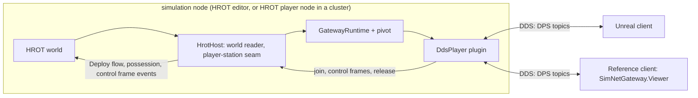
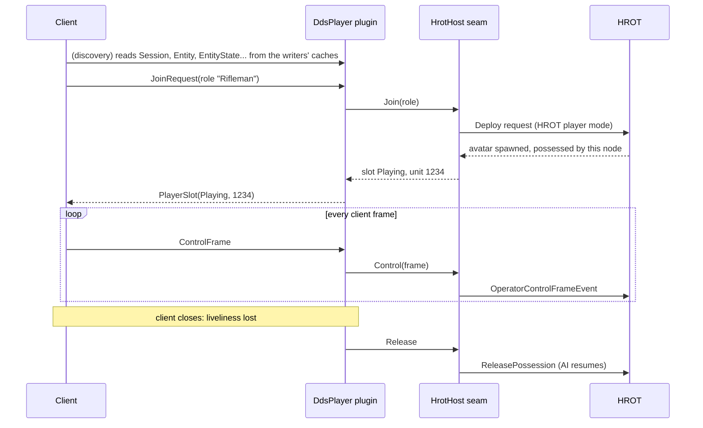

# DD-017: DPS - the DDS Player Station protocol

| | |
|---|---|
| **Status** | draft |
| **Tasks** | T-034 |
| **Rulings honoured** | R-049, R-050 (layer rules), DD-016 (host and side plugins) |
| **Date** | 2026-11-18 |

## 1. Context and goals

DPS (DDS Player Station) is a DDS contract between a simulation and an external **player station**: a program that shows the simulated
world in 3-D (an image generator), may draw gizmos, and may let one human play one unit of the simulation (first person). The first client
is an Unreal Engine plugin; nothing in the contract is specific to Unreal, and nothing in it exposes HROT's internals (the HROT host is the
first producer; another simulator could feed the same topics through its own host).

The owner's requirements (2026-11-18):

- A station can be plugged into a running simulation at any time and can go away at any time. The simulation does not need to know
  whether a station is there ("the less HROT cares, the better"). The gateway behaves as if the station were always there, passively.
- The station possesses a soldier of the simulation. The simulation's own player mode applies: a player either takes over a placed
  playable unit or has an avatar spawned for him and possesses it.
- One player per station. Several players = several stations.
- How people look and move (animation, clothing, equipment, how they use it) is critical for acceptance, so the simulation must provide
  enough information for a high-quality renderer.
- Everything is public: the contract, the plugin, a reference client. It works in the HROT editor (offline node) as well as in a cluster.

Goals:

- **G-1** Public DDS types (C#, CycloneDDS.NET; the IDL is generated, module `DdsPlayer`) with the world-to-station topics, the station-to-world topics and the gizmo topics.
- **G-2** A side plugin `SimNetGateway.Plugin.DdsPlayer` (key `dps`) on the public HROT host (DD-016) that publishes the world and acts as
  the simulation's player station on behalf of a connected client.
- **G-3** A reference client in this repository (the existing `SimNetGateway.Viewer`), so the contract is tested without Unreal or HROT.
- **G-4** A list of what the HROT host needs from HROT (data it does not expose today), written generically.

Out of scope here: the Unreal client itself (its own public repository, with the HROT-to-Unreal terrain importer), voice, multiple players
behind one station, any station logic inside HROT.

Anti-goals: a contract that mirrors HROT's internal NED schema; a station that needs HROT to change its behaviour when it connects; an
animation contract that dictates clips (the renderer animates; the simulation states what the body does).

## 2. Block diagram

- **HrotHost** (DD-016) reads the world into the pivot (`HrotEntityState` and friends). It gains a *player-station seam*: an interface the
  plugin calls to join, possess, send control frames and release, implemented by the host with HROT's own player mode (section 3.6). The
  host is the only part that compiles against HROT.
- **DdsPlayer plugin** maps the pivot to DPS topics and DPS inbound topics to the player-station seam. It depends on the plugin contract
  only (like the DIS and HLA plugins).
- **Clients** subscribe to the world topics; a client that plays also writes the player topics. A view-only client (a big screen, an
  instructor view) never writes.

## 3. Key concepts and decisions

### 3.1 One station = one simulation node (P-1)

HROT's player station is a cluster node (`StationNodeId`; possession and control frames name it; release on the node's departure).
Therefore each DPS client pairs with one node that loads the gateway:

- **Cluster:** each player PC runs the client and a HROT player node (`-m player`) with the gateway extension. That node is the player's
  station; several players = several player nodes, which HROT already supports.
- **Editor (offline):** the editor node is the station (one player), as the other sides already run in the editor.
- A node whose client is absent is an idle station: it does nothing (no join, no frames).

Rejected: one gateway serving many players (HROT's station identity is the node; a node cannot be several stations without HROT changes).

### 3.2 Late join and absence without a handshake (P-2)

- **World state topics** are keyed, `RELIABLE`, `TRANSIENT_LOCAL`, `KEEP_LAST 1` per instance: a client that joins late receives the
  current state of every instance from the writer's cache. An entity that leaves is **disposed**.
- **Event topics** (fire, detonation, effect) are `VOLATILE`, `RELIABLE`, `KEEP_LAST` small depth: a client not connected misses them, by
  design.
- **Player topics** (client to gateway) carry `LIVELINESS AUTOMATIC` with a lease (default 2 s, configurable). The gateway reacts to the
  liveliness of the matched writer: lost = the player left (section 3.6).
- The gateway publishes whether or not any client is matched. The simulation is never told about clients.

Rejected: a hello/ack session protocol (DDS discovery and durability already give it); per-client state replay by the gateway.

### 3.2a One partition per station (P-2a)

Every DPS topic of a station is written and read in one **DDS partition named after the station** (configuration `dps.partition`,
default the node's station name). A client is configured with the partition of the node it pairs with, and sees only that gateway: its
own world view (one id space), its own `PlayerSlot`, and only its `ControlFrame`s reach that gateway. A view-only client (big screen,
instructor) uses the partition of any node. A second client that writes player topics into a partition whose player is already matched is
ignored (the first matched writer wins, the gateway logs one warning).

Rejected: a station id in every key (each gateway still has its own id space, so world topics from N gateways would collide); one DDS
domain per station (domains are a deployment resource; partitions are free and configured per participant).

### 3.2b Delivery in two steps (P-2b, my call, reversible)

- **Step 1 - editor:** the offline node is the station (one player); the host already runs there (DD-016). HROT's player mode works in
  the networkless editor (HROT Player Join S4c): Deploy, possession, release on demand (the player's own release, as Esc does) and a
  later join again without the node leaving.
- **Step 2 - cluster player nodes:** the host running in `-m player` nodes (DD-016 kept it to the offline node); on a player node the
  configuration enables only the `dps` plugin, so DIS / HLA are not republished by every station.

### 3.2c Types and evolution (P-2c)

The C# types are the source: plain structs with CycloneDDS.NET attributes (as the other DDS types of this repository, DD-013), and the
IDL a client needs is generated from them by CycloneDDS.NET - no hand-written `.idl`. Types are extensible by appending fields (fields
are only ever added at the end), strings and sequences are bounded, and `Session` carries `ProtocolVersion` (major.minor; a client refuses
another major). CycloneDDS is the reference implementation; a client may use any DDS implementation that reads the generated IDL.

### 3.2d Scope of the first round (P-2d)

The owner: "First round is using what hrot provides today. We will extend it later when hrot gains the capabilities." The fields of
3.8 exist in the types from the start with an "unknown" value; they are filled when HROT provides the data. The HROT items of 3.8 are a
separate track and do not block this round.

### 3.3 Frames, units and identity (P-3)

- **Position:** the simulation's local Cartesian frame, metres, x east, y north, z up, the same frame the terrain was exported in (the
  HROT-to-client terrain importer uses it). `Session` carries the geo reference (UTM zone and origin) for clients that need geography.
  The conversion to the client's engine units and handedness happens once, in the client.
- **Orientation:** unit quaternion (x, y, z, w) in the same frame; the body's forward is +x of the body.
- **Time:** simulation time in seconds (double) on every state sample; `Session` carries time scale, paused and live/replay.
- **Identity:** `EntityId` = the gateway's network id of the entity (32-bit), stable for the entity's life; re-used ids are never alive at the
  same time.
- **Type:** the simulation's type id (HROT TKB type, an integer), the DIS entity type (7 fields) and a coarse `Domain` (Person, Ground,
  Air, Surface, Subsurface, Munition, Other). The client maps types to its own assets (a table in the client's content); the gateway makes
  no model choice.

### 3.4 Motion (P-4)

`EntityState` samples are sent on change with thresholds (position, orientation, velocity), plus a heartbeat (default 5 s), and carry
linear and angular velocity and acceleration so the client can extrapolate and smooth (dead reckoning, the client's choice of algorithm).
Character gait is derived by the client from speed (no gait field).

### 3.5 People: semantic state, the client animates (P-5)

The simulation states what the body does; the client chooses clips, blends, IK. `PersonState` carries:

- stance (Standing, Crouched, Prone) and the transition (target stance, progress 0..1);
- weapon posture (AtEase, Ready, Aimed), aim point (world), active weapon slot, held item (Weapon, Throwable, Phone, Binoculars, None);
- look target (world point) and head yaw;
- gesture (HandsUp, FistRaised, HoldSign, Waving, Throwing, Warning, IdleSmoking, IdleShiftWeight, IdleStretch, IdleLookAbout, None);
- injury (Ok, Wounded, Incapacitated, Dead);
- **action** (Reload, Throw, OpenDoor, Mount, Dismount, UseItem, ..., None) with start time, expected duration and target - see 3.8, HROT
  does not expose it yet;
- seat (vehicle entity id, seat role Driver / Gunner / Commander / Passenger / Station) or carry mode (Carried, Dragged, Stretcher).

`Appearance` (keyed by entity, sent once and on change) carries the resolved look: per slot (Skin, Top, Legs, Over, Head, Hair, Beard,
Extra) a kind name and a colour (#RRGGBB), a camouflage pattern by side, face traits, sex and age class; and equipment items (helmet,
vest, backpack, ...) and the weapon per slot with attachments, as far as the simulation provides them (3.8). Kind names are the
simulation's vocabulary (strings, documented on the C# types); the client maps them to meshes.

Rejected: publishing HROT's `AnimationChannel` / montage queue (their parameters are opaque per action and tied to HROT's own animation
executor); publishing only a DIS-like appearance bit field (too poor for the acceptance goal).

### 3.6 Playing: the gateway is the station (P-6)

DPS topics, client to gateway: `JoinRequest` (choose a playable unit by id or a role by name, or observe), `ControlFrame` (one per client
frame), `Leave`. Gateway to client: `PlayerSlot` (Waiting, Observing, Choosing, Requesting, Spawning, TakingControl, Playing, Dead; the
unit id; the respawn time; the offers: playable units and roles with their sides) and `OwnUnit` (ammo per weapon, health, what the unit
can use right now - the data a HUD needs).

The plugin maps them onto the host's player-station seam, which drives HROT's own player mode on the node:

- Join / choose = HROT's Deploy client (request a playable unit or a role; HROT's deploy server spawns the avatar at a spawn point).
- Playing = HROT possession; each `ControlFrame` becomes one `OperatorControlFrameEvent` (forward, lateral, steer, yaw, vertical, gait,
  trigger, mount, aim point, stance, shot / cancel / ammo / use press counters, use verb and target, lean, binoculars, look from / look
  direction, fire preference).
- Death, respawn delay and the return to choosing follow HROT's player states unchanged.
- **Liveliness lost** (or `Leave`): the gateway releases the unit (HROT `ReleasePossession`); HROT resumes the unit's paused AI task. HROT
  itself would release only on the station node's departure, which does not happen here because the node stays.

The client predicts nothing authoritative; it may smooth its own unit's camera from the control it sends (client choice).

### 3.7 Gizmos (P-7, optional topic set)

`Gizmo` instances, keyed by (producer, gizmo id), `TRANSIENT_LOCAL`: a shape (line strip, arrow, circle, polygon, box, text, icon), world
coordinates or attached to an entity (offset), colour, width, lifetime (0 = until disposed), layer name. Disposed = removed. A client
that does not draw gizmos does not subscribe. Producers: the simulation's debug gizmos (a later host task); the topic set is generic.

### 3.8 What the HROT host needs from HROT (G-4, generic wording)

Today HROT simulates and records stance, weapon posture and held item, look, gesture, health and injury, seats and carrying, turret pose,
weapons and ammo, doors; DPS can publish those at once. Missing for the acceptance goal (to be requested from HROT, phrased generically):

1. **Resolved appearance as data.** A person's look is resolved from the type's wardrobe and the entity's seed inside the 3-D map
   (`Map3D/Outfits.cs`); no component holds it. Move the resolver into a shared library (no presentation dependency) so the map and any
   external renderer dress a person the same way.
2. **Action state.** Reloading, throwing, opening a door, mounting / dismounting and using an item are not stated; a renderer would have to
   infer them. A small component `{ Kind, StartedAt, Duration, Target }` written by the muscle when an action starts.
3. **Equipment items** (helmet, vest, backpack, pouches) and **weapon attachments** as data, not only garment kinds.
4. **Vehicles:** lights, hatches / doors, rotor state, partial damage.
5. Smoke screens, swimming, parachute canopy state.

Until they exist, the corresponding DPS fields stay at their "unknown" value; the contract does not wait for them.

### 3.9 Replay (P-8)

State topics follow the replayed world (the host already reads recorded state in replay). Fire and detonation come from the recorded state
in replay as for the other sides. `Session.Mode = Replay` tells the client; the player topics are refused in replay (`PlayerSlot` =
Observing).

## 4. Topic summary

| Topic | Key | QoS | Direction |
|---|---|---|---|
| `Session` | none (one instance) | state | gateway to client |
| `Entity` (type, domain, side, name, DIS type) | EntityId | state | gateway to client |
| `EntityState` (pose, velocity, damage) | EntityId | state | gateway to client |
| `Articulation` (turret, gun, rotor, door ...) | EntityId, PartId | state | gateway to client |
| `PersonState` | EntityId | state | gateway to client |
| `Appearance` | EntityId | state | gateway to client |
| `Fire`, `Detonation`, `Effect` | none | event | gateway to client |
| `PlayerSlot`, `OwnUnit` | none (one per station partition) | state | gateway to client |
| `JoinRequest`, `ControlFrame`, `Leave` | none | player (liveliness) | client to gateway |
| `Gizmo` | Producer, GizmoId | state | gateway to client |

## 5. Sequence: a client joins a running exercise and plays

## 6. Testing

- Type round trip and QoS checks against an in-process DDS participant (late joiner gets every live instance; a disposed entity disappears).
- Plugin tests on the engine's in-memory transport: pivot changes become the right samples; liveliness loss calls release exactly once.
- Host tests on a staged HROT world: join a role, play, die, respawn; join a playable unit; leave mid-game (AI resumes).
- The reference client (`SimNetGateway.Viewer`) shows a live exercise from DPS topics only, and can possess and walk a unit with keys.

## 7. Placement

- This repository: the DDS types (and their generated IDL), `SimNetGateway.Plugin.DdsPlayer`, the host's player-station seam and the new pivot fields, the reference
  client, this document.
- HROT: the data of 3.8 (its own designs; generic).
- A separate public repository: the Unreal client and the terrain importer.

## 8. Left to the builder

Field names and type layout, threshold values, the topic name prefix, the reference client's UI, how the host seam reuses HROT's Deploy
client code, test names.

## 9. Open questions

- Which client-side extrapolation the reference client uses (a sample implementation helps other clients).
- Whether `OwnUnit` carries anything a HUD needs beyond ammo, health and the use verdict (e.g. hit feedback direction).
