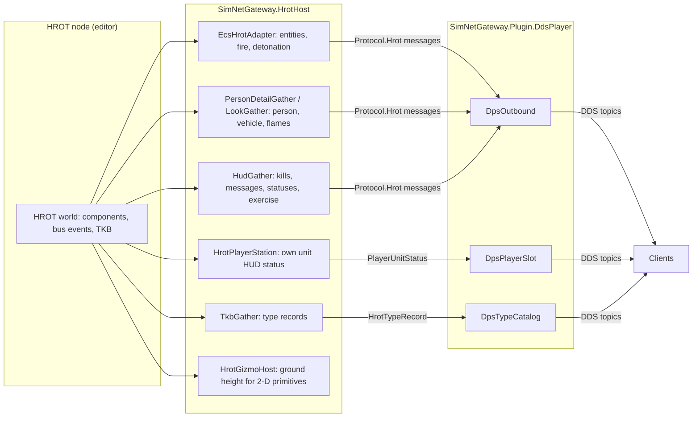
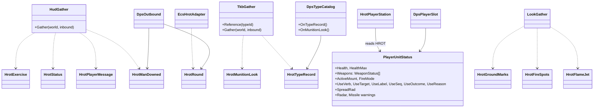
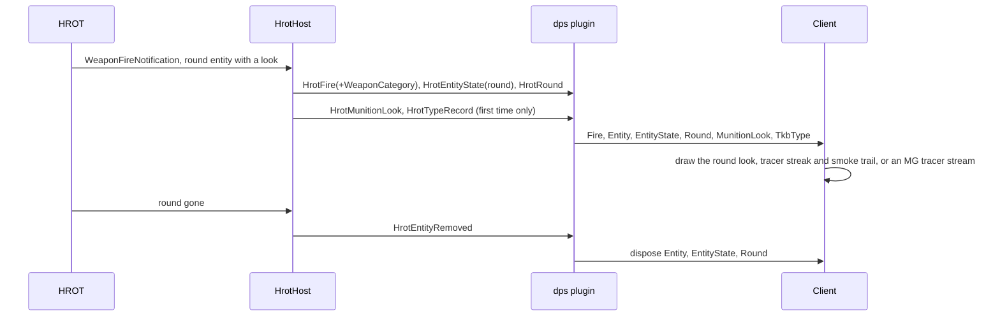
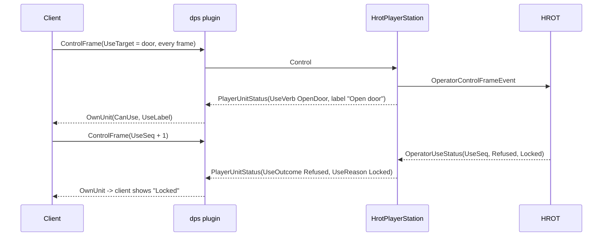

# DD-018: DPS round 2 - HUD, type data, rounds, flames

| | |
|---|---|
| **Status** | approved (R-133: the owner delegated the contract details; the contract is not handed to a client until the owner says so) |
| **Tasks** | T-035 |
| **Rulings honoured** | R-132 (DD-017), R-133, R-049, R-050, R-127 |
| **Date** | 2026-11-20 |

## 1. Context and goals

DD-017 round 1 published what HROT provided on 2026-11-18. Writing the client guide for the Unreal image generator showed what a
renderer and a player station still miss, measured against HROT's own 3-D map and FPS station (HROT `coordinator` 0b6cf8d96):

- **HUD:** `OwnUnit` leaves weapon and round names, fire mode, the use label and the use outcome empty; the kill feed, player messages,
  objectives, scores, the exercise result and the aircraft warnings are not on the wire.
- **Type data:** a renderer needs per-type facts (a munition's look, a weapon's category, openings, seats, body geometry) that live in
  HROT's TKB, which a scenario may replace, so they must come from the running simulation.
- **Rounds:** HROT draws real rounds (tracers, rockets with smoke trails, grenades in flight and lying); DPS does not say which entity
  is a round or how it looks.
- **Flames:** HROT CE-4635 added flamethrower jets, burning people, burning spots and scorch marks, all replicated state in HROT.
- **New readings:** `Demeanour` (fear, anger, civilian mode), `VehicleLook.RotorSpeed`, the crew's head out of a hatch.
- **Gizmos:** 2-D primitives (box, text) arrive with z = 0.

Goals: the topics and fields of section 3, filled by the HROT host from HROT's own readers, mapped by the `dps` plugin, tested as in
section 7. Out of scope: moving HROT's map-only presentation rules (gait, limb swing, rotors spinning, wheels, tracer streams) into
HROT's look library - that is HROT's work; the client guide links them for porting meanwhile. Roles and respawn (DD-017 step 2) and
the FPS station's extra keys (squad switch, seat switch, head out, lights, command wheel) are a later round.

## 2. Block diagram

- The host is the only part that compiles against HROT; it reads with HROT's own readers (`FlameJets`, `PersonLook`, `VehicleLook`,
  `OperatorFireModes`, `MunitionTkbCatalog.VisualOf`, the TKB) and hands BCL-only `Protocol.Hrot` messages to the plugins (R-050).
- `DpsOutbound` maps the new messages to the new topics as it does for round 1; `DpsPlayerSlot` fills `OwnUnit` from the extended
  `PlayerUnitStatus`; `DpsTypeCatalog` publishes each type record once.
- The DIS and HLA plugins ignore the new messages (they subscribe by type).

## 3. Key concepts and decisions

### 3.1 Player HUD (P-1)

**`OwnUnit` filled and extended** (fields appended):

| Field | From HROT |
|---|---|
| `AmmoEntry.Weapon` | the mount's category name (`WeaponCategory`, as HROT's HUD `Hud.KindOf`); HROT has no per-weapon display name |
| `AmmoEntry.AmmoType` | the loaded round's name (`Hud.RoundName`: the munition template's name) |
| `AmmoEntry` appended: `AmmoTypeId` (long), `Max`, `Magazine` (-1 = no magazine model), `LoadedRounds`, `Busy`, `Overheated`, `HeatPercent` | `WeaponAmmo` |
| `ActiveSlot` | the last control frame's `Mount` |
| appended `FireMode` (Sight / Lock) | `OperatorFireModes.Of` with the last frame's `FirePref` |
| `UseLabel` | HROT's verb label (`Hud.Label`) |
| appended `UseSeq`, `UseOutcome` (Running / Done / Refused), `UseReason` | `OperatorUseStatus` on the unit; a client shows it when `UseSeq` equals its last press, as HROT's HUD |
| appended `SpreadRad` | `HitModel.Sigma` of the selected mount (half-width, radians) |
| appended `RadarWarning` (None / Searched / Tracked), `RadarBearingDeg`, `MissileLaunch`, `MissileBearingDeg`, `MissileTimeToImpactS`, `MissileSeeker` | `RadarWarning`, `MissileWarning` on the unit (bearing: degrees, 0 = north, clockwise) |

Not on the wire, computed by the client as HROT's HUD does (rules in the client guide): **shock** (rounds passing within 5 m of the eye,
+0.5 each, decaying over 0.4 s - the client sees the rounds, 3.3) and **hit arcs** (a `Detonation` whose target is the own unit: the arc
points against the travel, else toward the shooter; 2 s). Rejected: the gateway computing them (it has no eye; HROT keeps them as
presentation memory too).

**`ManDowned`** (event): `SimTime`, `VictimId`, `SourceId`, `OriginalSourceId` (entity ids, 0 = unknown), `State` (Injury),
`BodyPart` (0 = unknown, else HROT's body part id + 1), `VictimSide`. From `ManDownedEvent`, local and remote (HROT's one kill
authority, CE-3364). Feeds the kill feed and the killer on the death screen.

**`PlayerMessage`** (event): `MessageId`, `OriginNode`, `To` (All, Side, Station, Unit, Instructor), `ToValue`, `Text` (256),
`Seconds`, `Priority`, `SentAt`, `SourceId`. From `PlayerMessageEvent`. All messages are published with their addressing; the client
filters as HROT's `PlayerMessages.Addressed` (All; Side = its side; Unit = its unit; Station = its station; Instructor only for an
instructor view). Rejected: filtering in the gateway (an instructor client in the same partition needs the rest).

**`Status`** (state, keyed by `StatusId`): one per HROT `ObjectiveStatus` (objectives, measures, triggers), the fields a HUD, a
scoreboard and a debrief read: role, state, closed, owner, progress (cur, need), value, target, score, pass, points, changed at,
reason, title, kind, group, phase, required, scored, weight, visible sides, step (cur, count), hold for, deadline, expected at,
capture, challenger, area (centre, radius), ends exercise, `SubjectId`, `ParentId`. Disposed when the status entity goes.
**`Exercise`** (state, one instance): HROT's `ExerciseResult` (phase, ended at, reason, the result per side). Kinds and titles stay
data, so a new objective needs no contract change. Rejected: one topic per HUD element (tickets, capture points, scoreboard) - HROT
derives all of them from the same statuses (`RulesModel`), and so can a client.

### 3.2 Type data (P-2)

**`TkbType`** (state, keyed by `TypeId`): `TypeId` (int64), `Name`, `CategoryPath`, `DisType` (text), `Schema` (`"hrot/1"`),
`ContentHash` (FNV-1a 64 of `Json`), `Json` (unbounded). `Json` is HROT's own serialization of the template, as its debug API
`GET /tkb/types/{id}` makes it (`EventSerializationHelper.SerializeToJson` per descriptor), restricted to an allow-list of
presentation descriptors (munition visual, warhead, weapon suite / system / capabilities, turret suite, vehicle openings and lights,
vehicle parameters, carrier, body geometry, person, outfit, visual definition, effects, sounds, locomotion, stride render model,
character animation, flight parameters). Published once per type when first referenced by an entity, a fire, a round or a loaded
weapon. Rejected: typed IDL per TKB record (HROT changes them often; every change would be a protocol change); a file shipped with the
client (a scenario can replace the TKB, so a file drifts from the run).

**Type ids are 64-bit.** `Entity.TypeId`, `Fire.MunitionTypeId`, `Detonation.MunitionTypeId` become `long` (protocol 1.0 is not
released, R-133). Rejected: an extra 64-bit field beside the 32-bit one (two ids for one thing).

### 3.3 Rounds (P-3)

HROT gives a network id only to rounds that have a look (tracers, shells, rockets, missiles, grenades, mortar bombs; ball ammo has
none). They are published as `Entity` (Domain Munition) + `EntityState` like any entity (verify the gather includes them; if not, it is
added). New:

- **`Round`** (state, keyed by `EntityId`): `MunitionTypeId`, `ShooterId`, `Muzzle` (launch point), `Lying`, `FuzeLeftS` (negative =
  no time fuze), `Stopped`. Sent on creation and on change of lying / stopped. The client draws the round's look at the entity's pose,
  the tracer streak and the smoke trail back toward `Muzzle` (HROT's `ProjectileLayer` rules, linked in the client guide).
- **`MunitionLook`** (state, keyed by `MunitionTypeId`): the resolved look `MunitionTkbCatalog.VisualOf` (shape, length, diameter,
  colour, smoke trail, tracer, tracer colour, sticks, bolt), sent once per munition type that is fired or seen. Typed rather than only in
  `TkbType`, because `VisualOf` falls back to HROT's built-in looks that no TKB record carries, and because every renderer needs it.
- **`Fire` appended `WeaponCategory`** (the shooter's mount category by name, unknown fallback): a client draws HROT's tracer streams for
  machine guns and autocannons (`FireStreams.IsAutomatic`) and knows a flamethrower.

Rate: rounds move fast; `EntityState` carries velocity and acceleration and the client dead-reckons, so the existing thresholds hold.
Bullets without a look stay off the wire (`Fire` is enough).

### 3.4 Flames (P-4)

- **`FlameJet`** (state, keyed by `EntityId` + `Mount`): `AimPoint`, `TargetId`, `RangeM`, `HalfAngleRad`, `Intensity`,
  `BurstStartedAt`, `BurnSeconds`; written while `FlameJets.TryGet` says lit, disposed when it goes out.
- **`PersonState` appended `Burning`** (`PersonLook.IsBurning`).
- **`FireSpots`** (state, keyed by the holder's `EntityId`): up to 8 spots, each world position (the host applies the holder's
  transform, as `EffectLayer.HolderPoint`), radius, intensity, since, seconds. From `FireState` (vehicles, buildings, terrain cells);
  disposed when none burns.
- **`GroundMarks`** (state, keyed by the cell's `EntityId`): up to 16 marks, each kind (VehicleStand, BurnedArea, BodyImprint), centre
  (x, y; z = ground height), heading, length, width, hot end, stand since, left at. From `GroundHeatMarks`; a renderer draws
  `BurnedArea` as a scorch, an IR renderer all three.

### 3.5 People and vehicles (P-5)

- **`PersonState` appended** `Fear`, `Anger` (quarters 0..4), `CivilianMode` (HROT's `CivilianMode` by name: Routine, Alarmed, Panic,
  Shelter, Inside, Cower, Casualty, Protest, Riot, Dispersing, ArmedHostile, Gather, Surrender, Watch; unknown fallback). From
  `Demeanour`.
- **`VehicleLook.RotorSpeed`** filled from `VehicleLook.RotorSpeed` (0..1), sent on a change of 0.05 or more and when it reaches 0 or 1.
- **`OpeningLook` appended `CrewExposed`** (`VehicleLook.CrewExposed` per opening id).

### 3.5a Animals, riders and the aim (P-5a)

HROT has animals (HROT `docs/designs/animals/DESIGN_Animals.md`): cattle, sheep, goats, pigs, horses (herd, riding, war), dogs,
cats, rabbits, hens, birds and flocks. Ridden horses are carriers with seats like a motorcycle (a firing rider seat). A dragon
(HROT CE-4634, open) is planned as the bird flight model scaled up with a rider seat and a flame breath on the shared flame.

- **`Domain` gains `DomainAnimal`** (appended): today a DIS kind-3 animal (category 200 - 208) maps to `DomainPerson`, wrongly.
- **`Animal`** (state, keyed by `EntityId`, for animals only): `Mode` (HROT's `AnimalMode` by name: Calm, Alert, Flee, Recover, Rest,
  Guard, Crouch), `FearBand` (0..3), flags `Bolting`, `Dangerous`, `Calling`; and for a flock (one entity drawn as many birds) `FlockCount`,
  `FlockInitialCount`, `FlockSeed`, `FlockMode` (Flying, Landed, Perched; count 0 = a single body). From HROT's `AnimalState` /
  `FlockState`; the species is the type (`TkbType`). The client animates (gait from speed, grazing, lying when resting, the flock's
  birds) by HROT's rules, linked in the client guide.
- **Riders:** a rider's `PersonState` already names the carrier (`SeatVehicleId`) and the seat role; the seat's pose (ride astride)
  and position come from the carrier's type data (`TkbType`: HROT's carrier seats with `SeatPose`). A dragon will be the same: an
  animal carrier with a rider seat, its breath a `FlameJet` on its mount.
- **The aim point is HROT's own:** `PersonState.AimPoint` is filled by HROT's one reading of the posture's aim
  (`WeaponPostureOf.TryAimPoint`: the target's chest, 1 m above its position, or the aimed point). Round 1 sent the target's position
  (its feet), so a client's upper body pitched too low. The client turns and pitches the upper body toward it from the shoulder,
  within HROT's limits (twist 75 degrees, pitch 35 degrees, eased with a 0.12 s time constant; none when prone or dead), and turns
  the head by `HeadYaw` less the drawn twist, within the neck - the rules are in the client guide.

### 3.6 Gizmo heights (P-6)

The host gives 2-D primitives (box, text) the ground height at their point from HROT's terrain height query, so a client never sees
z = 0 for them. Rejected: a 2-D flag for the client to drape (every client would need the terrain query the host already has).

### 3.6a Building damage and glass (P-7)

HROT replicates a building's damage on runtime damage entities (HROT `docs/DESIGN_Glass_Windows.md`, `DESIGN_Terrain_Import_UTM.md` §8):
`BuildingDamage` (wall breaches as rectangles on a panel, collapsed) and `WindowDamage` (per hit window: hits 1..2 = cracked with up
to two crack points (u, v), 3 = broken). A renderer that draws HROT's terrain must show both, or a shot window stays whole and a
breached wall stays closed.

- **`BuildingDamage`** (state, keyed by the building's `TerrainObjectKey` label `"<terrain>/<building label>"`, the identity the
  terrain export keeps): `Collapsed`; breaches (panel index within the building, from / to metres along the panel from its A end,
  bottom / top absolute z, kind: Hole / Passage); windows (panel index within the building, opening index on the panel, hits, the two
  crack points as bytes 0..255). Several HROT entities for one building (capacity overflow) are merged into one sample. Disposed when the
  building's damage goes (a reload).
- The pane geometry is static terrain (a `glazed` flag per window opening) and comes with the terrain export, not over DPS.
- Not in this round, same family, a later round: felled / damaged trees (`TreeDamage`), ground patches (craters, road blockage), door
  states (DD-017 section 10 gap). The client guide links them.
- Rejected: one topic for windows and one for breaches (HROT keeps them apart only so a glass hit does not re-send breaches on its
  internal wire; a client applies both to the same building); keying by HROT's building index (an index into one import's list; the
  label survives a re-export).

### 3.6b Ambient traffic: world-space tracks (P-8, revised 2026-11-20)

HROT runs SUMO through SumoSharp (vendored in HROT `FDP/ExtDeps/SumoSharp`, upstream public `pjanec/SumoSharp`). Two existing wires
were checked and neither fits DPS:

- **SumoSharp's DDS wire** (`sumo/vehicles` etc., HROT AQ93 D-wire, R-4020) is lane-relative dead reckoning (lane, position along
  the lane, lateral offset, speed, upcoming lanes): a receiver needs the SUMO net, SumoSharp's lane numbering and its reconstruction
  code to get a pose. The owner: the image generator must not deal with a road network, and DPS must not depend on SumoSharp.
- **SumoSharp's IG bridge** (`docs/IGBRIDGE-DESIGN.md`) reconstructs world-space poses for an IG with no prediction, but emits plain
  `[id, pos, quat, t]` samples at 20 - 30 Hz per mover: one sample stream per car, too many for thousands of movers.

**Decision: the gateway reconstructs, the client interpolates world-space tracks.** HROT already turns SUMO's wire into smooth
world-space poses every frame (`TrafficMirror`: SumoSharp's `DrClock` + `KinematicReconstructor`, terrain-local metres, SUMO's lane z or
the draped ground, into the `TrafficFrame` singleton). The host reads those poses and sends each mover as a short **track**: timed
knots (time, position x y z, heading, pitch, speed) on a smooth curve. A knot is added only when a cubic Hermite curve through the
knots already sent would miss the real pose by more than a tolerance (0.10 m position, 2 degrees heading), and at least every
`MaxKnotInterval` (1.0 s). The client plays traffic `PlaybackDelay` (default 1.2 s) behind the newest knot time, so it always
interpolates between real knots (a lane change, a junction turn, a stop all come out right) and never needs a road network; it
falls back to extrapolating along the last knot's heading and speed only when a knot is late.

- **`Mover`** (state, keyed by `MoverId`): kind (Car, Pedestrian), `TypeId` (the HROT TKB type; for a SUMO car 0 = HROT's generic
  traffic car), colour (0xRRGGBBAA; HROT's paint rule already applied), seed (clothes and face of a pedestrian), length, width,
  source. Written at spawn, disposed at despawn. A mover HROT turns into its own entity (a panicking pedestrian becomes a civilian)
  is disposed here and appears as an `Entity`.
- **`MoverTracks`** (event-like batch, reliable, volatile, keep-last): `SimTime` of the batch and up to 4096 entries
  `{MoverId, Knot}` (time as an offset from `SimTime`, float position, heading and pitch as degrees x 100, speed) - every knot added since
  the last batch, sent at 10 Hz. A late joiner gets the `Mover` instances from TRANSIENT_LOCAL and the next knots within
  `MaxKnotInterval`; it shows a mover from its second knot.
- **`TrafficLights`** (state, keyed by signal id): position, heading, state (Red, Yellow, Green, Off) per signal head, from SUMO's
  traffic-light state and the net's controlled lanes - placed in the world by the host, so the client needs no net.
- **One source per car:** HROT's local replica entities of SUMO cars (`TrafficReplicas`, within 300 m + 50 m of its units) are left
  out of `Entity`; every SUMO car reaches the client only as a `Mover`.
- **Roads:** the road surface comes with the terrain export (the terrain importer's business), not over DPS.
- Not SUMO-specific: any simulator's ambient traffic or crowd can feed `Mover` / `MoverTracks`.
- Budget: a car on a straight road needs one knot per second, a turning one a few; about 24 B a knot, so 10 000 movers at 2 knots/s
  are about 0.5 MB/s, batched into a few samples per tick.
- Rejected: SumoSharp's wire in the partition (needs the net and SumoSharp's code); dense pose samples per mover (IG bridge style;
  the rate); `EntityState` per mover (one keyed DDS instance and a heartbeat per car); predictive future segments from the route (the
  gateway knows the route only as lanes; delayed interpolation is exact and simpler).

### 3.6c One trajectory model, two playback modes (P-9)

The owner (2026-11-20): generalise the traffic tracks to every entity if it fits gameplay with background traffic, but keep two
lanes if a unified one would add latency or cost for ordinary entities (thousands of soldiers). Decision: unify the MODEL, keep the
two TRANSPORTS and two PLAYBACK modes.

- **Track point** (the one model): time, position, orientation, linear velocity, and (live entities) linear acceleration and angular
  velocity. An `EntityState` sample IS a track point already; a `MoverTracks` knot is one with orientation reduced to heading and
  pitch.
- **Curve rule** (the one math, in the client guide with a reference implementation in the reference client): between two points a
  cubic Hermite in position with the velocities as tangents and a slerp in orientation; past the newest point second-order dead
  reckoning (position + v t + a t^2 / 2, orientation by angular velocity); a correction blends from the shown pose to the new curve
  over 0.25 s.
- **Send rule** (the one policy, two references): send a point when the client's curve would leave a tolerance. For a **live**
  entity the reference is the extrapolation from the last sent point (today's `EntityState` thresholds: 0.05 m, 1 degree, 0.1 m/s,
  heartbeat 5 s); for a **delayed** mover it is the interpolation through the sent points (0.10 m, 2 degrees, at most 1 s apart).
- **Playback modes:** **Live** - shown at the newest simulation time by extrapolation; for everything a player sees and interacts
  with (units, vehicles, aircraft, rounds, the own unit). **Delayed** - shown `PlaybackDelay` behind the newest point by
  interpolation only; for background movers. Nothing is added to the latency of a live entity: its points and extrapolation are
  today's.
- **Transports:** live entities stay one keyed `EntityState` instance each (late join and disposal for free; thousands are fine);
  movers stay batched in `MoverTracks` (tens of thousands). A mover that HROT turns into an entity leaves `Mover` and appears as an
  `Entity`; the client blends the hand-over over the playback delay rather than jumping forward.
- Rejected: one topic for both (a batch loses keyed late join and disposal for entities; a keyed instance per mover is the cost the
  batch exists to avoid); delayed playback for every entity (a player would aim at where a target was a second ago, HROT judges the
  shot where it is now).

### 3.7 Contract rules kept

Fields are appended at the end of existing types; enumerations mirrored from HROT go by name with an unknown value 0 (DD-017 3.10);
every enumerator is prefixed with its enum name; strings and sequences are bounded, except `TkbType.Json`. The protocol stays 1.0
until the owner hands it to a client (R-133).

## 4. Class diagram

- `HudGather` (new, host): kills and messages from the bus (local and remote), statuses and the exercise result from components,
  change-detected.
- `TkbGather` (new, host): collects the type ids referenced this frame (entities, fires, rounds, loaded rounds), and for each id not yet
  sent this runtime emits its record and, for munitions, its look. Cleared at a world boundary.
- `LookGather` gains flames; `PersonDetailGather` gains demeanour and burning; `EcsHrotAdapter` gains rounds and the fire's weapon
  category.
- `DpsTypeCatalog` (new, plugin) writes `TkbType` and `MunitionLook`.

## 5. Sequence diagrams

A client joins and shows a burst of tracer fire:

The player uses a door and reads the outcome:

## 6. Edge cases and error handling

- A world boundary: the type catalog forgets what it sent (new writers; TRANSIENT_LOCAL serves late joiners); statuses, rounds, jets,
  spots and marks are disposed with their writers as in round 1.
- Replay: statuses, the exercise result, rounds, spots and marks follow the replayed world; kills and messages come from recorded
  events if HROT replays them (no extra work); `OwnUnit` stays empty (no player in replay).
- A TKB descriptor that fails to serialize is left out of `Json` with an entry `{type, serializationError}` (as HROT's debug API).
- An enumeration value HROT appends maps to the unknown value; the guard test lists HROT's names (as for round 1).
- `TkbType.Json` size: a template is a few kB; the allow-list keeps AI and damage tables out.

## 7. Test plan

- Protocol: round trip of every new and extended type; the generated IDL contains the new topics; QoS per category.
- Host (staged HROT world, as round 1): a man with `Demeanour` and `BurningUntil` -> person detail; a lit flame jet -> jet, then
  disposed; `FireState` and `GroundHeatMarks` -> spots and marks in world coordinates; a round with a look -> entity + `HrotRound` +
  munition look once; a fire from an MG mount -> category; `ManDownedEvent` and `PlayerMessageEvent` -> messages; an `ObjectiveStatus`
  -> status, then disposed; the TKB gather emits each referenced type once and again after a boundary; `PlayerUnitStatus` carries the
  weapon names, fire mode, use outcome and warnings; a gizmo box gets the ground height.
- Plugin (in-memory transport): each message -> the right sample; the type catalog writes once per type; name mapping with unknown
  fallback; the guard test of HROT's enumeration names (CivilianMode, WeaponCategory, HeatMarkKind, UseReason, UseOutcome,
  RadarWarningLevel).
- Reference client: shows the kill feed line, the weapon line with round name and fire mode, and the use verdict in its HUD text;
  counts the new topics in its headless summary.

## 8. Proposals

P-1 .. P-6 are sections 3.1 .. 3.6, approved under R-133 (the owner delegated the contract details and reviews before the hand-over).

## 9. As-built

(filled during T-035)
