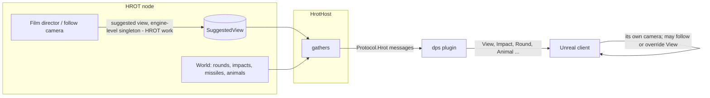
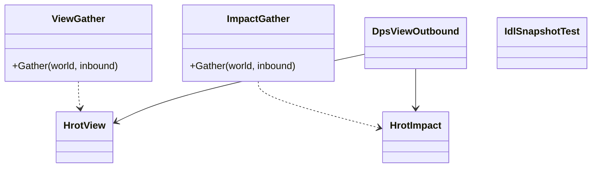
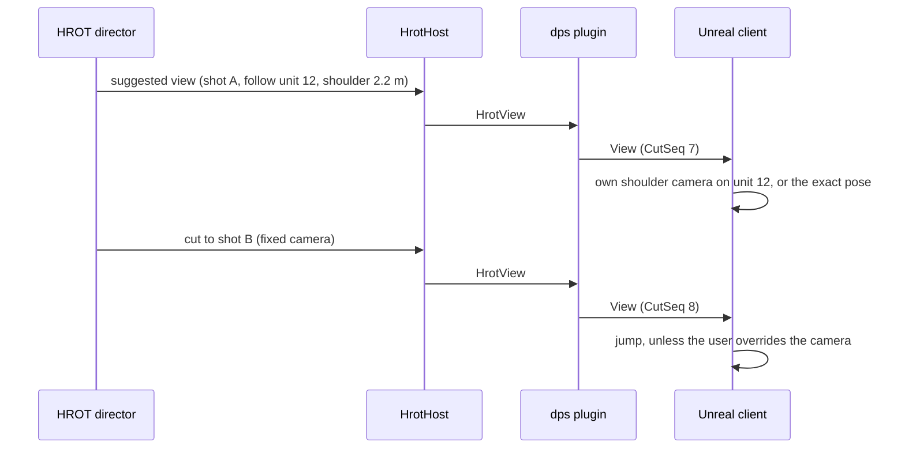

# DD-019: DPS round 3 - client feedback, the suggested view

| | |
|---|---|
| **Status** | approved (R-134) |
| **Tasks** | T-036 |
| **Rulings honoured** | R-132 (DD-017), R-133 (DD-018), R-134, R-049, R-050 |
| **Date** | 2026-11-20 |

## 1. Context and goals

The Unreal client team read the client guide (`docs/clients/DPS-Client-Guide.md`) and DD-017 / DD-018 and reported what is missing
or fragile. The owner (2026-11-20) ruled:

- *"the unreal should support independent camera override of whatever HROT suggests - HROT usually suggests from its film director.
  Unreal should also do its own camera binding and over the shoulder view handling. Add View topic now containing HROT suggested
  camera mode/location."*
- On porting HROT's map-only presentation rules: *"rather wait for HROT doing stuff correctly than do fragile hacks and inconsistent
  guesswork"* - the rules move into HROT's look library (HROT's work, requested separately); the gateway adds no constants table and no
  ported twist of its own, and replaces its existing ports with HROT's functions once they exist.

Goals: the topics and fields of section 3, the committed IDL, effects in replay, the guide's additions. Out of scope: multi-channel
camera sync (Unreal's own cluster rendering, e.g. nDisplay; every channel reads DPS as a view-only client), HROT's map-rule move.

## 2. Block diagram

- HROT's suggested camera lives in HROT's presentation layer today; the host must not reference it (R-050, DD-016). HROT is asked to
  publish it in an engine-level singleton; until it does, the host fills `View` with nothing and the topic has no instance.
- The client always owns its camera; `View` is advice.

## 3. Key concepts and decisions

### 3.1 The suggested view (P-1)

**`View`** (state, one instance per station partition): what HROT suggests the camera shows now.

| Field | Meaning |
|---|---|
| `Source` | None, Director (the film director's shot), Follow (HROT's follow camera on a unit), Operator (the editor's own camera) |
| `Mode` | Free, Orbit (around a target), Eyes, Shoulder, Chase, Fixed (a scripted camera key) |
| `TargetId` | the entity the camera is bound to (0 = none) |
| `Distance`, `Side` | the continuum distance (m; 0 = eyes, negative = ahead of the eyes) and the shoulder side (+1 right, -1 left) |
| `Position`, `Orientation`, `FovDeg` | the camera pose HROT computed (simulation frame), for a client that reproduces the shot exactly |
| `CutSeq` | grows at every hard cut: a client blends between samples of the same `CutSeq` and jumps on a new one |
| `Shot` | the take / shot name (64), for display |
| `SimTime` | when this was true |

Sent on change (pose beyond the entity thresholds, any other field) and at the heartbeat. A client may follow it, follow only its
binding (target, mode, distance) with its own controller, or ignore it.

Rejected: client-to-gateway camera control (the client owns its camera; HROT's own view is not the station's business); only the
binding without the pose (a director's free camera has no target).

### 3.2 Impacts on the static world (P-2)

**`Impact`** (event): `SimTime`, `Position`, `Normal`, `Surface` (the contract's `EffectSurface`), `Kind` (Entered, Left, Stopped),
`MunitionTypeId`, `ShooterId`, `Material` (HROT's terrain material name, 32). From HROT's `RoundImpactNotification` (one per surface a
round enters, leaves or stops on). A strike on a unit stays a `Detonation` with `TargetId` (HROT's rule, IM-8). The derived puff and
mark still arrive as `Effect`.

### 3.3 Event history depth (P-3)

`Fire`, `Detonation`, `Effect`, `Impact`, `ManDowned`, `PlayerMessage`: `KEEP_LAST 1024` (was 16). HROT raises one fire event per
shot (`Quantity` 1); a minigun fires 50 - 100 rounds a second. Rejected: a burst as one sample (loses each shot's time and origin;
HROT itself works per shot); `KEEP_ALL` (unbounded memory on a stalled reader).

### 3.4 Missile motor (P-4)

**`Round` appended** `LaunchedAt` (simulation time the round was fired) and `BurnSeconds` (the motor's burn, HROT's
`MissileDto.BurnSeconds`; 0 = no motor data). The client applies HROT's rule (trail full while `now - LaunchedAt < BurnSeconds`,
fading over the linger time, the guide's link) with no extra sample when the motor stops. Rejected: a `MotorBurning` flag (a sample per
missile at burn-out).

### 3.5 Airborne animals (P-5)

**`Animal` appended** `Airborne` (bool) from HROT's own state of a flying body (a bird, a flock flying, later the dragon) - the host
uses HROT's reader if one exists; otherwise this is requested from HROT and stays false. No height-above-ground guess.

### 3.6 The committed IDL (P-6)

The generated `DpsTopics.idl` and `DpsTypes.idl` are committed under `docs/clients/idl/` with the protocol version in a header line; a
test fails when they differ from what the build generates. A client needs no .NET build to get them.

### 3.7 Effects in replay (P-7)

In replay HROT raises no fire, impact or detonation events in the world the host reads, so `EffectRules.ForFrame` yields nothing while
`Fire` / `Detonation` still flow from the recorded state. The host derives `Effect` in replay from the same recorded fire and
detonation it already publishes, through HROT's `EffectRules` per-event functions (`ForShot`, `ForDetonation`, `ForImpact`) where their
inputs are available; where HROT's functions need a live event that replay cannot give, it is requested from HROT and documented as a
gap. One effect path for the client, live and replay.

### 3.8 Contract rules kept

Append-only, prefixed enumerators, 0 = unknown, bounded strings; protocol 1.0 until the owner hands the contract over.

## 4. Class diagram

- `ViewGather` reads HROT's suggested-view singleton when it exists (a seam until then); `ImpactGather` reads
  `RoundImpactNotification`; the round gather gains launch time and burn; the animal gather gains `Airborne`.
- `DpsViewOutbound` writes `View` and `Impact`; the existing modules get the appended fields.
- `IdlSnapshotTest` compares the committed IDL with the generated one.

## 5. Sequence diagrams

## 6. Edge cases

- No suggested view (HROT has none yet, no director running): no `View` instance; a client uses its own default camera.
- World boundary: `View` ends with its writer as every state topic; the next suggestion starts a new instance.
- Replay: `View` follows what HROT suggests in replay (a review camera) when HROT provides it.

## 7. Test plan

- Protocol: round trips of `View`, `Impact`, the appended fields; the history depth; the IDL snapshot test.
- Host: impacts from `RoundImpactNotification` (entered, left, stopped; surface and material); launch time and burn on a missile round;
  airborne from HROT's reader (or a recorded gap); effects in replay from recorded fire and detonation.
- Plugin: mapping and change detection of `View` (a new `CutSeq` on a cut); `Impact` mapping.

## 8. Proposals

P-1 .. P-7 are sections 3.1 .. 3.7, approved under R-134.

## 9. As-built

T-036 was built in one round (protocol still 1.0). What waits for HROT is listed last.

- **Contract:** new topics `View` (state, keyless, one instance) and `Impact` (event); enums `ViewSource`, `ViewMode`, `ImpactKind`; `Round` appended `LaunchedAt`, `BurnSeconds`; `Animal` appended `Airborne`; `Fire`, `Detonation`, `Effect`, `Impact`, `ManDowned`, `PlayerMessage` are KEEP_LAST 1024 (`MoverTracks` stays 16: not in the approved list). 34 topics.
- **Pivot messages:** `HrotView`, `HrotImpact`; `HrotRound` and `HrotAnimal` appended fields with defaults; both new messages are in the one DIS ignore list (`HrotIgnoredIngress`).
- **Plugin:** `DpsViewOutbound` (View change detection by the entity thresholds and the heartbeat; `CutSeq` starts at 1 and grows when source, mode, target or shot changes; a source that stops gives one sample with Source None; Impact mapping). Round and animal fields are mapped in the existing modules.
- **Host:** `ISuggestedViewSource` seam on `HrotServices.SuggestedView` (no implementation; `ViewGather` sends nothing without one). HROT has no engine-level source: `ViewTelemetry` / `ViewControl` (`Hrot.UI.Common.Map3D`) are per canvas and live in `Hrot.Presentation`, as do the director and the follow camera, and no FDP or engine singleton holds a suggested view (`DESIGN_Agent_Shared_View.md` is about the debug API reading that canvas telemetry). `ImpactGather` reads `RoundImpactNotification` (registered in `EnsureRegistered` like the other events). `RoundGather` fills `LaunchedAt` and `BurnSeconds` (`RoundGather.BurnOf` is a port of the one-line TKB read of `ProjectileLayer.BurnOf`). `AnimalGather` sets `Airborne` from `FlockState.Mode == Flying`.
- **Effects in replay (3.7):** `GatherReplayEffects` now also runs HROT's `EffectRules.ForShot` over a `WeaponFireNotification` rebuilt from each recorded muzzle-flash entity (shooter, mount index, the mount's ammo) and `EffectRules.ForDetonation` over a `DetonationNotification` rebuilt from each new `RecentDetonations` entry (position, ammo, shooter), so `Effect` flows in replay beside `Fire` and `Detonation`.
- **Committed IDL (3.6):** `docs/clients/idl/DpsTopics.idl` and `DpsTypes.idl` with the first-line version header, `scripts/refresh-dps-idl.sh` to refresh them (it drops the generator's timestamp line), and a test (`DpsRoundThreeTests.The_committed_idl_equals_the_generated_one`) that ignores the header, the timestamp line and line endings.
- **Guide:** articulation, angle table, seats, engine level, terrain importer dependency, View, Impact, motor, airborne, history depth, multi-channel, the committed IDL, runbook step 7 (HROT's `showcases/player-station`, on HROT's `ui` branch until merged); the replay gap reworded.

**Deviations and limits**

- `Impact.Surface` is read from the specs `EffectRules.ForImpact` returns (HROT keeps the ground-or-building rule inline in that function, not as a callable one), so it is Unknown when HROT draws no effect for the round. `Impact.Material` is always empty: `RoundImpactNotification` carries no material.
- `LaunchedAt`: HROT has no tick-to-time conversion. The host takes `SpawnTick` (the frame counter of `GlobalTime`) as the frames since spawn times the delta of the first-seen frame, back from the first-seen time (exact when seen in the first frames; a paused frame gives the first-seen time). Fixed at first sight. A replicated round with no `BallisticProjectile` has `LaunchedAt` = first seen.
- `Airborne` is true for flocks only: a single body has no flying state (`BirdFlightModel` writes no `FlightState`; `FlightState.Airborne` is kept by the aircraft models only), so it stays false.
- Replay effects: `RecentBurst` has no target and no damage, so a replayed burst is judged as on the ground or in the air with the size from the munition's explosive, and a strike on a unit draws a ground mark that a live run does not. A replay still has no `Impact` (the event is not recorded) and no `View`. If HROT raised events in a replay world, an effect could be sent twice (the live path and the replay path); HROT raises none today.
- The reference client (`DpsClient`) does not subscribe to `View` or `Impact` yet.

**What waits for HROT (T-036 stays in-progress)**

1. An engine-level suggested view: a singleton or reader in Hrot.Core or Fdp (source, mode, target network id, distance, side, pose, fov, shot) filled by the film director, the follow camera and the operator camera; the host then implements `ISuggestedViewSource` over it.
2. A surface class and a terrain material name on `RoundImpactNotification` (or a callable `EffectRules` function for the impact surface), and recording of the event for replay.
3. A target and the damage in `RecentBurst` (or recording of `DetonationNotification`), so replayed effects match live ones.
4. A flying state for single bodies (a lone bird, the dragon later).
