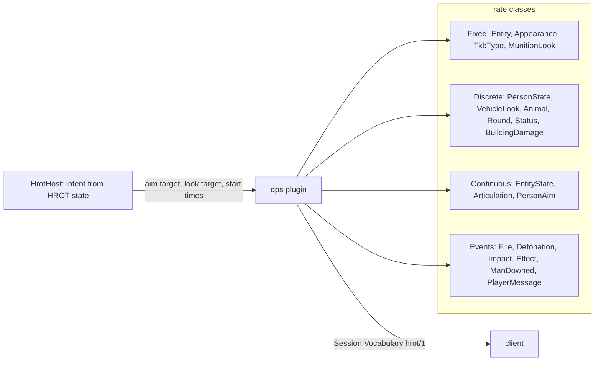
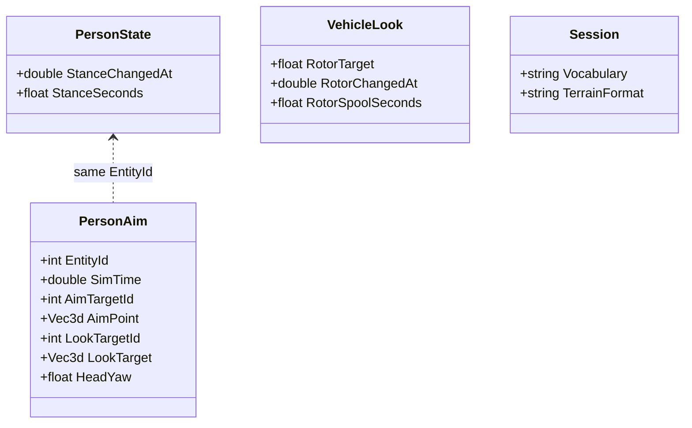
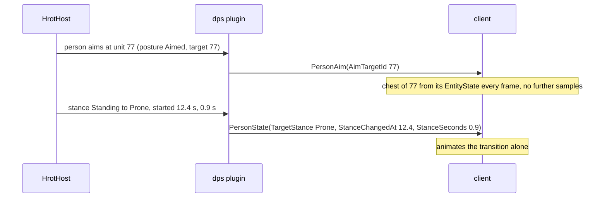

# DD-020: DPS round 4 - rate classes, intent instead of moving results, a producer-neutral contract

| | |
|---|---|
| **Status** | approved (R-135) |
| **Tasks** | T-037 |
| **Rulings honoured** | R-132, R-133, R-134, R-135, R-050 |
| **Date** | 2026-11-20 |

## 1. Context and goals

Two findings before the contract is handed to the first external client (protocol 1.0 is still open, R-133):

- **Rate.** `PersonState` (about 150 bytes, one instance per person) is re-sent for three continuously changing values: `AimPoint`
  (the moving chest of the aimed-at unit), `LookTarget` / `HeadYaw` (the same for the look), `StanceProgress` (2 % steps through a
  transition). Thousands of soldiers in a fight re-send the whole state many times a second. Spooled and animated vehicle values
  (rotor speed, an opening's progress) stream the same way.
- **Producer coupling.** The wire is standalone (own types, committed IDL, any DDS), but part of its vocabulary is HROT's: raw HROT
  numbers in plain integers, HROT's names in free strings, contract comments that define fields as "HROT's X".

The owner approved both fixes (2026-11-20, R-135): *"approved 'I'd fix it in two layers'"* and the standalone cleanup *"yes do"*.

Goals: section 3. Out of scope: replacing the host's ports with HROT's look library (waits for HROT `ui` to reach `coordinator`).

## 2. Block diagram

- The host reads HROT's INTENT where HROT has it (the aimed entity, the looked-at entity, when a transition started and how long it
  takes) instead of sampling the moving result.
- Every topic belongs to one rate class; a field goes into the topic of its class.

## 3. Key concepts and decisions

### 3.1 Rate classes (P-1)

| Class | Changes | Topics | Rule |
|---|---|---|---|
| Fixed | once per instance (or per type) | `Entity`, `Appearance`, `TkbType`, `MunitionLook`, `Mover` | never re-sent unless the thing itself changes |
| Discrete | on events | `PersonState`, `VehicleLook`, `Animal`, `Round`, `Status`, `Exercise`, `BuildingDamage`, `FireSpots`, `GroundMarks`, `OwnUnit`, `PlayerSlot`, `TrafficLights`, `View` | no continuous field; a value that moves over time is sent as a start time + target + duration |
| Continuous | by threshold + heartbeat, extrapolated by the client | `EntityState`, `Articulation`, `PersonAim`, `MoverTracks`, `FlameJet` | small samples |
| Events | as they happen | `Fire`, `Detonation`, `Impact`, `Effect`, `ManDowned`, `PlayerMessage` | KEEP_LAST 1024 |

The class of each topic is stated in its contract comment and in the guide; a new field goes into a topic of its class.

### 3.2 Intent instead of the moving result (P-2)

- **Aim.** `PersonAim.AimTargetId` (an entity id, 0 = none): while a man aims at a unit, the client takes the aim point from that
  unit's pose (its chest: 1 m above its position, the producer's rule stated in the guide). `PersonAim.AimPoint` carries a point aim
  only, and changes only when that point moves.
- **Look.** `PersonAim.LookTargetId` the same way; `LookTarget` only for a point; `HeadYaw` changes only for a glance or a look the
  client cannot derive (a point look).
- **Stance.** `PersonState.StanceChangedAt` (simulation time the transition began) and `StanceSeconds` (its duration) replace the
  streamed progress; `StanceProgress` stays (append-only) at the value of the last discrete sample and is documented as superseded. The
  host reads the duration from HROT's stance data; if HROT has none, it stays 0 (the client uses its own clip length) and the gap is
  recorded.
- **Spooled and animated vehicle values.** `VehicleLook.RotorTarget`, `RotorChangedAt`, `RotorSpoolSeconds` (and the same per
  opening: `TargetProgress`, `ChangedAt`, `Seconds`) where HROT's rule is a spool or a timed motion; the current value fields stay for
  clients that only need a value. If HROT's rule is not a simple timed motion for some value, that value stays continuous and is
  recorded.
- **`PersonAim`** (continuous, keyed by `EntityId`, about 40 bytes): `SimTime`, `AimTargetId`, `AimPoint`, `LookTargetId`,
  `LookTarget`, `HeadYaw`. `PersonState`'s own `AimPoint`, `LookTarget`, `HasLookTarget`, `HeadYaw` stay (append-only) and are
  documented as superseded by `PersonAim`; the gateway keeps them equal to the last discrete sample and does NOT re-send `PersonState`
  for their changes.

Rejected: lowering thresholds or rates on `PersonState` (still a full sample per change); splitting without intent (the small topic
would still stream at the same rate).

### 3.3 A producer-neutral contract (P-3)

- **Raw numbers become contract enums**, mapped by name in the gateway like the others, 0 = unknown:
  `UseVerb` (`OwnUnit.UseVerb`, `ControlFrame.UseVerb`), `BodyPart` (`ManDowned`), `Gait` (`ControlFrame`: Walk, Run - replacing the
  0 = run byte), `StanceRequest` (`ControlFrame.Stance`: None, Standing, Crouched, Prone - replacing stance + 1), `ArticulationKind`
  + `Index` (`Articulation`; turret 0 is index 0, no 2000 offset; `PartId` stays the key and is documented as opaque). Fields are
  appended where a type change is needed; the old field is documented as superseded and kept equal.
- **Producer vocabularies.** Free strings that carry the producer's own names (appearance slot and garment kinds, camouflage, hair,
  gizmo layers and families, `Status.Kind` / `Group`, `Impact.Material`, `AmmoEntry.Weapon` / `AmmoType`, `Effect.EffectType`'s
  meaning, `Articulation.Kind`) are documented as "a name from the producer's vocabulary". `Session` gains `Vocabulary` (e.g.
  `hrot/1`) so a client knows whose names it reads; the guide lists HROT's.
- **Producer-specific extensions**, marked in the contract and the guide as optional for a client: `TkbType` (tagged by `Schema`) and
  `BuildingDamage` (keyed by the producer's terrain export; `Session.TerrainFormat` names that format, e.g. `hrot-terrain/1`).
- **Neutral wording.** Every contract comment defines its field in its own terms (meaning, unit, frame, range); "HROT" appears only as
  the reference producer in the guide and in the gateway's code.

Rejected: removing the HROT-shaped topics (`Status`, the control frame) - general enough, other simulators have the same concepts;
a separate contract per producer (one client per producer).

## 4. Class diagram

## 5. Sequence diagrams

## 6. Edge cases

- A target that dies or leaves: `AimTargetId` cleared on the next discrete change (the posture changes with it in HROT).
- A target the client does not have (not published, e.g. outside its view): `AimPoint` is filled too, as a fallback the client uses.
- Superseded fields: kept equal to the last discrete sample; documented; removed only at a major version.

## 7. Test plan

- Protocol: round trips; the IDL snapshot refreshed; the rate class stated on every topic (a test over the contract's comments or an
  attribute).
- Host: a man aiming at a moving unit sends one `PersonAim` and no further `PersonState` while the target moves; a point aim moving
  sends `PersonAim` only; a stance change sends one `PersonState` with start and duration; rotor spool sends one `VehicleLook`.
- Plugin: enum mappings with unknown fallback (use verbs, body parts, gait, stance request, articulation kind); `Session.Vocabulary`.
- A measured before/after count of `PersonState` samples in a staged fight (the reduction, in the as-built).

## 8. Proposals

P-1 .. P-3 approved under R-135.

## 9. As-built

(filled during T-037)
