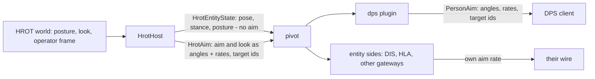

# DD-021: The aim and look stream - fast-changing body state apart from the rest

| | |
|---|---|
| **Status** | draft - proposal for the owner's approval (not built) |
| **Tasks** | T-038 |
| **Rulings honoured** | R-133, R-135 (rate classes), R-050 |
| **Date** | 2026-11-20 |

## 1. Context and goals

The owner (2026-11-20): *"The player normally looks around and aims around, so there is no perfect idea possible. So the right
approach is to have a different topic that sends the stuff that is changing quickly apart from the stuff that is not changing
quickly."*

What exists (DD-020, round 4): `PersonAim` is already a separate continuous topic (about 40 bytes: `AimTargetId`, `AimPoint`,
`LookTargetId`, `HasLookTarget`, `LookTarget`, `HeadYaw`), and `PersonState` is no longer re-sent for aim or look. The intent
encoding (`AimTargetId`) removes the stream only for a unit the simulation aims at a known target. A **live player** aims at a POINT
(HROT's operator fire path reports the posture Aimed at the crosshair point, no target entity; `AimAndFireExecutor.SayAt` ->
`WeaponPostureOf.Report`), and his look is his camera. For him the stream remains, and it is shaped badly:

1. **The wrong measure.** `PersonAim` is re-sent when `AimPoint` moves more than `PositionThresholdM` (0.05 m). The point is where
   the crosshair rests, often hundreds of metres away: a fraction of a degree of mouse moves it metres, so a sweeping player sends
   nearly every gather.
2. **No rate, no extrapolation.** A client gets samples of a sweep but cannot predict between them, so smoothness needs many samples.
3. **Two streams in one sample.** Aim and look (the camera, the head) change on different schedules; each re-sends the other.
4. **The shared entity state carries the aim.** `HrotEntityState` (the pivot message every side reads) holds `AimPoint`, so an aim
   move re-sends the whole entity state inside the gateway (re-sent at 0.5 m since the aim fix `ceed02d`); each entity side (DIS, HLA
   and other gateways) then filters it again.

Goal: the fast body state (aim and look) travels as its own small, dead-reckoned stream measured in angles, apart from the slow
state, on the DPS wire and in the pivot.

## 2. Block diagram

## 3. Proposed decisions (leans)

### P-1 Aim and look as directions with rates, not as points

`PersonAim` carries, per body:

| Field | Meaning |
|---|---|
| `AimYaw`, `AimPitch` | the aim direction (radians; yaw in the simulation frame, 0 = +x, counter-clockwise; pitch up), from the shoulder |
| `AimYawRate`, `AimPitchRate` | rad/s, for extrapolation |
| `AimRange` | metres along the direction to the aimed point (0 = unknown) - the point is derived, `AimPoint` stays as the fallback |
| `AimTargetId` | as today: when set and the client has the unit, aim at its chest |
| `LookYaw`, `LookPitch` (+ rates) | where the eyes point (for a player: his camera), so the head and the vision cone follow |
| `LookTargetId` | as today |

Sent when the extrapolated direction would differ from the true one by more than an angle threshold (lean: 1 degree for aim, 2 for
look), plus a heartbeat; never for the point moving because the range changed. Rejected: a smaller position threshold (still distance,
not angle); fixed-rate streaming (sends while still).

### P-2 Aim and look as two topics, or one with separate send rules

Lean: ONE topic `PersonAim` (one instance per body, keyed by entity), but each half has its own due rule, and a sample sends both
(so the instance stays whole for a late joiner). Alternative: `PersonAim` and `PersonLook` as two topics (cleanest rates, one more
instance per body). Decide by measurement (P-5).

### P-3 The pivot follows: `HrotAim` apart from `HrotEntityState`

A new pivot message `HrotAim` (entity id, the same fields as P-1) carries the fast body state; `HrotEntityState` keeps pose,
stance, posture and injury and is no longer re-sent for aim. The entity sides that publish an aim (the DIS life form, other gateways'
life form aim) subscribe to `HrotAim` and apply their own rate. The aim fix `ceed02d` (entity state follows a moving aim) is then
replaced by this, with a test per entity side that a moving aim still reaches its wire.

### P-4 The player's own frame as the source

For a possessed unit the host has the client's control frame (`LookFrom`, `LookDir`, `AimPoint`, the body `Yaw`). Lean: the aim and
look of a possessed unit come from the latest control frame the station applied (the player's own crosshair and camera), so other
viewers see exactly what the player does; for AI units from HROT's posture and look state as today.

### P-5 Measure before and after

A staged fight with a sweeping player (a scripted control frame sweeping 90 degrees per second with pauses) and 20 AI men aiming at
moving targets: samples per second of `PersonAim` (and `HrotEntityState` in the pivot) before and after, and the reconstruction error
of the client's extrapolation against the true direction.

## 4. Open for the owner

- P-2: one topic or two.
- The angle thresholds (P-1).
- Whether the protocol stays 1.0 (append the angle fields, keep `AimPoint` as the fallback) - lean: yes, append.

## 5. When approved

A full design (class and sequence diagrams per R-008), then build: contract fields, host `HrotAim`, the plugin's due rules, the
entity sides' subscription, the reference client's extrapolation, the guide (state that a live player always aims at a point and how
to render it), the measurement in the as-built.
