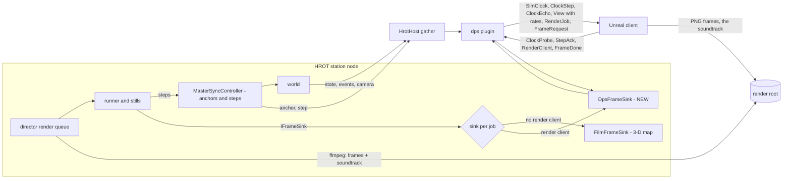
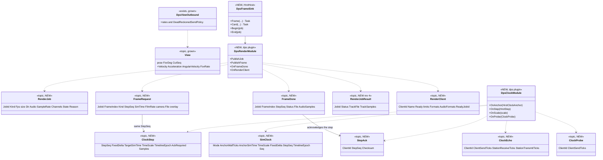
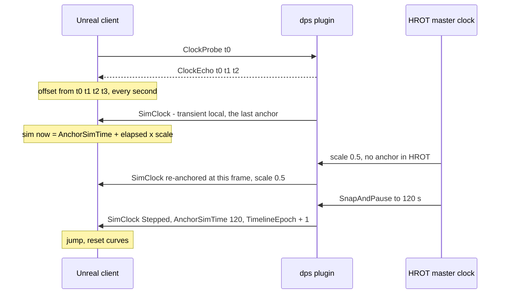
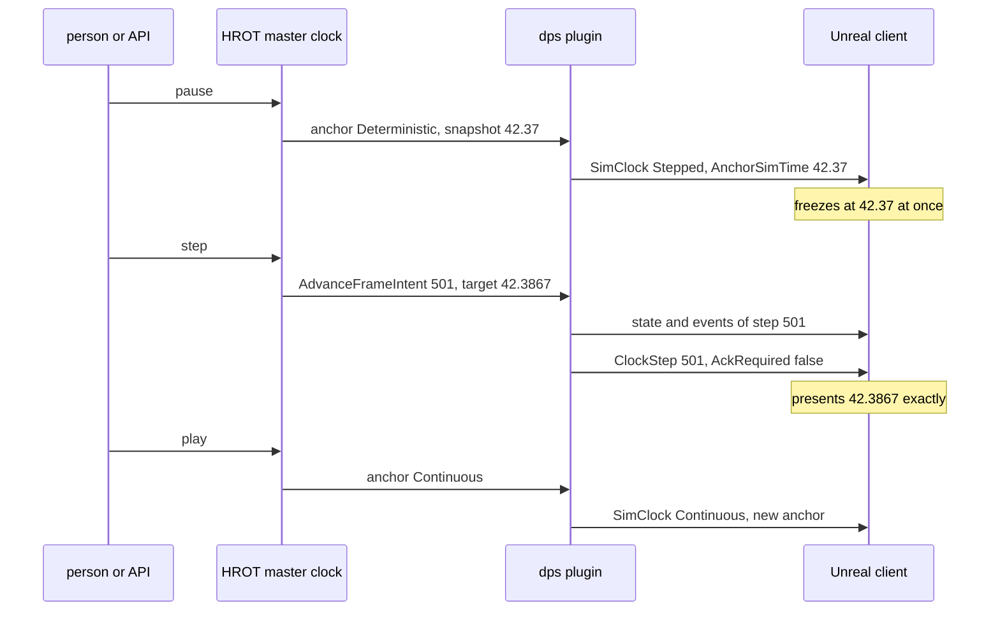
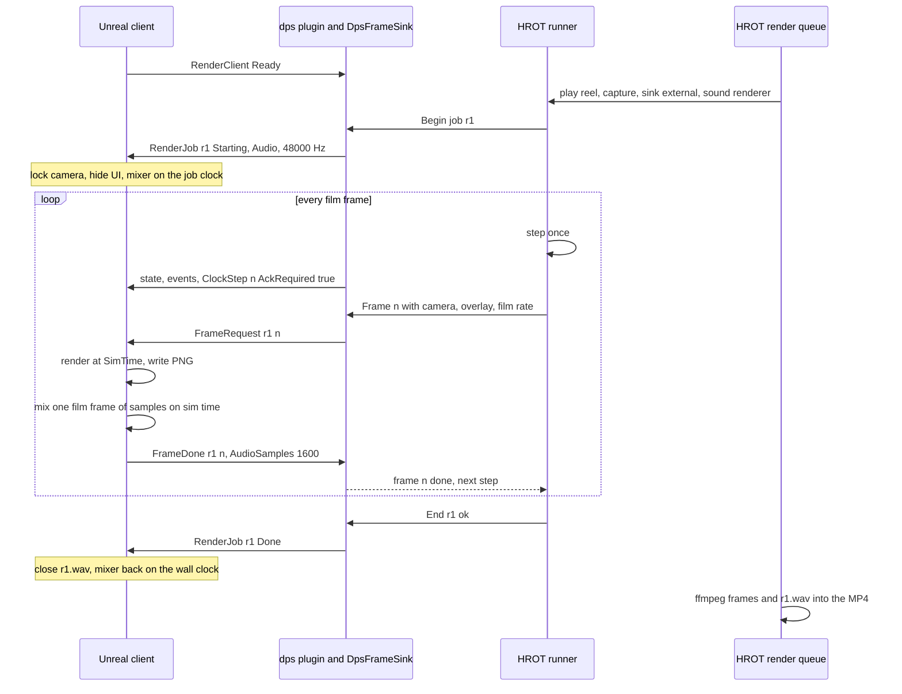
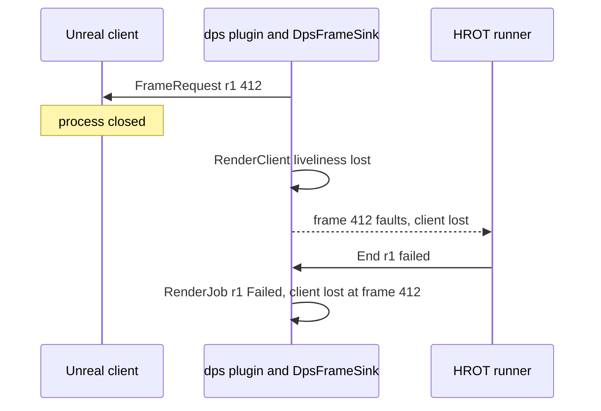

# DD-022: Time, stepping and director rendering through DPS - an external renderer as the film's camera and microphone

| | |
|---|---|
| **Status** | approved rev 4 (R-138, 2026-11-21); rev 5 freezes the contract (3g `ClientWorld`, 3h the field-level table) - the Unreal session agreed P-1 .. P-6 ([its answers](../clients/NOTE-2026-11-21-Unreal-Answers-DD-022.md), `5e63786`); rev 6 (`2026-11-21`) the render client's facts - D-B4 counts instances since the last presentation, the audio tolerance and no panning ([note §5](../clients/NOTE-2026-11-21-Unreal-Round-7-Render.md)); parts A-C and 3g built (T-045, section 9), part D not built |
| **Tasks** | T-039 |
| **Rulings honoured** | R-132, R-133 (contract open, append-only), R-134 (the client owns its camera; HROT's rules live in HROT), R-135 (rate classes, producer-neutral), R-136, R-137, R-138 (approval) |
| **Date** | 2026-11-21 (rev 3: HROT's time sync measured in code - no pulse; the audio track reworked; the Unreal session's findings. Rev 4: the Unreal session's answers - the tick epoch, the per-step sample barrier, the binding kept, warm-up, S-1 through Unreal's non-real-time mixer) |

## 1. Context and goals

The owner (2026-11-21):

- R-136: *"I still need to run HROT 3D map together with the Unreal. Just when the Unreal is connected via the gateway, the director will
  not take pictures of internal HROT 3D map, but will use the Unreal over the gateway. This way I will be able to prepare the clips
  without Unreal in plain HROT, and when I connect the Unreal I can tell the director to render the clips by rerunning all prepared reels,
  and the Unreal will render them."*
- R-137: *"do we have some kind of time synchronization for asynchronous mode where the Unreal is running at its own pace but still needs
  to have some idea about the simulation time? Is the DPS containing all what is needed for time synchronization in the same way as HROT
  cluster synchronize itself? And also, does it support stepped operation already? Not during film taking, but during normal simulation.
  I think it should follow the conventions the HROT nodes are using regarding time control, and those will be reused for the film taking.
  And the camera instructions, they might follow the same dead reckoning mechanisms [as the entities]. ... the sounds in HROT are not good.
  It would make much more sense to somehow take the audio track from the Unreal, the same way as we are taking snapshots from there."*
- Rev 3 (2026-11-21): *"I think the pulse is no longer in use"* - measured, confirmed (1a). *"we cannot simply measure what goes through
  the audio output because the sounds, they are played continuously ... it would need some more sophisticated approach, like that the
  Unreal will actually create the soundtrack somehow"* - 3f.
- Rev 4: the Unreal session answered section 8 ([note](../clients/NOTE-2026-11-21-Unreal-Answers-DD-022.md)); every answer is folded into the
  section it changes and marked *(Unreal, rev 4)*; section 8 keeps the questions with their answers.

| Part | Section | What |
|---|---|---|
| A | 3b | **The clock** for a client running at its own pace, by HROT's own anchor model |
| B | 3c | **Stepped operation** in normal simulation, by HROT's lockstep (order + acknowledge) |
| C | 3d | **The camera dead-reckoned** like an entity |
| D | 3e, 3f | **Director rendering**: the frames, and a soundtrack the client builds on simulation time |

### 1a. What exists - measured 2026-11-21 (HROT `coordinator`, code read; nothing run)

**DPS today:** time is only `Session.Mode` (`SessionModeLive`, `Paused`, `Replay`), `Session.TimeScale` and `Session.SimTime` *"at the
last change of the session ... not a clock"* (`DpsTopics.cs:56-74`, `DpsOutbound.cs:100-107`). A client takes time from
`EntityState.SimTime`; a quiet world gives a sample only every heartbeat (5 s). ⛔ No wall-clock anchor, no clock offset, no step, no
acknowledgement. `View` is Discrete, pose and FOV, no rates (DD-019 3.1).

**HROT's cluster time as the code does it today** (the conventions to follow):

| What | Where (FDP) | Behaviour |
|---|---|---|
| ⛔ **No time pulse, no PLL** | `Time/Controllers/SlaveSyncController.cs` header: *"No TimePulse or PLL is used."*; no pulse type exists in the C# tree (grep `pulse` over `FDP/`: only unrelated hits) | ⚠ stale: `FDP/Docs/projects/toolkits/FDP.Toolkit.Time.md` ("Continuous Mode Synchronization"), `docs/designs/time-ctrl-unif` 4.6, the comment at `MasterSyncController.cs:153`; `TimeConfig` still holds unused `PLLGain`, `MaxSlew`, `JitterWindowSize`, `AverageLatencyTicks` |
| **One clock formula** | `SlaveSyncController.AdvanceContinuousTime` | `TotalTime = baselineSim + (SyncedWallTicks - baselineWall) / 10^7 x TimeScale` - a pure function of the synced wall clock |
| **The anchor** = `SwitchTimeModeEvent` { `TargetMode` (Continuous / Deterministic), `BarrierWallTicks`, `SimTimeSnapshot`, `TimeScale`, `FixedDelta` }, on DDS as `SwitchTimeModeWireDto` (reliable, transient local, keep last 1) | `Time/Messages/TimeMessages.cs:72`; `SlaveSyncController.ApplyTimeSnap` | every anchor re-bases: `baselineSim = SimTimeSnapshot`, `baselineWall = BarrierWallTicks`, the scale |
| **When the master sends one** | `MasterSyncController.cs` | boot (`:130`, paused or running); **pause** `SwitchToDeterministic` (`:433`: barrier = now + 200 ms lookahead, snapshot = the time; the master freezes at once, `:631`); **resume** `SwitchToContinuous` (`:477`: barrier = the tick the time belongs to); **`SnapAndPause`** (`:561`: seek, live branch, scenario load, Stop preview; moves `TimelineEpoch`); **`JumpWhileRunning`** (`:598`) |
| **The wall clock** | `HighResUtcClock.GetTicks` | UTC, 100 ns ticks; `SyncedWallTicks = local + offset` |
| **The offset** | `TimeSyncRequest` / `TimeSyncResponse` (NTP, four timestamps), `SlaveTimeSyncTranslator`, `MasterTimeSyncTranslator` | every 1 s (`SyncRefreshIntervalTicks`); RTT over 200 ms discarded (`MaxRttTicks`); hard snap on the first or a > 1 s change, else a 10 % steer (`SyncCorrectionWeight`) |
| **Pause and barrier on a slave** | `SlaveSyncController.DrainModeSwitchEvents` | a Deterministic anchor in the future: keeps running to the barrier, then snaps to the snapshot (back by up to the lookahead x scale); already past: snaps at once |
| **Stepping** | `MasterSyncController.ExecuteStep` (`:373`), `SlaveSyncController.UpdateStepping` | paused = Deterministic; a step = `AdvanceFrameIntent` { `FrameID`, `FixedDelta`, `TargetSimTime` } -> `FrameOrderDescriptor`; the slave sets `TotalTime = TargetSimTime`, answers `FrameStepCompletedEvent` -> `FrameAckDescriptor`; the master waits for its expected slave set, queues up to 8 steps (`MaxQueuedSteps`) |
| **The DPS station** | `Hrot.Editor/EditorSubsystem.cs:478, :2199` | the editor runs `MasterSyncController` with no slaves: it IS its own master; its anchors and steps are on its event bus even with no network translator |

**Two HROT findings from the reading** (for the HROT session; not chased here):

- **F-H1** a scale change while running (`SetTimeScaleIntent` -> `MasterSyncController.SetTimeScale`, `:196-225`) publishes **no anchor**:
  slaves keep the old scale until the next switch. Read in code only - to measure on a cluster before calling it a defect.
- **F-H2** the documents above still describe the pulse and PLL; the owning time design should say the anchor model (Time Architecture).

**HROT's director (owned by HROT; reused, not copied):** takes, reels, the runner, stills and the render queue (`DirectorRenders`,
`RenderRequest`) - `docs/DESIGN_Film_Director.md`, `docs/DESIGN_Director_Timeline_Editor.md` 11u; the frame sink `IFrameSink`
(`DirectorHost.cs:110`), today only `FilmFrameSink` = the 3-D map (`DirectorAdapters.cs:135`); `FilmOverlay` = the subtitle + the film
graphics resolved to world points per frame (`FilmGraphics.cs:48`); the sound track `IDirectorSound`; the film process (recordings are
the source F-1, one director on every host F-2) - `docs/DESIGN_Film_Production.md`. The runner waits on the sink's task before the next
step: **a film frame is a lockstep step**.

### 1b. Inputs from the Unreal session (HROT `unreal-ig`, `docs/designs/IG/DRAFT_Unreal_Image_Generator.md` U-18l, U-18m)

The session's note [`NOTE-2026-11-21-Unreal-Player-Findings.md`](../clients/NOTE-2026-11-21-Unreal-Player-Findings.md) (gateway `bf2a406`) and its
design rows; the note's other items (blocked shot, kill cam, station keys, weapon names) are answered in the note itself and tracked as
T-040 .. T-043 - they are not this design's.

| Finding | Bearing |
|---|---|
| The guide said `ControlFrame.Lateral` is (forward, right); HROT sends A = +1 = LEFT (`EmbodiedKeys` MoveSide; HROT `ManualMotion`: *"lateral + = left"*) | ✅ corrected in the guide and DD-017 3.11 with this revision |
| Unreal's high-resolution screenshot holds **no canvas** (the HUD is not in it); Unreal keeps **one global screenshot request** at a time | 3e: the film overlay must be drawn into the scene or composited by the client's capture path, not as canvas HUD; frames are captured one at a time - lockstep suits it |
| At the eyes the camera looks along the body heading, not the gaze (`PersonAim` look target) | 3d: the camera's binding at the eyes should use the look intent (DD-020/021); the client's to-do |
| No muzzle point on the wire (the barrel circle, the blocked X) | a contract gap, not this design: later round |
| J/G/H/U/T/I/M station keys not in the contract | known (guide "Not carried by DPS yet"), not this design |
| Measured: `player-station` in PIE at 22 fps; join to Playing in 60 ms | a live client runs well below HROT's 60 Hz: the clock must be a formula, never "one step per client frame" (3b) |

**Out of scope:** the director itself, takes, reels, the timeline (HROT's); Unreal's rendering and audio pipelines (the client's); frames
or audio inline over DDS (D-5); a headless HROT node with no map (needs HROT's film camera without a map - a later round).

## 2. Block diagram

- **MasterSyncController** - the station's own time master (the editor). Unchanged; the host reads its anchors and steps (H-6).
- **dps plugin** - publishes the anchor as `SimClock` (3b), each step (3c), the camera with rates (3d); runs the render topics (3e).
- **DpsFrameSink** - HROT's `IFrameSink` over DPS; each frame is a step the client acknowledges (3e).
- **Unreal client** - its clock is HROT's slave formula; it presents steps; in a render job it renders frames and builds the soundtrack.
- **render root** - a folder both reach; HROT encodes the movie from the client's frames and soundtrack.

## 3. Key concepts and decisions

### 3a. What HROT has to provide (requests to the HROT session)

HROT's design for these: [DESIGN_Linked_Client_Director.md](https://github.com/pjanec/HROT/blob/ui/docs/designs/IG/DESIGN_Linked_Client_Director.md) and its
[Architect_Question_113](https://github.com/pjanec/HROT/blob/ui/docs/blueprints/Architect_Question_113_Linked_Client_For_The_Director.md) (HROT `ui`, CE-11017 .. CE-11025; approved there as R-11009: HROT calls this side a *linked client* - it never knows what is behind the gateway).

| Id | HROT change | Why |
|---|---|---|
| H-1 | A node extension can offer an `IFrameSink` (a capability); the director picks it per job: an offered, ready external sink wins over `FilmFrameSink` unless the request says `renderer: map` | R-136 |
| H-2 | `IFrameSink` learns the job: `Begin(job: id, kind, what, fps, width, height, dir)`, `End(job, outcome)`, default no-ops | the client locks its camera, hides its UI, warms up, starts its soundtrack |
| H-3 | The sink receives the film camera of the frame (pose, vertical FOV) and the frame's film rate (sim seconds per film second) | the frame uses HROT's camera exactly; the soundtrack follows the film's rate |
| H-4 | A sink may fail a frame (the task faults with a reason); the job fails with it | no silent fallback mid-movie |
| H-5 | Measure: does the gateway load in the Replay Browser host (films from recordings)? | otherwise renders from recordings run in the editor host only |
| H-6 | The host hands the gateway each `SwitchTimeModeEvent` the master publishes, each `AdvanceFrameIntent`, the master's `TimelineEpoch` and its current scale | 3b, 3c mirror HROT's own anchors and steps instead of inferring them from samples |
| H-7 | The director's sound becomes a per-job choice (`sound: renderer` = the sink's soundtrack, `hrot` = today's mixer log) | R-137 |
| H-8 | F-H1 and F-H2 above, measured and fixed in HROT | the cluster's own slaves and HROT's docs |

### 3b. Part A - the clock: HROT's anchor, mirrored

HROT has no periodic pulse: a slave's time is a formula over the synced wall clock, re-based by every anchor. DPS carries the same:

**New topic `SimClock`** (gateway -> client; Discrete class - it changes on events, the time itself is the formula; state QoS:
reliable, transient local, keep last 1; one instance):

| Field | Meaning | HROT counterpart |
|---|---|---|
| `Mode` | `ClockModeContinuous`, `ClockModeStepped` (paused = Stepped with no steps) | `TargetMode` |
| `AnchorWallTicks` | the station's wall tick the anchor's time belongs to: HROT's `HighResUtcClock` ticks - 100 ns since 0001-01-01 UTC, the epoch and unit of .NET `DateTime.Ticks` and Unreal's `FDateTime::Ticks` | `BarrierWallTicks` |
| `AnchorSimTime` | the simulation time at `AnchorWallTicks` (in Stepped: the time to hold) | `SimTimeSnapshot` |
| `TimeScale` | sim seconds per wall second while Continuous | `TimeScale` |
| `FixedDelta` | the step size the station uses | `FixedDelta` |
| `StepSeq` | the last step's id (3c) | `FrameID` |
| `TimelineEpoch` | grows at every discontinuity (seek, live branch, load, Stop) | `MasterSyncController.TimelineEpoch` |
| `Seq` | grows with every sample | - |

Sent at every HROT anchor (pause, resume, snap, jump, boot), at every step (new `StepSeq` and `AnchorSimTime` = the step's target), and
**at a scale change** (the gateway re-anchors itself at that frame - F-H1 must not reach the client). No periodic sample.

The client's clock, **the same formula as `SlaveSyncController`**:

- Continuous: `sim(now) = AnchorSimTime + (stationNow - AnchorWallTicks) / 10^7 x TimeScale`, with `stationNow = clientNow + offset`.
- Stepped: `sim = AnchorSimTime` (held; it moves only with steps).
- A new anchor re-bases the formula; the client **eases** a small difference (under the guide's 0.25 s correction blend) and **jumps** on
  a new `TimelineEpoch`.

**New topics `ClockProbe` / `ClockEcho`** (Event class) - HROT's NTP handshake: `ClockProbe` { `ClientId`, `ClientSendTicks` },
`ClockEcho` { `ClientId`, `ClientSendTicks`, `StationReceiveTicks`, `StationTransmitTicks` }. The client probes every second, drops
RTTs over 200 ms, hard-snaps the first or a > 1 s change and otherwise steers by 10 % - HROT's own constants (`TimeConfig`).

⭐ **The probe is needed on one machine too** (measured, HROT `Fdp.Toolkits/Time/HighResUtcClock.cs`): HROT's tick is the UTC time read
**once at process start** plus a monotonic stopwatch since then - monotonic, but not the system's UTC now: it keeps the start's UTC and the
stopwatch's drift, and each process has its own start. So a client must not compare `AnchorWallTicks` with its own `UtcNow`. *(Unreal, rev 4)*
The client takes elapsed time from its monotonic clock (`FPlatformTime::Seconds`) and the offset only from the probe; its clock
`FHrotDpsClock` is already the anchor formula (fed from samples today), so it changes its feed, not its shape.

Decisions:

- D-A1 **Mirror the anchor, not invent a pulse.** Rejected: a 1 Hz pulse - HROT itself dropped it; the anchor model needs no traffic
  while nothing changes.
- D-A2 **On a pause the client freezes at once at `AnchorSimTime`** (the master froze when it announced, `:631`). Rejected: copying the
  slave's "run to the barrier, then snap back" - for a renderer that is a visible jump back of up to 200 ms x scale; the barrier exists so
  simulating slaves stop together, and a viewer simulates nothing.
- D-A3 **`EntityState.SimTime` keeps its meaning**; `Session.SimTime` / `TimeScale` stay, superseded for clock use.
- D-A4 **One `SimClock`** instead of HROT's three wire types: a viewer needs the same information, not HROT's internal command
  semantics; HROT's DTO names stay HROT's (R-135, producer-neutral).

### 3c. Part B - stepped operation in normal simulation: HROT's lockstep

**New topic `ClockStep`** (gateway -> client; Event class, keep last 1024) - HROT's `FrameOrder`: `StepSeq` (= `FrameID`), `FixedDelta`,
`TargetSimTime`, `TimeScale`, `TimelineEpoch`, `AckRequired`. Written after the step's state and events are published.

**New topic `StepAck`** (client -> gateway; Event class) - HROT's `FrameAck`: `ClientId`, `StepSeq`, `Checksum` (0 = none).

| Case | `AckRequired` | The station waits |
|---|---|---|
| Normal stepped simulation (the person or the API steps the editor) | false | no - the client presents `TargetSimTime` exactly, never extrapolates past it; a viewer never holds the simulation |
| A render job (3e) | true | yes - the director's runner waits on the frame (D-B1) |

- D-B1 **A film frame is a step** (R-137 *"those will be reused for the film taking"*): `FrameRequest` names its `StepSeq`; `FrameDone`
  acknowledges it. Rejected: a separate frame clock - two lockstep mechanisms for one concept.
- D-B2 **The client is not in HROT's expected slave set** in normal stepping. *(Unreal, rev 4, Q-2: "present the step, never hold" - a live
  viewer runs at 20-30 fps.)* The lock is for film frames only.
- D-B3 **Order within a step:** state and events first, then `ClockStep`. Live stepping: the client presents after the poll that brought
  the `ClockStep` (at worst a state one step late, unseen).
- D-B4 **A stated barrier for render jobs** *(Unreal, rev 4, Q-6: a film frame could keep a unit one step old for good)*: a `ClockStep`
  with `AckRequired` carries **`Samples`** - how many world updates the gateway wrote in that step's gather. ⭐ **Rev 6 (`2026-11-21`, the
  client's render note §2 and its answer §5):** the rev-4 rule (*"samples whose `SimTime` lies in (previous target, target]"*) is
  SUPERSEDED - `Entity`, `TkbType` and other state topics carry no `SimTime`. Now:
  - **The unit is an instance, not a sample:** a keyed state topic counts one per instance written or disposed in the step (a write and a
    dispose of one instance count once); a keyless state topic (`Session`, `View`, `PlayerSlot`, `OwnUnit`, `Exercise`) one if written; an
    event topic (`Fire`, `Detonation`, `Effect`, `Impact`, `ManDowned`, `PlayerMessage`, `MoverTracks`) one per sample, never more per step
    than the topic's depth. *(Why: every state topic is keep-last-1 per instance; two writes before the reader's take arrive as one sample,
    so a sample count can come up short and the frame stalls.)*
  - **The topic set:** every gateway-written world topic; NOT `SimClock`, `ClockStep`, `ClockEcho`, `RenderJob`, `FrameRequest`,
    `GizmoFrame`, nor any client-written topic.
  - **The client counts since its last presentation** (step 0: since it sent `ReadyJobId`) and presents when its count reaches `Samples`;
    a count above it is a gateway defect (log, present); its own 10 s guard stays.
  - **Two gateway rules make that count exact:** from `RenderJob` Starting to Done it writes counted topics only in a step's gather, just
    before that step's `ClockStep` (a `Session` or `Status` change at another moment waits for the next gather); nothing counted is written
    between `ReadyJobId` and step 0's gather (HROT does not step until the client is ready). Built with part D; its rail checks both rules
    and the instance count on a seeded random world.

### 3d. Part C - the camera, dead-reckoned like an entity

`View` gets the entity's motion fields, appended: `Velocity`, `Acceleration`, `AngularVelocity` (body frame), `FovRate`. It moves to the
**Continuous** class and is sent by the entity rule (the shared `DeadReckonedSendPolicy`, Common, R-114): when the client's prediction
would miss by more than the position or angle threshold, plus the heartbeat. The client uses **the same curve routine as for entities**
(Hermite between samples, second-order dead reckoning past the newest, 0.25 s correction blend) on **the clock of 3b**; a new `CutSeq` is
a hard cut (jump, never blend).

- D-C0 **The binding stays and wins when bound** *(Unreal, rev 4, Q-3)*: while `View` is bound to a unit (`TargetId`, `Mode`, `Distance`,
  `Side`), the client places the camera from the binding against **its own** predicted pose of that unit, so camera and unit share one
  prediction and the unit does not shake in the frame; the rates serve unbound shots (free, fixed key, director flights). In a render job
  both are exact (the barrier D-B4 gives the world of the frame, `FrameRequest` the camera).
- D-C1 The gateway derives the rates from the per-frame camera on sim time (smoothed). Later, if noisy: HROT states them (a request).
- D-C2 In a render job the frame's camera is exact (`FrameRequest`, H-3); dead reckoning is for the live view only.
- Binding at the eyes (1b): the look follows `PersonAim`'s look intent, not the body heading - the client's to-do.

### 3e. Part D - director rendering: frames

| Topic | Direction | Class | Content |
|---|---|---|---|
| `RenderClient` | client -> gateway | Discrete, player QoS with liveliness | `ClientId`, `Name`, `Ready`, `MaxWidth`, `MaxHeight`, `MaxSupersample`, `Formats` (`RenderFormatPng`), `AudioFormats` (`AudioFormatWavPcm16`, `WavFloat32`), `MaxSampleRate`, `ReadyJobId` (rev 4: the job it has warmed up for) |
| `RenderJob` | gateway -> client | Discrete, state per `JobId` | `JobId`, `ClientId`, `Kind` (Movie, Stills), `What`, `Fps`, `Width`, `Height`, `Supersample`, `Dir`, `Audio` (bool), `SampleRate`, `Channels`, `State` (Starting, Running, Done, Failed, Cancelled), `Reason` |
| `FrameRequest` | gateway -> client | Event, keep last 1024 | `JobId`, `FrameIndex`, `Kind` (`FrameKindScene`, `FrameKindSilence`), `StepSeq`, `SimTime`, `FilmRate` (sim s per film s), `Position`, `Orientation`, `FovDeg`, `Width`, `Height`, `Supersample`, `File`, `Subtitle`, `SubtitlePosition`, `SubtitleAlpha`, `Graphics` (<= 64: kind Ring / Arrow / Route / Area / Label, <= 64 world points, radius, text, colour, alpha), `LayersOn`, `LayersOff` |
| `FrameDone` | client -> gateway | Event, keep last 1024 | `ClientId`, `JobId`, `FrameIndex`, `StepSeq`, `Status` (Written, Failed), `File`, `AudioSamples` (informational, rev 4), `Reason`, `RenderMs` |
| `RenderJobResult` | client -> gateway | Event | `ClientId`, `JobId`, `Status`, `TrackFile`, `TrackSamples`, `Reason` - after `RenderJob` Done, the track closed (rev 4) |

Rev 4 additions *(Unreal, rev 4, Q-4, Q-5, Q-8)*:

- **Warm-up and a per-job ready.** `RenderClient` gets `ReadyJobId`: the job the client has finished warming up for. The runner's first
  `Frame` of a job waits for it; timeouts: **180 s** from `RenderJob` Starting to `ReadyJobId` (the first frame after a rebuild hitched 28 s:
  shaders, streaming), **30 s** per frame after that.
- **Warm-up at cuts is the client's own:** after a `CutSeq` or either epoch change inside a job the client renders warm-up frames itself
  at the frame's sim time and camera, unrequested and unstepped (anti-aliasing history, texture streaming); the time shows in `RenderMs`.
- **The overlay** is drawn by the client's one HUD drawing code (`HrotDpsHud`) into the capture: (a) the UI screenshot path (proved,
  U-18m; the viewport's size, no supersampling), or (b) a scene capture into a render target with the canvas drawn onto it (supersampling,
  no global screenshot request) - (a) first, (b) when `Supersample > 1`. World-space graphics are projected through the frame's camera.
- **The render root:** one folder configured on each side (same machine today); `RenderJob.Dir` and `FrameRequest.File` are relative to
  it; the client refuses `..` and absolute paths.
- **The render client is its own process** (3f): a live IG and a render client may both be on the station; the render client is
  view-only (no player writers), the one `RenderClient` of the station (D-7).

Decisions: lockstep (= D-B1); the camera in the request (D-2); the overlay as data, drawn by the client **into the captured image** -
not as canvas HUD, which Unreal's capture omits (1b) (D-3); title cards HROT's (D-4); files in a shared render root, HROT encodes (D-5);
one render client per station (D-7); loud failure, default timeout 30 s (D-8); selection per job, auto when connected, `renderer: map`
to force (D-9). The first draft's D-6 (sound stays HROT's) is SUPERSEDED by 3f (R-137).

### 3f. Part D - the soundtrack: built by the client on simulation time

**The problem** (the owner, rev 3): a render job runs in lockstep, far slower than real time, while the client's normal audio plays
continuously on the wall clock. Recording the audio output during a job would capture minutes of stretched, repeated or missing sound for
seconds of film. ⇒ **the soundtrack must be computed from simulation time, not recorded from the speakers.**

What makes it computable: every sound has a **sim-time cause** the client already receives - an event with its `SimTime` (`Fire`,
`Detonation`, `Effect`, `Impact`, `ManDowned`, glass breaking, door actions) or a **state** with its timing (engine level and rotor spool
as start time + target + duration, `VehicleLook`; a burning man, `FlameJet`, `FireSpots`; footsteps from motion) - and the **listener** is
the film camera, known for every frame. The film's audio timeline is the frames: frame `n` lasts `1 / Fps` film seconds and covers
`FilmRate / Fps` sim seconds from its `SimTime`.

Two ways for Unreal to build it - both keyed on sim time, the choice is Unreal's (Q-7):

| | **S-1 Non-real-time mixing, frame by frame** (lean) | **S-2 A cue sheet, composed after the job** |
|---|---|---|
| How | during the job Unreal's audio is not driven by the wall clock: for each `FrameRequest` the client advances its mixer by exactly one film frame of samples (`SampleRate / Fps`, remainder carried) and appends them to the job's track. Voices start at their event's sim time placed inside the frame (`offset = (eventSimTime - frameSimTime) / FilmRate x SampleRate`), continuous sounds follow their state at the frame's sim time, the listener is the frame's camera. (Unreal's movie render path is known to offer an audio output that renders the mixer this way; whether it fits a frame-by-frame external clock is Unreal's question) | during the job the client only **logs cues**: { sound, start sim time, emitter (entity id or point), gain, loop / stop }, plus the camera per frame (it already has it). After `RenderJob` Done it renders the track offline from the log: each cue at its film time, attenuated and panned from the camera path, Doppler and the sound's travel delay on sim time (as U-17k does live) |
| Gives | Unreal's full live sound model (attenuation, reverb, MetaSounds) frame-exact | independent of the mixer's real-time loop; re-renderable (another mix, another language) without re-running the job |
| Costs | the mixer must be steppable; sounds started by gameplay code must be started by sim time | a second, offline spatialiser unless Unreal can render the log through its own mixer offline |
| Slow motion (`FilmRate` < 1) | the voices of the frame are pitched or stretched by the client's rule (Q-9) | the same rule at composition |

Common rules (either way):

1. One track per job: `Dir/<JobId>.wav`, the job's `SampleRate` and `Channels`; the client reports the track's total samples with
   `RenderJob` Done (a new `RenderJobResult` event: `JobId`, `TrackFile`, `TrackSamples`, `Status`, `Reason`); HROT checks it against `round(frames x SampleRate / Fps)` within the
   mixer's latency (rev 4): **1024 samples**, one mixer buffer (rev 6, measured by the client: 71552 against 72000; a larger miss fails the
   job with both numbers - HROT CE-11021).
2. Title card frames (`FrameKindSilence`, HROT's cards) are silence in the track.
3. A reel item boundary (`WorldEpoch` or `TimelineEpoch` change inside the job): voices in flight fade out over a short time (Q-10); the
   next item starts silent.
4. Sounds are keyed to sim time **only** - never to the wall clock, never to the client's frame count.
5. HROT muxes `frames + <JobId>.wav` with its existing ffmpeg step (H-7).

- D-F1 **The client builds the soundtrack from sim-time causes** (S-1 or S-2). Rejected: recording the live output during the job (the
  owner's objection: stepped, slower than real time); rejected: HROT's mixer log (*"the sounds in HROT are not good"*), kept only as the
  map render's sound (`sound: hrot`).
- D-F2 **S-1, through Unreal's non-real-time mixer** *(Unreal, rev 4, Q-7; engine source read, not run)*: UE 5.8 ships it
  (`NonRealtimeAudioRenderer`, `FMixerPlatformNonRealtime::RenderAudio(seconds)`); Movie Render Queue already calls it once per film frame
  with exactly `1 / fps` seconds and records the master submix to WAV (`MovieGraphDefaultAudioRenderer.cpp:176-237`). The client does the
  same per `FrameRequest`. Consequences:
  - **A render client is a separate Unreal process** started with the non-real-time device (MRQ's `-deterministicaudio`); it is silent
    live, so it is not the live IG switching mode.
  - **The audio is checked by its total at `End`**, not per frame: the mixer's latency compensation drops a head and drains a tail, so
    `FrameDone.AudioSamples` is informational; `RenderJob` Done carries the track's total samples and HROT compares it with
    `round(frames x SampleRate / Fps)`.
  - The client's sound delays move from the wall clock to sim time (`HrotShotRenderer.cpp:48` today reads real time) - the client's work.
  - Format: **48 000 Hz, stereo, PCM16** (float32 possible).
  - Slow motion (Q-9): each voice starts at its film time and plays at natural speed - S-1 gives it by itself; pitching could be a later
    per-job option. Reel item boundary (Q-10): voices fade out over **0.25 s**.
  - S-2 stays the documented fallback if the non-real-time device proves unusable in practice.
  - **As measured by the client (rev 6, render note §3-4):** the non-real-time device mixes every *spatialized* sound to zero (Unreal
    UE-381932, open) ⇒ during a job the client attenuates by distance with the air's low-pass but **does not pan** - the track is centred
    until S-2 or the client's own panner (a client item, no contract change). A voice starts in the frame that reaches its sim time, so up
    to one film frame late (33 ms at 30 fps), accepted. The Q-10 fade and slow motion are not built on the client yet.

### 3g. World readiness for EVERY load - `ClientWorld` (rev 5, `2026-11-21`)

HROT's ruling (R-11009 there, Q113-I/J): while the gateway is connected, **every** world-changing load - live, replay, from the start screen or
the director - waits in a load step until the linked client has loaded the new world (its terrain). A live viewer that never renders must load
the terrain too, so readiness is not a render-job matter: a small generic topic, written by any client that wants the station to wait for it.

- **`ClientWorld`** (client -> gateway; Discrete; player QoS with liveliness; keyed by `ClientId`): `WorldEpoch` (the `Session.WorldEpoch` the
  client is presenting or loading), `State` (`ClientWorldStateLoading`, `ClientWorldStateReady`, `ClientWorldStateFailed`), `Step` (bounded 64,
  e.g. "terrain city-battle", shown on HROT's heartbeat), `Reason` (bounded 256, on Failed), `WaitForMe` (bool: false = a passive viewer the
  station never waits for).
- HROT's load step is resolved when **every** live `ClientWorld` with `WaitForMe` reports `Ready` for the station's current `WorldEpoch` (the query is `BeginWorld` / `IsWorldReady`, section 9); a
  `Failed` fails the load with its reason; a client whose liveliness is lost stops being waited for (the load goes on without it).
- `RenderClient.ReadyJobId` stays for the render job's warm-up (3e); world readiness is `ClientWorld`'s alone.

### 3h. The round-7 contract, frozen (rev 5, `2026-11-21`)

Appended to protocol 1.0 (R-133: append-only; existing topics only gain fields at their end). Conventions as round 1-6: enumerators prefixed
with their enum's name, 0 = unknown / none, bounded strings and sequences, `ClientId` = the client's random nonzero `ulong`, simulation frame
(metres, x east, y north, z up), sim time in seconds (double), wall ticks = 100 ns since 0001-01-01 UTC (`long`).

| Topic | Dir | Rate class | QoS | Key | Fields (in order) |
|---|---|---|---|---|---|
| `SimClock` | gw -> client | Discrete | reliable, transient local, keep last 1 | - | `Mode` (`ClockMode`), `AnchorWallTicks` (long), `AnchorSimTime` (double), `TimeScale` (float), `FixedDelta` (float), `StepSeq` (long), `TimelineEpoch` (long), `Seq` (uint) |
| `ClockProbe` | client -> gw | Event | reliable, volatile, keep last 16 | `ClientId` | `ClientId` (ulong), `ClientSendTicks` (long) |
| `ClockEcho` | gw -> client | Event | reliable, volatile, keep last 16 | `ClientId` | `ClientId`, `ClientSendTicks`, `StationReceiveTicks`, `StationTransmitTicks` (long) |
| `ClockStep` | gw -> client | Event | reliable, volatile, keep last 1024 | - | `StepSeq` (long), `FixedDelta` (float), `TargetSimTime` (double), `TimeScale` (float), `TimelineEpoch` (long), `AckRequired` (bool), `Samples` (uint, the world instances and events written in the step's gather, counted as D-B4 rev 6 says; 0 = not stated, only filled when `AckRequired`) |
| `StepAck` | client -> gw | Event | reliable, volatile, keep last 16 | `ClientId` | `ClientId`, `StepSeq` (long), `Checksum` (int, 0 = none) |
| `ClientWorld` | client -> gw | Discrete | player QoS (reliable, volatile, keep last 1, AUTOMATIC liveliness, lease `DefaultLeaseMs`) | `ClientId` | `ClientId`, `WorldEpoch` (uint), `State` (`ClientWorldState`), `Step` (64), `Reason` (256), `WaitForMe` (bool) |
| `RenderClient` | client -> gw | Discrete | player QoS | `ClientId` | `ClientId`, `Name` (64), `Ready` (bool), `MaxWidth`, `MaxHeight` (int), `MaxSupersample` (byte), `Formats` (uint bits: 1 = PNG), `AudioFormats` (uint bits: 1 = WAV PCM16, 2 = WAV float32), `MaxSampleRate` (int), `ReadyJobId` (32) |
| `RenderJob` | gw -> client | Discrete | reliable, transient local, keep last 1 | `JobId` | `JobId` (32), `ClientId`, `Kind` (`RenderKind`), `What` (128), `Fps` (int), `Width`, `Height` (int), `Supersample` (byte), `Dir` (256, relative to the render root), `Audio` (bool), `SampleRate` (int), `Channels` (byte), `State` (`RenderState`), `Reason` (256) |
| `FrameRequest` | gw -> client | Event | reliable, volatile, keep last 1024 | - | `JobId` (32), `FrameIndex` (int), `Kind` (`FrameKind`), `StepSeq` (long), `SimTime` (double), `FilmRate` (float), `Position` (Vec3d), `Orientation` (Quat), `FovDeg` (float), `Width`, `Height` (int), `Supersample` (byte), `File` (256), `Subtitle` (512), `SubtitlePosition` (`SubtitlePosition`), `SubtitleAlpha` (float), `Graphics` (<= 64 `FilmGraphic`), `LayersOn`, `LayersOff` (<= 32 `LayerName` { `Name` (64) }; as built: a struct of its own, the existing `NameItem` holds 32) |
| `FrameDone` | client -> gw | Event | reliable, volatile, keep last 1024 | - | `ClientId`, `JobId` (32), `FrameIndex` (int), `StepSeq` (long), `Status` (`FrameStatus`), `File` (256), `AudioSamples` (int, informational), `Reason` (256), `RenderMs` (float) |
| `RenderJobResult` | client -> gw | Event | reliable, volatile, keep last 16 | - | `ClientId`, `JobId` (32), `Status` (`FrameStatus`), `TrackFile` (256), `TrackSamples` (long), `Reason` (256) |
| `View` (grown) | gw -> client | **Continuous** (was Discrete) | unchanged | - | ... existing fields, then **`Velocity` (Vec3f), `Acceleration` (Vec3f), `AngularVelocity` (Vec3f, body frame), `FovRate` (float)** |

`FilmGraphic` (struct): `Kind` (`FilmGraphicKind`), `Points` (<= 64 Vec3d, world, resolved for the frame), `Radius` (float), `Text` (64),
`ColourRgb` (uint 0xRRGGBB), `Alpha` (float).

Enums: `ClockMode` { `ClockModeUnknown`, `ClockModeContinuous`, `ClockModeStepped` } · `ClientWorldState` { `ClientWorldStateUnknown`,
`ClientWorldStateLoading`, `ClientWorldStateReady`, `ClientWorldStateFailed` } · `RenderKind` { `RenderKindUnknown`, `RenderKindMovie`,
`RenderKindStills` } · `RenderState` { `RenderStateUnknown`, `RenderStateStarting`, `RenderStateRunning`, `RenderStateDone`,
`RenderStateFailed`, `RenderStateCancelled` } · `FrameKind` { `FrameKindUnknown`, `FrameKindScene`, `FrameKindSilence` } · `FrameStatus`
{ `FrameStatusUnknown`, `FrameStatusWritten`, `FrameStatusFailed` } · `SubtitlePosition` { `SubtitlePositionUnknown`, `SubtitlePositionBottom`,
`SubtitlePositionTop`, `SubtitlePositionCentre` } · `FilmGraphicKind` { `FilmGraphicKindUnknown`, `FilmGraphicKindRing`, `FilmGraphicKindArrow`,
`FilmGraphicKindRoute`, `FilmGraphicKindArea`, `FilmGraphicKindLabel` }.

**What a client may build now** (no HROT change needed, the gateway publishes it from what HROT has): `SimClock`, `ClockProbe` / `ClockEcho`,
`ClockStep` / `StepAck` in normal stepping, `View` with rates, `ClientWorld` (the gateway reads it; HROT's load step waits on it once HROT
CE-11018 lands). **What arrives with HROT's linked-client seam** (HROT CE-11018, CE-11021): `RenderClient`, `RenderJob`, `FrameRequest`,
`FrameDone`, `RenderJobResult` are in the IDL at once, so a client can build and test against a fake publisher before HROT drives them.

## 4. Class diagram

- `DpsClockModule` is a new small module (R-003) fed by two new pivot messages from the host, `HrotClockAnchor` (a copy of HROT's
  anchor + `TimelineEpoch`) and `HrotStep` (H-6); it answers probes with the station's `HighResUtcClock`-equivalent UTC ticks.
- `DpsViewOutbound` grows the rates and reuses `DeadReckonedSendPolicy` (Common, R-114).
- `DpsFrameSink` implements HROT's `IFrameSink` in the HROT host; `DpsRenderModule` is the plugin side.

## 5. Sequence diagrams

### 5a. A client joins and keeps time (continuous)

### 5b. A pause and steps in normal simulation

### 5c. Render a reel: frames and the soundtrack (S-1)

With S-2 the loop logs cues instead of mixing, and the client composes `r1.wav` after `Done` before reporting it written.

### 5d. The client goes away mid-job

A timeout and a `FrameStatusFailed` take the same path. No fallback to the map inside a job.

## 6. Edge cases and error handling

| Case | Behaviour |
|---|---|
| No `ClockEcho` (lost probes) | the client keeps its last offset (0 before the first) and says so in its log |
| A client joins while Stepped | `SimClock` (transient local) gives Stepped, `AnchorSimTime`, the last `StepSeq`; it holds that time |
| A scale change while running | the gateway re-anchors at that frame (3b) - the client never sees F-H1 |
| A cluster station (later): the anchor's barrier in the future | the client freezes at `AnchorSimTime` at once (D-A2) |
| Seek, live branch, load, Stop | `TimelineEpoch` + 1: curves reset, no blend across it; `WorldEpoch` only for a world boundary |
| `ClockStep` before some of its state (cross-topic) | Q-6 |
| `StepAck` from a client that is not the job's | ignored |
| Request larger than the client's limits | the job fails before frame 0 with the limit named |
| No client ready at job start | the map renders with HROT's sound (D-9, `sound: hrot`) |
| A reel item loads the next scenario or recording (often another terrain: HROT's cluster loads it first, the client must load its level too) | epochs change inside the job; the client keeps the job and its track (3f rule 3), sets `RenderClient.Ready` false while it loads the new world and true again for the new `WorldEpoch`; HROT's cluster load phase waits for that in a linked-client load step on the station node (HROT `LinkedClientLoadStep`, beside its 3-D map step) (per node, like the filming node's 3-D map; HROT Q113-I), so the node is not play-ready and no frame request goes to a client still loading |
| Audio total differs from frames x samples per frame | HROT fails the job with both numbers |
| Path outside the render root | the gateway never writes one; the client refuses it |

## 7. Test plan

Gateway side (xUnit, `ManualClock`, an in-process fake client; properties checked after every operation where possible):

- **Clock equivalence (property):** over a seeded random sequence of play, pause, step, scale, snap and jump on a fake
  `MasterSyncController`-shaped clock, a client model fed only `SimClock` computes **the same sim time as HROT's `SlaveSyncController`
  formula** at every probe instant (Continuous: within one tick; Stepped: exactly), and jumps exactly once per `TimelineEpoch` change.
- **Scale re-anchor:** a scale change while running produces one `SimClock` whose formula is continuous at that instant.
- **Handshake:** a fake client with a known offset computes it within tick resolution; RTT > 200 ms is dropped.
- **Steps:** every HROT step gives one `ClockStep` after its state in the same gather; `StepSeq` grows within an epoch; `AckRequired`
  only inside a render job.
- **View rates:** a camera on a known path (straight, turn, orbit) is predicted within the thresholds between samples; a `CutSeq` is
  never blended; a steady move needs fewer samples than today.
- **Render lockstep (property):** over a seeded job with random answer delays, every `Frame` gives exactly one `FrameRequest`, its task
  completes exactly on its own `FrameDone`, indices 0..N-1 without gaps, `StepSeq` equals the step's.
- **Audio accounting:** the reported total equals `round(N x SampleRate / Fps)` within the stated latency tolerance; outside it the job
  fails with both numbers.
- **Barrier (property):** for a seeded random step, `ClockStep.Samples` equals the number of world samples the fake transport saw written
  in that gather, and a fake client that withholds one sample never presents the step.
- **Warm-up:** the first frame waits for `ReadyJobId`; 180 s then fails with the reason; later frames use 30 s.
- **Failures:** timeout, `FrameStatusFailed`, liveliness lost - each faults the pending frame with its reason.
- **Contract rules:** the new topics in the committed IDL, enumerators prefixed, 0 = unknown, rate classes stated, no producer names.
- **Live check:** the reference client gets `--clock` (prints its sim time against `EntityState.SimTime` while the editor runs, pauses,
  steps and changes speed) and `--render <dir>` (flat images and a tone per `Fire` event placed by sim time); one take rendered through it
  from the HROT editor; the MP4 has the expected frame count and audio length, and the tones land on the shots' frames.

HROT side: in HROT's design for H-1 .. H-8.

## 8. Proposals, and the Unreal session's answers (rev 4)

| | Proposal | Unreal (rev 4) | Status |
|---|---|---|---|
| P-1 | `SimClock` mirroring HROT's anchor + `ClockProbe` / `ClockEcho` (3b) | yes; state the tick epoch | folded (3b) - awaits the owner |
| P-2 | `ClockStep` / `StepAck`; no wait in normal stepping, a wait in render jobs (3c) | yes; plus the per-step `Samples` barrier for render jobs | folded (D-B4) - awaits the owner |
| P-3 | `View` with rates, Continuous, by the entity rule; cuts jump (3d) | yes, keeping the binding fields | folded (D-C0) - awaits the owner |
| P-4 | The render topics, a film frame = an acknowledged step (3e) | yes; a warm-up timeout apart from the frame timeout, a per-job ready | folded (3e rev 4) - awaits the owner |
| P-5 | The soundtrack built on sim time (3f) | S-1 through the engine's non-real-time mixer, on a client started for rendering; checked by its total at the end | folded (D-F2) - awaits the owner |
| P-6 | HROT requests H-1 .. H-8 as one prompt to the HROT session | yes | after the owner's approval |
| P-7 | *(rev 7, 2026-11-21 - HROT's film contract as built, CE-11018)* append `FrameKindRepeat` to `FrameKind` (slow motion past one frame per step repeats the last scene: no image, the client advances its track one frame) and `FrameRequest.Fade` (float 0..1, the dip to black over the picture); the camera arrives as forward + up and the gateway converts it to the wire's `Orientation` | - | ✅ approved (R-142) |

| | Question | Answer *(Unreal, rev 4)* |
|---|---|---|
| Q-1 | clock as the slave formula; same machine? | yes; one PC today; client elapsed time from its monotonic clock, the offset from the probe (needed even locally, 3b) |
| Q-2 | "wait for the renderer" outside films? | no - present the step, never hold |
| Q-3 | rates, or binding + pose? | both: the binding for bound shots (placed from the client's own prediction of the unit), rates for unbound |
| Q-4 | frame time, timeout, warm-up | a live high-res shot 0.5-1 s; 30 s per frame, 180 s for the job's warm-up; warm-up frames after every cut, by the client |
| Q-5 | overlay in the captured image? | yes: the UI-screenshot path first, a render-target capture when supersampling |
| Q-6 | barrier? | live: not needed; render jobs: `Samples` per step (D-B4) |
| Q-7 | S-1 or S-2? | S-1 via the non-real-time mixer (as Movie Render Queue does), a separate render process; 48 kHz stereo PCM16; total checked at the end |
| Q-8 | render root | same machine, a local folder; relative paths only |
| Q-9 | slow motion | normal speed from the onset |
| Q-10 | fade at a reel boundary | 0.25 s |

**Client-side work it implies** (HROT `unreal-ig`, not the gateway's): `FHrotDpsClock` fed from `SimClock` and the probe, a job clock in
render jobs; sound delays on sim time; read `View`, bound cameras from the client's own prediction; a render mode (fixed step, UI hidden,
warm-up at cuts, the overlay in the capture, PNG, `FrameDone`); a render process with the non-real-time mixer recording `<JobId>.wav`.

## 9. As-built notes

### Parts A-C and 3g as built (T-045, 2026-11-21)

Built: the clock (3b), normal stepping (3c), the camera's rates (3d) and `ClientWorld` readiness (3g). **Not built:** the render topics (`RenderClient`, `RenderJob`, `FrameRequest`, `FrameDone`,
`RenderJobResult`, `StepAck` with `AckRequired`) - they stay contract only. Tests: `DpsClockTests` (HrotHost.Tests: HROT's real `MasterSyncController`; Plugin.DdsPlayer.Tests: topics, echo, gate), `DpsRoundThreeTests` (view rates).

| Piece | As built |
|---|---|
| Host (`HrotClockGather`, HrotHost) | Reads HROT's bus events read-only (`SwitchTimeModeEvent`, `AdvanceFrameIntent`) and the node's `ITimeController`; `HrotServices` got `EventBus`, `TimeController`, `WallTicks` (`HighResUtcClock.GetTicks`), all passed from the context in `GatewayCapability.ServicesFrom` (a rail checks it). Anchors go to the pivot as `HrotClockAnchor` at once; steps as `HrotStep`, **after** the frame's world gather (the host forces a gather in a frame that carries a step, so the state of the frame precedes it - D-B3). No DTO of HROT's wire is used (R-134) |
| Anchors | Several events in one frame: the last one. A gateway that starts late (a world boundary rebuilds it) anchors from the controller's state. **F-H1:** a running clock whose scale changed gets one new anchor from the controller's own `(TotalWallTicks, TotalTime)` pair - deviation from "AnchorWallTicks = now": the pair belongs to the controller's last update, so the client's formula is exact from then on; the station's `now` is used only when the controller's wall ticks are not the real clock's (after stepping they are synthetic: more than 2 s off) |
| Plugin (`DpsClockModule`) | `HrotClockAnchor` -> `SimClock` (growing `Seq`); `HrotStep` -> `SimClock` (Stepped, at the target) then `ClockStep` (`AckRequired` false, `Samples` 0) |
| ⭐ ClockEcho timing | **Answered on a thread of its own** (`DpsClockEcho`): CycloneDDS.NET has `DdsWaitSet`; the thread blocks on the probe reader, stamps `StationReceiveTicks` when the wait returns, writes the echo with `StationTransmitTicks` stamped just before. It touches only the probe reader and the echo writer, so the host frame never delays it. Measured in-process: the recovered offset is within 1 ms of a known 3 s with the host frame never ticked, and stays within 1 ms with a 30 ms delay between the wake and the take (stamping after that delay fails the test by ~15 ms). Deviation from the class diagram: not a method of `DpsClockModule` (the engine's tick would add the frame to the outbound leg). The host's clock reaches the plugin as `SideBinding.StationTicks` (additive) so anchors and echoes are on one clock |
| Tick arithmetic | `DpsClockFormula.SecondsSince` subtracts the `long` ticks first; a rail fails with the double subtraction (ticks ~6.4e17, a double resolves 128 ticks there) |
| View rates (`DpsViewOutbound`) | Rates from the last 4 samples on **simulation** time (velocity of the newest pair moved to the newest sample by the trend of the pairs; angular velocity of the newest pair in the camera's frame from the relative rotation; FOV rate), reset at a cut and whenever simulation time does not advance. Send rule: the shared `DeadReckonedSendPolicy` (Common, R-114): the held model is predicted with the DIS RVW predictor (velocity and acceleration in the world axes, angular velocity in the body axes), the position and angle thresholds and the heartbeat as for entities; plus a changed distance or side, and a field of view off its prediction by more than 0.1 degrees. A cut always sends. A straight flight at 5 m/s for 10 s: 3 samples (the old rule sent one per frame, 600); a 0.5 rad/s orbit of radius 10 m: 19; a constant turn: 2 |
| ClientWorld (3g) | **Supersedes any `ReadyFor(epoch)` wording.** Two calls on `IClientWorldGate` (Gateway.HrotDis, the plugin's host service implements it; the host reaches it as `GatewayCapability.ClientWorldGate`, HROT's linked client forwards to it in HROT CE-11026): `BeginWorld(Guid loadId)` at the load's commit forces a new `Session.WorldEpoch` (bumped even when the gateway saw no boundary, published on the next frame, remembered against the id); `IsWorldReady(loadId, out failure, out step)` is false until that epoch is published (the race: a poll right after the commit read the old world as ready), then true when every live `WaitForMe` client is Ready for it (true at once with none; an unknown id is true); `failure` = the first Failed reason for the epoch, `step` = the first Loading client's step. A client is dropped when its writer's liveliness is lost or its instance goes away. The table lives in the host service, so it survives a world boundary |
| Known limits | A boundary that follows `BeginWorld` is a bump of its own (the clients see two epochs; the second load is cheap for a client that holds the world). ⭐ It cannot hang the load: `IsWorldReady` evaluates the clients against the NEWEST published epoch once that is at least the load's own (review fix, `2026-11-21`; rail `A_world_boundary_after_BeginWorld_is_waited_for_on_the_newest_epoch_and_never_deadlocks`) - ready for a newer world than asked is ready for the world now shown. A client whose writer dies exactly while a boundary rebuilds the runtime (the new reader sees no liveliness event for it) stays in the table until it is removed by its instance or the host ends. The step's own world state is simulated in the frame after the controller's update, so a client may read it one step later than its `ClockStep` (as 3c's D-B3 already allows) |
