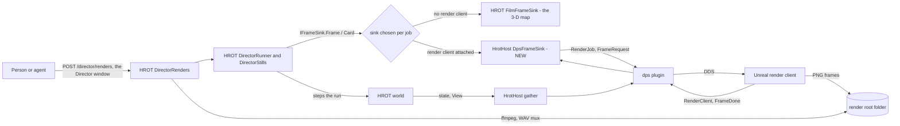
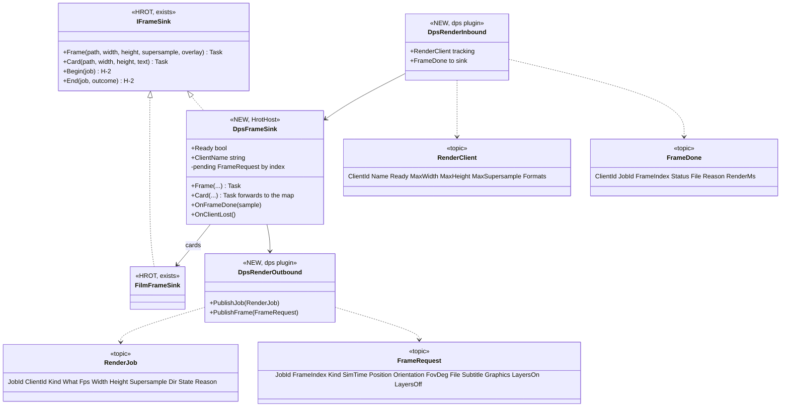
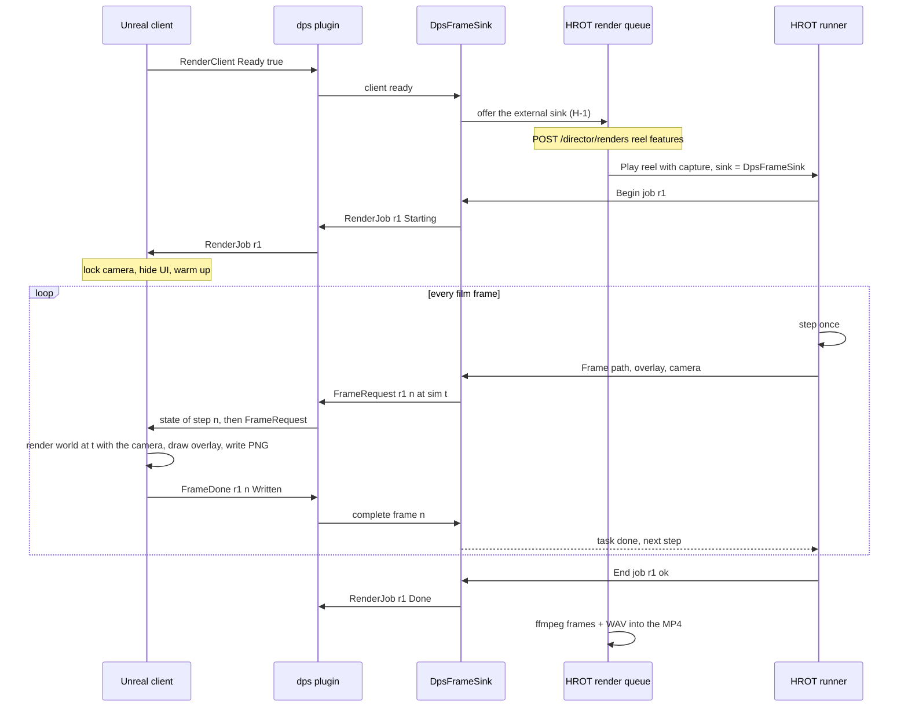
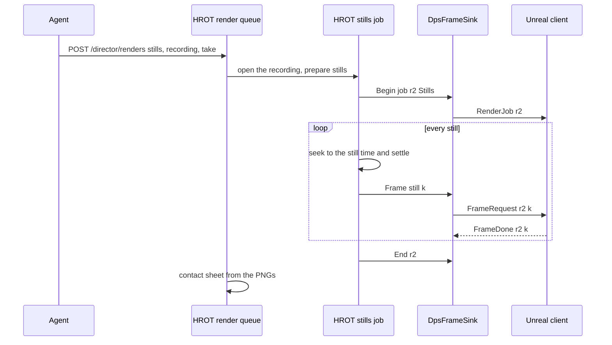
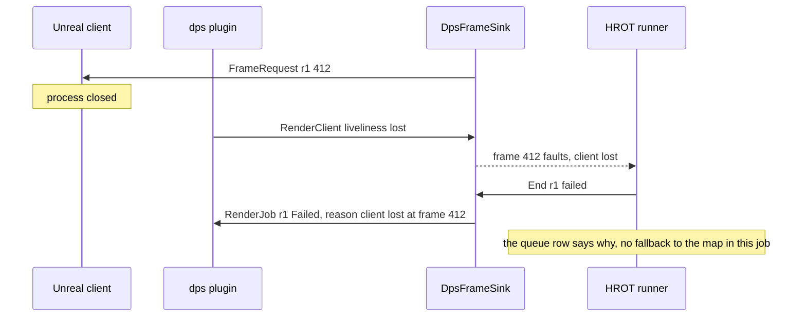

# DD-022: Director rendering through DPS - an external renderer as the film's camera

| | |
|---|---|
| **Status** | draft - for the Unreal session's feedback, then the owner's approval (not built) |
| **Tasks** | T-039 |
| **Rulings honoured** | R-132, R-133 (contract open, append-only), R-134 (the client owns its camera; HROT's rules live in HROT), R-135 (rate classes, producer-neutral), R-136 |
| **Date** | 2026-11-21 |

## 1. Context and goals

The owner (2026-11-21, R-136): *"I still need to run HROT 3D map together with the Unreal. Just when the Unreal is connected via the
gateway, the director will not take pictures of internal HROT 3D map, but will use the Unreal over the gateway. This way I will be able
to prepare the clips without Unreal in plain HROT, and when I connect the Unreal I can tell the director to render the clips by rerunning
all prepared reels, and the Unreal will render them."*

**What HROT already has** (its design docs own it; this design reuses it and does not copy it):

| HROT piece | Owning design | What it does |
|---|---|---|
| Takes, reels, the director's runner, stills, the render queue (`DirectorRenders`: a `RenderRequest` = Movie or Stills, fps, size, supersample, captions, still times) | HROT `docs/DESIGN_Film_Director.md`, `docs/DESIGN_Director_Timeline_Editor.md` section 11u | Plays a reel (live, or from recordings), steps the run **one step per film frame**, hands every frame to a frame sink, encodes the MP4 (ffmpeg) with its sound track |
| The frame sink seam `IFrameSink` (`Frame(path, width, height, supersample, FilmOverlay)`, `Card(path, width, height, text)`), today one implementation `FilmFrameSink` = the 3-D map | HROT `Hrot.Presentation/Map3D/Director/DirectorHost.cs:110`, `DirectorAdapters.cs:135` | The runner waits on the returned task before the next step - lockstep comes for free |
| `FilmOverlay` = the subtitle (text, position, alpha) + the film graphics already **resolved to world points for this frame** (ring, arrow, route, area, label; radius, text, colour, alpha) | HROT `FilmGraphics.cs:48` | What a film burns over the scene |
| The sound track: the director logs the mixer's cues and renders a WAV on the film frames' sim times | HROT `IDirectorSound` | Muxed into the MP4 by HROT |
| The film production process: films are cut from recordings, iterated in the Replay Browser, rendered by the agent or the person over the same routes | HROT `docs/DESIGN_Film_Production.md` (F-1, F-2, F-6) | The workflow this design must not fork |
| The suggested camera `CameraSuggestion` (node-local, written by the map every frame from the director, follow camera or operator) | HROT `docs/designs/vehicle-appearance/DESIGN_Look_Rules_For_Renderers.md` D-1 | Already on DPS as `View` (DD-019 3.1) |

**Goal:** when a DPS render client (the Unreal image generator) is attached, the director's frame sink is that client. HROT's map keeps
running and drawing for the person; the reels, takes, stills and renders are prepared in plain HROT and re-rendered by Unreal without
any change to them.

**Out of scope:** the director itself, takes, reels, the timeline (HROT's); Unreal's own rendering pipeline (the client's); frames
transferred over DDS (section 3, D-5); a headless HROT node with no map (needs HROT's film camera without a map - D-1's deferred step,
a later round).

## 2. Block diagram

- **HROT `DirectorRenders` / `DirectorRunner`** - unchanged in behaviour: queue, play reels, step one step per frame, wait on the sink,
  encode. The only change is *which* `IFrameSink` a job gets (H-1, section 3a).
- **`DpsFrameSink` (NEW, in `SimNetGateway.HrotHost`)** - implements HROT's `IFrameSink`. Each `Frame` call becomes a `FrameRequest`
  (the frame's sim time, the film camera, the size, the overlay as data, the file name); its task completes when the matching
  `FrameDone` arrives.
- **dps plugin** - four new topics (section 3b), beside the existing world topics the client already renders from.
- **Unreal render client** - renders the world at the request's sim time through the request's camera, draws the overlay, writes the
  PNG into the render root, answers `FrameDone`.
- **render root** - a folder both processes reach (same machine, or a shared folder). HROT encodes from it exactly as today, so
  ffmpeg, the sound track and title cards stay HROT's.
- **3-D map** - keeps drawing the live picture for the person while Unreal renders; it is simply not the film's sink.

## 3. Key concepts and decisions

### 3a. What HROT has to provide (requests to the HROT session - the gateway does not change HROT)

| Id | HROT change | Why |
|---|---|---|
| H-1 | A node extension can **offer an `IFrameSink`** (a capability), and the director picks it per job: an offered and ready external sink wins over `FilmFrameSink` unless the request says `renderer: map` | the owner's rule (R-136): connected => Unreal renders |
| H-2 | `IFrameSink` learns the job: `Begin(job: id, kind, what, fps, width, height, dir)` and `End(job, outcome)`, with default no-op bodies so `FilmFrameSink` is untouched | the client must lock its camera, hide its UI and warm up before frame 0, and release after |
| H-3 | The sink receives the **film camera of this frame** (pose, vertical field of view) with `Frame(...)` - the same values the map films with (`FilmStudio`'s film camera; today readable as `CameraSuggestion`) | the frame must use HROT's camera exactly, not a separately streamed `View` |
| H-4 | A sink may **fail a frame** (the task faults with a reason); the job then fails with that reason, named in `/director/renders` | no silent fallback mid-movie to the map (mixed frames) |
| H-5 | Measure: does the gateway (a node extension) load in the **Replay Browser** host? Films are rendered from recordings there (Film Production F-1) | if not, renders from recordings run in the editor host only until it does |

HROT's routes and panels stay as they are; a job's row says which renderer took it (`renderer: external "<client name>"` or `map`).

### 3b. New DPS topics (proposed; contract append-only, R-133)

| Topic | Direction | Rate class | QoS | Key |
|---|---|---|---|---|
| `RenderClient` | client -> gateway | Discrete | player QoS (reliable, transient local, AUTOMATIC liveliness <= 2 s, like `JoinRequest`) | `ClientId` |
| `RenderJob` | gateway -> client | Discrete | state (reliable, transient local, keep last 1 per key) | `JobId` |
| `FrameRequest` | gateway -> client | Event | reliable, volatile, keep last 1024 | - |
| `FrameDone` | client -> gateway | Event | reliable, volatile, keep last 1024 | - |

**`RenderClient`** - "I can render films for this station":

| Field | Meaning |
|---|---|
| `ClientId` | random nonzero, as on the player topics |
| `Name` | bounded 64, shown in HROT's render rows ("unreal-ig-1") |
| `Ready` | false while loading a level or terrain; the gateway offers the sink only while true |
| `MaxWidth`, `MaxHeight`, `MaxSupersample` | what it can render; a larger request is refused before frame 0 |
| `Formats` | bit set; `RenderFormatPng` = 1 is the only one now |

**`RenderJob`** - one instance per job, disposed after `End`:

| Field | Meaning |
|---|---|
| `JobId` | HROT's render job id (bounded 32) |
| `ClientId` | the client chosen for it (others ignore the job) |
| `Kind` | `RenderKindMovie`, `RenderKindStills` |
| `What` | bounded 128: "reel features", "ua-tank-ammo/main" - for logs and UI |
| `Fps`, `Width`, `Height`, `Supersample` | the job's capture options |
| `Dir` | bounded 256, relative to the render root: where the frames go |
| `State` | `RenderStateStarting`, `Running`, `Done`, `Failed`, `Cancelled` |
| `Reason` | bounded 256, set on Failed / Cancelled |

**`FrameRequest`** - one per film frame or still:

| Field | Meaning |
|---|---|
| `JobId`, `FrameIndex` | the frame's identity; `FrameIndex` grows from 0 within a job |
| `Kind` | `FrameKindScene` (render the world) - title cards stay HROT's (D-4) |
| `SimTime` | render the world as of this simulation time (the same clock as every state topic) |
| `Position`, `Orientation`, `FovDeg` | the film camera for this frame, simulation frame (as `View`); the client uses it exactly |
| `Width`, `Height`, `Supersample` | as the job (repeated so a frame is self-contained) |
| `File` | bounded 256, relative to the render root, ".png" |
| `Subtitle` | bounded 512 text; `SubtitlePosition` (`SubtitleBottom`, `Top`, `Centre`); `SubtitleAlpha` 0..1; empty = none |
| `Graphics` | bounded sequence (64) of `FilmGraphic`: `Kind` (`FilmGraphicRing`, `Arrow`, `Route`, `Area`, `Label`), `Points` (<= 64 world points, already resolved for this frame), `Radius`, `Text` (bounded 64), `ColourRgb`, `Alpha` |
| `LayersOn`, `LayersOff` | bounded name lists: the take's layer override (HROT layer names, as `GizmoView`); the client maps the ones it knows |

**`FrameDone`** - the answer:

| Field | Meaning |
|---|---|
| `ClientId`, `JobId`, `FrameIndex` | which request |
| `Status` | `FrameStatusWritten`, `FrameStatusFailed` |
| `File` | as written (relative) |
| `Reason` | bounded 256 when failed |
| `RenderMs` | for the job report |

### 3c. Decisions (leans) with rejected alternatives

| | Lean | Rejected |
|---|---|---|
| D-1 | **Lockstep through HROT's own stepping rule**: the runner already waits on the sink's task before the next step, so each frame is rendered at exactly its sim time | Unreal filming the live stream free-running - jitter decides which sim time lands in which frame, two renders differ |
| D-2 | **The camera travels in the `FrameRequest`**, not taken from `View` | `View` is advice sampled on thresholds and keep-last-1; a frame needs the exact camera of its sim time |
| D-3 | **The overlay travels as data and Unreal draws it** (subtitle text + world-space graphics already resolved by HROT, with colour, radius and alpha) | HROT compositing over Unreal's PNG - it would need Unreal's exact projection and re-reads every file; graphics on the ground belong in the 3-D scene |
| D-4 | **Title cards stay HROT's** (text on black, no scene): the sink forwards `Card` to the map's sink | a card in Unreal - no world, no benefit, a second font and layout |
| D-5 | **Frames are files in a shared render root**, HROT encodes as today (ffmpeg, WAV mux) | frames inline over DDS - 1-4 MB per frame at 30 fps; can be added later as another `Formats` bit |
| D-6 | **Sound stays HROT's track** (HROT's map host runs its mixer during the render) | Unreal's own audio into the movie - a second sound model and a sync problem; Unreal keeps its live audio (U-17k) |
| D-7 | **One render client per station**: the first `Ready` client; a second one is ignored with one warning (the `GizmoView` rule) | several clients rendering one job - which frames win |
| D-8 | **Failure is loud**: a frame not answered within a timeout (default 30 s, like HROT's `/film/capture`), a `FrameStatusFailed`, or the client's liveliness lost fails the job with a reason; no fallback to the map inside a job | silent fallback - a movie of mixed renderers |
| D-9 | **Selection per job, at its start**: external when a ready client exists, else the map; the request may force `renderer: map` | a global switch - would block preparing in HROT while Unreal is connected |

### 3d. The frame barrier - what "the world as of `SimTime`" means

The runner steps the run, the gateway gathers and publishes that step's state (all topics), **then** writes the `FrameRequest` for it.
The client renders a request only after it has taken every reader in the same poll, using the samples up to `SimTime` (the state the
gather published for that step). Reliable writers on one participant deliver in order per topic; across topics DDS does not promise
order, so P-6 asks the Unreal session whether a stated barrier is needed (a `StepSeq` on `FrameRequest` matched by a `StepSeq` on a small
per-step clock sample).

## 4. Class diagram

- `DpsFrameSink` is the only new HROT-facing class; it lives in the HROT host (it implements a HROT interface), offered to HROT as a
  capability while a ready `RenderClient` is known (H-1).
- `DpsRenderOutbound` / `DpsRenderInbound` are new small modules of the dps plugin (R-003), beside `DpsViewOutbound` and the player inbound.
- The topics are plain contract types in `SimNetGateway.Protocol.DdsPlayer` with `[DpsRate]`, no producer names (R-135).

## 5. Sequence diagrams

### 5a. Attach, then render a reel to a movie

The runner's own rule makes it lockstep: it does not step again until the sink's task for the frame completes. Title cards between
reel items go to the map's sink (D-4) and never reach the client.

### 5b. Stills from a recording

Depends on H-5 when the stills job runs in the Replay Browser.

### 5c. The client goes away in the middle of a job

A timeout (D-8) and a `FrameStatusFailed` take the same path with their own reason.

### 5d. Live preview of a reel (no capture) - unchanged

The person plays a reel on screen; HROT's map films live and writes `CameraSuggestion`; the client follows `View` (Source Director)
as today (DD-019 3.1). No `FrameRequest` is sent outside a render job.

## 6. Edge cases and error handling

| Case | Behaviour |
|---|---|
| Request larger than `MaxWidth` / `MaxHeight` / `MaxSupersample` | the job fails before frame 0 with the limit named |
| No client ready when the job starts | the map's sink (D-9) - the row says `renderer: map` |
| Client becomes ready during a job | used from the next job only |
| Client restarts (new `ClientId`) mid-job | the old client's liveliness is lost => the job fails (5c); re-queue it |
| Duplicate or stale `FrameDone` (wrong job, old index) | ignored, counted in the job report |
| `Session.WorldEpoch` changes during a job (a reel item loads the next scenario or recording) | expected inside a reel; the client keeps the `RenderJob` and re-joins the world as section 3.11 of DD-017 says; the next `FrameRequest` is for the new world |
| A frame request for a time the client has no samples for yet | the barrier (3d); otherwise the client waits up to the timeout |
| Path outside the render root (`..`, absolute) | the gateway never writes one; the client refuses it (`FrameStatusFailed`) |
| Gizmo layers in a take's override that the client does not know | ignored by the client, listed once in its log |
| Two stations on one machine | each has its own partition and its own render client; render roots per station are the client's configuration |

## 7. Test plan

Gateway side (xUnit, `ManualClock`, an in-process fake render client; no sleeping):

- **One request, one completion (property):** over a seeded random job (N frames, random answer delays and orders), every `Frame` call
  produces exactly one `FrameRequest`, its task completes exactly when its own `FrameDone` arrives, never before, and frame indices are
  0..N-1 without gaps.
- **Content equals the call:** the request's camera, size, file and overlay (subtitle and every graphic point) equal the sink call's
  arguments; all strings and sequences within their bounds (truncated, never thrown).
- **Lockstep:** with an unanswered request the next `Frame` is never called by a runner stub that obeys HROT's rule.
- **Failure paths:** timeout, `FrameStatusFailed`, liveliness lost - each faults the pending task with its reason, publishes
  `RenderJob Failed` with it, and leaves no pending entry.
- **Selection:** no ready client => not offered; `Ready` false => withdrawn; second client => ignored with one warning; forced
  `renderer: map` honoured.
- **Cards never reach the client.**
- **IDL snapshot and contract rules:** the four topics in the committed IDL, enumerators prefixed, 0 = unknown, rate class stated, no
  producer names.
- **Live check (runbook):** the reference client gets a `--render <dir>` mode that writes a flat image per request (proves the
  handshake end to end); then the HROT editor renders one take through it, and the MP4 has the expected frame count.

HROT side (in HROT's design for H-1 .. H-4): the director picks the offered sink; `FilmFrameSink` unchanged; a faulted frame fails the
job with its reason.

## 8. Proposals awaiting approval (and the questions for the Unreal session)

| | Proposal | Lean | Question for Unreal |
|---|---|---|---|
| P-1 | The four topics of 3b | yes | Anything missing for Movie Render Queue or a frame grab (anti-aliasing warm-up frames, a motion blur shutter, exposure lock)? |
| P-2 | Lockstep per frame (D-1) | yes | How long does one high-quality frame take at 1280x720 and 1920x1080? Is 30 s a sane timeout? |
| P-3 | Camera in the request (D-2), the client uses it exactly | yes | Is the vertical FOV + the simulation-frame pose enough, or do you need a near/far plane or an aspect override? |
| P-4 | Overlay as data drawn by Unreal (D-3), cards stay HROT's (D-4) | yes | Can you draw world-space rings, arrows, routes, areas and labels plus a subtitle in the film's style (HROT's colours and alpha)? |
| P-5 | Files in a shared render root (D-5), HROT encodes and adds sound (D-6) | yes | Do you render on the same machine as HROT? If not, which shared folder setup is acceptable? |
| P-6 | The frame barrier (3d) without a stated sequence first; add `StepSeq` only if you see torn frames | lean: measure first | Does your poll-then-render order give you a consistent world at `SimTime`, or do you want `StepSeq` now? |
| P-7 | One render client per station, failure is loud (D-7, D-8) | yes | - |
| P-8 | Selection per job, auto when connected, `renderer: map` to force (D-9; R-136) | yes | - |

## 9. As-built notes

Not built.
