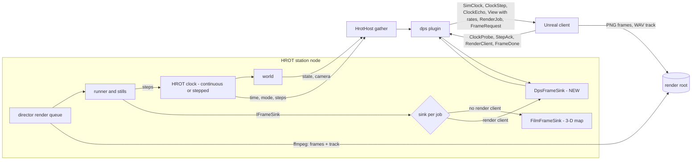
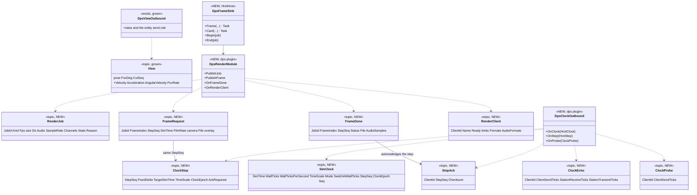
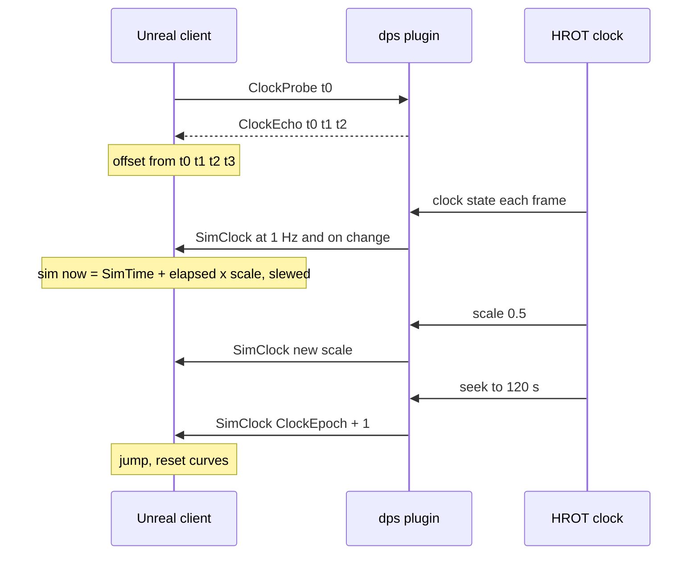
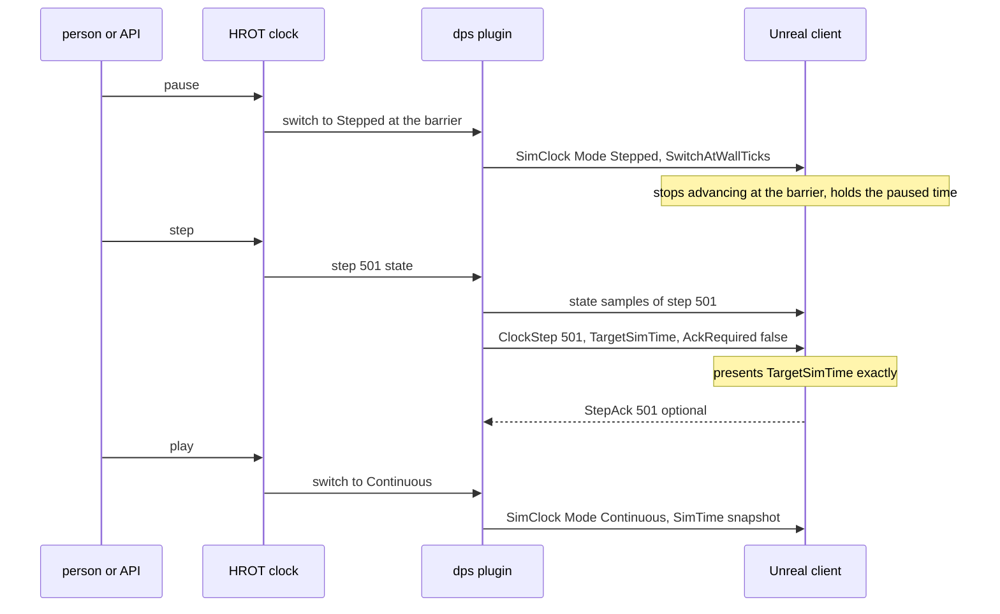
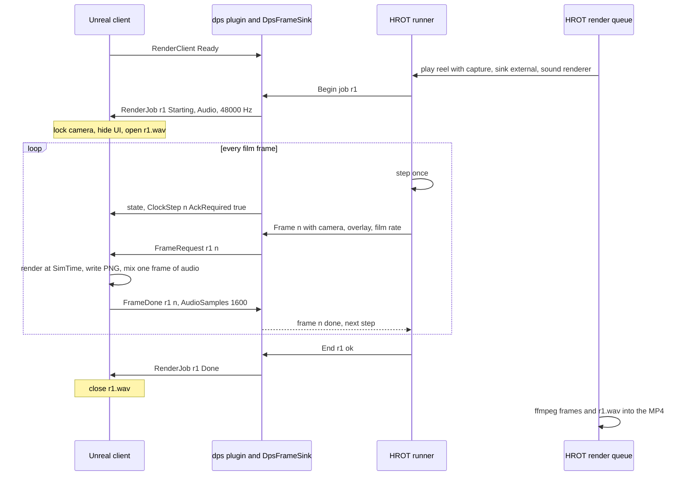
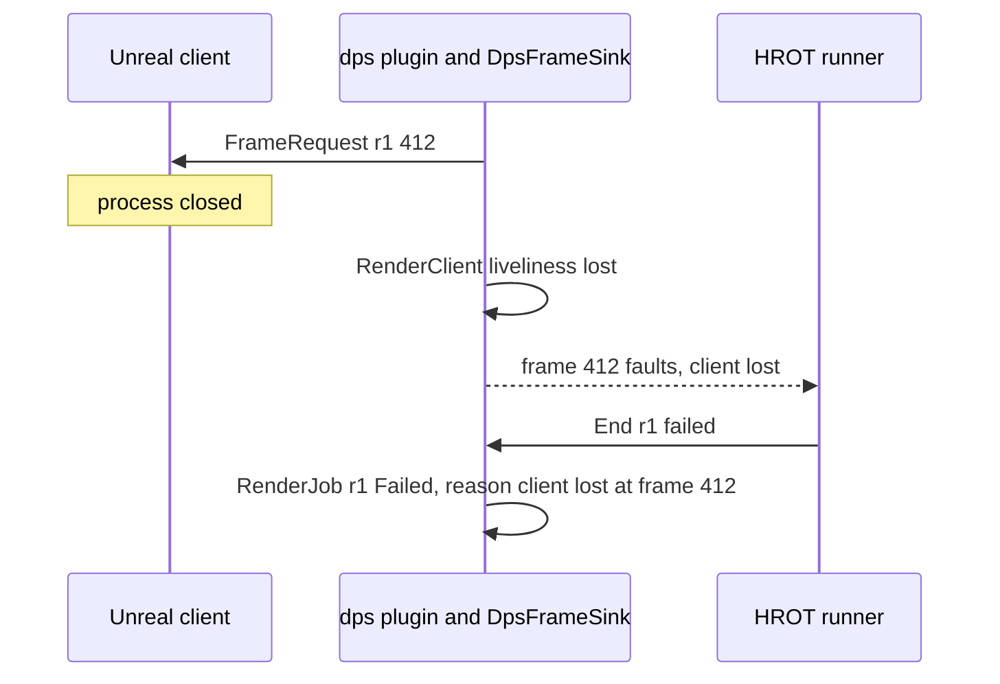

# DD-022: Time, stepping and director rendering through DPS - an external renderer as the film's camera and microphone

| | |
|---|---|
| **Status** | draft - for the Unreal session's feedback, then the owner's approval (not built) |
| **Tasks** | T-039 |
| **Rulings honoured** | R-132, R-133 (contract open, append-only), R-134 (the client owns its camera; HROT's rules live in HROT), R-135 (rate classes, producer-neutral), R-136, R-137 |
| **Date** | 2026-11-21 |

## 1. Context and goals

The owner (2026-11-21):

- R-136: *"I still need to run HROT 3D map together with the Unreal. Just when the Unreal is connected via the gateway, the director will
  not take pictures of internal HROT 3D map, but will use the Unreal over the gateway. This way I will be able to prepare the clips
  without Unreal in plain HROT, and when I connect the Unreal I can tell the director to render the clips by rerunning all prepared reels,
  and the Unreal will render them."*
- R-137: *"do we have some kind of time synchronization for asynchronous mode where the Unreal is running at its own pace but still needs
  to have some idea about the simulation time? Is the DPS containing all what is needed for time synchronization in the same way as HROT
  cluster synchronize itself? And also, does it support stepped operation already? Not during film taking, but during normal simulation.
  I think it should follow the conventions the HROT nodes are using regarding time control, and those will be reused for the film taking.
  And the camera instructions, they might follow the same dead reckoning mechanisms [as the entities]. ... the sounds in HROT are not good.
  It would make much more sense to somehow take the audio track from the Unreal, the same way as we are taking snapshots from there."*

Four parts, built on one another:

| Part | Section | What |
|---|---|---|
| A | 3b | **Time synchronization** for a client running at its own pace, by HROT's cluster conventions |
| B | 3c | **Stepped operation** in normal simulation, by HROT's lockstep convention (order + acknowledge) |
| C | 3d | **The camera dead-reckoned** like an entity |
| D | 3e, 3f | **Director rendering**: frames and the audio track from the client, as a lockstep participant of B |

### 1a. What exists - measured 2026-11-21

**DPS today (this repository):** time is only `Session.Mode` (`SessionModeLive`, `Paused`, `Replay`), `Session.TimeScale` and
`Session.SimTime` *"at the last change of the session ... not a clock"* (`DpsTopics.cs:56-74`, filled in `DpsOutbound.cs:100-107`). A client
takes the time from `EntityState.SimTime` (DD-017 3.11). ⇒ ⛔ **no clock**: no wall-clock anchor, no clock-offset handshake, no step
announcement, no acknowledgement. A quiet world (nothing moving) gives a client a time sample only every heartbeat (5 s). `View` is a
Discrete topic with pose and FOV, no rates (DD-019 3.1).

**HROT's cluster time (the conventions to follow; HROT owns them):**

| HROT piece | Where | What it does |
|---|---|---|
| Two modes: `Continuous` and `Deterministic` (stepped; "paused" IS Deterministic with no steps) | `docs/designs/time-ctrl-unif/docs/DESIGN.md` 4.2-4.3; `MasterSyncController.cs:121-135` | one master, slaves follow |
| Mode switch `SwitchTimeModeWireDto` { TargetMode, BarrierWallTicks, FixedDelta, SimTimeSnapshot, TimeScale } | `Fdp.Network.Cyclone/Time/Messages/TimeMessages.cs:72` | a switch takes effect at a FUTURE wall-clock barrier (lookahead 200 ms) on every node at once; a resume snaps to `SimTimeSnapshot` |
| Continuous sync: a pulse { MasterWallTicks, SimTimeSnapshot, TimeScale, SequenceId } ~1 Hz; the slave PLL-slews its virtual wall clock (median jitter filter, gain) | `FDP/Docs/projects/toolkits/FDP.Toolkit.Time.md` "Continuous Mode Synchronization"; time-ctrl-unif 4.6 | sim(t) = snapshot + (t - masterTicks - offset) x scale, smoothed |
| Clock offset: NTP four-timestamp handshake `TimeSyncRequest` / `TimeSyncResponse` | `TimeMessages.cs:123-150`; `docs/designs/time-ctrl-3/DESIGN.md` 2.2 | wall clocks of different machines compared |
| Stepping: `FrameOrderDescriptor` { FrameID, FixedDelta, SequenceID, TimeScale, TargetSimTime } and `FrameAckDescriptor` { FrameID, NodeID, Checksum }; the master steps again only when every expected slave acknowledged | `TimeMessages.cs:11-56`; time-ctrl-unif 4.2, 5 "Step Flow" | lockstep |
| Stepped mode is deterministic; sim time going back starts a new epoch | `docs/blueprints/DESIGN_Time_Architecture.md` 17 | a seek, a load, a Stop |

⚠ The pulse struct is documented and named in `MasterSyncController.cs:153`; its current definition was not found by grep in the C#
tree - which pulse the editor node (the DPS station) carries today is HROT request H-6.

**HROT's director (owned by HROT; reused, not copied):** takes, reels, the runner, stills and the render queue (`DirectorRenders`:
`RenderRequest` = Movie or Stills, fps, size, supersample, captions, still times) - `docs/DESIGN_Film_Director.md`,
`docs/DESIGN_Director_Timeline_Editor.md` 11u; the frame sink seam `IFrameSink` (`Frame(path, width, height, supersample, FilmOverlay)`,
`Card(...)`), one implementation `FilmFrameSink` = the 3-D map (`DirectorHost.cs:110`, `DirectorAdapters.cs:135`); `FilmOverlay` = the
subtitle + the film graphics resolved to world points per frame (`FilmGraphics.cs:48`); the sound track `IDirectorSound` (a mixer cue log
rendered to a WAV on the film frames' sim times); the film process (recordings are the source, F-1; one director on every host, F-2) -
`docs/DESIGN_Film_Production.md`. The runner already waits on the sink's task before the next step: **a film frame is a lockstep step**.

**Out of scope:** the director itself, takes, reels, the timeline (HROT's); Unreal's rendering and audio pipelines (the client's); frames
or audio inline over DDS (D-5); a headless HROT node with no map (needs HROT's film camera without a map - a later round).

## 2. Block diagram

- **HROT clock** - the station node's own time control (play, pause, step, scale, seek). Unchanged.
- **HrotHost gather** - reads the clock each frame and hands the dps plugin the time state and each step (H-6).
- **dps plugin** - publishes the clock by HROT's convention (3b), each step (3c), the camera with rates (3d); runs the render topics (3e).
- **DpsFrameSink** - HROT's `IFrameSink` over DPS; each frame is a step the client must acknowledge (3e).
- **Unreal client** - keeps its own clock slaved to `SimClock`, presents steps, renders frames and the audio track when asked.
- **render root** - a folder both reach; HROT encodes the movie from the client's frames and the client's audio track.

## 3. Key concepts and decisions

### 3a. What HROT has to provide (requests to the HROT session)

| Id | HROT change | Why |
|---|---|---|
| H-1 | A node extension can offer an `IFrameSink` (a capability); the director picks it per job: an offered, ready external sink wins over `FilmFrameSink` unless the request says `renderer: map` | R-136 |
| H-2 | `IFrameSink` learns the job: `Begin(job: id, kind, what, fps, width, height, dir)`, `End(job, outcome)`, default no-ops | the client locks its camera, hides its UI, warms up, opens its audio track |
| H-3 | The sink receives the film camera of the frame (pose, vertical FOV) and the frame's film rate (sim seconds per film second, for speed ramps) | the frame uses HROT's camera exactly; the audio follows the film's rate |
| H-4 | A sink may fail a frame (the task faults with a reason); the job fails with it | no silent fallback mid-movie |
| H-5 | Measure: does the gateway load in the Replay Browser host (films from recordings)? | otherwise renders from recordings run in the editor host only |
| H-6 | The host exposes the station clock as HROT's own controllers state it: mode (Continuous / Deterministic), scale, sim time, a monotonic wall tick of the same frame, each step (its id, fixed delta, target sim time), a mode switch's barrier, and a discontinuity counter (seek, load, Stop) | 3b, 3c follow HROT's conventions instead of guessing them from samples |
| H-7 | The director's sound track becomes optional per job (`sound: renderer` = take it from the sink, `hrot` = today's mixer log) | R-137: the audio from Unreal |

### 3b. Part A - the clock, by HROT's continuous-mode convention

**New topic `SimClock`** (gateway -> client; Continuous class; state QoS: reliable, transient local, keep last 1; one instance) - the
DPS form of HROT's pulse plus its mode switch, so a client needs one reader:

| Field | Meaning | HROT counterpart |
|---|---|---|
| `SimTime` | simulation time at `WallTicks` | `SimTimeSnapshot` |
| `WallTicks` | the station's monotonic wall clock at that moment, in `WallTicksPerSecond` units | `MasterWallTicks` |
| `WallTicksPerSecond` | e.g. 10 000 000 | - |
| `TimeScale` | sim seconds per wall second while running (0 = not advancing) | `TimeScale` |
| `Mode` | `ClockModeContinuous`, `ClockModeStepped` (paused is Stepped with no steps) | `TimeMode` |
| `SwitchAtWallTicks` | 0 = in effect now; else a pending switch to `Mode` at that wall tick (HROT's barrier), so a client stops or starts at the same moment as the cluster | `BarrierWallTicks` |
| `StepSeq` | the last step's id (3c); unchanged in Continuous | `FrameID` |
| `ClockEpoch` | grows at every discontinuity: a seek, a load, a Stop, sim time going back | Time Architecture 17 "new epoch" |
| `Seq` | grows with every sample | `SequenceId` |

Sent at 1 Hz while Continuous (HROT's pulse rate) and at once on any change of mode, scale, epoch or a step. A client's model, the same
as HROT's slave: `sim(now) = SimTime + (now - WallTicks - offset) / WallTicksPerSecond x TimeScale`, slewed (not jumped) toward each new
sample with HROT's jitter filter and gain; jumped on a new `ClockEpoch`.

**New topics `ClockProbe` / `ClockEcho`** (client -> gateway / gateway -> client; Event class) - HROT's NTP handshake, keyed by the
client: `ClockProbe` { `ClientId`, `ClientSendTicks` }, `ClockEcho` { `ClientId`, `ClientSendTicks`, `StationReceiveTicks`,
`StationTransmitTicks` }; offset = ((t1 - t0) + (t2 - t3)) / 2 with t3 the client's receive tick. On one machine with one monotonic
clock the offset is 0 and the probe is optional.

Decisions:

- D-A1 **One `SimClock` instead of three topics** (pulse, mode switch, step announcement as HROT has them): a client is a viewer, not a
  simulating slave, so it needs the same information but no separate command semantics. Rejected: copying HROT's three wire DTOs - a
  client would merge them anyway, and their names and ids belong to HROT's internal wire (R-135, producer-neutral).
- D-A2 **The barrier is carried** (`SwitchAtWallTicks`): the gateway on the editor node sees a pause the moment it takes effect, so the
  field is 0 there; on a cluster node it lets the client stop at the cluster's barrier. Rejected: dropping it - a cluster pause would
  then reach the client one network delay late and its picture would run past the paused time and spring back.
- D-A3 **`EntityState.SimTime` keeps its meaning**; `Session.SimTime` and `Session.TimeScale` stay (superseded for clock use).

### 3c. Part B - stepped operation in normal simulation, by HROT's lockstep convention

While the station is stepped (`SimClock.Mode` Stepped), every step HROT takes is announced after its state is published:

**New topic `ClockStep`** (gateway -> client; Event class, keep last 1024) - HROT's `FrameOrder`: `StepSeq` (= HROT's frame id),
`FixedDelta`, `TargetSimTime` (the time after the step), `TimeScale`, `ClockEpoch`, `AckRequired` (bool).

**New topic `StepAck`** (client -> gateway; Event class) - HROT's `FrameAck`: `ClientId`, `StepSeq`, `Checksum` (0 = none; reserved for a
presentation hash later).

| Case | `AckRequired` | The station waits for the client |
|---|---|---|
| Normal stepped simulation (a person or the API steps) | false | no - a viewer never holds the simulation; the client presents `TargetSimTime` exactly (no extrapolation past it) and may ack for diagnostics |
| A render job (3e) | true | yes - exactly HROT's master waiting for its expected slaves; the step's frame is rendered before the next step |

Decisions:

- D-B1 **The film frame is a step** (R-137: *"those will be reused for the film taking"*): `FrameRequest` names its `StepSeq`, and
  `FrameDone` is that step's acknowledgement. Rejected: a separate frame clock - two lockstep mechanisms for one concept.
- D-B2 **The state of a step precedes its `ClockStep`** (the gather publishes the step's state topics, then the `ClockStep`); a client
  presents a step after it has taken every reader in the poll in which the `ClockStep` arrived. Cross-topic order is not promised by DDS,
  so a stated barrier is Q-6 for the Unreal session (a `StepSeq` on the state samples would be the heavy alternative).

### 3d. Part C - the camera, dead-reckoned like an entity

`View` gets the entity's motion fields, appended (R-133): `Velocity` (m/s), `Acceleration` (m/s2), `AngularVelocity` (rad/s, body
frame), `FovRate` (deg/s). It moves to the **Continuous** class and is sent by the entity rule (DD-017 3.4): when the client's
dead-reckoned pose would miss the real one by more than the position or angle threshold, plus the heartbeat. The client uses **the same
curve routine as for entities** (the guide's one trajectory model: Hermite between samples, second-order dead reckoning past the newest,
0.25 s correction blend) - except that a new `CutSeq` is a hard cut: jump, never blend.

- D-C1 **The gateway derives the rates** from the per-frame camera on sim time (the suggestion is written every frame), smoothed over
  the last frames. Rejected for now: asking HROT for analytic rates from the director's camera path - later, if the derived ones prove
  noisy (a HROT request then).
- D-C2 **In a render job the frame's camera is exact** (in `FrameRequest`, H-3); dead reckoning is for the live view only.

### 3e. Part D - director rendering: frames

**New topics** (as in the first draft, now tied to steps):

| Topic | Direction | Class | Content |
|---|---|---|---|
| `RenderClient` | client -> gateway | Discrete, player QoS with liveliness | `ClientId`, `Name`, `Ready`, `MaxWidth`, `MaxHeight`, `MaxSupersample`, `Formats` (`RenderFormatPng`), `AudioFormats` (`AudioFormatWavPcm16`, `WavFloat32`), `MaxSampleRate` |
| `RenderJob` | gateway -> client | Discrete, state per `JobId` | `JobId`, `ClientId`, `Kind` (Movie, Stills), `What`, `Fps`, `Width`, `Height`, `Supersample`, `Dir`, `Audio` (bool), `SampleRate`, `Channels`, `State` (Starting, Running, Done, Failed, Cancelled), `Reason` |
| `FrameRequest` | gateway -> client | Event, keep last 1024 | `JobId`, `FrameIndex`, `Kind` (`FrameKindScene`, `FrameKindSilence`), `StepSeq`, `SimTime`, `FilmRate` (sim s per film s; 1 = normal, 0.25 = slow motion), `Position`, `Orientation`, `FovDeg`, `Width`, `Height`, `Supersample`, `File`, `Subtitle`, `SubtitlePosition`, `SubtitleAlpha`, `Graphics` (<= 64: kind Ring / Arrow / Route / Area / Label, <= 64 world points, radius, text, colour, alpha), `LayersOn`, `LayersOff` |
| `FrameDone` | client -> gateway | Event, keep last 1024 | `ClientId`, `JobId`, `FrameIndex`, `StepSeq`, `Status` (Written, Failed), `File`, `AudioSamples` (samples written for this frame), `Reason`, `RenderMs` |

Decisions (unchanged from the first draft): lockstep (D-1, now = D-B1); the camera in the request (D-2); the overlay as data drawn by
the client (D-3); title cards HROT's (D-4); files in a shared render root, HROT encodes (D-5); one render client per station (D-7); loud
failure with a timeout, default 30 s (D-8); selection per job, auto when connected, `renderer: map` to force (D-9). ⛔ D-6 of the first
draft (sound stays HROT's) is **SUPERSEDED by 3f** (R-137).

### 3f. Part D - director rendering: the audio track from the client

The client already plays the world's sounds from DPS events, heard from its camera (Unreal U-17k). In a render job it **records what its
film camera hears** into one track per job:

1. At `RenderJob` Starting (with `Audio` true) the client opens `Dir/<JobId>.wav` at the job's `SampleRate` and `Channels`.
2. For every `FrameRequest` the client advances its audio by exactly **one film frame of samples** (`SampleRate / Fps`, the remainder
   carried so the total stays exact), mixing the sounds whose sim time falls in the frame's sim interval, from the frame's camera, at the
   frame's `FilmRate` (a slow-motion frame covers less sim time; how sounds stretch is the client's choice - Q-9).
3. `FrameDone.AudioSamples` reports the samples written for the frame - HROT checks the running total against the frame count.
4. At `RenderJob` Done the client closes the file; HROT muxes `frames + <JobId>.wav` with its existing ffmpeg step (H-7).

- D-F1 **Non-real-time, frame-locked audio** (one film frame of samples per step): the track is aligned with the frames by
  construction, whatever the render speed. Rejected: recording the client's live audio output during the job - the job runs slower than
  real time, so the audio would be stretched and drift; rejected: HROT's cue log rendered by HROT - the owner: *"the sounds in HROT are
  not good"*.
- D-F2 **One file per job**, not per frame: a job's cut points (reel items, title cards) are HROT's; a title card frame (HROT's) gets
  silence, written by the client when HROT sends a `FrameRequest` with `Kind` `FrameKindSilence` and no picture (the client writes the
  samples only).
- D-F3 **HROT's mixer track remains** as `sound: hrot` for a map render (no client).

## 4. Class diagram

- `DpsClockOutbound` is a new small module (R-003) fed by two new pivot messages from the host, `HrotClock` and `HrotStep` (H-6).
- `DpsViewOutbound` grows the rates and reuses the entity send rule (`DeadReckonedSendPolicy` in Common, R-114) instead of its own
  threshold code.
- `DpsFrameSink` implements HROT's `IFrameSink` in the HROT host; `DpsRenderModule` is the plugin side.

## 5. Sequence diagrams

### 5a. A client joins and keeps time (continuous)

### 5b. A pause and steps in normal simulation

### 5c. Render a reel: frames and the audio track

### 5d. The client goes away mid-job

A timeout and a `FrameStatusFailed` take the same path. No fallback to the map inside a job.

## 6. Edge cases and error handling

| Case | Behaviour |
|---|---|
| No `ClockEcho` answered (old gateway, lost probe) | the client assumes offset 0 (same machine) and says so in its log |
| A client joins while Stepped | `SimClock` (transient local) gives Mode Stepped and the last `StepSeq`; it presents that time |
| A pause switch whose barrier the client receives late (`now > SwitchAtWallTicks`) | the client switches at once and eases back to the paused `SimTime` (HROT's "emergency swap") |
| Sim time goes back (seek, load, Stop) | `ClockEpoch` + 1: curves reset, no blend across it; a new `WorldEpoch` only for a world boundary |
| `ClockStep` arrives before some of its state (cross-topic) | Q-6; until settled the client presents the step after the poll that brought it |
| `StepAck` from a client that is not the job's | ignored |
| Request larger than the client's limits | the job fails before frame 0 with the limit named |
| No client ready at job start | the map renders, HROT's own sound (D-9, D-F3) |
| A reel item loads the next scenario or recording | `WorldEpoch` and `ClockEpoch` change inside the job; the client keeps the `RenderJob` and its open track, re-joins the world |
| A title card frame | `FrameKindSilence`: the client writes one frame of silence, no picture; HROT draws the card |
| Audio total differs from frames x samples per frame | HROT fails the job with both numbers (a client defect, never padded silently) |
| Path outside the render root | the gateway never writes one; the client refuses it |

## 7. Test plan

Gateway side (xUnit, `ManualClock`, an in-process fake client; no sleeping; properties checked after every operation where possible):

- **Clock model (property):** over a seeded random sequence of play, pause, scale and seek on a fake station clock, a client model fed
  only `SimClock` predicts the station's sim time within one gather period while Continuous, exactly while Stepped, and jumps exactly
  once per `ClockEpoch` change.
- **Handshake:** a fake client with a known clock offset computes it within the test's tick resolution from `ClockProbe` / `ClockEcho`.
- **Steps:** every HROT step produces exactly one `ClockStep`, after its state samples in the same gather; `StepSeq` strictly grows within
  an epoch; `AckRequired` only inside a render job.
- **View rates:** for a camera on a known path (straight, a turn, an orbit) the client-side prediction from the published samples stays
  within the thresholds between samples; a `CutSeq` change is never blended; the number of samples for a steady move falls versus today.
- **Render lockstep (property):** over a seeded job with random answer delays and orders, every `Frame` call produces exactly one
  `FrameRequest`, its task completes exactly on its own `FrameDone`, indices 0..N-1 with no gaps, `StepSeq` equals the step's.
- **Audio accounting:** the sum of `AudioSamples` equals `round(N x SampleRate / Fps)`; a client that reports fewer fails the job with
  both numbers.
- **Failures:** timeout, `FrameStatusFailed`, liveliness lost - each faults the pending frame with its reason and leaves nothing pending.
- **Contract rules:** the new topics in the committed IDL, enumerators prefixed, 0 = unknown, rate classes stated, no producer names.
- **Live check:** the reference client gets `--clock` (prints its predicted sim time against `EntityState.SimTime`) and `--render <dir>`
  (flat images and a sine-tone track); then one take rendered through it from the HROT editor; the MP4 has the expected frame count and
  audio length.

HROT side (in HROT's design for H-1 .. H-7).

## 8. Proposals awaiting approval, and questions for the Unreal session

| | Proposal | Lean |
|---|---|---|
| P-1 | `SimClock` + `ClockProbe` / `ClockEcho` as HROT's continuous convention in one client-facing clock topic (3b) | yes |
| P-2 | `ClockStep` / `StepAck` as HROT's lockstep convention; no wait in normal stepping, a wait in render jobs (3c) | yes |
| P-3 | `View` with rates, Continuous, sent and predicted by the entity rule; cuts jump (3d) | yes |
| P-4 | The render topics, a film frame = an acknowledged step (3e) | yes |
| P-5 | The audio track from the client, frame-locked, one WAV per job, HROT muxes (3f) | yes |
| P-6 | HROT requests H-1 .. H-7 go to the HROT session as one prompt after approval | yes |

| | Question for the Unreal session |
|---|---|
| Q-1 | Can your clock be slaved to `SimClock` (offset + slew), and do you run on the same machine as HROT (offset 0)? |
| Q-2 | In normal stepped simulation, should you be able to hold HROT's steps (ack required) for a "wait for the renderer" mode outside films, or is "present the step, never hold" right? |
| Q-3 | Is the camera with velocity, acceleration and angular velocity enough for your camera rig, or do you prefer only the binding (target, distance) plus the pose? |
| Q-4 | For a render job: how long is one high-quality frame at 1280x720 and 1920x1080? Is 30 s a sane timeout? Do you need warm-up frames (anti-aliasing history, texture streaming) before frame 0? |
| Q-5 | Can you draw the film overlay (world-space rings, arrows, routes, areas, labels; a subtitle) in HROT's colours and alpha? |
| Q-6 | Does presenting a step after the poll that brought its `ClockStep` give you a consistent world, or do you want a stated barrier now? |
| Q-7 | Can you render audio non-real-time, one film frame of samples per step (an audio mixer you advance yourself, or Movie Render Queue's audio pass)? Which sample rate and channel layout? |
| Q-8 | Shared render root: which folder setup works for you (same machine, network share)? |
| Q-9 | Slow motion (`FilmRate` < 1): do you prefer sounds time-stretched, pitched down, or played at normal speed at their onset? |

## 9. As-built notes

Not built.
