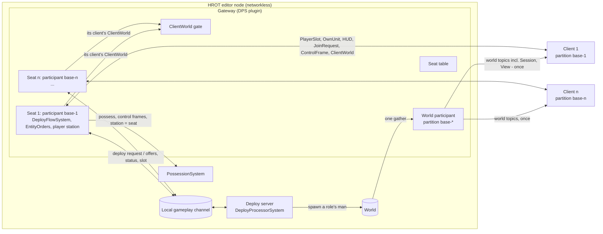
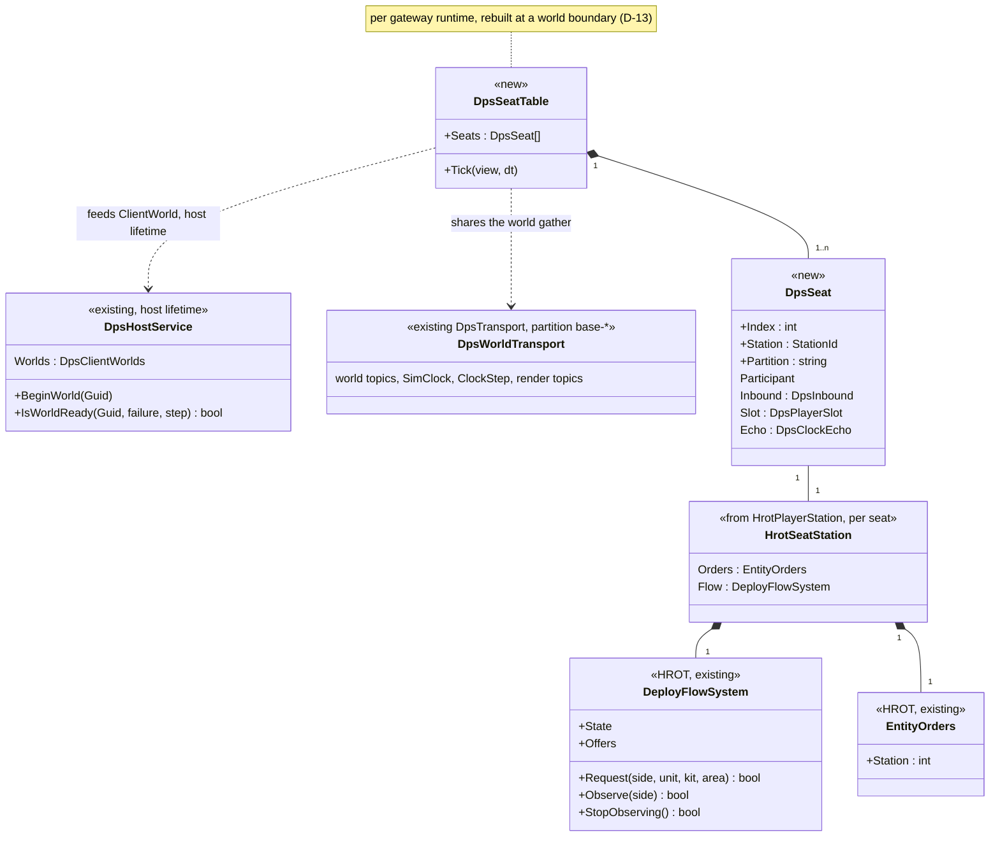
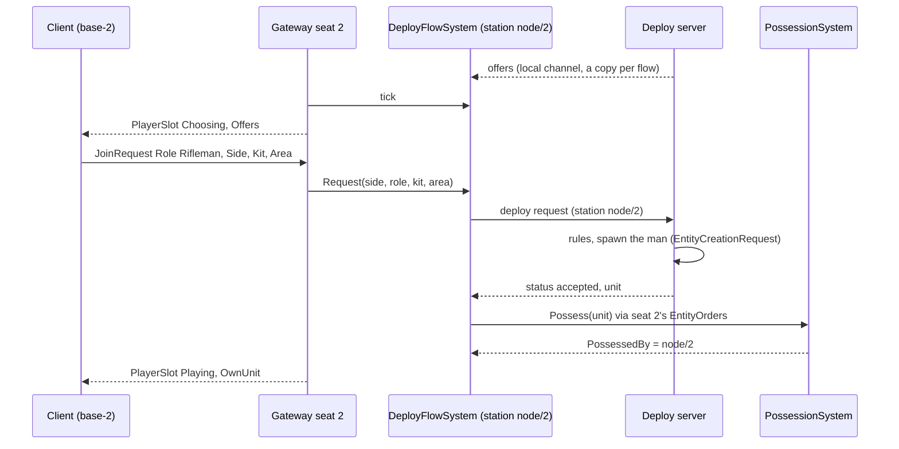
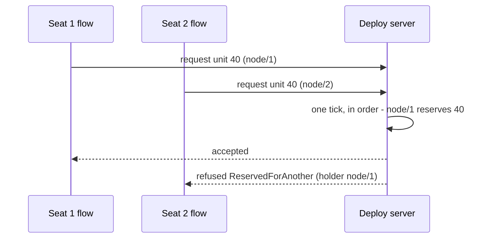
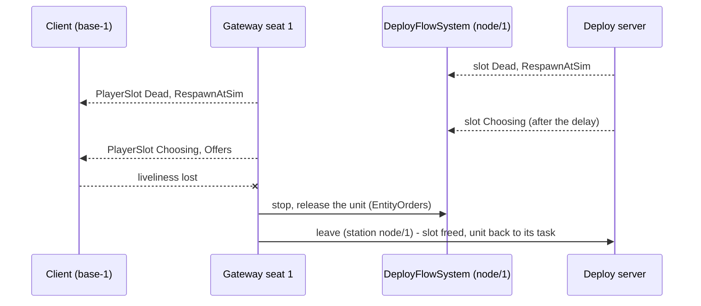

# DD-023: Several players behind one gateway (the editor as the server)

| | |
|---|---|
| **Status** | rev 2 (2026-11-21): an independent review folded in (section 3b; it overturns rev 1's D-1 topic split, D-6 and section 6's "no seat sees no world"); approved by the user (R-140: P-1 .. P-7); HROT's half is HROT `Architect_Question_114` |
| **Tasks** | T-046 (this design) |
| **Rulings honoured** | R-139, R-132 (amended: one player per station stays, a station is now a seat), R-133 (append-only), R-135, R-012, R-002 |
| **Related** | DD-017 (the station, the partition, the join flow - its section 3.1 *"rejected: one gateway serving many players"* is superseded by this design for the editor host); DD-022 (the clock, the steps, `ClientWorld` - shared by every seat); HROT [`DESIGN_Player_Join.md`](https://github.com/pjanec/HROT/blob/ui/docs/DESIGN_Player_Join.md) (owns the deploy server and the deploy flow reused here); HROT `docs/blueprints/Architect_Question_114_Seats_On_One_Node.md` (owns `StationId`, the deploy server in the editor, the local gameplay channel) |
| **Date** | 2026-11-21 |

## 1. Context and goals

The user (R-139): one HROT editor runs as the all-in-one, networkless server; the gateway in it serves **several** external clients, each one
player. Today a station is a node (HROT C-8) and the gateway admits one player (DD-017 3.1, `DpsInbound.cs:12`).

Goals:
- N **seats** in one gateway; each seat is one player with its own unit, slot, view, HUD and gizmo view.
- Every client stays **unchanged**: it is configured with its seat's partition and sees exactly today's contract.
- The player's deployment (side, placed unit or role, kit, spawn area, death, respawn) is **HROT's own** deploy server and deploy flow, not a
  gateway copy.
- Every world load waits for every seat's client (DD-022 3g, unchanged).

Out of scope: the editor's CPU with many players (user: *"an independent story"*); cluster player nodes (DD-017's model stays, as seat 0);
a lobby or seat discovery; voice.

## 2. Block diagram

What the picture shows that prose hides: the world is **gathered and written once** (one participant whose partition name is a wildcard),
while everything a player owns lives in **its seat's own participant**; and the gateway seat **decides nothing about deployment** - it sits
between its client and HROT's one deploy server, through the same deploy flow a cluster player node runs.

## 3. Key concepts and decisions

| Term | Meaning |
|---|---|
| **Seat** | one player position in the gateway: a station id, a DDS partition, a deploy flow, an `EntityOrders`, a player station. Seat 0 is the editor's own user |
| **`StationId`** | HROT's station number: node in the low 16 bits, seat in the high 16 (user, R-139); seat 0 = the node id itself, so today's values are unchanged (HROT Q114) |
| **Seat partition** | `<base>-<n>` for seat n; the world participant writes on `<base>-*`, which DDS matches to every seat partition (a wildcard on one side only) |

- D-1 **One world participant, one participant per seat.** CycloneDDS.NET takes one partition per participant (`DdsParticipant(domain,
  defaultPartition)`). World topics are written once by a participant on `<base>-*`; each seat's own topics (`PlayerSlot`, `OwnUnit`,
  `PlayerMessage`, `GizmoFrame`, the HUD; rev 2: `View` and `Session` are WORLD topics, D-9) and its inbound topics (`JoinRequest`, `ControlFrame`, `Leave`, `GizmoView`, `ClockProbe`) live on
  `<base>-<n>`. The inbound routing is the partition: a seat reads only its own client. Rejected: appended keyed copies of `PlayerSlot`,
  `OwnUnit`, `View` (every client changes); a DDS domain per seat (domains are a deployment resource, DD-017 3.2a).
- D-2 **A seat is a HROT station.** Each seat's `EntityOrders` carries `Station = StationId.Of(editorNode, n)`; HROT's possession compares
  station numbers only (`Possession.cs:221-263`, `StationClaims.cs:97-104`), so units held by different seats are arbitrated in one place,
  in one tick. Rejected: seat ids in a reserved number range (a seat would not know its node); reusing node ids (collide with the editor's).
- D-3 **Deployment is HROT's: one deploy server in the editor, one `DeployFlowSystem` per seat** (user, R-139). The seat builds the flow with
  its station, its own `Possess` callback (its `EntityOrders`) and an environment answered by the editor; the flow reads its own slot from
  the server (`DeployProcessorSystem.TryGetSlot`). The gateway maps DPS onto the flow's verbs and readouts (section 3a). Rejected: a thin
  deploy client in the gateway (duplicates the state machine, its 10 s waits and retries - "one implementation per concept").
- D-4 **The gateway ticks its seats' flows** (`Execute(view, dt)` from its own frame), since seats come and go at run time and an ECS
  system is composed once at node start (HROT `GameplayClientPack.cs:36-39`).
- D-5 **Seat lifecycle.** Seats are configured (`dps.seats`, default 1); each seat's participant exists from the start, so a client may join
  at any time. A seat is free when no client is its player (DD-017's one-player rule, per seat). Leave or lost liveliness: the seat's flow
  stops, the seat's unit is released, and the deploy server's slot for that station is freed (HROT Q114 leave verb).
- D-6 *(rev 2: partly SUPERSEDED by D-11 - the station numbering changes even with one seat)* **One seat = today's layout exactly.** With `dps.seats` 1 the gateway uses one participant on `<base>` as now; partitions with a
  suffix appear only from 2 seats. An existing single-player deployment changes nothing.
- D-7 **What every seat shares, unchanged:** the world gather, `SimClock` / `ClockStep` (on the world participant), the `ClientWorld` gate
  (rev 2, D-10: read per seat, never on `<base>-*`; the host service already waits for every `WaitForMe` client, T-045), the render
  client (one per gateway, DD-022 D-7).

### 3b. Rev 2 - the independent review (2026-11-21), folded

The review checked every claim against the code; four findings broke rev 1, the rest were gaps. Decisions added or changed:

- D-8 **`Entity.Playable` and `Session` on the world participant.** `Playable` is today computed from the one station's offers
  (`DpsTransport.cs:98-101`); a world writer has no station. It now comes from the deploy server's offers, which are the same for every
  seat. `Session` is keyless: written ONLY by the world participant, `StationName` = the base name (`DpsTransport.cs:92` used the
  partition).
- D-9 **`View` is a world topic.** Its only source is HROT's one `CameraSuggestion` (`CameraViewSource.cs:17`), the editor's or the
  director's suggestion; every client already binds its own camera (R-134). A per-seat view would need a new source; none is wanted.
- D-10 **Client-written topics are read PER SEAT, never on `<base>-*`.** `ClientWorld`, `ClockProbe` (its echo written on the seat's
  participant, one echo thread per seat), `JoinRequest`, `ControlFrame`, `Leave`, `GizmoView`. The host service's one `ClientWorld` table
  is fed by every seat's reader, so the gate waits for every SEATED client and a stray client on `<base>-x` can never stall a load.
- D-11 **Seat numbering:** station `node/0` is the editor's own user; gateway seats are `node/1 .. node/N`, also with one seat. Today the
  gateway player and the editor user share the editor node's station (`HrotPlayerStation.cs:89`); D-11 separates them. Every "is this
  mine" check in the host (`HrotPlayerStation.cs:89, 480, 507, 541, 581`) uses the seat's station. N is capped at 1024 (the high 16 bits
  stay positive far below 32768).
- D-12 **The render client sits on a named seat** (`dps.renderSeat`, default 1). `ClockStep.Samples` (DD-022 D-B4 rev 6) = the world
  topics counted on `<base>-*` + that seat's own counted topics (`PlayerSlot`, `OwnUnit`, `PlayerMessage`); during a job every seat's
  counted writes also happen only in the step's gather.
- D-13 **Lifetimes.** Per gateway runtime (die at a world boundary, `DdsPlayerPlugin.cs:7-9`): the world participant, the seat
  participants, the seat table, each seat's `DeployFlowSystem` and `EntityOrders` (they hold the world and map, `DeployFlowSystem.cs:88-96`;
  rebuilt where `DisGatewaySystem` sees a new world, `:116-128`). Host lifetime (`DpsHostService`): the `ClientWorld` table, the forced
  epoch, the seat configuration.
- D-14 **The flow's environment in the editor:** `GateOpen` = a scenario is loaded; `OperatingLive` = the editor runs live AND sim time
  advances (`PossessionSystem` runs only then, `Possession.cs:184`; a paused editor would time every deploy out after 10 s of wall time);
  `ServerExists` = the editor composes the server (HROT Q114-B).
- D-15 **`PlayerMessage` per seat** through HROT's one addressing rule `PlayerMessages.Addressed` (`PlayerMessages.cs:45-52`), moved below
  `Hrot.Presentation` so the gateway can call it (HROT Q114-I); never a second filter in the gateway.
- D-16 **Feature-test scenarios (HROT R-4277)**, each with `checks.json` expect rows: `two-seats-deploy` (two seats deploy as two roles
  of one side; both Playing; the role count is respected), `two-seats-one-unit` (the race; exactly one holder), `seat-leaves-vehicle`
  (a seat riding and driving leaves; the vehicle is free), `seat-respawn` (death, the delay, Choosing again). Role spawn points seeded
  from the scenario (HROT Q114-J), so each run is the same.

Mapping note: DPS `SlotState.Spawning` has no `DeployFlowState` twin (`DpsTypes.cs:50`); map by name, `Spawning` unused. The flow gains a
`Side` readout for `PlayerSlot.Side` (HROT Q114-C).

### 3a. DPS onto HROT's deploy flow

| DPS (client to gateway, seat n) | `DeployFlowSystem` (seat n) |
|---|---|
| `JoinRequest` Kind Observe, `Side` | `Observe(side)` |
| `JoinRequest` Kind Unit, `UnitId`, `Side` | `Request(side, unitNetId)` |
| `JoinRequest` Kind Role, `UnitId` = the offered role's `Offer.Id`, `Side`, `Kit`, `AreaId` | `Request(side, roleId, kit, areaNetId)` (the server tells a role by its id, `DeployProcessorSystem.cs:168`) |
| `Leave` / liveliness lost | `StopObserving()` or release + the server's leave (HROT Q114) |

| `DeployFlowSystem` readout | DPS `PlayerSlot` (seat n's partition) |
|---|---|
| `State` Waiting / Observing / Choosing / Requesting / TakingControl / Playing / Dead | `SlotState` of the same name (already 1:1, `DpsTypes.cs:50`) |
| `Offers` (Placed / Role / Area, count / max, holder) | `Offers` (`OfferKindUnit` / `OfferKindRole`; **append `OfferKindArea`**); `Free` = holder 0 |
| `LastRefusal` | `Reason` |
| the slot's `RespawnAtSim`, `Side`, unit | `RespawnAtSim`, `Side`, `UnitId` |

## 4. Class diagram

`DpsSeat` is what today's single transport holds per player (inbound, slot, own unit, view, HUD, gizmo view), cut out of `DpsTransport`;
`HrotSeatStation` is today's `HrotPlayerStation` per seat, its placed-unit join (DD-017 step 1) replaced by the deploy flow.
`DeployFlowSystem` and `EntityOrders` are HROT's, used unchanged except HROT Q114's registry flag.

## 5. Sequence diagrams

### 5a. Join and deploy as a role

The seat only translates. Refusals (`WrongSide`, `HeldByAnotherStation`, a full role) come back from the server through the flow's
`LastRefusal` into `PlayerSlot.Reason`; the client sees Choosing again.

### 5b. Two seats reach for one unit

One server, one tick: the race is decided in one place (`StationClaims.ForPossess`), never between nodes.

### 5c. Death, respawn, leave

## 6. Edge cases and error handling

- **Two clients on one seat partition:** DD-017's rule per seat - the first `JoinRequest` owns it, the other is dropped with one warning.
- **More clients than seats:** *(rev 1 said "sees no world" - FALSE, the review: `<base>-*` matches any `<base>-<x>`)* a client on a partition with no seat SEES the world but is nobody's player: no seat reads its `JoinRequest`, `ControlFrame` or `ClientWorld`, so it can neither play nor hold up a load (D-10). It is a view-only client, as DD-017 3.2a allows.
  Discovery of free seats is out of scope (a lobby would be an appended topic on `<base>-*`).
- **A world load:** every seat's flow returns to Waiting (the gate closes); the deploy server forgets its slots, answers and pending spawns at the world boundary (HROT Q114-H; rev 1 assumed they reset - they do not, `DeployProcessorSystem.cs:63-78`); the
  `ClientWorld` gate waits for every seat's client (DD-022 3g).
- **The editor's own user** stays seat 0 and keeps possessing through the map; deploying it through the same flow is P-6.
- **A replay:** seats are view-only during a replay (nothing enters the world, as today); their flows sit in Waiting (D-13) and the deploy server is gated off (HROT Q114-H).
- **Config with one seat:** today's single partition (D-6); the player is station node/1, no longer the editor's own station (D-11).

## 7. Test plan

- **Seats are independent (property):** seeded random joins, requests, deaths and leaves on 1 .. 8 seats; after every step each client's
  `PlayerSlot` equals its seat flow's readout, no seat ever holds a unit another seat holds, and the server's slots equal the seats'.
- **The race (5b):** two seats request one unit in one frame - exactly one Playing, the other Choosing with `ReservedForAnother`.
- **Partitions:** a world sample reaches every seat client once; a seat's `PlayerSlot` reaches only its client; a client's
  `ControlFrame` reaches only its seat.
- **One seat = today:** with `dps.seats` 1, today's DPS suites pass unchanged (one partition, no suffix).
- **Leave:** lost liveliness frees the seat, releases EVERY unit the station holds (a ridden vehicle too, HROT Q114-E) and frees the server's slot; the next client joins it.
- **A stray client** on `<base>-x` with no seat: sees the world, its `ClientWorld` never reaches the gate (D-10).
- **Old recordings still play** after `StationId` (HROT Q114-A's layout alias).
- **Render on a seat:** `Samples` = world + the render seat's counts, exact on a seeded world (D-12).
- **The scenarios of D-16 pass** in `scripts/scenario-regression.sh`.
- **Loads:** a load with three seat clients waits until all three are Ready (extends T-045's gate rails).
- **HROT side** (HROT Q114): the editor composes the server; a role's man spawns in the editor; the local channel gives each flow its own
  copy of offers and status.

## 8. Proposals awaiting approval

| # | Proposal | Lean |
|---|---|---|
| P-1 | World participant on `<base>-*`, one participant per seat on `<base>-<n>` (D-1); `View`, `Session` world topics; client-written topics read per seat (D-8 .. D-10) | yes - clients unchanged |
| P-2 | A seat is a HROT station `StationId.Of(node, n)`, 16/16 (D-2; HROT Q114-A) | yes (16/16 is the user's) |
| P-3 | The gateway ticks one `DeployFlowSystem` per seat (D-3, D-4); DD-017's step-1 placed-unit join is replaced by it | yes |
| P-4 | Seats configured (`dps.seats`, at most 1024), participants made per gateway runtime; seats are node/1 .. node/N, the editor user node/0 (D-5, D-11, D-13) | yes |
| P-7 | The render client on a named seat; `Samples` = world + that seat (D-12) | yes |
| P-8 | Append to `Offer` what HROT's deploy offer carries and DPS lacks (`DeployOfferTopic`, HROT `GameplayTopics.cs:81-94`): the role's `Kits` (<= 8 names of 32; `JoinRequest.Kit` already picks one by index) and an area offer's `Outline` (<= 32 world points; a spawn area is an area entity with an outline, HROT `SpawnArea.cs`, which DPS does not send) | yes - append-only; awaits the user |
| P-5 | Append `OfferKindArea` to `OfferKind` (3a) | yes - `JoinRequest.AreaId` already exists |
| P-6 | The editor's own user deploys through the same flow as seat 0 (one path for every player) | later, optional - HROT's UI, not this design |

Needs HROT first (HROT Q114): `StationId`; the deploy server composed in the editor; the local gameplay channel; the flow's registry flag;
the leave verb.

## 9. As-built notes

**T-047 (2026-11-21), the gateway part with no HROT dependency: built; HROT Q114 is not, so joining is still today's placed-unit possession per seat.**

| Built | Where |
|---|---|
| `dps.seats` (default 1, 1 .. 1024; outside = a configuration error naming the key, from the file and from `DpsSettings.Validate`) | `DpsSettings.cs`, `DpsSide.cs`, `DdsPlayerPlugin.Check` |
| World participant on `<base>-*` (Seats >= 2) or `<base>` (Seats 1, D-6): every world topic, `Session` (`StationName` = the base name, one writer), `View`, `SimClock` / `ClockStep`, `PlayerMessage` | `DpsTransport.cs` |
| `DpsSeat` per seat on `<base>-<n>` (Seats 1: the world participant itself): `PlayerSlot`, `OwnUnit`, `GizmoFrame` + `DpsGizmos`, `DpsInbound` (Join / Control / Leave), `GizmoView`, `DpsClockEcho` (probe read and echo written on the seat), `DpsClientWorldInbound` into the host-lifetime `DpsHostService.Worlds` | `DpsSeat.cs` |
| `Entity.Playable` from ONE offerable-unit set: the union of every seat's offers, rebuilt once per frame by index loops into a reused `HashSet` (0 bytes in the steady state, test-proved) | `DpsTransport.RefreshPlayable` |
| N `HrotPlayerStation`s, one per seat, station `node \| n << 16` (one field, used at the five "is this mine" sites); `SideBinding.PlayerSeats` appended (`PlayerStation` = seat 1, so DIS / HLA are unchanged); `IGatewayPlugin.PlayerSeats(settings)` (default 1) tells the host how many | `HrotPlayerStation.cs`, `DisGatewaySystem.cs`, `GatewayRuntime.cs`, `GatewayCapability.cs`, `PluginSet.SeatsFor`, `IGatewayPlugin.cs` |

Findings and deviations:
- **INTERIM `PlayerMessage`** stays on the world participant (every seat's client sees every message) until HROT Q114-I moves `PlayerMessages.Addressed` below `Hrot.Presentation` and the message is routed per seat (D-15).
- **Behaviour change on purpose (D-11):** the gateway player is station `node \| 1 << 16`, no longer the node's own station, also with one seat. Tests that assumed the node id were changed.
- **Refusal text (added, not in the design's seat list):** the seam had no refusal channel (`PlayerSlot.Reason` was always empty). `PlayerSlotSnapshot` gained an appended `Reason` (HROT's own `OrderResult.Detail` of a refused `Possess`); a seat that loses the race (another station was granted the unit) now returns to Choosing at once with that text instead of waiting out the 10 s timeout. `PlayerSlot.Reason` is capped at 64 characters by the contract, so long texts are cut.
- **PackHarness does not run HROT's `PossessionSystem`:** the tests' arbiter (first request in event order wins a free unit) stands in for it, as `Stage.Hold` already did; the real system's race is the deploy-server scenario `two-seats-one-unit` (D-16), which needs HROT Q114.
- `ClockStep.Samples` counting for the render seat (D-12) is not built (`Samples` is unchanged, 0 as before); `dps.renderSeat` is not added. Part of the HROT-dependent half.
- Seats beyond the stations the host offers (a host with fewer player stations than `dps.seats`) only observe, with one warning.
- Not built here (HROT Q114): the deploy flow per seat (D-3, D-4), roles and areas (`OfferKindArea`, P-5), the leave verb, the seat table type.
