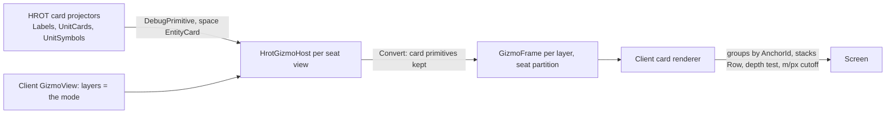
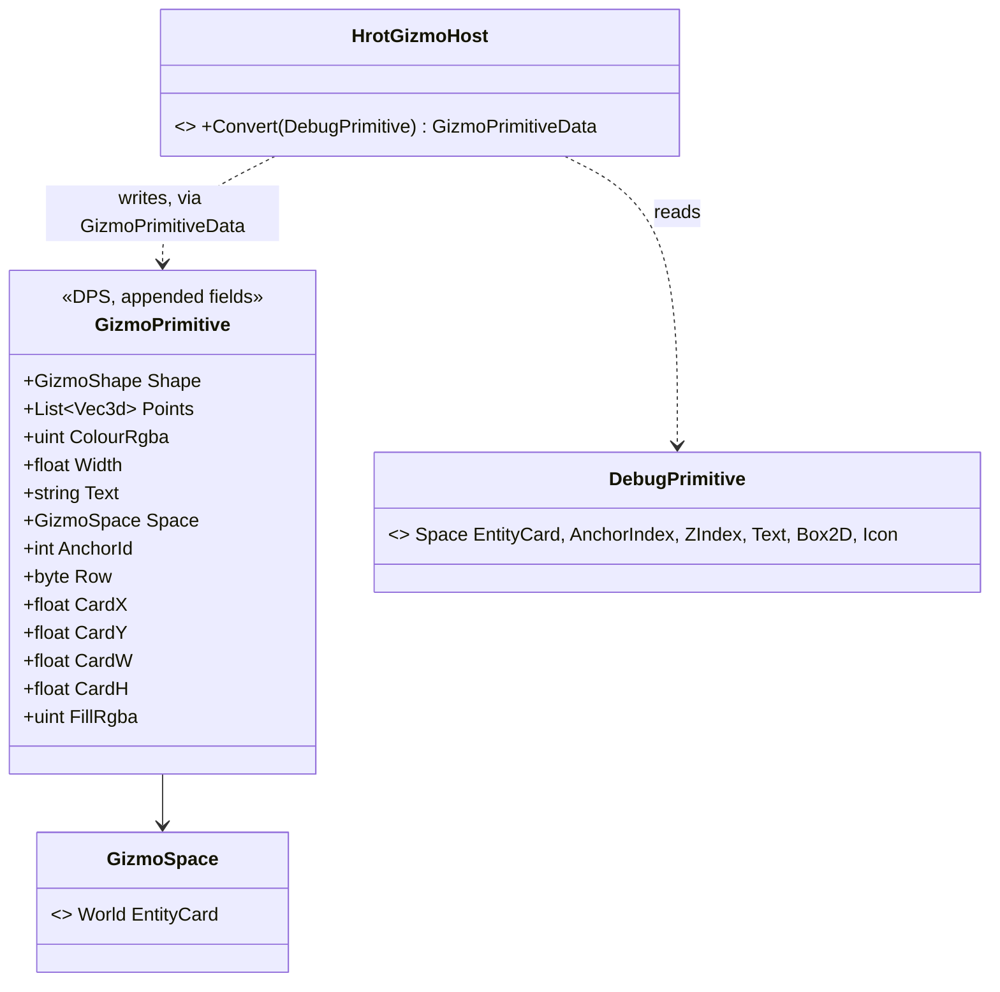
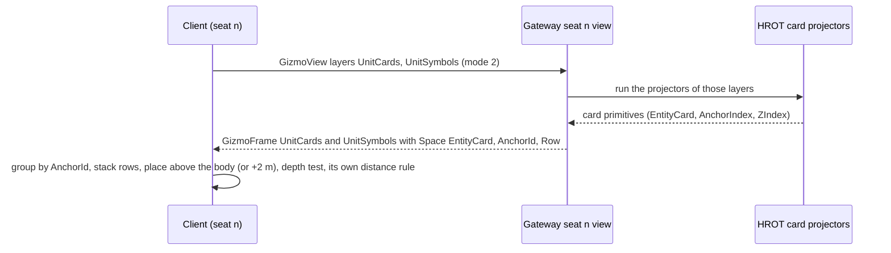

# DD-024: Entity cards (3-D labels) over `GizmoFrame`

| | |
|---|---|
| **Status** | approved rev 2 (R-144): P-1, P-3, P-4 approved; P-2 (the cutoff on the wire) REJECTED - *"why distance cutoff that is each IG's choice isnt it? otherwise approved"* |
| **Tasks** | T-052 (re-scoped from Entity fields to this design) |
| **Rulings honoured** | R-143 (the three modes, rule A, the swarm exception), R-133 (append-only), R-135 (producer-neutral), R-140 (seats) |
| **Related** | DD-017 3.11 (the gizmo protocol: `GizmoView`, `GizmoFrame`), DD-023 (one gizmo view per seat), HROT `docs/DESIGN_Map_3D_Mode.md` §6am (cards hidden behind terrain), HROT `docs/UX/DESIGN_Unit_Symbols.md` (the symbol in the card) |
| **Date** | 2026-11-21 |

## 1. Context and goals

HROT's 3-D labels are gizmos: `[GizmoProjector]` rules on the layers `Labels`, `UnitCards`, `UnitSymbols` build an entity CARD from rows of
primitives (`EntityCards.cs`: `Card(netId, layer).Row(n).Frame/Text/Bar/Tick/Symbol`), each primitive in `CoordinateSpace.EntityCard`,
anchored by `AnchorIndex` = the entity's network id, ordered by `ZIndex` = the row. The gateway's gizmo host drops them today
(`HrotGizmoHost.Convert`, `default: return null`). Goal: carry them, so the client DRAWS HROT's cards and decides nothing about content —
one source of truth for what a card shows and who gets one (rule A is HROT's `AircraftNameGizmo`). The three modes are the client's layer
subscription (mode 1 none; mode 2 `UnitCards` + `UnitSymbols`; mode 3 those plus `Labels`). Out of scope: a camera on the wire.

## 2. Block diagram

What the picture shows that prose hid: the CONTENT and the "who gets a card" decision stay in HROT's projectors; the gateway only stops
dropping a primitive kind; the client only lays out and occludes.

## 3. Key decisions

- D-1 **Append to `GizmoPrimitive`, no new topic.** Fields (all appended, R-133): `Space` (new enum `GizmoSpace` { World = 0, EntityCard = 1 }),
  `AnchorId` (the DPS entity id the card belongs to; 0 in World space), `Row` (byte, 0 = card-wide: frame and symbol cell), `CardX`, `CardY`,
  `CardW`, `CardH` (floats in the card's layout units, below), `FillRgba`. Rejected: a new `EntityCard`
  topic (a second gizmo channel beside `GizmoFrame`, with its own layers and views - the same concept twice).
- D-2 **Card-space shapes reuse the existing `GizmoShape` values:** `Text` (CardX = x px from the row's left, Width = font px, Text),
  `Box` (a bar or tick: CardX = centre as a fraction of the card width, CardW = half-width fraction, CardH = height px; `FillRgba` its fill),
  `Icon` (the symbol: Text = the symbol code, HROT's `SymbolCode` wire form, a 2525C SIDC with the producer's extension after `|`;
  CardH = height px; row 0 = the left cell spanning the rows), and the frame as a row-0 `Box` (fill = the background, `ColourRgba` = the
  outline). The exact mapping of each HROT row helper (`Frame`, `Bar`, `Tick`, `Text`, `Symbol`) is the build's, read from `EntityCards.cs`.
- D-3 *(rev 2: REJECTED by the owner, R-144 - each client chooses its own distances; the paragraph below stays as the record)* ~~**The distance cutoff travels with the primitive** (`MaxMetresPerPixel`, HROT's own per-rule number: card 1, name 2, aircraft name 0 =
  none). The gateway has no camera (`GizmoView` carries none), so the client applies it with its own camera:
  `m/px = 2 * d * tan(fovV / 2) / viewportHeight`. Rejected: a camera on `GizmoView` (per-frame traffic for a client-side test).~~ ⭐ **Rev 2:** nothing on the wire; HROT's numbers (card 1 m/px, name 2 m/px, aircraft name none) are a suggestion in the client guide; rule A (R-143) is the client's: it does not cut a card whose anchor `Entity.Domain` is Air (HROT's projectors still decide which aircraft get a card - the swarm exception, D-6).
- D-4 **Views: one per seat** (DD-023, built in T-047) answers the Unreal note's G-2 - each seat's client has its own `GizmoView` and gets its
  own `GizmoFrame`s; a second display needing other layers takes a seat (seats are configured, cheap). Rejected: several views inside one
  seat (the one-player-per-seat rule would need a view table per client for one partition).
- D-5 **`Entity.IsUnit` (G-3) is kept** - a body-less commander arrives as an entity and must not get a stand-in body. `ParentId` (L-1) and
  `Symbol` (L-3) are NOT built now: the cards carry what they would have (SUPERSEDES R-143's L-1/L-3; kept as possible later appends).
- D-6 **The swarm exception (R-143) is HROT's rule** - `AircraftNameGizmo` skips an aircraft whose direct commander is an air unit; a HROT
  tracker item, not gateway logic.

## 4. Class diagram

## 5. Sequence diagrams

## 6. Edge cases

- An anchor the client does not hold (a card for an entity not yet received) - the client skips the card until the `Entity` arrives.
- A network id not mapped to a DPS entity id - the gateway drops the primitive (counted in its diagnostics).
- 31-character card text (HROT's `CardText`) fits `Text` (64).
- A frame's primitives above 4096 (`GizmoFrame.Primitives` bound) - the gateway already splits or drops per its frame rule; cards for 8 000
  units are the stress case: measure, and say which in the as-built.

## 7. Test plan

- Card primitives of each helper (frame, bar, tick, text, symbol) arrive with Space EntityCard, the right AnchorId (the DPS id of the anchor),
  Row, card fields and MaxMetresPerPixel; World-space primitives are unchanged (existing gizmo suites green).
- Mode subscription: a view with only `UnitCards` + `UnitSymbols` gets no man's card; adding `Labels` adds them.
- Contract: appended fields last, IDL added lines only.
- Mutations: cards still dropped; AnchorId = the network id unmapped; Row lost; a World-space primitive turned into a card.

## 8. Proposals awaiting approval

| # | Proposal | Lean |
|---|---|---|
| P-1 | Card primitives in `GizmoFrame` by appended `GizmoPrimitive` fields (D-1, D-2) | ✅ approved (R-144) |
| P-2 | The cutoff carried per primitive, applied by the client (D-3) | ⛔ REJECTED (R-144) - each client's choice |
| P-3 | Views per seat; a second display takes a seat (D-4) | ✅ approved (R-144) |
| P-4 | Keep `IsUnit`; do not build `ParentId` / `Symbol` now (D-5); the swarm exception in HROT (D-6) | ✅ approved (R-144) |

## 9. As-built notes

Built (T-052). Files: the contract (`DpsTypes.cs` `GizmoSpace`; `DpsTopics.cs` the eight appended `GizmoPrimitive` fields and `Entity.IsUnit`), the committed IDL (added lines only), `IGizmoSource.cs` (`GizmoPrimitiveData` carries the same fields, all
defaulted), `HrotGizmoHost.cs` (`Convert` branches on `CoordinateSpace.EntityCard` first), `HrotPlayerStation.cs` (the anchor check), `DpsGizmos.cs` (the mapping to the topic), `DpsOutbound.cs` (`IsUnit`), the client guide's "Entity cards" section.

Deviations from the design above, and what was found:

- **D-2's field mapping, exact.** Text: `CardX` / `CardY` = the product's `TextX` / `TextY`, `Width` = the font size in WHOLE pixels (the product keeps it in `ThicknessU16`, not tenths). Box: `CardX` / `CardY` / `CardW` / `CardH` = the product's centre x (fraction of the card), centre y (px below the row's top),
  half-width (fraction) and half-height (px) - the half-height, not the height D-2 says, so nothing is converted and a client reads what HROT's renderer reads; `ColourRgba` = the outline, `Width` its pixels, `FillRgba` the fill. Icon: `Text` = the symbol code, `CardH` = its height px.
  The frame is two Boxes on row 0 (background with fill, outline without).
- **Card text is read from the inline content**, never from the intern hash: for a card primitive the product's `StringHash` shares four bytes with `AnchorIndex`, so the world path's `StringHash != 0` test would misread every card text.
- **The anchor check is liveness, not translation.** The DPS entity id IS the network id (`DpsOutbound` writes `EntityId = s.Id`, the adapter's `NetworkIdentity`), so `AnchorId` equals the product's `AnchorIndex`. "Unmapped" = not an entity the gateway publishes: no id, not in the node's entity map, not alive, or a replica
  (`ReplicationRoute`). Such a primitive is dropped and counted (`HrotGizmoHost.UnmappedCardPrimitives`).
- **`IsUnit` is derived from the DIS kind** (11, the host's unit kind, `DrWire.UnitKind`) in `DpsOutbound`: the pivot `HrotEntityState` carries no flag and none was added. HROT's `CompositeUnitTkbTranslator` stamps `UnitEntity` from a TKB composite and `UnitDis` gives every unit kind 11, so the two agree.
- **Commanders already are DPS entities.** The adapter's selection (`SimTransform` + `TkbIdentity` + `NetworkIdentity`, no `ReplicationRoute`) takes a commander at its `UnitCentroidSystem` position. Its DIS kind is neither life form (3) nor platform (1), so no person, appearance or vehicle-look message is gathered
  (rail `CommanderGatherTests`). `Entity.ParentId` already existed in the contract (still 0, DD-017 §10).
- **The symbol cell travels in the `UnitCards` frame**, not in `UnitSymbols`: HROT's `UnitSymbolCardGizmo` draws it with `Card(net, Labels, unitCard: true)`, which lands on the card's own layer; the `UnitSymbols` layer only switches it on. The standalone 2-D map symbols (`EntityLocal` icons) stay dropped.
- **Finding, HROT:** `HealthBarGizmo` calls `Card(net, Labels)` without the unit flag, so a body-less commander that carries `Health` would get a bar on the Labels layer; a real commander has no `Health`, so mode 2 is clean (the rail removes it).
- **Not measured:** cards of 8 000 units against the 4096-primitive frame bound (§6); the gateway truncates beyond it as for every layer.
- Real HROT card projectors run in the rails (the host finds them by reflection), so the mode rail exercises the product's own cards, not a stand-in.
