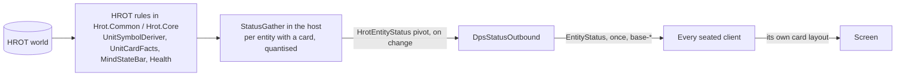
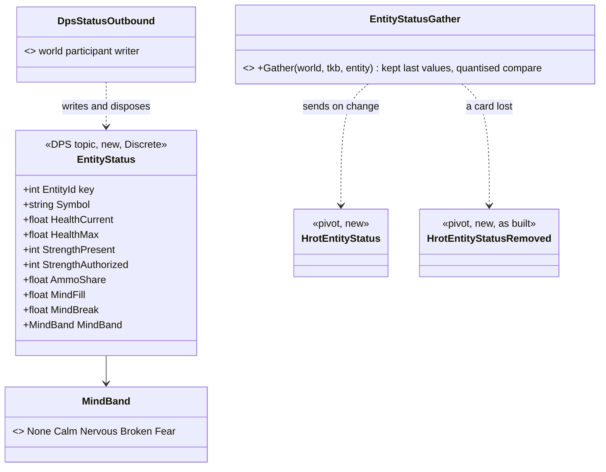
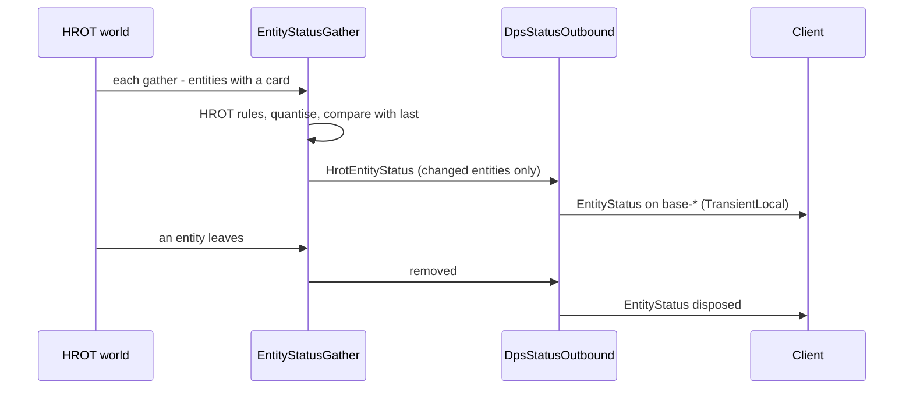

# DD-025: `EntityStatus` — what a client needs to draw its own entity cards

| | |
|---|---|
| **Status** | approved rev 1 (R-146); built (T-062, section 9) |
| **Tasks** | T-062 |
| **Rulings honoured** | R-146, R-133 (append-only), R-135 (rate classes, producer-neutral), R-140 (world topics once on `<base>-*`), R-143 / R-144 (labels: the client's look), HROT 2026-09-05 *"no precalculated percentages"* |
| **Related** | DD-024 (cards as gizmos — stays, optional: the client no longer subscribes by default); the Unreal note `NOTE_UnrealIg_To_Ui_Entity_Status.md` (HROT `unreal-ig` `2a8e52f1d`) asking for it |
| **Date** | 2026-11-22 |

## 1. Context and goals

🔒 User, via the Unreal lane: *"we can leave the HROT labels via Gizmo, but we do not need to subscribe to that layer, so it stays optional.
And let's write a note to HROT lane about the extra status we will need and send it on change."* — then to this session: *"approved, write
DD-025 and build it"*. The client draws its own cards from entity DATA; HROT keeps the MEANING (how health, strength, the symbol and the mind
state are computed) and the gateway sends the values, computed by HROT's own rules. Out of scope: the behaviour / task rows (§3 D-5).

## 2. Block diagram

What the picture shows that prose hid: the gateway decides NOTHING about content — every value comes from a HROT function the HROT map's
own cards use; the gateway only quantises and sends on change.

## 3. Decisions

- D-1 **A new keyed topic `EntityStatus`, rate class Discrete**, reliable, TRANSIENT_LOCAL, KEEP_LAST 1, written once by the world participant
  (like `Entity`), disposed with the entity, counted in the render barrier's world set (DD-022 D-B4 rev 6). Rejected: appending to `Entity`
  (Fixed class: name and type rarely change, status often) or to `EntityState` (Continuous: would resend status at pose rate).
- D-2 **Fields** (all from HROT's rules, `HrotEntityStatus` pivot):

  | Field | Source (HROT) | "none" |
  |---|---|---|
  | `EntityId` (key) | the network id | — |
  | `Symbol` (string 40) | `UnitSymbolDeriver` for the type + `WithSide` (as HROT's `UnitSymbolGizmo`), wire form: 2525C SIDC + producer extension after `\|` | `""` (not a unit) |
  | `HealthCurrent`, `HealthMax` (float) | `Health.Current`, `Health.Max` — ⛔ no fraction (HROT ruling: "no precalculated percentages"; `HealthBarGizmo.cs`) | `HealthMax` 0 |
  | `StrengthPresent`, `StrengthAuthorized` (int) | `UnitCardFacts.Strength` (a unit's men present / authorized) | `StrengthAuthorized` 0 (not known) |
  | `AmmoShare` (float 0..1) | `UnitCardFacts`' ammunition share (the SITREP's reader) | -1 |
  | `MindFill`, `MindBreak` (float), `MindBand` (enum None, Calm, Nervous, Broken, Fear) | `MindStateBar.Of` (stress for a soldier, fear for a civilian; the break tick) | `MindBand` None |

  The commander flag is `Entity.IsUnit` (T-052) — not repeated.
- D-3 **Which entities** *(as built: exactly `Seeable.OnMap`; "a seated man" below is not excluded by it, section 9 item 1)*: those HROT would give a card — the gateway's entity set filtered by HROT's `Seeable.OnMap` (Hrot.Common); none for
  rounds, effects, a seated man; animals by the same rule.
- D-4 **On change, quantised:** floats compared at a step of 0.01 (health and fill), ints exactly, strings exactly; one sample per changed
  entity per gather; 0 B per steady gather (HOT path).
- D-5 **`Behaviour` and `Task` are NOT in this round.** ⛔ *Rev 1 said the reader lives in `Hrot.Presentation` — WRONG (corrected
  2026-11-22 when the owner asked).* The behaviour is simulation state and its reader is below Presentation: `BehaviorState.ActiveBehaviorHash`
  plus `BehaviorRegistry.TryGetName`, and `BrainIntentReader.Read(repo, entity, registry, scope)` (the task slot), all in `Fdp.Toolkits`,
  which the gateway references. The only gap: the node's `BehaviorRegistry` instance is a property of each node bootstrapper, not offered on
  `HrotNodeContext` (HROT CE-11032). Once it is, `Behaviour` (the active behaviour's name) and `Task` (`BrainIntentReader`'s task slot,
  the scenario scope) are appended.

## 4. Class diagram

## 5. Sequence

## 6. Edge cases

- A late-joining client gets every last status at once (TransientLocal).
- A world boundary rebuilds the runtime: every status is sent again for the new world.
- Replay: statuses follow the restored world (HROT's components are restored) — the same gather.
- A unit with unknown strength: `StrengthAuthorized` 0; a client shows no strength bar.

## 7. Test plan

- Each field equals HROT's rule's output for a man, a vehicle, a squad commander and a civilian (compare to the HROT functions in the test,
  not hard-coded values); `HealthMax` 0 for an entity with no Health.
- On change: a steady world writes nothing; a health change of 0.005 writes nothing, of 0.02 once; a mind band change once.
- Once on the world participant with 2 seats; a late client gets the last values; a removed entity disposes its status.
- 0 B per steady gather; contract: a new topic, the IDL gains lines only.
- Mutations: a fraction sent instead of the pair; written per seat; the quantise step 0; an entity with no card given a status.

## 8. Proposals

All approved with the design (R-146). D-5's later round needs a HROT item first.

## 9. As-built notes

Built as T-062. The class and sequence diagrams above hold as built (the gather is `EntityStatusGather`; a second pivot message was added, item 6 below). Tests: `EntityStatusGatherTests` (HrotHost.Tests: each field against HROT's own functions, which entities, on change, 0 B, and the whole chain through the plugin), `DpsEntityStatusTests` (Plugin.DdsPlayer.Tests: the mapping, once on the world participant with 2 seats, a late client, disposal), `DpsEntityStatusTests` (Protocol.DdsPlayer.Tests: the contract and the IDL) and the seeded barrier rail of `DpsRenderTests`, which now writes `EntityStatus` among the counted world topics (`DpsTransport` holds it as a keyed topic; `FakeRenderClient` counts it). Client guide: "Entity status" in `DPS-Client-Guide.md`; the reference client keeps the topic in `DpsWorld.EntityStatuses`.

Where the build is exact about what the design left open (none contradicts a decision):

1. **Which entities (D-3):** the filter is `Seeable.OnMap` and nothing else. The design's "a seated man" is not excluded by HROT's rule (a man in a vehicle seat has a card in HROT), so he gets a status; the sentence in D-3 was prose, the measured rule is `Seeable.OnMap` (it excludes a round, a cloud, a minefield and its records, an air arena, the map camera, a rule entity and a macro instance that expanded into nothing seeable).
2. **What "a unit" is (D-2):** an entity with HROT's `UnitEntity`, the projector filter of HROT's `UnitCardGizmo` and `UnitSymbolCardGizmo`. `Symbol`, `StrengthPresent` / `StrengthAuthorized` and `AmmoShare` are read for units only (a man would read as 1 of 1 men: HROT never draws that). `Symbol` is `UnitSymbolDeriver.TryOfType` for the entity's TKB type, from the host's template database (not the world singleton), in the side of `EntityInfo.ForceId`, written in wire form by `SymbolCode.Format`; made once per type and side, so a steady gather allocates nothing. A reload of the template database clears the cache.
3. **Mind state (D-2):** read for a living person only (`PhysicsColliderReaders.IsPerson`, not `CombatLife.IsDestroyed`): HROT's `MindStateGizmo` draws it for nobody else. A band None is sent as fill 0, mark -1.
4. **None-values:** a health pool whose maximum is not positive or not finite is `HealthCurrent` 0, `HealthMax` 0 (HROT's bar draws nothing for it); an unknown ammunition share is -1; a non-finite value is its none-value (the plugin enforces it too).
5. **On change (D-4):** every float field is compared at the step 0.01 against the LAST SENT value (health, ammunition share, mind fill and mark), so a slow drift is sent once it adds up to a step; ints and the symbol exactly.
6. **A second pivot message, `HrotEntityStatusRemoved`:** an entity that stays but stops having a card (it became a rule's or a cloud's entity, or a macro instance that now has no seeable member) is withdrawn once (the instance is disposed); an entity that leaves is disposed through `HrotEntityRemoved` as the sequence shows. Not in the design's sequence; added because "disposed with the entity" alone would leave a stale card.
7. **The topic is a new module, `DpsStatusOutbound`,** registered by `DpsSide` (now nine modules); the DIS side ignores both messages (`HrotIgnoredIngress`). The protocol minor stays 0 (a new topic, an appended enum; the IDL gained lines only).

Mutations (the four of section 7, each made, the touched tests run red, restored): a fraction sent instead of the pair (6 of the 12 gather tests); the status written once per seat (the 2-seat test); the quantise step 0 (5 tests, among them the 0 B rail and the half-step one); an entity with no card given a status (the no-card test).
