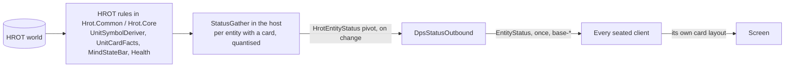
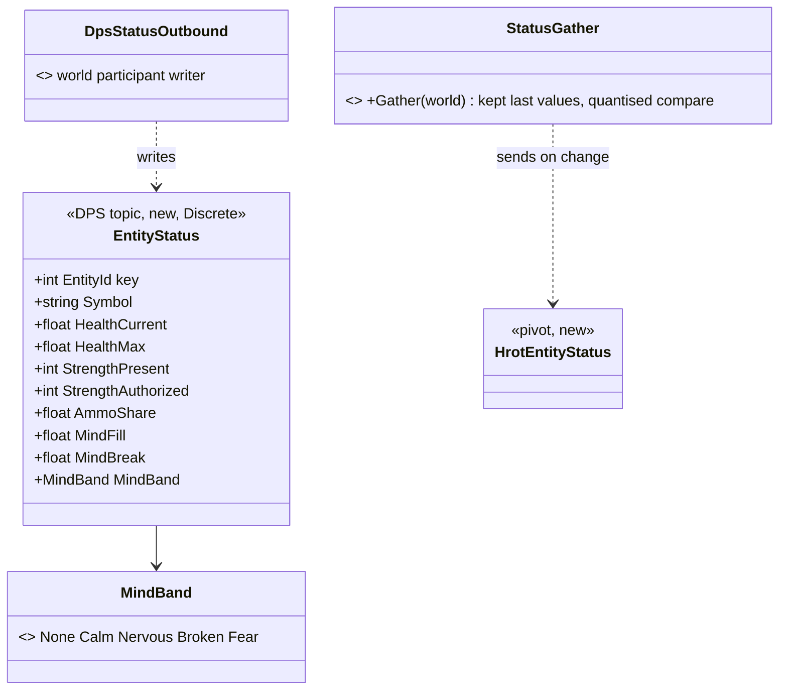
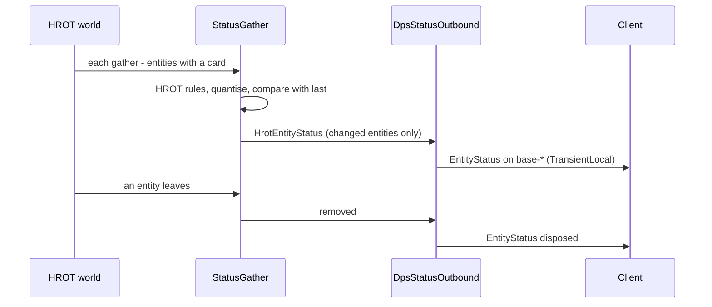

# DD-025: `EntityStatus` — what a client needs to draw its own entity cards

| | |
|---|---|
| **Status** | approved rev 1 (R-146) |
| **Tasks** | T-062 |
| **Rulings honoured** | R-146, R-133 (append-only), R-135 (rate classes, producer-neutral), R-140 (world topics once on `<base>-*`), R-143 / R-144 (labels: the client's look), HROT 2026-09-05 *"no precalculated percentages"* |
| **Related** | DD-024 (cards as gizmos — stays, optional: the client no longer subscribes by default); the Unreal note `NOTE_UnrealIg_To_Ui_Entity_Status.md` (HROT `unreal-ig` `2a8e52f1d`) asking for it |
| **Date** | 2026-11-22 |

## 1. Context and goals

🔒 User, via the Unreal lane: *"we can leave the HROT labels via Gizmo, but we do not need to subscribe to that layer, so it stays optional.
And let's write a note to HROT lane about the extra status we will need and send it on change."* — then to this session: *"approved, write
DD-025 and build it"*. The client draws its own cards from entity DATA; HROT keeps the MEANING (how health, strength, the symbol and the mind
state are computed) and the gateway sends the values, computed by HROT's own rules. Out of scope: the behaviour / task rows (§3 D-5).

## 2. Block diagram

What the picture shows that prose hid: the gateway decides NOTHING about content — every value comes from a HROT function the HROT map's
own cards use; the gateway only quantises and sends on change.

## 3. Decisions

- D-1 **A new keyed topic `EntityStatus`, rate class Discrete**, reliable, TRANSIENT_LOCAL, KEEP_LAST 1, written once by the world participant
  (like `Entity`), disposed with the entity, counted in the render barrier's world set (DD-022 D-B4 rev 6). Rejected: appending to `Entity`
  (Fixed class: name and type rarely change, status often) or to `EntityState` (Continuous: would resend status at pose rate).
- D-2 **Fields** (all from HROT's rules, `HrotEntityStatus` pivot):

  | Field | Source (HROT) | "none" |
  |---|---|---|
  | `EntityId` (key) | the network id | — |
  | `Symbol` (string 40) | `UnitSymbolDeriver` for the type + `WithSide` (as HROT's `UnitSymbolGizmo`), wire form: 2525C SIDC + producer extension after `\|` | `""` (not a unit) |
  | `HealthCurrent`, `HealthMax` (float) | `Health.Current`, `Health.Max` — ⛔ no fraction (HROT ruling: "no precalculated percentages"; `HealthBarGizmo.cs`) | `HealthMax` 0 |
  | `StrengthPresent`, `StrengthAuthorized` (int) | `UnitCardFacts.Strength` (a unit's men present / authorized) | `StrengthAuthorized` 0 (not known) |
  | `AmmoShare` (float 0..1) | `UnitCardFacts`' ammunition share (the SITREP's reader) | -1 |
  | `MindFill`, `MindBreak` (float), `MindBand` (enum None, Calm, Nervous, Broken, Fear) | `MindStateBar.Of` (stress for a soldier, fear for a civilian; the break tick) | `MindBand` None |

  The commander flag is `Entity.IsUnit` (T-052) — not repeated.
- D-3 **Which entities:** those HROT would give a card — the gateway's entity set filtered by HROT's `Seeable.OnMap` (Hrot.Common); none for
  rounds, effects, a seated man; animals by the same rule.
- D-4 **On change, quantised:** floats compared at a step of 0.01 (health and fill), ints exactly, strings exactly; one sample per changed
  entity per gather; 0 B per steady gather (HOT path).
- D-5 **`Behaviour` and `Task` are NOT in this round** — measured: what HROT shows as a unit's current actions and phase lives in
  `Hrot.Presentation` (`ActionStatusGizmo`, `SquadGizmo`), which the gateway cannot reference; computing it here would be a second rule. They
  wait for HROT to move a "current behaviour / task" reader into `Hrot.Common` (HROT tracker item), then are appended.

## 4. Class diagram

## 5. Sequence

## 6. Edge cases

- A late-joining client gets every last status at once (TransientLocal).
- A world boundary rebuilds the runtime: every status is sent again for the new world.
- Replay: statuses follow the restored world (HROT's components are restored) — the same gather.
- A unit with unknown strength: `StrengthAuthorized` 0; a client shows no strength bar.

## 7. Test plan

- Each field equals HROT's rule's output for a man, a vehicle, a squad commander and a civilian (compare to the HROT functions in the test,
  not hard-coded values); `HealthMax` 0 for an entity with no Health.
- On change: a steady world writes nothing; a health change of 0.005 writes nothing, of 0.02 once; a mind band change once.
- Once on the world participant with 2 seats; a late client gets the last values; a removed entity disposes its status.
- 0 B per steady gather; contract: a new topic, the IDL gains lines only.
- Mutations: a fraction sent instead of the pair; written per seat; the quantise step 0; an entity with no card given a status.

## 8. Proposals

All approved with the design (R-146). D-5's later round needs a HROT item first.

## 9. As-built notes

Not built.
