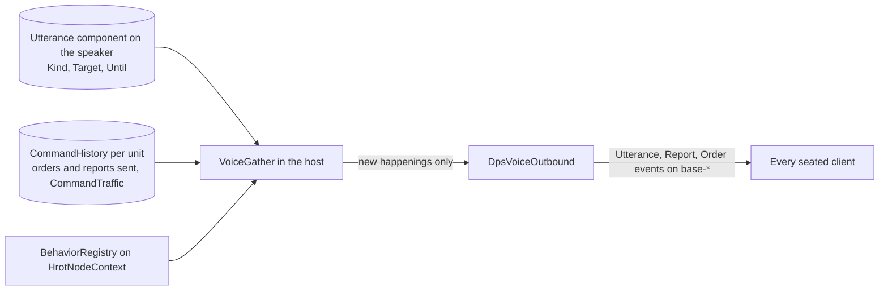
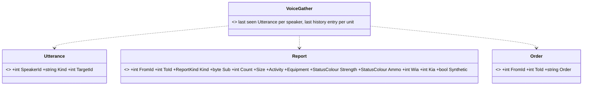
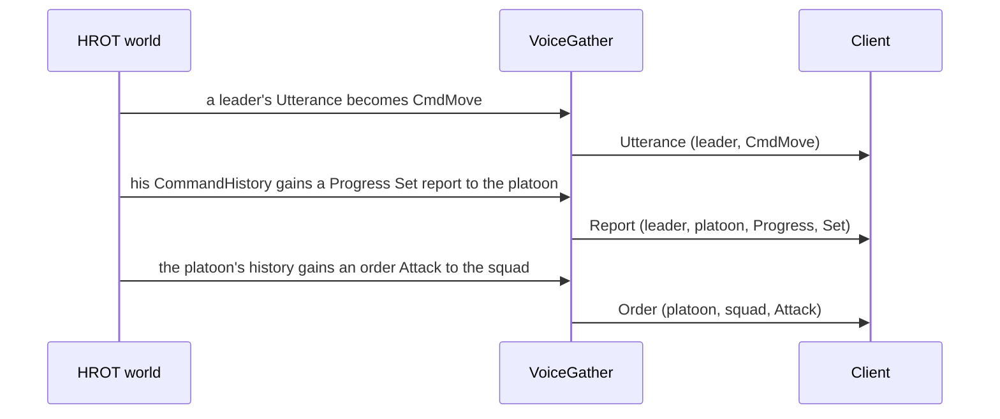

# DD-026: Voice events — what HROT's men shout, report and order, for a client's voice lines

| | |
|---|---|
| **Status** | approved rev 1 (R-148) |
| **Tasks** | T-064 |
| **Rulings honoured** | R-148, R-133, R-135, R-140 (world topics once), R-146 (HROT gives meaning, the client the look / sound) |
| **Related** | the Unreal note `NOTE_UnrealIg_To_Hrot_Squad_Voice.md` (HROT `unreal-ig` `a9db274c3`); HROT AQ105 callouts (`Speech.cs`), the command chain (`CommandHistory.cs`, `ReportQueue.cs`); DD-025 (the behaviour registry on the node context, HROT CE-11032) |
| **Date** | 2026-11-22 |

## 1. Context and goals

🔒 User (via the Unreal lane): *"the samples will stay in Unreal only. The HROT is just the source of a good triggers for those sounds."* — then
to this session: *"yes, write the task for the voice event"*. Three EVENT topics, once on the world partition: a man's shout, a report up or
down the chain, an order given. The client maps them to its recorded lines and decides who hears them. Nothing changes in HROT.

## 2. Block diagram

What the picture shows that prose hid: HROT's shouts are STATE (a component that lasts until `Until`) and its reports and orders are a
HISTORY; the gateway turns each new entry into one event, so the events follow exactly what HROT decided, with no rule of the gateway's.

## 3. Decisions

- D-1 **Three event topics** (rate class Event: reliable, VOLATILE, KEEP_LAST 32 — a late joiner does not hear old traffic), written once on the
  world partition, counted in the render barrier's world events:
  - `Utterance { SpeakerId, Kind (UtteranceKind NAME, string 24), TargetId }` — one per NEW utterance (a change of Kind, Target or Until on the
    speaker's `Utterance`);
  - `Report { FromId, ToId, Kind (ReportKind), Sub (the subtype byte: ProgressKind / RequestKind), Count, Size, Activity, Equipment,
    Strength, Ammo, Wia, Kia (HROT's `CommandReport` enums as they are), Synthetic (true = injected over the debug HTTP; a client may stay silent) }`
    (the Unreal lane's reply, `7ca8356`: the client picks its lines by them; `At` / `Radius` / `Phase` / `ObservedAt` / `Seq` not carried) — one per report entry that enters a unit's `CommandHistory`;
  - `Order { FromId, ToId, Order (string 32: the ordered behaviour's registry NAME) }` — one per order entry.
- D-2 **Names, not numbers**, for kinds and orders (a client keys its clips by name); enum values that already are IDL-safe stay enums.
- D-3 **`ToId` 0 = to a superior HROT does not simulate** ("HQ"); measure and say in §9.
- D-4 **No HROT change** — every source exists (Speech.cs, CommandHistory.cs; the registry since CE-11032). ⛔ No gateway rule for when a man
  shouts or reports.

## 4. Class diagram

## 5. Sequence

## 6. Edge cases

- The same utterance held for seconds: one event. A repeated identical shout after `Until` passed: a new event.
- A world boundary: the gather forgets; nothing is replayed to clients.
- A replay: the restored components and histories make the same events (HROT's state, not its events — R-11007's rule).

## 7. Test plan

- An utterance gives one event, held gives none, a new kind one more; a report entry and an order entry give one event each with the right
  ids and names; `ToId` 0 for an unsimulated superior; written once with 2 seats; 0 B per steady gather; the IDL gains lines only.
- Mutations: one event per gather while held; the order hash instead of the name; written per seat.

## 8. Proposals

Approved with the design (R-148).

## 9. As-built notes

Not built.
