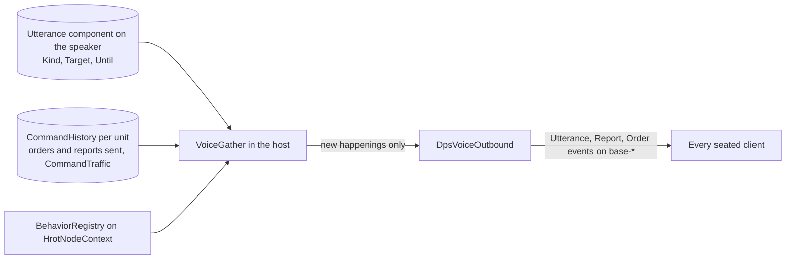
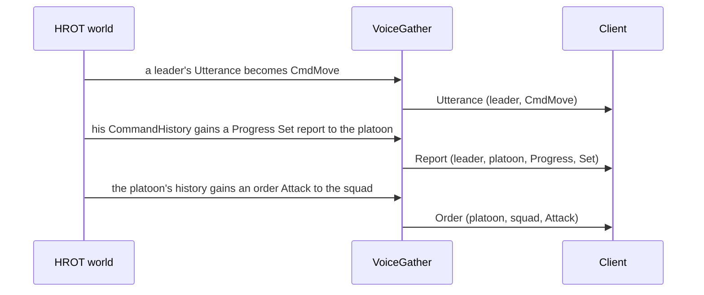
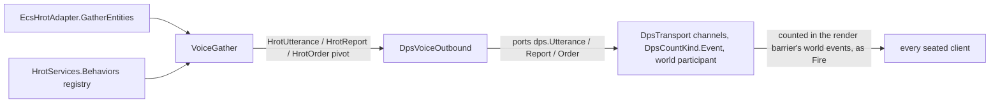

# DD-026: Voice events — what HROT's men shout, report and order, for a client's voice lines

| | |
|---|---|
| **Status** | approved rev 1 (R-148) |
| **Tasks** | T-064 |
| **Rulings honoured** | R-148, R-133, R-135, R-140 (world topics once), R-146 (HROT gives meaning, the client the look / sound) |
| **Related** | the Unreal note `NOTE_UnrealIg_To_Hrot_Squad_Voice.md` (HROT `unreal-ig` `a9db274c3`); HROT AQ105 callouts (`Speech.cs`), the command chain (`CommandHistory.cs`, `ReportQueue.cs`); DD-025 (the behaviour registry on the node context, HROT CE-11032) |
| **Date** | 2026-11-22 |

## 1. Context and goals

🔒 User (via the Unreal lane): *"the samples will stay in Unreal only. The HROT is just the source of a good triggers for those sounds."* — then
to this session: *"yes, write the task for the voice event"*. Three EVENT topics, once on the world partition: a man's shout, a report up or
down the chain, an order given. The client maps them to its recorded lines and decides who hears them. Nothing changes in HROT.

## 2. Block diagram

What the picture shows that prose hid: HROT's shouts are STATE (a component that lasts until `Until`) and its reports and orders are a
HISTORY; the gateway turns each new entry into one event, so the events follow exactly what HROT decided, with no rule of the gateway's.

## 3. Decisions

- D-1 **Three event topics** (rate class Event: reliable, VOLATILE, KEEP_LAST 32 — a late joiner does not hear old traffic), written once on the
  world partition, counted in the render barrier's world events:
  - `Utterance { SpeakerId, Kind (UtteranceKind NAME, string 24), TargetId }` — one per NEW utterance (a change of Kind, Target or Until on the
    speaker's `Utterance`);
  - `Report { FromId, ToId, Kind (ReportKind), Sub (the subtype byte: ProgressKind / RequestKind), Count, Size, Activity, Equipment,
    Strength, Ammo, Wia, Kia (HROT's `CommandReport` enums as they are), Synthetic (true = injected over the debug HTTP; a client may stay silent) }`
    (the Unreal lane's reply, `7ca8356`: the client picks its lines by them; `At` / `Radius` / `Phase` / `ObservedAt` / `Seq` not carried) — one per report entry that enters a unit's `CommandHistory`;
  - `Order { FromId, ToId, Order (string 32: the ordered behaviour's registry NAME) }` — one per order entry.
- D-2 **Names, not numbers**, for kinds and orders (a client keys its clips by name); enum values that already are IDL-safe stay enums.
- D-3 **`ToId` 0 = to a superior HROT does not simulate** ("HQ"); measure and say in §9.
- D-4 **No HROT change** — every source exists (Speech.cs, CommandHistory.cs; the registry since CE-11032). ⛔ No gateway rule for when a man
  shouts or reports.

## 4. Class diagram

## 5. Sequence

## 6. Edge cases

- The same utterance held for seconds: one event. A repeated identical shout after `Until` passed: a new event.
- A world boundary: the gather forgets; nothing is replayed to clients.
- A replay: the restored components and histories make the same events (HROT's state, not its events — R-11007's rule).

## 7. Test plan

- An utterance gives one event, held gives none, a new kind one more; a report entry and an order entry give one event each with the right
  ids and names; `ToId` 0 for an unsimulated superior; written once with 2 seats; 0 B per steady gather; the IDL gains lines only.
- Mutations: one event per gather while held; the order hash instead of the name; written per seat.

## 8. Proposals

Approved with the design (R-148).

## 9. As-built notes

Built (T-064, `2026-11-22`); HROT pin `e2b43ab4c`: every source exists there (`Civilians/Speech.cs` `Utterance` / `Utterances.Say`, `Squad/Command/CommandHistory.cs` `CommandReportHistory` / `CommandOrderHistory` / `CommandHistoryOf`, `CommandReports.cs` `CommandReport`, the registry on `HrotNodeContext`). The contract (`Utterance`, `Report`, `Order`, the enums) and the IDL are unchanged.

What the picture shows: no second mechanism - the same pivot message, module, port and event channel as a Fire; the only new thing is the gather that turns HROT's STATE into events.

| # | as built |
|---|---|
| 1 | **Where:** `VoiceGather` (host, called once per `GatherEntities`, after the others), three pivot messages (`HrotUtterance`, `HrotReport`, `HrotOrder`; the DIS side ignores them), `DpsVoiceOutbound` (the tenth dps module), three channels on `DpsTransport` (`DpsCountKind.Event`, depth 1024 like Fire), three ports. A report is mapped by NUMBER: HROT's `ReportKind` / `ElementSize` / `ElementActivity` / `StatusColour` are numbered as the contract's (a rail pins it); a value out of range is the contract's none (0). |
| 2 | **A new utterance** is a change of `Kind`, target (network id, 0 = none) or `Until` against what the gather saw. `Utterances.Say` always writes a new `Until`, so an identical shout after the first was over is new and a held one is not. `UtterNone` is never sent. The kind NAME comes from a per-kind string cached once (no allocation per gather). |
| 3 | **A new history entry:** both histories are newest-first lists of 32; the entries in front of the newest one seen last gather are new, sent oldest first; if the remembered one is gone (more than 32 in one gather) all 32 are sent. HROT writes a report / an order TWICE (outgoing on the sender, incoming on the addressee, each only where a history exists): the gather sends the outgoing entry, and the incoming one only when the sender keeps no history, so it is ONE event. A re-sent order (HROT's `Repeats`) is not news. `Sub` = `CommandReport.Subtype`, `Synthetic` = `Synthetic != 0`; `At` / `Radius` / `Phase` / `ObservedAt` / `Seq` are not carried. |
| 4 | **`ToId` 0 (measured, D-3):** HROT stores `CommandPictureOps.NetIdOf(Entity.Null)` = **0** for a report to a superior it does not simulate (`Entity.Null` is index 0); an addressee that exists gets its `NetworkIdentity`, and an entity with none gets its SLOT INDEX (`PictureConditions.cs:19-25`, CE-4200) - so an id is a gateway entity id only for a unit with a network id (the units a gateway publishes all have one). The gather writes what HROT stored and adds no rule. Rail `A_report_to_a_superior_hrot_does_not_simulate_has_to_id_zero`. |
| 5 | **Order names:** `BehaviorRegistry.TryGetName(hash)`; a hash the registry does not know, and a node with no registry, send NO order (names, not numbers; D-2). ⚠ HROT's history also holds "abstract order" hashes; any the registry does not name are silently not sent - measure a scenario before relying on every order being heard. |
| 6 | **First sight and the boundary (§6):** the first gather of a world and the first after `Clear` (a world boundary: `EcsHrotAdapter.Reset`) only REMEMBER; a unit or speaker first seen later is remembered silently too, except a speaker whose shout is still going (`Until` after now), which is said. So an entry that was already in a unit's history when the gather first looked is never sent - a replay or restore makes no events from old entries (R-11007's rule), at the price that a unit created and reporting within one gather period is missed. |
| 7 | **Cost:** a steady gather allocates 0 bytes (`GC.GetAllocatedBytesForCurrentThread`, 300 gathers after a tier-up wait); only a new event allocates its pivot message. Replicas (`_replicas`) are skipped, as the other gathers do. |
| 8 | **Not done:** the client-side mapping of kinds to lines (the Unreal lane's); no gateway rule decides when a man speaks (D-4). |

Rails: `VoiceGatherTests` (12: one event per shout / report / order, held none, identical-after-`Until` new, seeded sequences x3, ids / numbers / `Synthetic`, the dedupe of the two copies, `ToId` 0, 35 reports in one gather, resend, unknown name, first gather and boundary, 0 B, the whole chain with 2 seats) and `DpsVoiceTests` (4: every field and bound, enum numbering, once with 2 seats, a late client hears nothing old). Mutations (each made, the named tests red, restored): an event every gather while held (7 tests); the order hash instead of the name (2); written per seat (3); `Until` ignored (4); the incoming copy not deduped (4); the first gather replaying (1); a per-gather allocation (1); `Synthetic` dropped (1); a re-sent order listed (the steady / order tests).
