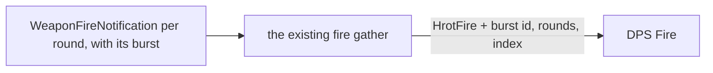
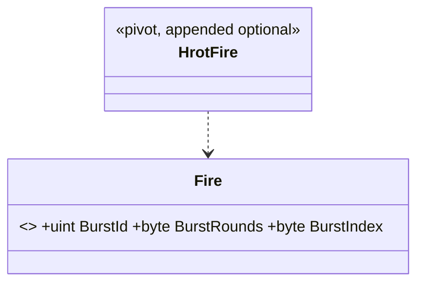
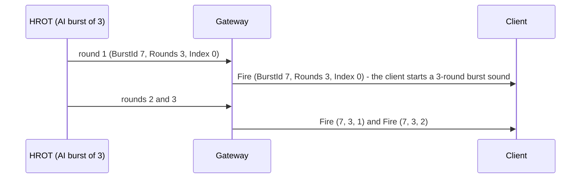
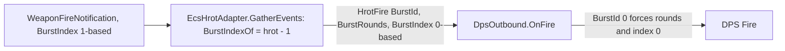

# DD-027: Bursts on `Fire` — which rounds the AI fired as one burst

| | |
|---|---|
| **Status** | approved rev 1 (R-147) |
| **Tasks** | T-065 (after HROT CE-11033) |
| **Rulings honoured** | R-147, R-133 (append-only), HROT R-11012 |
| **Related** | HROT `docs/DESIGN_Weapon_Layers.md` §5l (the AI's bursts and the `FireBurst` component) |
| **Date** | 2026-11-22 |

## 1. Context

🔒 User: *"I think we should send the burst information to the DPS instead of a single shot … cannot apply to player, because we never know how
long burst the player is going to do."* HROT (CE-11033) stamps each round's `WeaponFireNotification` with its burst (BurstId / BurstRounds / BurstIndex, HROT R-11013:
recordings may break); each round stays one `Fire` sample. The client may play a burst sound from the first round instead of N single ones.

## 2. Block diagram

## 3. Decisions

- D-1 **Append to `Fire`:** `uint BurstId` (0 = not a planned burst — a single aimed shot or a player's round), `byte BurstRounds` (the planned
  rounds), `byte BurstIndex` (0-based, this round's place). Rejected: a separate `Burst` topic (a client would join two topics per round).
- D-2 **Copied from the round:** the notification's own burst fields (⛔ SUPERSEDED: reading a `FireBurst` component on the shooter).
- D-3 Each round is still one sample (tracers, impacts, ammunition keep agreeing with the picture).

## 4. Class diagram

## 5. Sequence

## 6. Edge cases / 7. Tests

A player's rounds have BurstId 0; a burst cut short by the heat latch or a lost target ends with fewer Fire samples than `BurstRounds` (the
client stops its sound at the next gap); index order holds. Tests: rounds of one burst share the id with indices 0..N-1; singles and player
rounds are 0; the IDL gains lines only. Mutations: index not counted; a player's round given a burst.

## 8. Proposals / 9. As built

Approved (R-147).

## 9. As built (T-065, 2026-11-22)

HROT pin moved from `e2b43ab4c` to `a36176252` (`HROT_ROOT=/home/user/hrot-c5f8c1971`); the whole gateway built against it with no source change needed. The fields exist there: `WeaponFireNotification.BurstId / BurstRounds / BurstIndex`
(`FDP/Toolkits/Fdp.Toolkits/Combat/Events/WeaponFireEvents.cs`, 1-based index). Contract and IDL unchanged.

*What the picture shows:* the 1-to-0-based shift is the gateway's, in the HROT-facing gather; the pivot and the client only ever see 0-based.

| # | as built |
|---|---|
| 1 | `HrotFire` gained three optional trailing fields (`BurstId`, `BurstRounds`, `BurstIndex`, 0-based); existing constructors keep working. `EcsHrotAdapter.BurstIndexOf(id, hrotIndex)` = `hrotIndex - 1`, and 0 when `BurstId` is 0 or the index is 0 (never wraps to 255). |
| 2 | `DpsOutbound.OnFire` copies the three; a round with `BurstId` 0 is sent 0/0/0 whatever the other fields hold. Each round is still one `Fire` sample (D-3). The replay path (flash entities, no notification) sends 0/0/0. |
| 3 | Tests: `LookGatherTests` (stamp copied, index shifted for a 3-round burst, no burst = 0/0/0, shift for every value), `DpsOutboundTests` (3 rounds = 3 samples with one id and indices 0..2; id 0 = 0/0/0). |
| 4 | Defaults: none needed - every field has a source. |

Mutations (each reddened the named test, then restored): index not shifted -> `A_planned_burst_stamp_is_copied...` and `The_burst_index_shift_holds...`; stamp dropped in the gather -> `A_planned_burst_stamp_is_copied...`; `BurstId` dropped in `OnFire` -> `Every_round_of_a_burst_is_a_fire_sample...`; a round with no id given a burst -> `A_round_without_a_burst_id_goes_out_as_zero_zero_zero...`.
