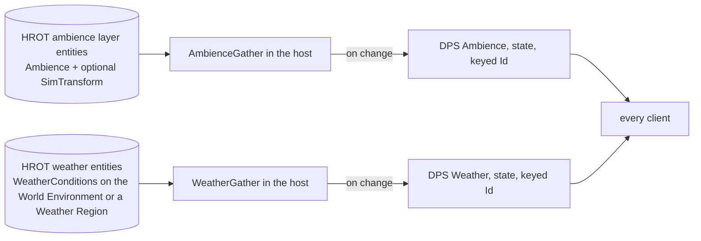
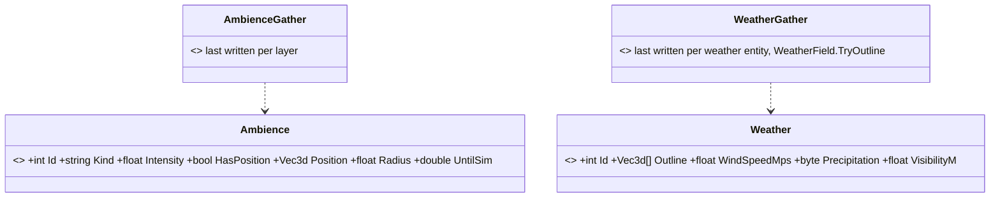
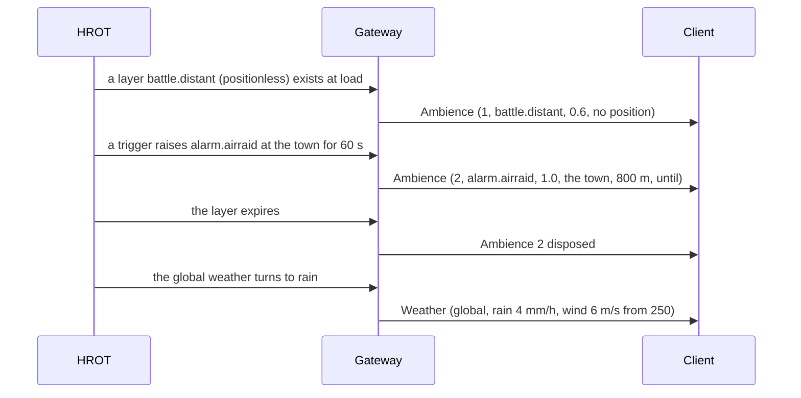
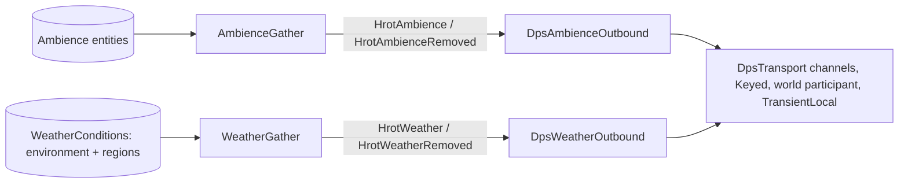

# DD-028: Ambience and weather on DPS — what a client plays and how the sky and air are

| | |
|---|---|
| **Status** | approved rev 1 (R-149) |
| **Tasks** | T-066 (after HROT CE-11034) |
| **Rulings honoured** | R-149, R-133 (append-only), R-135 (producer-neutral), R-140 (world topics once), HROT R-11014, R-11007 (effects from state) |
| **Related** | HROT `docs/designs/audio/DESIGN_Ambience.md` (the layers and the kinds), `docs/designs/weather/DESIGN_Weather_And_Time.md` (the weather entities); the Unreal note `NOTE_UnrealIg_To_Hrot_Battle_Ambience.md` (`unreal-ig` `0f2d9b4f1`) |
| **Date** | 2026-11-22 |

## 1. Context

🔒 User: *"indicate to the Unreal client what kind of ambient sound to play without knowing the exact name of the sound … more like a kind
ID"* → *"approved, write the design and reply to Unreal"*. HROT (CE-11034) keeps ambience layers as entities; its weather already replicates
inside HROT (`EntityWeather`). Neither reaches DPS today.

## 2. Block diagram

## 3. Decisions

- D-1 **`Ambience` (state: reliable, transient-local, keep-last 1, keyed `Id`; disposed when the layer goes):** `Id`, `Kind` (string 32, the
  dotted kind — a client falls back to the parent name it knows), `Intensity` (0..1), `HasPosition`, `Position` (Vec3d), `Radius` (m),
  `UntilSim` (0 = until disposed). Written once on the world partition. Rejected: an event per cue — a late joiner misses a siren sounding now.
- D-2 **`Weather` (state, keyed `Id`):** one row per HROT weather entity — `Outline` (≤ 32 points; empty = the global weather), `FeatherM`,
  surface wind (`WindFromDeg`, `WindSpeedMps`, `WindGustMps` — HROT's lowest level), `Precipitation` (kind) + `PrecipitationMmPerHour`,
  `VisibilityM`, `FogTopM`, `FogVisibilityM`, `CloudOctas` (lowest layer), `CloudBaseM`, `GroundTemperatureC`, `RelativeHumidity`. Rejected:
  every wind level and cloud layer — no client asked; append later. Rejected: the gateway blending regions per seat — the client picks the
  region its camera is in (a region's `Outline` and `FeatherM` are enough).
- D-3 **Both sent on change only** (a layer's or weather's own state changes rarely); counted in the render barrier's world state.
- D-4 **Producer-neutral names** (R-135); the kind list lives in HROT (`AmbienceKinds`) and is copied into the client guide.

## 4. Class diagram

## 5. Sequence

## 6. Edge cases and tests

A layer replaced (same kind and place) keeps its row with new values; a load disposes every row; a late joiner gets every live row; an
unknown kind is sent as is. Tests: create / replace / dispose / expiry rows; positionless vs positioned; weather global vs region with its
outline; on change only (0 writes while steady, 0 B per steady gather); written once with 2 seats; the IDL gains lines only. Mutations: a row
not disposed on expiry; written every frame; the outline dropped for a region.

## 7. Proposals / 8. Notes

Approved (R-149).

## 9. As built (T-066, 2026-11-22)

HROT pin moved from `e2b43ab4c` to `a36176252`; the gateway built with no source change. Sources there: `Ambience` (`FDP/Toolkits/Fdp.Toolkits/Ambience/Ambience.cs`), `WeatherConditions` / `WeatherField.GlobalOf` / `TryOutline` (`FDP/Toolkits/Fdp.Toolkits/Weather/`), `EditablePolyline`. Contract and IDL unchanged.

*What the picture shows:* the same pivot + module + keyed-state channel as `EntityStatus` (DD-025); two small modules, no new mechanism. The DIS side ignores the four pivot messages.

| # | as built |
|---|---|
| 1 | `AmbienceGather` / `WeatherGather` (host, called after `VoiceGather`; cleared at a world boundary so the new world states everything again). Id = the entity's network id, its slot index when it has none. An entity in `TearDown` (HROT's expiry marks it at once) or destroyed is withdrawn once. |
| 2 | On change only: a held layer or weather sends nothing; a steady gather allocates 0 bytes (rail, 300 gathers). Weather compares the mapped values plus the region's origin and relative points. |
| 3 | `DpsAmbienceOutbound` / `DpsWeatherOutbound` write once on the world participant (rail: one write with 2 seats); a disposal is sent only for a row that was written; a late joiner gets the current rows (TransientLocal rail). |

**Defaults and mappings chosen (a field HROT has no direct source for):**

| field | rule |
|---|---|
| `Ambience.Radius` of a positionless layer | 0 (HROT ignores it there) |
| `Ambience.Intensity` | clamped 0..1, non-finite = 0 |
| `Weather` global row | only when the world has a World Environment (`WeatherField.GlobalOf`); none = no row, the client keeps its own default (HROT would read its built-in ISA day) |
| `Weather.FeatherM` of the global weather | 0 (unused there) |
| surface wind | the USED wind level with the lowest altitude; no level = calm (0, 0, 0) |
| cloud | the used layer with the lowest base; no layer = 0 octas, base 0 |
| `FogVisibilityM` | HROT's value only when `FogTopM` > 0, else 0 (HROT's default 200 means nothing without fog) |
| `Precipitation` | HROT's number 0..5 = the contract's enum; out of range = None |
| Region outline | HROT's points are relative to the entity: sent as origin + point in the simulation frame, Z = the entity's Z; more than 32 points are sampled evenly down to 32 (first point kept). A weather entity with no outline of 3+ points or no position is no region (as `WeatherField`) |
| Not carried | pressure, lapse rate, further wind levels and cloud layers, cloud kind (D-2: no client asked) |

Mutations (each reddened the named tests, then restored): layer written while held -> `A_layer_is_sent...`, `A_steady_gather_allocates_nothing`; weather written while held -> `Weather_is_sent_on_change_only...`; layer disposal missed (host) -> `A_layer_is_sent...`, torn-down rail; disposal missed (DPS) -> `A_late_client_gets_the_current_state...`; region outline dropped (host and DPS) -> `Weather_is_sent_on_change_only...`, `Every_weather_field_reaches_the_topic...`; surface wind from the highest level -> `The_global_weather_has_an_empty_outline...`; a second write per row -> `Ambience_and_weather_are_written_once...`.
