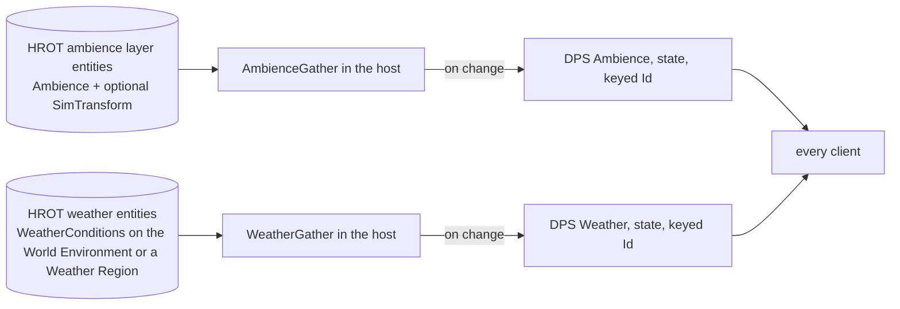
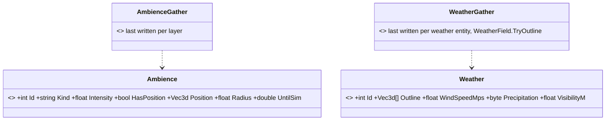
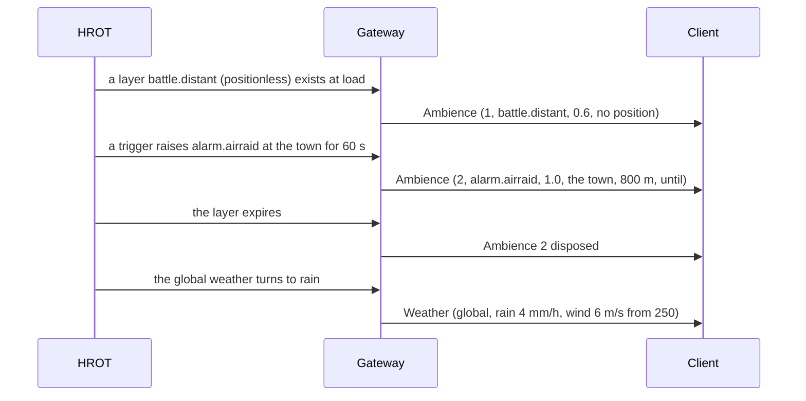

# DD-028: Ambience and weather on DPS — what a client plays and how the sky and air are

| | |
|---|---|
| **Status** | approved rev 1 (R-149) |
| **Tasks** | T-066 (after HROT CE-11034) |
| **Rulings honoured** | R-149, R-133 (append-only), R-135 (producer-neutral), R-140 (world topics once), HROT R-11014, R-11007 (effects from state) |
| **Related** | HROT `docs/designs/audio/DESIGN_Ambience.md` (the layers and the kinds), `docs/designs/weather/DESIGN_Weather_And_Time.md` (the weather entities); the Unreal note `NOTE_UnrealIg_To_Hrot_Battle_Ambience.md` (`unreal-ig` `0f2d9b4f1`) |
| **Date** | 2026-11-22 |

## 1. Context

🔒 User: *"indicate to the Unreal client what kind of ambient sound to play without knowing the exact name of the sound … more like a kind
ID"* → *"approved, write the design and reply to Unreal"*. HROT (CE-11034) keeps ambience layers as entities; its weather already replicates
inside HROT (`EntityWeather`). Neither reaches DPS today.

## 2. Block diagram

## 3. Decisions

- D-1 **`Ambience` (state: reliable, transient-local, keep-last 1, keyed `Id`; disposed when the layer goes):** `Id`, `Kind` (string 32, the
  dotted kind — a client falls back to the parent name it knows), `Intensity` (0..1), `HasPosition`, `Position` (Vec3d), `Radius` (m),
  `UntilSim` (0 = until disposed). Written once on the world partition. Rejected: an event per cue — a late joiner misses a siren sounding now.
- D-2 **`Weather` (state, keyed `Id`):** one row per HROT weather entity — `Outline` (≤ 32 points; empty = the global weather), `FeatherM`,
  surface wind (`WindFromDeg`, `WindSpeedMps`, `WindGustMps` — HROT's lowest level), `Precipitation` (kind) + `PrecipitationMmPerHour`,
  `VisibilityM`, `FogTopM`, `FogVisibilityM`, `CloudOctas` (lowest layer), `CloudBaseM`, `GroundTemperatureC`, `RelativeHumidity`. Rejected:
  every wind level and cloud layer — no client asked; append later. Rejected: the gateway blending regions per seat — the client picks the
  region its camera is in (a region's `Outline` and `FeatherM` are enough).
- D-3 **Both sent on change only** (a layer's or weather's own state changes rarely); counted in the render barrier's world state.
- D-4 **Producer-neutral names** (R-135); the kind list lives in HROT (`AmbienceKinds`) and is copied into the client guide.

## 4. Class diagram

## 5. Sequence

## 6. Edge cases and tests

A layer replaced (same kind and place) keeps its row with new values; a load disposes every row; a late joiner gets every live row; an
unknown kind is sent as is. Tests: create / replace / dispose / expiry rows; positionless vs positioned; weather global vs region with its
outline; on change only (0 writes while steady, 0 B per steady gather); written once with 2 seats; the IDL gains lines only. Mutations: a row
not disposed on expiry; written every frame; the outline dropped for a region.

## 7. Proposals / 8. As built

Approved (R-149). Not built.
