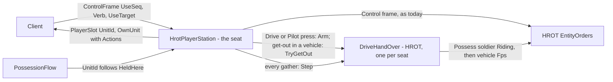
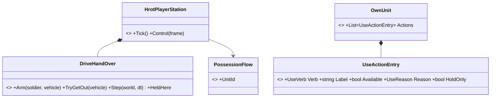
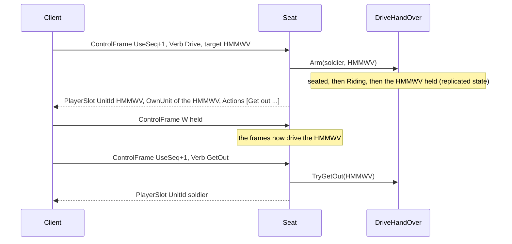

# DD-029: A remote seat drives what it boards, and sees HROT's whole verb list

| | |
|---|---|
| **Status** | approved (R-151) - built 2026-11-23 (T-070, review) |
| **Tasks** | T-070 |
| **Rulings honoured** | R-151, R-133 (append-only), R-135 (producer-neutral), R-146 (HROT gives meaning, the client the look) |
| **Related** | HROT `DESIGN_Entity_Control.md` §8h.10 (CE-11041, R-11019 — the shared `DriveHandOver`); the Unreal note `NOTE_UnrealIg_To_Ui_Remote_Drive_Handover.md` (HROT `unreal-ig` `4260bd6f1`); DD-017 (the DPS player station) |
| **Date** | 2026-11-23 |

## 1. Context and goals

Measured by the Unreal lane: a remote player who taps Drive on an empty vehicle is seated as its driver and never drives — the hand-over
(seat → ride the soldier → possess the vehicle) runs only in HROT's local screen. HROT moves it into one station-side class, `DriveHandOver`
(HROT §8h.10); this design is the gateway's half: the seat owns one, and `OwnUnit` carries the whole offered-verb list (today only the first
action). 🔒 User: *"Every piece of logic needs to be handled by HROT, so the client just sent what action was selected and the rest must happen
from the HROT."* · *"yes go ahead with 1 and 3, whatever needed for the unreal lane"*.

## 2. Block diagram

The seat arms HROT's own hand-over on the press the client already sends and steps it each gather; the flow's unit follows what the seat
holds, so `PlayerSlot` reports the vehicle and its `OwnUnit` (the vehicle's weapon slots: the lone driver fires the M2, HROT U-5). The verb
list is what `OperatorUseActions.For` already computes for the HUD (`HrotPlayerStation.cs:399`).

## 3. Decisions

- D-1 **No gateway rule**: the seat calls HROT's `DriveHandOver` (`Arm` on a Drive / Pilot press, `TryGetOut` on Get-out in a vehicle,
  `Step` each gather). Rejected: a gateway copy of the steps — two copies drift (the reason HROT moved them).
- D-2 **`PossessionFlow.UnitId` follows `DriveHandOver.HeldHere`** for the seat's station. Rejected: a new "you now drive X" message — the
  slot already names the unit.
- D-3 **`OwnUnit` gains `Actions`**, appended: `[DdsBound(8)] List<UseActionEntry>` with `{ UseVerb Verb; string Label (32); bool Available;
  UseReason Reason; bool HoldOnly }`, in HROT's order (the first is the primary, as `UseVerb` today). Sent with the rest of `OwnUnit` (on
  change). Rejected: a sibling topic — the list belongs to the same target and the same moment as the primary action.
- D-4 The client sends the chosen `Verb` back in `ControlFrame` (exists); what it means stays HROT's.

## 4. Class diagram

## 5. Sequence

## 6. Edge cases

- The hand-over times out (15 s, HROT's) or the soldier is released meanwhile: the seat stays on the soldier.
- The vehicle is destroyed while driven: HROT's orphan-rider release lets the soldier go; the slot follows what the seat holds.
- A vehicle already driven by another player: HROT refuses the seat (§8q); the action list shows it unavailable with its reason.

## 7. Test plan

- A Drive press on an empty vehicle: `PlayerSlot.UnitId` becomes the vehicle; a frame with W moves it; Get-out returns the soldier.
- `OwnUnit.Actions` equals `OperatorUseActions.For` for the target, in order, bounds 8 / 32; a refused verb carries its reason; on change only.
- Mutations: the seat never arms the hand-over; the flow does not follow `HeldHere`; the list dropped or reordered. The IDL gains lines only.

## 8. Proposals

Approved with the design (R-151).

## 9. As-built notes

Built 2026-11-23 (T-070) against HROT's `DriveHandOver` (CE-11041, `Hrot.Common/Orders/DriveHandOver.cs`); the classes and sequences above are true.

| part | as built | deviation, and why |
|---|---|---|
| the seat | `HrotPlayerStation` owns one `DriveHandOver(() => world, () => its EntityOrders)`; the station number of the seat is the identity (`EntityOrders.Station`), so HROT compares `PossessedBy.StationNodeId` with the seat's number | — |
| `Step` | called once per `Frame` (every gather), with the wall seconds since the last frame from the seat's own `NowMs` (tests move it); only while a scenario runs live and not while a recording is shown | HROT's local station steps with the frame `dt`; the seat has no frame `dt`, so its clock is wall time (the 15 s timeout is wall time too) |
| arming | `Control`: a NEW press (`UseSeq` moved) resolves, the way HROT's brain resolves it (`UseVerb` = an index into `OperatorUseActions.For`'s list for the frame's `UseTarget`), and an available Drive or Pilot arms the hand-over on the target vehicle | armed only for the possession flow (`PossessionFlow`), see below |
| Get out | a new press while the seat holds a vehicle with its soldier aboard (`DriveHandOver.RiderOf`) = `TryGetOut`; the press is not forwarded to the vehicle; once the slot is back on the soldier, his first frame carries it (`UseSeq` of the press, verb 0, the vehicle as target), as HROT's station queues it | ⭐ **the client's own press counter** is kept per unit: after the unit changes the forwarded `UseSeq` is the new unit's `OperatorUseStatus.UseSeq` (0 when it has none), so a press already acted on is not replayed on the vehicle; added, not drawn |
| the slot | `PossessionFlow(…, handOver)`: while Playing, `UnitId` follows `DriveHandOver.HeldHere` (the unit the seat holds as Fps) before the flow's own follow runs; while a hand-over or a Get out is pending the flow does not drop to Choosing when the unit it names is released (the possession is moving between two units) | the pending-hand-over guard was not drawn: a release can show before the soldier's possession does |
| `OwnUnit.Actions` | `UseActionEntry { Verb, Label (32), Available, Reason, HoldOnly }`, `[DdsBound(8)]`, appended at the END of `OwnUnit`; filled from `OperatorUseActions.For` in HROT's order (label = `HudWords.Label`); `DpsPlayerSlot` compares it with the last written (a copy: the station reuses its list) so it is sent on change only, 0 B steady. The IDL gained lines only; the protocol version is unchanged (appended fields have not bumped it) | — |

⚠ **Not done / open**
- HROT's deploy flow (`DeployFlowPlayerFlow`, the editor's) takes its unit from HROT's deploy flow, not from `PossessedBy`: the hand-over is armed for the possession flow only. A deploy-flow seat that drives needs the same follow there (a tracker row to file with HROT).
- `ControlFrame.Verb` (the enumeration) is mapped to HROT's verb NUMBER (`UseVerbOf`), but HROT's brain reads `UseVerb` as an INDEX into the offered list: a press that names Drive by enumeration is refused as nothing to do unless Drive happens to be at that index. The client can send the entry's position in `UseVerb` (the note says so). Aligning the name with the index (resolve a named verb to its position in the list for the target) is a small follow-up, not built here (it would change `UseVerbOf`'s tested meaning).
- While the seat drives the vehicle its own `OwnUnit.Actions` is HROT's list for the VEHICLE as the acting unit (usually empty): Get out is any new press, as on HROT's station (E), not a listed verb.
- A destroyed vehicle: the slot goes Dead on it (HROT's rule for a unit out of the fight) until the soldier is let go and the seat joins again.
