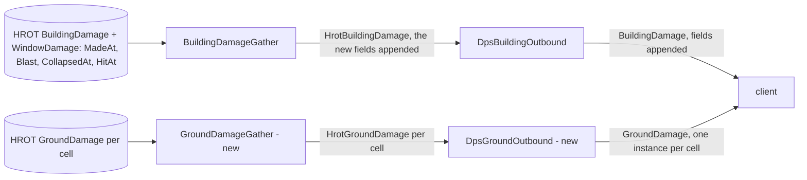
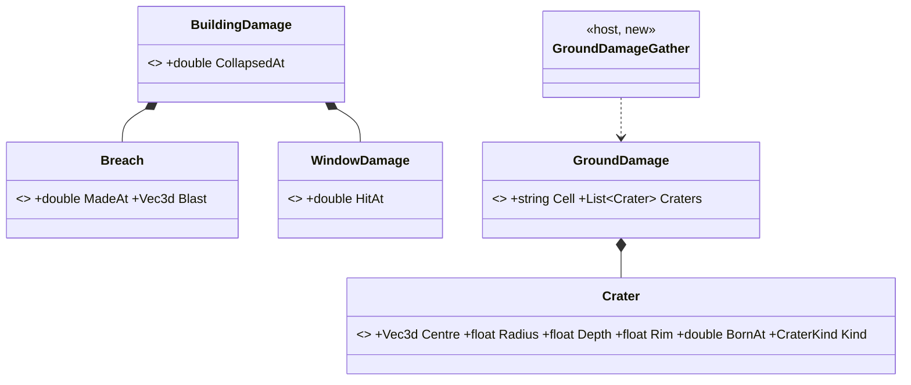
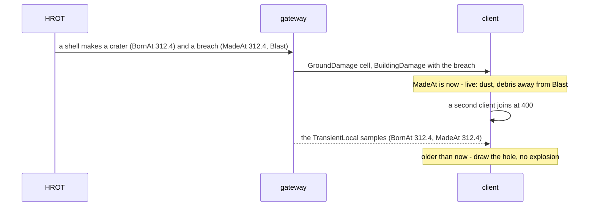

# DD-030: Building damage carries when and where from; craters on DPS

| | |
|---|---|
| **Status** | approved (R-152) |
| **Tasks** | T-074 |
| **Rulings honoured** | R-152, R-133 (append-only), R-135 (producer-neutral), R-146 (HROT gives meaning, the client the look) |
| **Related** | HROT CE-11051 (the damage records' times and blast points, terrain lane, UTM §8.3a); HROT `NOTE_Ui_To_UnrealIg_Rounds_And_Building_Damage_Decisions.md`; the Unreal note `NOTE_UnrealIg_To_Ui_Missiles_And_Building_Damage.md` (`5c36842fa`) §2.2; DD-018 / DD-020 (`BuildingDamage`) |
| **Date** | 2026-11-24 |

## 1. Context and goals

The Unreal client draws building damage from DPS `BuildingDamage`. It must tell a LIVE change (dust, debris, glass) from the state at JOIN
(a TransientLocal sample — no replay), and throw debris away from the blast. 🔒 User: *"Can't we stamp the damage records with time in HROT as
well, so that we do not invent another timestamping just in the gateway?"* — HROT now records them (CE-11051): per breach `MadeAt` and
`BlastX/Y/Z`, the building's `CollapsedAt`, per window `HitAt` (0 = from a save). And craters reach no client today: HROT's `GroundDamage`
(per 64 m cell, ≤ 16 craters: centre, radius, depth, rim, `BornAt`, kind) has no DPS topic. 🔒 User: *"feel free to continue with the crater
topic in gateway"*.

## 2. Block diagram

The gateway COPIES HROT's values — it stamps nothing of its own. Both topics are state (Discrete, Reliable, TransientLocal): a joining client
gets the current damage with the times it happened, and compares them with the sim time to know it is not live.

## 3. Decisions

- D-1 `Breach` gains `MadeAt` (double, sim s; 0 = unknown, from a save) and `Blast` (Vec3d, the simulation frame); `WindowDamage` gains `HitAt`;
  `BuildingDamage` gains `CollapsedAt` — appended (R-133). Rejected: the gateway's own first-seen stamp — a second clock beside HROT's record.
- D-2 New topic **`GroundDamage`**, one instance per HROT cell: key `Cell` = `"<cellX>,<cellY>"` (the record's own identity), a list of
  craters `{ Centre (Vec3d, z = the ground at the centre), Radius, Depth, Rim, BornAt, Kind (CraterKind name or enum) }`, ≤ 16. Disposed
  when the cell has none. Rejected: one instance per crater — HROT keeps them per cell; a crater has no id of its own.
- D-3 Change-only, written once on the world partition, like `BuildingDamage`.

## 4. Class diagram

## 5. Sequence

## 6. Edge cases

A value 0 (from a save) = unknown age: draw, never animate. A cell emptied (HROT removes its record) disposes its instance. A world boundary
forgets and re-sends. A crater on a replica cell (another node's) is sent like any other HROT state.

## 7. Test plan

The new fields copied exactly (breach, window, collapse); a crater gives one cell instance with its craters in HROT's order; held = no write; an
emptied cell disposes; a late joiner gets the current state; written once with 2 seats; 0 B steady; the IDL gains lines only.
Mutations: a field not copied; a crater dropped; written while held; not disposed.

## 8. Proposals

Approved with the design (R-152).

## 9. As-built notes

Not built.
