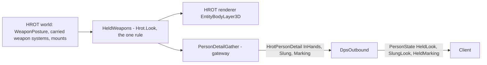
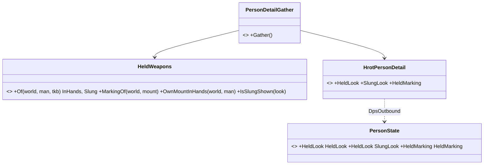
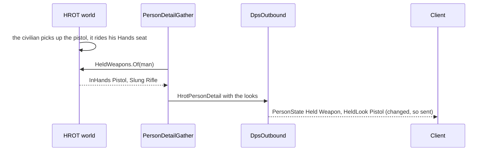

# DD-031: What a person holds, as HROT draws it (the held-weapon look)

| | |
|---|---|
| **Status** | approved (R-153), built (T-076, in review) |
| **Tasks** | T-076 |
| **Rulings honoured** | R-153, R-133 (append-only), R-146 (HROT gives meaning, the client the look) |
| **Related** | HROT `Hrot.Look` `HeldWeapons` (moved from `Hrot.Presentation/Map3D`, HROT CE-11055); DD-018 / DD-020 (`PersonState`); the Unreal note `NOTE_UnrealIg_To_Ui_Civilian_Weapons_And_Throws.md` (HROT `unreal-ig` `653051d4a`) |
| **Date** | 2026-11-24 |

## 1. Context and goals

`PersonState` says `Held = Weapon` and the active mount, not WHICH weapon. A civilian's picked-up pistol or rifle (HROT CE-3233) is a weapon-system
ENTITY in one of his carry seats (Hands / Back / Hidden), not one of his type's mounts, so a client reading his `TkbType` cannot find it. HROT's own
renderer answers the question with ONE rule, `HeldWeapons.Of(world, man, tkb)` (what is in the hands and what is slung) and `HeldWeapons.MarkingOf`
(a toy, a less-lethal launcher). It moves to `Hrot.Look` so the gateway calls the same rule (the CE-11005 / CE-4671 precedent). 🔒 User: *"Yes go"*.

## 2. Block diagram

The renderer and the gateway call the same function, so the client draws what HROT draws.

## 3. Decisions

- D-1 **The gateway calls `Hrot.Look.HeldWeapons`**. Rejected: a gateway copy of the rule (two copies drift); the client reading mounts from `TkbType` (cannot see a picked-up weapon).
- D-2 **HROT's finer vocabulary (`HeldLook`: Rifle, Pistol, MachineGun, ScopedRifle, Rpg, MissileTube, Manpads, Mortar, Bow, Crossbow)**, not the observer's `ItemLook`. Rejected: `ItemLook` - files a machine gun, an RPG and a missile tube under "Rifle" on purpose (what an AI concludes it sees), not what is drawn.
- D-3 **`PersonState` appends `HeldLook`, `SlungLook`, `HeldMarking`** (sent with the rest of `PersonState`, on change). `HeldLook` is meaningful only while `Held = Weapon`; `SlungLook` is drawn only where HROT shows a slung weapon (`HeldWeapons.IsSlungShown`, sent as is). DPS enums `HeldLook_*` (Rifle = 0), `HeldMarking_*` (None = 0).
- D-4 **The carried weapon entity itself**: if the gateway publishes it as an entity of its own while it rides a man's carry seat, the client would draw it twice; measured in T-076 and, if so, the rule HROT's renderer uses for a carried weapon (drawn in the hands, not as an object) is followed - reported in the as-built notes.

## 4. Class diagram

## 5. Sequence

## 6. Edge cases

- No `WeaponPosture` or not a life form: the defaults (Rifle, Rifle, None) with `Held = None`.
- A man who just fired a launcher shows a tube in HROT for a moment (`EntityBodyLayer3D` CE-1090): a renderer effect, not sent.
- A toy (looks like a rifle, fires nothing): `HeldMarking_Toy`.

## 7. Test plan

- A civilian with a picked-up pistol: `HeldLook_Pistol`; a rifle: `HeldLook_Rifle`; a soldier's machine gun: `HeldLook_MachineGun` - each equal to `HeldWeapons.Of` on the same world.
- Change only: a steady man sends nothing; switching weapon sends one sample.
- The IDL gains lines only; 0 B steady gather.
- Mutations: the look not copied; the slung and in-hands swapped; the marking dropped.

## 8. Proposals

Approved with the design (R-153).

## 9. As-built notes

Built (T-076). The classes and sequences of sections 4 and 5 are as drawn.

- **HROT half (CE-11055).** `HeldWeapons.cs` (`HeldLook`, `HeldMarking`, `HeldWeapons`) moved by `git mv` from `Hrot.Presentation/Map3D` to `Hrot.Look/People/HeldWeapons.cs`, verbatim except its one Presentation dependency (`WeaponKits.TypeOf` -> `FiringBlasts.TypeOf`, the call `WeaponKits` forwards to). The **namespace `Hrot.UI.Common.Map3D` is kept** (the CE-4671 LK-S1 precedent), so no caller changed. Proof: Hrot.Look, Hrot.Presentation and its tests build; `Hrot.Presentation.Tests` (Map3D, person outfits, block figure, held, body-layer classes, under `xvfb-run -a`) 257 passed 0 failed 0 skipped; `Hrot.Look.Tests` 58 passed.
- **Pivot and contract.** `HrotPersonDetail` appends `HeldLook`, `SlungLook` (`HrotHeldLook`) and `HeldMarking` (`HrotHeldMarking`), defaults Rifle / Rifle / None. `PersonDetailGather` maps HROT's enums to them BY NAME (a member HROT appends falls back to Rifle / None); `DpsOutbound` copies pivot to contract by number, which a rail pins (`The_pivot_look_enums_mirror_the_contracts_by_name_and_order`). `PersonState` gained the three fields at its END; the IDL gained 24 lines and lost none. No new topic.
- **Guard.** The gather calls `HeldWeapons.Of` / `MarkingOf` only for a person that has `WeaponPosture` (section 6: none = the defaults). HROT's renderer is narrower still: it calls `Of` and `MarkingOf` only for a man whose type is a soldier (`look.Soldier`) and shows the marking only while his held item is None. The gateway sends HROT's answer for every person with a posture and leaves that choice to the client (the fields are meaningful while `Held` is Weapon).
- **0 B steady.** `HeldWeapons.Of` / `OwnMountInHands` / `MarkingOf` allocate nothing in a steady gather, measured with a soldier, a toy gunner, a civilian with a picked-up pistol (rail `A_steady_person_gather_with_a_held_look_allocates_nothing_and_sends_nothing`, 0 B over 400 gathers). Whole-adapter steady gathers of a world with such men allocate about 187 B per gather with or without this change (measured with the new block disabled): pre-existing, outside T-076.
- **D-4 measured.** `EcsHrotAdapter`'s entity query (`SimTransform`, `TkbIdentity`, `NetworkIdentity`, not a record or a door) does NOT exclude an embarked weapon system: a picked-up weapon with a network id riding a man's carry seat is published as an entity of its own (rail `D4_...`, pinning what is). Nothing changed. HROT's renderer (`EntityBodyLayer3D`) draws such a weapon as a carried object after the figures (pass 2, `DrawCarried`: in the hands level, a pistol on the hip when stowed, a rifle slung on the back) and skips it when the bearer shoulders it or holds it as his load (`HeldWeapons.Of` `fromLoad`) or when its station is concealed; a soldier's hands figure also shows the held look, so for a soldier the carried object and the figure's own look are one drawing. A client that draws both the weapon entity and `HeldLook` for the same man would draw the weapon twice: the decision (hold the entity back while it rides a carry seat, or send a flag) is the coordinator's and is not taken.

