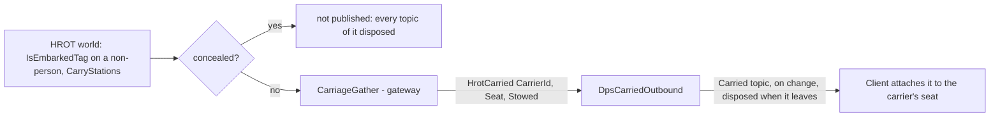
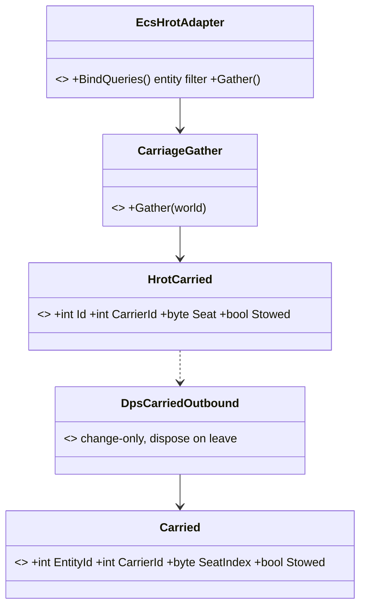
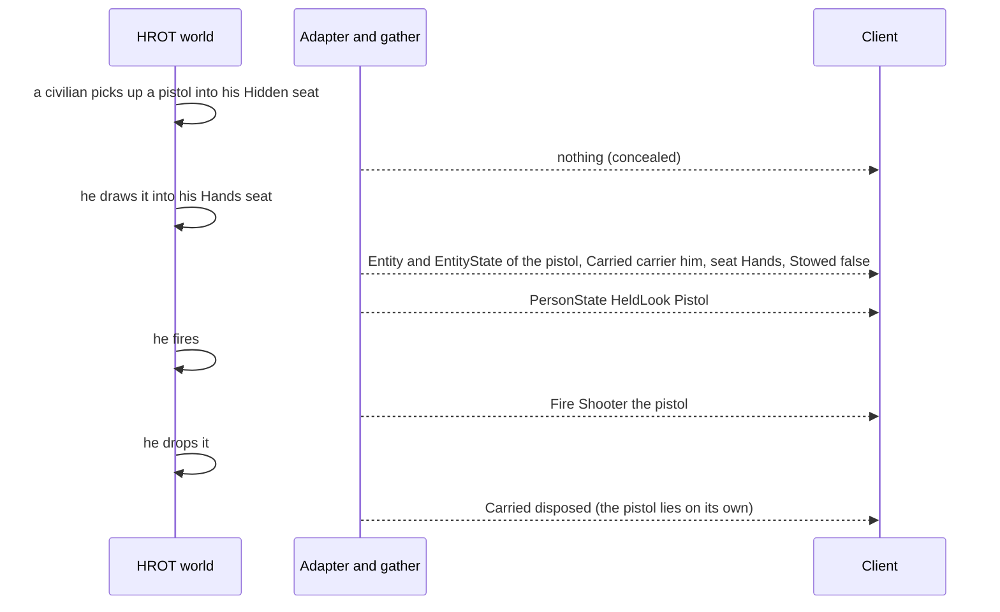

# DD-032: A carried entity says what carries it; a concealed one is not sent

| | |
|---|---|
| **Status** | approved (R-154) - building 2026-11-24 (T-077) |
| **Tasks** | T-077 |
| **Rulings honoured** | R-154, R-133 (append-only), R-135 (producer-neutral), R-146 |
| **Related** | DD-031 (D-4, the measurement that found it); DD-018 §Riders (`PersonState` seat fields: persons only); HROT `EntityBodyLayer3D.DrawCarried` (`:1734-1739`), `CarryStations.IsConcealed / IsStowed`, `Embarkation`; the Unreal notes on civilian weapons (`653051d4a`) and passenger seats (`af6d4f6cb`) |
| **Date** | 2026-11-24 |

## 1. Context and goals

A NON-person riding a carrier - a picked-up pistol in a man's Hands seat, a stowed rifle on his Back, the UH-60's M134 in its door station -
is published as an ordinary entity: nothing on the wire says it rides anyone (seat facts exist only in `PersonState`). Its `EntityState` is
the carrier's reference point (a station weapon: its station), so a client draws it loose. It must stay published: a carried weapon fires
as ITSELF (`Fire.Shooter`, HROT `AimAndFireExecutor.cs:120`). And a CONCEALED one (a pistol in the Hidden seat, a worn charge) is skipped by
HROT's renderer and its observers, but today a client would show it. 🔒 User: *"Yes"* (to: send carrier and seat, drop concealed).

## 2. Block diagram

## 3. Decisions

- D-1 **A new Discrete topic `Carried`** `{ [key] EntityId; CarrierId; byte SeatIndex; bool Stowed }`, Reliable, TransientLocal, KeepLast 1;
  one instance per non-person entity while it rides a carrier; disposed when it leaves. `SeatIndex` is the index into the carrier's seat
  list (the same meaning as `PersonState.SeatIndex`); `Stowed` = HROT's `CarryStations.IsStowed` (on the back / the hip, not in the hands).
  Rejected: fields on `Entity` (Fixed rate, sent once - the carrier changes) or on `EntityState` (Continuous - a discrete fact in every
  motion sample, DD-020 rate classes); persons (they have `PersonState`'s seat fields - not repeated here).
- D-2 **A concealed carried entity is not published at all** (`CarryStations.IsConcealed`): none of its topics; when it becomes concealed
  its instances are disposed, when it is drawn it appears (with its `Carried`). It cannot fire while concealed (HROT's fire gates skip a
  stowed seat), so no `Fire` names a missing shooter. Rejected: a `Concealed` flag (the client would hold what it must not show).
- D-3 **The client's rule** (written into the client guide): attach a `Carried` entity to its carrier's seat; a weapon in a person's HANDS
  seat is the one `PersonState.HeldLook` names (draw it once, with that look; the entity is the anchor of its shots); a `Stowed` one on
  the back / hip; a station weapon (the door gun) at the carrier's seat.

## 4. Class diagram

## 5. Sequence

## 6. Edge cases

- The carrier is not published (filtered, or not yet): `CarrierId` is still its network id; the client waits for it, as for `SeatVehicleId`.
- A carrier dies or is removed: HROT's orphan rule frees the rider; `Carried` is disposed when its tag goes.
- A world boundary (`Session.WorldEpoch`): the client drops everything, as for every topic.

## 7. Test plan

- A pistol in Hands: `Carried` names the man and the seat, `Stowed` false; on the Back: `Stowed` true; the UH-60 M134: carrier the
  helicopter, seat 9; dropped: disposed. Each equal to HROT's `IsEmbarkedTag` / `CarryStations` on the same world.
- Concealed: no topic of it is written; drawn: it appears; stowed back into Hidden: its instances disposed.
- Change only, 0 B steady; the IDL gains lines only; `AllTopics` count +1.
- Mutations: the concealed filter removed; `Stowed` inverted; the dispose on leave dropped; persons not excluded.

## 8. Proposals

Approved with the design (R-154).

## 9. As-built notes

(to be filled by T-077)
