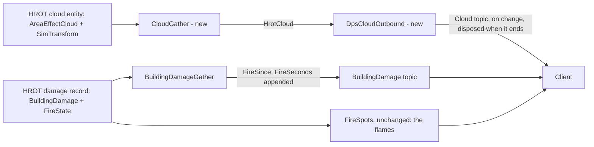
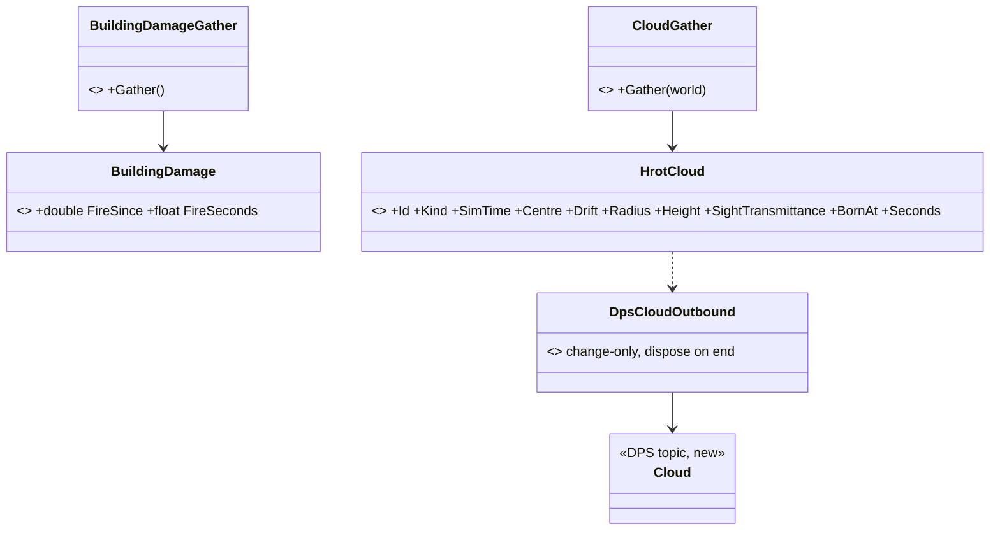
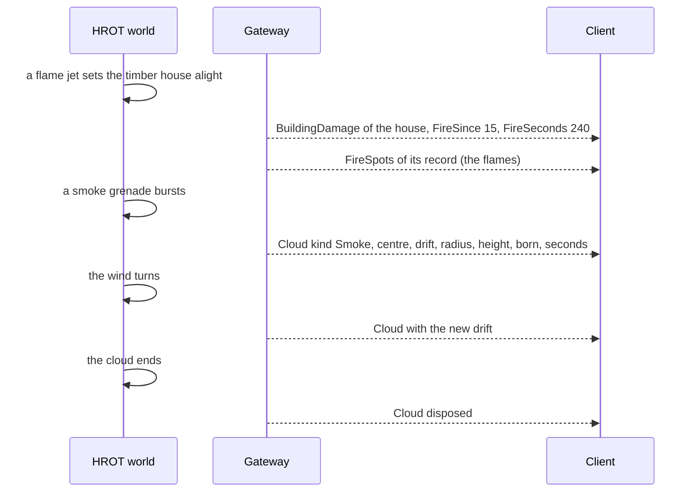

# DD-033: A burning house by its key, and smoke and gas clouds

| | |
|---|---|
| **Status** | approved (R-155) - building 2026-11-24 (T-078) |
| **Tasks** | T-078 |
| **Rulings honoured** | R-155, R-133 (append-only), R-135 (producer-neutral), R-146 |
| **Related** | DD-030 (`BuildingDamage`, `GroundDamage`); `FireSpots` (DD-018 rounds); HROT `BuildingFires.cs` + `BuildingDamageSystem.ApplyFire` (CE-3488), `AreaEffectClouds.cs` (CE-3219 part 3); the Unreal note `NOTE_UnrealIg_To_Ui_Fire_On_The_Wire.md` (`40f50597a`) and its answer |
| **Date** | 2026-11-24 |

## 1. Context and goals

① A building's fire is ONE `FireState` spot on its damage record (HROT CE-3488); `FireSpots` already sends it, but its holder is the damage
record, which a client never gets as an `Entity` - it cannot tell WHICH house burns, so it cannot light, smoke and char the house.
② Smoke and gas clouds (`AreaEffectCloud`: smoke grenades, tear gas, smoke dischargers) are replicated entities that block sight in HROT and
have no DPS topic. 🔒 User: *"Do number 1 and 2."*

## 2. Block diagram

## 3. Decisions

- D-1 **`BuildingDamage` appends `FireSince` (s, 0 = never burned) and `FireSeconds`** from the SAME record's `FireState` (its one spot,
  HROT v1: one fire per building). Burning = `FireSince <= now < FireSince + FireSeconds`; burnt out after. `FireSpots` keeps the flames
  (unchanged). Rejected: a building key on `FireSpots` (a spot list is not a house); a separate topic (the record is already keyed by house).
- D-2 **A new Discrete topic `Cloud`** `{ [key] CloudId; CloudKind Kind; double SimTime; Vec3d Centre; Vec3f Drift; float Radius, Height;
  float SightTransmittance; double BornAt; float Seconds }`, Reliable, TransientLocal, KeepLast 1; `Centre` is the cylinder's base centre at
  `SimTime`, `Drift` its velocity (the wind's), so the client moves it itself (DD-020: a moving value is a start + rate); re-sent when the
  drift, size or kind changes; disposed when the cloud ends. `CloudKind_None / _TearGas / _Smoke` in HROT's order.
- D-3 **The cloud entity is not ALSO published as a plain `Entity`** (it has no body; the `Cloud` topic is its whole truth), filtered in the
  adapter's one entity loop like `BuildingDamage` records. Rejected: both (a client would see a bodiless entity it cannot draw).

## 4. Class diagram

## 5. Sequence

## 6. Edge cases

- A loaded save: HROT's record has no `FireState` after a load unless it was saved - `FireSince` 0 (never burned, as sent).
- A cloud whose size changes over time: measured in T-078; if HROT grows it, the growth is re-sent as a rate or on change (as-built notes).
- Many clouds at once (a smoke screen): one instance each; change-only, so a steady cloud costs nothing after its first sample.

## 7. Test plan

- A house set alight: its `BuildingDamage` carries `FireSince` / `FireSeconds` equal to the record's `FireState` spot; a brick house never.
- A smoke cloud and a tear-gas cloud: `Cloud` fields equal HROT's `AreaEffectCloud` + `SimTransform` (+ drift); wind change ⇒ one sample;
  end ⇒ disposed; the cloud entity never appears as `Entity`. Change only, 0 B steady; IDL gains lines only; `AllTopics` +1.
- Mutations: fire fields not copied; drift dropped; dispose on end dropped; the cloud entity not filtered.

## 8. Proposals

Approved with the design (R-155).

## 9. As-built notes

(to be filled by T-078)
