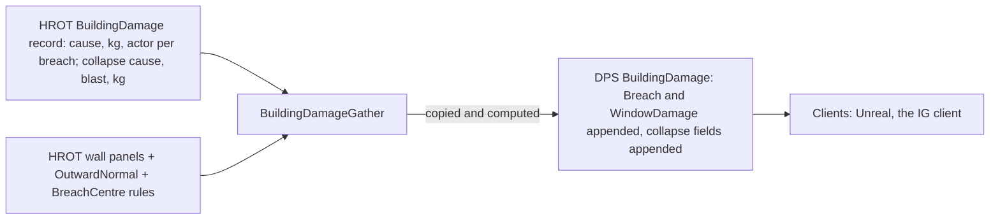
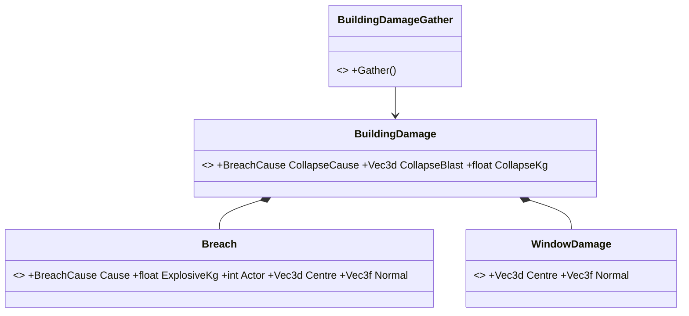
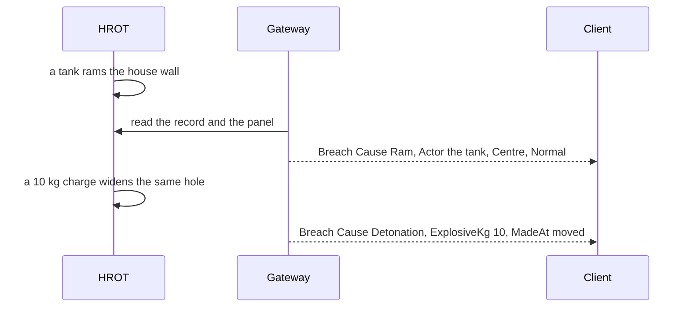

# DD-034: What made a breach, and where it is in the world

| | |
|---|---|
| **Status** | approved (R-156) - building 2026-11-25 (T-075, widened) |
| **Tasks** | T-075 |
| **Rulings honoured** | R-156, R-152 (HROT stamps, the gateway copies), R-133 (append-only), R-135 (producer-neutral), R-146 |
| **Related** | DD-030 (`MadeAt`, `Blast`, craters); HROT CE-11054 (the record's cause, kg, actor and collapse fields - `HANDOFF_Ui_To_Terrain_Breach_Cause.md` §2a), HROT's one outward-normal and breach-centre rules; the notes `NOTE_UnrealIg_To_Ui_Breach_Cause.md` (`1c2d48a19`) and `NOTE_IgClient_To_Ui_Breach_Cause.md` (`ig-client-notes` `46ad6ddd5`) |
| **Date** | 2026-11-25 |

## 1. Context and goals

Two image generators draw a breach differently by its CAUSE (a detonation scorches and throws debris out; a ram or a blade pushes the wall in)
and cannot tell it from `Blast` alone. The second client also has its OWN building geometry, not HROT's panels, so it needs the breach's
PLACE in the world. HROT records the cause, the charge's kg, the ramming vehicle and the collapse's cause (CE-11054); the gateway copies them
and computes the world place with HROT's own rules. 🔒 User: *"Ok, just pls do the terrain parts yourself if the changes are small"* (on the plan).

## 2. Block diagram

## 3. Decisions

- D-1 **`Breach` appends** `BreachCause Cause` (`BreachCause_Unknown = 0, _Detonation, _Ram, _Blade, _Push`, HROT's order), `float ExplosiveKg`
  (0 unless a detonation), `int Actor` (the ramming / blading vehicle's entity id, 0 otherwise), `Vec3d Centre` (the hole's middle in the
  world), `Vec3f Normal` (the wall's outward normal, horizontal). Copied from HROT's record; `Centre` / `Normal` from HROT's rules, never a
  gateway formula.
- D-2 **`WindowDamage` appends** `Vec3d Centre`, `Vec3f Normal` - the opening's middle and its wall's outward normal, by HROT's rules.
- D-3 **`BuildingDamage` appends** `BreachCause CollapseCause`, `Vec3d CollapseBlast`, `float CollapseKg` (0 / Unknown while standing).
- D-4 `MadeAt == 0` (a loaded save): `Cause` and `ExplosiveKg` are kept (saved in HROT), `Actor` is 0. Rejected: a separate "cause" topic -
  the cause belongs to the breach, at the same moment.

## 4. Class diagram

## 5. Sequence

## 6. Edge cases

- A merged hole (a ram widened by a blast): `Detonation`, the larger kg (HROT's merge rule).
- A free wall (no building): its normal is the left-hand perpendicular of the panel (HROT's documented rule).
- An actor the client does not know: the client ignores it (as for any id).

## 7. Test plan

- Each field equals HROT's record / rule on the same world: a blast, a ram, a blade, a merge, a collapse; a window's centre and normal.
- Change only, 0 B steady; IDL gains lines only.
- Mutations: cause not copied; centre computed off the wrong end; normal not outward; collapse fields dropped.

## 8. Proposals

Approved with the design (R-156).

## 9. As-built notes

Built as designed (D-1..D-3, same files as T-074: `BuildingDamageGather`, `HrotMessages`, `DpsTopics` / `DpsTypes`, `DpsBuildingOutbound`). Deviations and facts worth knowing:

- **Pivot shape.** The cause travels as the NAME of HROT's `BreachCause` (like `Kind`), the outbound maps it by name to the DPS enum, an unknown name to `Unknown`. `HrotBreach` / `HrotWindowDamage` / `HrotBuildingDamage` gained the fields as trailing defaulted members.
- **Frame.** `Centre`, `Normal` and `CollapseBlast` are HROT's terrain-local metres, copied as `Blast` is (no conversion); `Normal` is `(x, y, 0)` from `WallGroups.OutwardNormal`, `Centre` is `WallGroups.BreachCentre` (both computed once per breach per gather, allocation-free).
- **Merge across entities.** Cause and kg of one breach held by several damage entities merge by HROT's own `SavedBuildingDamage.Merge` (Detonation wins, larger kg; by arrival order, as HROT's save does); the actor follows HROT's `MergeOrigin` (the later-stamped entity's when it names one, else the other's). The collapse's blast point follows the entity with the latest `CollapsedAt`.
- **Window centre: resolved by HROT CE-11058.** HROT had no ONE rule placing an opening in the world (the glass pane leaves, `AimPoint` and the inverse `WindowDamage.PaneUv` each did it inline, and `TerrainOpening.At` is the opening's START along the panel); `WallGroups.OpeningCentre` / `OpeningSpan` now is that rule and the gather calls it (`A + dir * (At + Width / 2)`, z = (Sill + Head) / 2). The gateway's interim copy `WindowCentre` was deleted. An opening index the panel does not have (synthetic data only) sends a zero centre rather than throwing. A test still recomputes the centre independently from the panel.
- **Standing building.** `CollapseCause` / `CollapseBlast` / `CollapseKg` are sent only while `Collapsed` (a stale record value is not sent), as `CollapsedAt` is.
- **Protocol version** stays 1.0 as for T-074 (appended fields, R-133); the IDL only gained lines (`IdlSnapshotTests` and the prefix test in `DpsTopicTests`).
