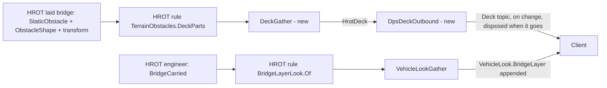
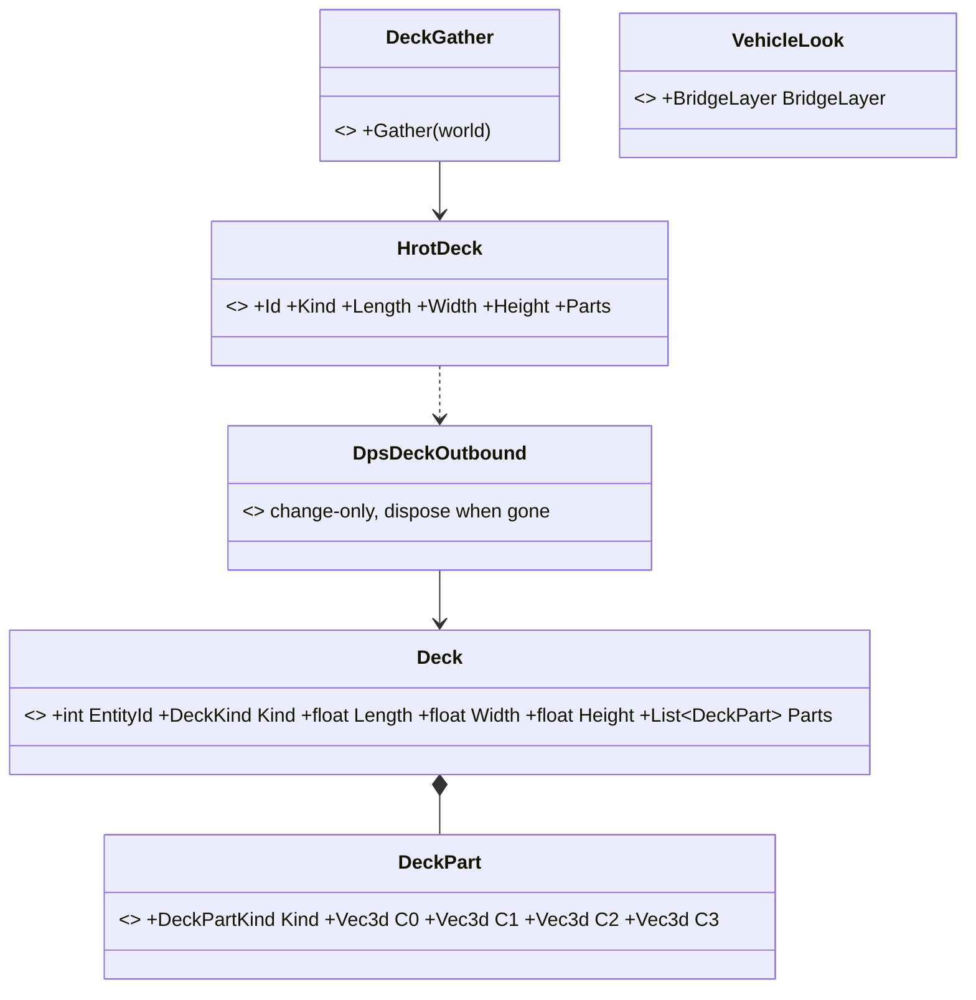
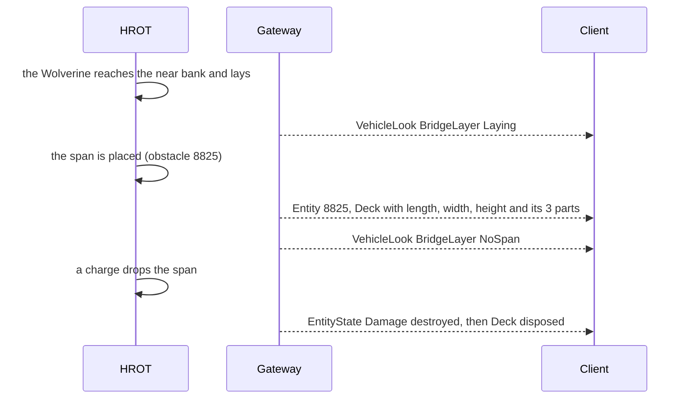

# DD-035: Laid bridges and the bridge layer on DPS

| | |
|---|---|
| **Status** | approved (R-158) - building 2026-11-26 (T-083) |
| **Tasks** | T-083 |
| **Rulings honoured** | R-158, R-133 (append-only), R-135, R-146 (HROT gives the meaning, the client the look); one HROT rule per derived fact (R-157) |
| **Related** | HROT `docs/designs/engineering/DESIGN_Bridge_Laying.md` §11 (the laid deck, CE-4692) and §12f (the engineer, CE-4693); HROT `NOTE_Backend_To_Ui_Bridge_Laying.md`; DD-018 (`VehicleLook`) |
| **Date** | 2026-11-26 |

## 1. Context and goals

HROT's engineers lay and recover bridges during play (CE-4692 / CE-4693). A LAID span is a static obstacle entity — TKB 8825 (assault bridge) / 8826 (floating
bridge), DIS kind 5 — whose per-instance `ObstacleShape` (Length = the span between the deck ends, Width, Height = the deck above the bank) is centred on the entity
along its heading; HROT's terrain draws ONE deck and two ramps (`DeckGeometry`, ramps at 1 : 4) and its units walk on exactly that. The layer vehicles (118 an
M104 Wolverine, 119 an Improved Ribbon Bridge transporter) show `BridgeLayerLook.Of`: Carried / Laying / Recovering / NoSpan. The gateway sends none of it.
🔒 User: *"yes go ahead"* (to the deck topic, the layer state, the note).

## 2. Block diagram

## 3. Decisions

- D-1 **A new Discrete topic `Deck`**: `{ [key] EntityId; DeckKind Kind (Assault, Floating — from the obstacle's TKB type); float Length, Width, Height;
  [DdsBound(3)] List<DeckPart> Parts }`, `DeckPart { DeckPartKind Kind (Deck, Ramp); Vec3d C0, C1, C2, C3 }` — the corners' x, y in the sim frame and z = the height
  ABOVE THE GROUND under that corner (HROT's ground-relative rule: the client adds its own terrain height, as HROT does). Reliable · TransientLocal · KeepLast 1;
  one instance per STANDING laid bridge; on change; disposed when the obstacle goes (recovered, or fallen at Health 0 — a fall can be told from a recovery by the
  entity's `EntityState.Damage` destroyed before the dispose).
- D-2 **The corners come from ONE HROT rule**, `TerrainObstacles.DeckParts(position, yaw, shape)` — extracted from `DeckOf` (`StaticObstacles.cs:114-118`) so the
  terrain and the gateway share it; never a gateway copy of the clamps or the ramp rule.
- D-3 **`VehicleLook` appends `BridgeLayer`** (`BridgeLayer_NoSpan = 0, _Carried, _Laying, _Recovering`, HROT's `BridgeLayerState` order) from
  `BridgeLayerLook.Of` — sent for the two engineer types, NoSpan for every other vehicle. No progress (HROT has none on the wire in v1, BL-21).
- D-4 The obstacle stays a plain `Entity` too (its type, its damage); a client draws it from `Deck`, never as a box.
- Rejected: shape fields only, the client building the ramps (a second copy of HROT's ramp rule) · world z for the corners (the client's terrain is HROT's
  heights; ground-relative is how HROT itself draws them) · a progress value (none in HROT).

## 4. Class diagram

## 5. Sequence

## 6. Edge cases

- A bridge placed by the scenario (not laid): the same obstacle ⇒ the same `Deck`.
- A floating bridge: the same deck rule (its own TKB figures).
- Constructing (held until its bake commits): sent once it stands, as HROT's terrain draws it.

## 7. Test plan

- A laid 8825 / 8826: `Deck` kind, sizes equal `ObstacleShape`, parts equal `TerrainObstacles.DeckParts`; recovered / fallen ⇒ disposed; change-only, 0 B steady.
- A layer vehicle in each `BridgeLayerState` ⇒ `VehicleLook.BridgeLayer` equal `BridgeLayerLook.Of`; a plain vehicle NoSpan.
- IDL gains lines only; `AllTopics` +1. Mutations: a part's corners from the wrong end; dispose dropped; the layer state not copied.

## 8. Proposals

Approved with the design (R-158).

## 9. As-built notes

(to be filled by T-083)
