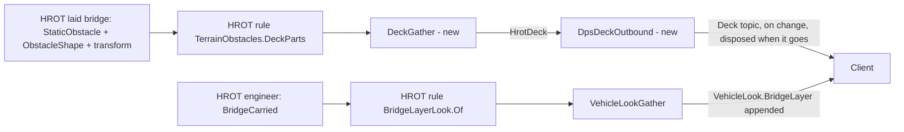
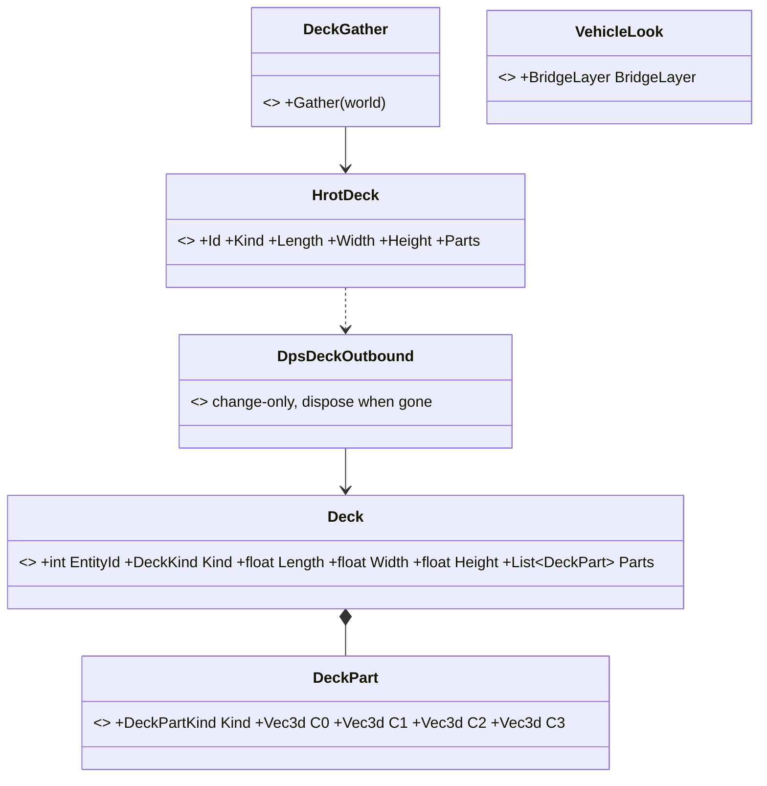
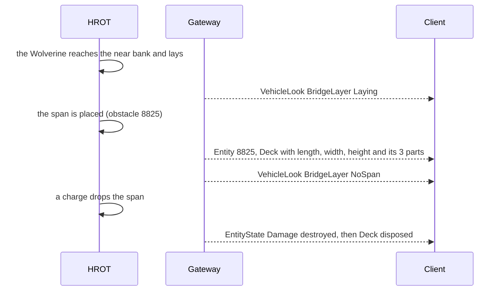

# DD-035: Laid bridges and the bridge layer on DPS

| | |
|---|---|
| **Status** | approved (R-158) - built 2026-11-26 (T-083, review) |
| **Tasks** | T-083 |
| **Rulings honoured** | R-158, R-133 (append-only), R-135, R-146 (HROT gives the meaning, the client the look); one HROT rule per derived fact (R-157) |
| **Related** | HROT `docs/designs/engineering/DESIGN_Bridge_Laying.md` §11 (the laid deck, CE-4692) and §12f (the engineer, CE-4693); HROT `NOTE_Backend_To_Ui_Bridge_Laying.md`; DD-018 (`VehicleLook`) |
| **Date** | 2026-11-26 |

## 1. Context and goals

HROT's engineers lay and recover bridges during play (CE-4692 / CE-4693). A LAID span is a static obstacle entity — TKB 8825 (assault bridge) / 8826 (floating
bridge), DIS kind 5 — whose per-instance `ObstacleShape` (Length = the span between the deck ends, Width, Height = the deck above the bank) is centred on the entity
along its heading; HROT's terrain draws ONE deck and two ramps (`DeckGeometry`, ramps at 1 : 4) and its units walk on exactly that. The layer vehicles (118 an
M104 Wolverine, 119 an Improved Ribbon Bridge transporter) show `BridgeLayerLook.Of`: Carried / Laying / Recovering / NoSpan. The gateway sends none of it.
🔒 User: *"yes go ahead"* (to the deck topic, the layer state, the note).

## 2. Block diagram

## 3. Decisions

- D-1 **A new Discrete topic `Deck`**: `{ [key] EntityId; DeckKind Kind (Assault, Floating — from the obstacle's TKB type); float Length, Width, Height;
  [DdsBound(3)] List<DeckPart> Parts }`, `DeckPart { DeckPartKind Kind (Deck, Ramp); Vec3d C0, C1, C2, C3 }` — the corners' x, y in the sim frame and z = the height
  ABOVE THE GROUND under that corner (HROT's ground-relative rule: the client adds its own terrain height, as HROT does). Reliable · TransientLocal · KeepLast 1;
  one instance per STANDING laid bridge; on change; disposed when the obstacle goes (recovered, or fallen at Health 0 — a fall can be told from a recovery by the
  entity's `EntityState.Damage` destroyed before the dispose).
- D-2 **The corners come from ONE HROT rule**, `TerrainObstacles.DeckParts(position, yaw, shape)` — extracted from `DeckOf` (`StaticObstacles.cs:114-118`) so the
  terrain and the gateway share it; never a gateway copy of the clamps or the ramp rule.
- D-3 **`VehicleLook` appends `BridgeLayer`** (`BridgeLayer_NoSpan = 0, _Carried, _Laying, _Recovering`, HROT's `BridgeLayerState` order) from
  `BridgeLayerLook.Of` — sent for the two engineer types, NoSpan for every other vehicle. No progress (HROT has none on the wire in v1, BL-21).
- D-4 The obstacle stays a plain `Entity` too (its type, its damage); a client draws it from `Deck`, never as a box.
- Rejected: shape fields only, the client building the ramps (a second copy of HROT's ramp rule) · world z for the corners (the client's terrain is HROT's
  heights; ground-relative is how HROT itself draws them) · a progress value (none in HROT).

## 4. Class diagram

## 5. Sequence

## 6. Edge cases

- A bridge placed by the scenario (not laid): the same obstacle ⇒ the same `Deck`.
- A floating bridge: the same deck rule (its own TKB figures).
- Constructing (held until its bake commits): sent once it stands, as HROT's terrain draws it.

## 7. Test plan

- A laid 8825 / 8826: `Deck` kind, sizes equal `ObstacleShape`, parts equal `TerrainObstacles.DeckParts`; recovered / fallen ⇒ disposed; change-only, 0 B steady.
- A layer vehicle in each `BridgeLayerState` ⇒ `VehicleLook.BridgeLayer` equal `BridgeLayerLook.Of`; a plain vehicle NoSpan.
- IDL gains lines only; `AllTopics` +1. Mutations: a part's corners from the wrong end; dispose dropped; the layer state not copied.

## 8. Proposals

Approved with the design (R-158).

## 9. As-built notes

Built as designed (T-083), against HROT unreal-ig `76c4210b9` (`TerrainObstacles.DeckParts` extracted from `DeckOf`, CE-4692 rails green, HROT as-built BL-4a).

- **Measured first.** The laid bridge is published today by `EcsHrotAdapter` as an ordinary `Entity` (the entity query takes `SimTransform` + `TkbIdentity` + `NetworkIdentity`, lifecycle Active only, so a **Constructing** obstacle is skipped until its bake commits: the design's edge case holds by construction). A bridge is told from a solid obstacle by `StaticObstacle.Kind == ObstacleKind.WalkableDeck` (HROT's component, derived from the TKB). Which bridge it is (assault / floating) HROT has **no field for**: the gateway compares the TKB type with HROT's named constants `TkbEntityTypes.Obstacle_AssaultBridge` / `Obstacle_FloatingBridge` (no number of ours; another deck type is `Unknown`). The heading is `TerrainObstacles.Yaw(SimTransform.Rotation)` and the size is `ObstacleShape`, the very values the bake feeds the rule.
- **Contract.** `Deck` (`[DdsKey] EntityId`, `DeckKind`, `Length/Width/Height`, `[DdsBound(3)] List<DeckPart>`), `DeckPart` (`DeckPartKind`, `C0..C3` as `Vec3d`), enums `DeckKind` (Unknown, Assault, Floating), `DeckPartKind` (Deck, Ramp), `BridgeLayer` (NoSpan, Carried, Laying, Recovering); `VehicleLook.BridgeLayer` appended. `AllTopics` 56; the IDL only gained lines. Pivot: `HrotDeck`, `HrotDeckPart`, `HrotDeckEnded`, `HrotDeckKind`, `HrotDeckPartKind`, `HrotBridgeLayer` (T-080 pattern: `PivotEnum` tables by member name; the one rename row is `TerrainWalkableKind.Slab` to `Deck`; mirror and reverse-mapper rails extended).
- **Host.** `DeckGather` (new, `HrotHost`) keeps the last inputs per bridge (type, position, yaw, length, width, height) and calls `DeckParts` only when one changed (it allocates the three parts); a steady bridge sends nothing and allocates 0 B (rail). A bridge not seen in a frame is sent `HrotDeckEnded` once. `VehicleLookGather` reads `BridgeLayerLook.Of` through `PivotEnum<HrotBridgeLayer>` and a change alone sends the look.
- **Plugin.** `DpsDeckOutbound` (new): one `Deck` per standing bridge, disposed on `HrotDeckEnded` (never for an instance it did not write). The fall-vs-recovery rule needs no extra code: the host sends the entity's own state (Damage destroyed) in the frame the obstacle is last seen and the dispose after it; a recovery has no destroyed state.
- **Deviations.** None to the decisions. The design's `DeckKind { DeckKindAssault ... }` gained a leading `DeckKindUnknown = 0` (the contract's enums start with their unknown / none value).
- **Rails.** `DeckGatherTests` (deck equals `DeckParts` on the same world for 8825 and 8826 incl. the entity still published; steady sends nothing; move / reshape one new deck; dispose once, Constructing held; solid obstacle none; bridge layer equals `BridgeLayerLook.Of` for every state), `DpsDeckTests`, `DpsTopicTests.A_deck_round_trips...`, the pivot enum mirror rails. Mutations caught: corners from the wrong end, deck dispose dropped (host and plugin), layer state not copied, kind not copied.

### T-084: obstacles and roadblocks (scope extension, as-built)

User, 2026-11-26: *"Do we support roadblocks like sandbags walls in the gateway? I need the Unreal to render these and remove these when the block is breached by the bulldozer."* Measured: HROT's static obstacles 8806 to 8824 are already published as `Entity` + `EntityState`; a bulldozer's push drains their health (`ObstacleDamage`, CE-7012) and `ObstacleRemovalSystem` removes the entity at zero, so the removal and the destroyed `Damage` already reach a client. Missing was the per-instance `ObstacleShape` (`[PerInstanceValue]`), which `TkbType` does not carry.

- **New Discrete topic `Obstacle`** `{ [key] EntityId; float Length, Width, Height }` (`AllTopics` 57, IDL gains lines only). Geometry as HROT's own `TerrainObstacles.PrismOf` builds it: centred on the entity in plan, `Length` along the heading, base at the entity's Z, `Height` up (stated in the topic's comment and the guide). One per standing obstacle whose `StaticObstacle.Kind` is Solid (a WalkableDeck keeps its `Deck`, no `Obstacle`); change-only (an edited size is one new sample); disposed when the obstacle goes.
- **Host.** `ObstacleGather` beside `DeckGather`, with the same last-inputs / Seen / ended-once bookkeeping (steady 0 B). One class for both was weighed and rejected: the two differ in input (a shape alone versus pose + shape + type), output (a message of three floats versus the rule's parts) and kind test, so a merged class would be a switch around two disjoint bodies; the shared part is ~15 lines of bookkeeping. The adapter takes `IsDeck` first, then `IsSolid`, so a bridge can never also be an obstacle.
- **Plugin / client.** `DpsObstacleOutbound`, pivot `HrotObstacle` / `HrotObstacleEnded`, ports, transport, side, `DpsWorld.Obstacles`, client program.
- **Rails** (`DeckGatherTests`, `DpsDeckTests`, `DpsTopicTests`): the size equals `ObstacleShape`; two walls of one type with different per-instance sizes send their own; a bridge has no `Obstacle`; steady sends nothing and allocates 0 B; a bulldozed obstacle (health 0, then removed) is disposed once; IDL pure addition. Mutations caught: size not copied, dispose dropped, bridge not excluded.
