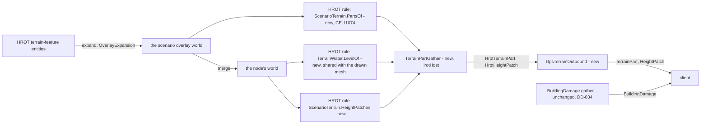
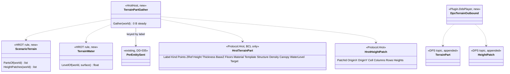
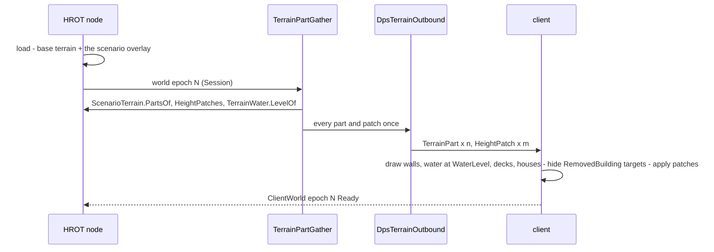
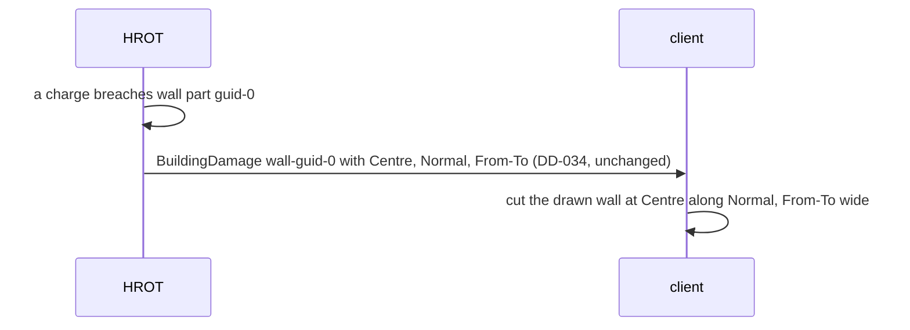
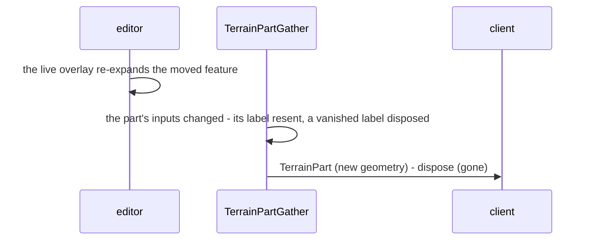

# DD-036: A scenario's own terrain on DPS — walls, water, bridges, houses, removals and reshaped ground

| | |
|---|---|
| **Status** | draft — P-1 … P-8 await the user's approval (§8) |
| **Tasks** | T-087 (gateway); HROT CE-11074 (its half: the rules the gateway calls) |
| **Rulings honoured** | R-133 (append-only), R-128 (BCL-only `Hrot*` messages), R-146 (HROT gives the meaning, the client the look), R-157 (one HROT rule per derived fact); HROT R-11022 (a wall is breached in part) |
| **Related** | Unreal's ask: HROT `docs/blueprints/batches/NOTE_UnrealIg_To_UiIntegration_Scenario_Terrain_Features.md` · HROT `docs/designs/engineering/DESIGN_Breachable_Obstacle_Walls.md` §9 S5 / §8 V-5 · HROT `docs/DESIGN_Terrain_Authoring.md` §18 (features, the overlay) · DD-034 (a breach's `Centre`, `Normal`, `From`/`To`) · DD-035 (`Deck`: ground-relative deck parts) |
| **Date** | 2026-11-27 |

## 1. Context and goals

A scenario can add terrain of its own: walls, fences and hedges, water, a bridge, houses, clutter, tree groups, reshaped ground, and edits of a base
building (removal). HROT expands these terrain-feature entities into terrain PARTS (`FeatureKinds.OfKind` → `OverlayExpansion`) and merges them
into the world every node runs on. The Unreal client builds its level from the BASE terrain only, and nothing on DPS carries the scenario's parts.
⇒ Unreal shows a river crossing on dry desert, a tank driving over the Vltava with no bridge, a removed house still standing, and soon (R-11022) a
breached sandbag wall it never drew.

**Goal:** every scenario part reaches the client with the same geometry HROT simulates. The client draws it with its own look and hides a removed base
building by its key. Breaches arrive as today (`BuildingDamage`, DD-034).

**Measured (HROT `unreal-ig` `d9658d023`, `2026-11-27`):**

| | |
|---|---|
| the kinds scenarios use | clutter 49 · wall 29 · ground shape 28 · tree group 11 · water 8 · house 7 · building edit 3 · bridge 1 (`scenarios/**`, `TerrainFeature.Kind`) |
| where the parts are at run time | merged into the world and NOT kept apart: `TerrainResidency.cs:262-264` reads the compiled overlay (`TerrainFolderWorld.ReadOverlay`) and `TerrainWorldMerge.Merge`s it; the editor's live overlay (`LiveOverlayResult`, its `Parts`) merges in the bake ⇒ ⚠ nothing tells a scenario part from a base part today |
| the part schema | the world file's features (`TerrainFolderWriter`, `FeatureKinds.Line/Area`): `wall` / `fence` lines (material, height, thickness), `surface` areas (water, forest + density + canopy, scrub, open), `slab` / `ramp` (`zRef: ground`, `structure`), `building` (template or height, baseZ, floors, material), `tree` points — ⭐ the same file Unreal's terrain export already reads for the base |
| ⭐ Unreal's question 3: does water lower the ground? | ⛔ **no**. The ground mesh is cut out under every water polygon (`TerrainWorldMesh`; water is impassable, Terrain Authoring CE-6002), and the drawn water is a flat surface at **the lowest ground height round its edge** (`TerrainWorldQuery.BuildTagged`, `:283-311`) |
| ground shapes | change the height grid itself (level / raise / lower polygons with a skirt, draw order wins, Terrain Authoring G-14 / G-3) |

## 2. Block diagram

*What the picture shows:* the gateway decides nothing about geometry. Three HROT rules state the parts, the water level and the reshaped heights,
and the breaches stay on their existing path.

## 3. Key concepts and decisions

**3.1 The unit is the expanded PART, keyed by its label** (P-1). A feature expands to one or more parts, each with a stable label
`<entity guid>/<i>` (a house's walls, a bridge's slabs and ramps). The part is what HROT simulates, and its label is the key a breach record names
(`wall:<label>`, DD-034). ⛔ Not the feature entity: the client would re-expand it and would need a second copy of HROT's expansion rules (R-157).

**3.2 The schema is the world file's** (P-2). `TerrainPart` carries what a world-file feature carries, typed:

| field | for | note |
|---|---|---|
| `Label` (key, 96) | all | the part's stable label |
| `Kind` (`TerrainPartKind`) | all | `Wall` · `Fence` · `Water` · `Forest` · `Scrub` · `Open` · `Slab` · `Ramp` · `Building` · `Tree` · `RemovedBuilding` (appendable) |
| `Points` (≤ 256 `Vec3`) | all | a line's vertices, a polygon's ring, a slab's 4 corners, a tree's 1 point; X / Y the sim frame |
| `ZRef` (`TerrainZRef`) | all | `Absolute` or `Ground` (Z = above the ground under that point, DD-035's rule) |
| `Height`, `Thickness`, `BaseZ`, `Floors` | walls, buildings | as the world file |
| `Material` (32) | walls, buildings | producer vocabulary (DD-020 §3.3: `sandbags`, `concrete`, `hedge`, …) |
| `Template` (64) | buildings | the house template name (empty = an extruded footprint) |
| `Structure` (96) | slabs, ramps | the parts of one bridge (`osm-bridge/<id>` or the feature's) |
| `Density`, `Canopy` | forest | trees per hectare, canopy top |
| `WaterLevel` | water | ⭐ HROT's level (P-3) |
| `Target` (96) | `RemovedBuilding` | the BASE building's label the client hides |

**3.3 Which parts are the scenario's** (P-4). A HROT rule `ScenarioTerrain.PartsOf(world)` returns the current scenario overlay's parts. The
residency keeps the parsed overlay world beside the merge (today it is merged and dropped), and the editor's live overlay result serves the same
rule, so the two paths cannot disagree. A node without the overlay (a scenario never saved since its features were drawn) sends no parts, exactly
what HROT itself has.

**3.4 Reshaped ground as height patches** (P-5). A ground shape changes the height grid, so the client gets the RESOLVED heights
(`ScenarioTerrain.HeightPatches`: the merged grid over each shape's rectangle plus its skirt), in tiles of at most 64 × 64 samples at the grid's own
spacing (`HeightPatch { PatchId, OriginX, OriginY, Cell, Columns, Rows, Heights[] }`). ⛔ Not the shapes: their skirt, draw order and pad rules would
be a second implementation.

**3.5 Lifecycle.** State topics, keyed, reliable, transient-local, keep last 1. Each sample is written once per world epoch and again only when its
inputs change: in the editor a feature is moved, added or deleted live, and a removed part is disposed. Steady state sends nothing and allocates
0 B (the `PerEntitySent` bookkeeping of DD-035, keyed by label).

**3.6 Breaches are unchanged** (P-6). A wall part's breaches arrive as `BuildingDamage` (DD-034). ⚠ The client places a gap by `Centre`,
`Normal` and `From`/`To`, not by the breach's panel rank: on sloping ground HROT splits a line into pieces (CE-5015), so a rank is not a polyline
segment (HROT review V-5).

## 4. Class diagram

## 5. Sequence diagrams

### 5a. A scenario loads

### 5b. A wall is breached

### 5c. The editor moves a feature live

## 6. Edge cases and error handling

| case | behaviour |
|---|---|
| a polygon or line longer than 256 points | split into consecutive parts `<label>#k` (a line overlapping by one vertex); the client joins them by the label stem |
| a height patch larger than 64 × 64 | tiled; `PatchId` = shape label + tile index |
| a node without the compiled overlay | no parts (HROT has none either); not an error |
| a breach on a part the client has not drawn yet | the client keeps the `BuildingDamage` until the part arrives (the existing rule for a key it does not know) |
| recording replay | the overlay comes back by its hash (HROT O-8); the parts are re-sent at the replay's world epoch |
| clutter parts | sent as `Building` (template) or `Tree` parts, as they expand; ⚠ to measure which part kinds clutter expands to (§8 P-7) |

## 7. Test plan

- **Contract:** `DpsTopicTests` for the two new topics (append-only; the IDL refresh only gains lines; the topic count asserted).
- **Host (HrotHost.Tests, real HROT world built in code):** a wall, a water and a bridge feature produce their parts with the world file's numbers; the
  water level equals `TerrainWater.LevelOf`; a ground shape produces patches equal to the merged grid; a `remove` edit produces a `RemovedBuilding`
  naming the base label; a moved feature re-sends its parts and disposes vanished labels; steady state allocates 0 B and sends nothing.
- **Invariants:** every label HROT's overlay holds is sent exactly once per epoch; no base part is ever sent; a breach's `BuildingDamage` key equals the
  part's `Label`.
- **Plugin:** the outbound writes, updates and disposes by key over real DDS.
- **Acceptance with Unreal:** `bl-placed-bridge` (the river at its level, the deck over it); `stechovice-battle` (the authored bridge, the removed house);
  `va-dozer-breach-wall` (HROT CE-11072: the sandbag wall drawn, then cut where HROT cut it).

## 8. Proposals awaiting approval

| | proposal | lean |
|---|---|---|
| P-1 | the unit is the expanded part keyed by its label, not the feature entity | ⭐ yes: the client never re-expands (R-157) |
| P-2 | the `TerrainPart` schema is the world file's features, typed | ⭐ yes: Unreal's terrain export already reads that file for the base |
| P-3 | water carries HROT's level (the lowest ground round its edge, the drawn mesh's rule), exposed as `TerrainWater.LevelOf` and shared with that mesh | ⭐ yes |
| P-4 | HROT keeps the scenario overlay world beside the merge, and one HROT rule (`ScenarioTerrain.PartsOf`) serves both the compiled and the editor's live overlay | ⭐ yes (HROT CE-11074) |
| P-5 | reshaped ground as height patches of the resolved grid, not the shapes | ⭐ yes |
| P-6 | breaches unchanged; the client places a gap by `Centre` / `Normal` / `From`–`To` | ⭐ yes |
| P-7 | v1 covers walls, fences, hedges, water, forest, scrub, open, bridges, houses, trees, removals and ground; clutter after a measurement of what it expands to | ⭐ yes |
| P-8 | an `Enterable` / `Door` building edit (kind 16, BE-3) is not sent in v1 (it changes no outside look) | ⭐ yes |

## 9. As-built notes

*(none yet)*
