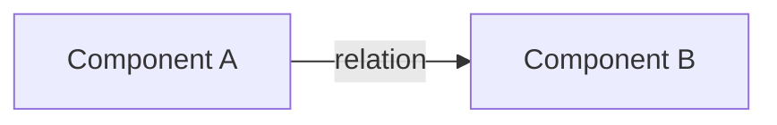
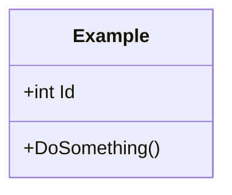
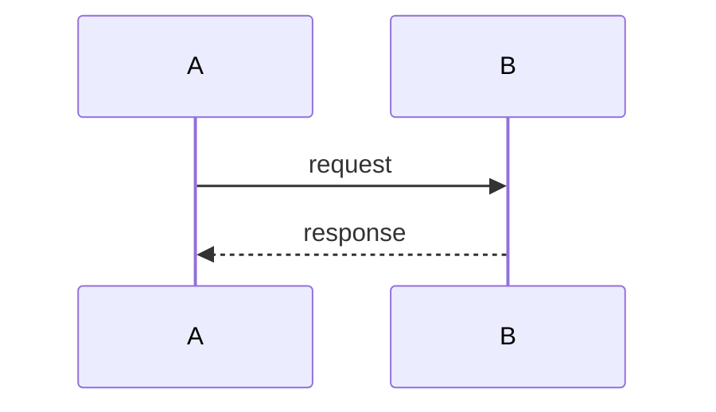

# DD-NNN: <Title>

| | |
|---|---|
| **Status** | draft / in review / approved / implemented / superseded by DD-NNN |
| **Tasks** | T-NNN, ... |
| **Rulings honoured** | R-NNN, ... |
| **Date** | YYYY-MM-DD (last significant change) |

## 1. Context and goals

What problem this solves, which rulings constrain it, what is explicitly out of scope.

## 2. Block diagram

Describe every block and every arrow: who owns what, who calls whom, which data flows where.

## 3. Key concepts and decisions

The vocabulary and the decisions, each with the alternatives rejected (one line each:
alternative + the fact that killed it).

## 4. Class diagram

Describe the responsibilities of each class and the meaning of each relation.

## 5. Sequence diagrams

One diagram per important flow (happy path and the interesting edge cases).

Describe step by step what happens and why.

## 6. Edge cases and error handling

## 7. Test plan

## 8. Proposals awaiting approval

`P-1`, `P-2`, ... - decision-shaped, with a recommended lean. Approved items are copied to
`docs/RULINGS.md` as new `R-` ids.

## 9. As-built notes

Filled in after implementation: where the code deviates from this design and why.
